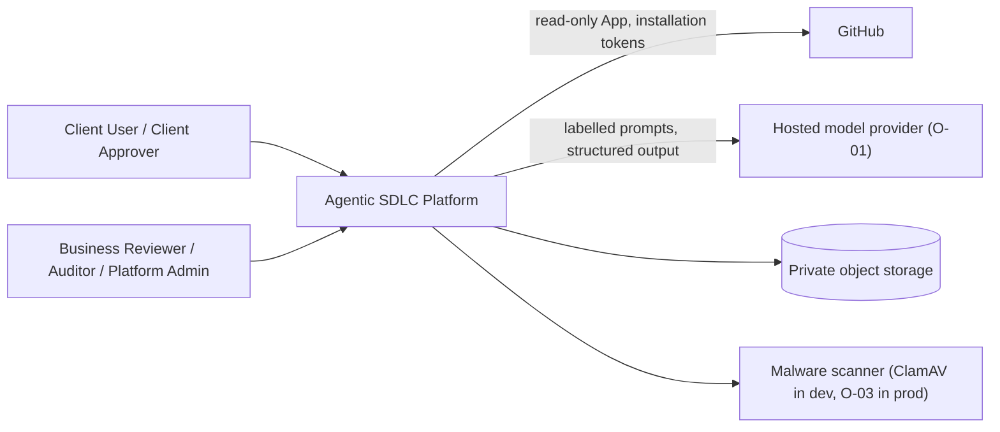
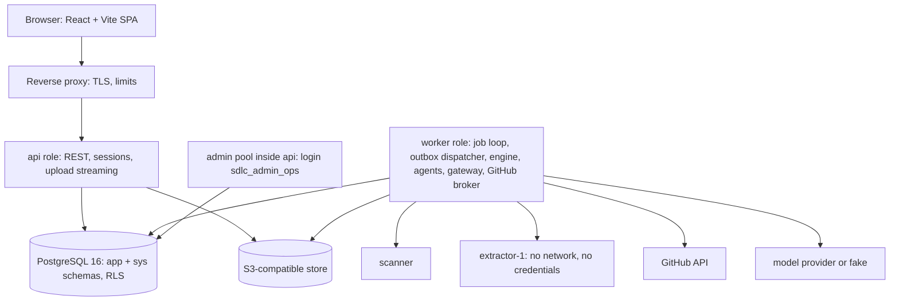
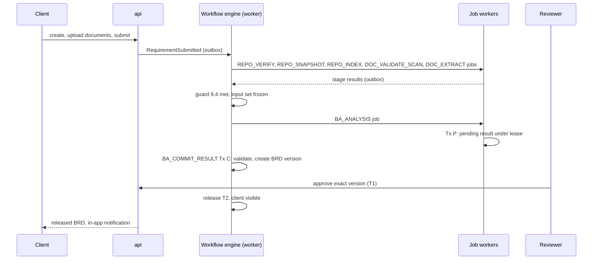

# Technical Design Document — Agentic SDLC Platform — Release 1 — Revision v1.0.4 — Submitted for Architecture and Security Approval

Nov 1, 2026 · @Tej

This is the technical design for Release 1, submitted for architecture and security approval. It implements the frozen PRD (Document A v0.7) and replaces v0.4, which is kept unchanged in the archive tab. It is not approved, and it is not a design freeze.

## 1. Document control and revision history

**Status:** Revision v1.0.4 of the Release 1 technical design (a precision correction of one count label in 33.1, with a whole-document count audit in 33.12). Submitted for Architecture and Security Approval. Not yet approved or frozen. Five separate gates apply (section 35). (1) Conditional M0 and database preparation may begin only after the owner acceptances O-06, O-11 and O-13. (2) Approval of the complete technical design has NOT been given. (3) Full Release 1 implementation is NOT READY while O-32 and O-15 remain unresolved. (4) Real client onboarding is NOT READY (O-15, O-01, O-02, O-03, O-23 and security gate G1). (5) Production deployment is BLOCKED by the production database decisions O-31 and O-19 and by the other production dependencies recorded in section 35. The newer evidence package (91 runtime tests, 5 failure-path cases) is NOT a gate for any of these: the verified figures are 87 runtime tests and 4 failure-path cases from the supplied archive, and 91 and 5 stay NOT VERIFIED. All database results are author-run on a PostgreSQL 16.15 scratch cluster, are not independently reproduced, and are not proof of production managed-PostgreSQL compatibility. No application code exists. Details of this revision: 33.12. The v1.0.3 changes are in 33.10.

### 1.1 Authority order

| Rank | Source | Role in this document |
|---|---|---|
| 1 | Document A, PRD v0.7 (frozen) | Product scope, behaviour, requirements and the 60 acceptance criteria. Never changed here |
| 2 | Architecture decisions agreed in the review rounds | Modular monolith, PostgreSQL queue and outbox, RLS, model gateway, GitHub App, restricted extractor, two-person rules |
| 3 | Document B v0.4 | Baseline design. Where it conflicted with 1 or 2, v1.0 follows 1 or 2 and says so (section 33.2) |
| 4 | General engineering practice | Used only to fill gaps, and labelled **\[Recommendation\]** |

### 1.2 Labels used in this document

| Label | Meaning |
|---|---|
| **\[PRD\]** | Required by Document A v0.7 |
| **\[Decision\]** | Agreed architecture decision |
| **\[Recommendation\]** | Engineering proposal, changeable without a product decision |
| **\[Provisional\]** | Safe default built while an open decision (O-ID) is pending. Changing it is a configuration or small change |
| **Executed** | Run by the author against PostgreSQL 16.15 in a scratch sandbox. Not independently reproduced and not proof of production managed-PostgreSQL compatibility. Evidence is in 34.B to 34.D |
| **Planned** | Test or check designed but not yet run. A planned test is not evidence |

### 1.3 Revision history

| Version | Date | Summary |
|---|---|---|
| 1.0.4 | 2026-11-01 | Precision correction. Section 33.1 now labels 19 functions and 150 column grants as historical v1.0 and states the current 24 functions, 195 column grants and 2 relation grants. A whole-document search of the ten count figures found two more unlabelled historical figures and one unlabelled newer-package claim, now labelled. No count, status, decision, gate or PRD alignment changed. No test was rerun. Details: 33.12. |
| 1.0.3 | 2026-11-01 | Documentation-only correction. The newer evidence package is stated not to be a gate for M0 or database implementation; gates are O-06, O-11, O-13. AC-EXT-37 has one status everywhere. The document is a design submitted for architecture and security approval, not final and not a design freeze. Sandbox claims qualified. API and frontend compared: 6 mismatches corrected, 9 gaps NOT VERIFIED. Safeguard S-27 for the disabled REPO_VALIDATING retry specified (not implemented). Details: 33.10. |
| 1.0.2 | 2026-11-01 | Documentation-only correction. Test counts reconciled to the supplied archive: 87 runtime tests and 4 failure-path cases verified; 91 and 5 NOT VERIFIED. 24 functions and 195 grants confirmed from SQL text and catalog log. Manifest mismatch for 5 of 13 files recorded. Six SQL corrections rated individually. AC-EXT-37 status split into design, owner approval and runtime. O-27 kept dormant. Five readiness levels and a final verdict. No SQL, script, test, log or archive was created or changed. Details: 33.9, 34.D. |
| 1.0.1 | 2026-11-01 | Targeted correction. C1 fatal failure now DEAD; C2 expired outbox lease refused; C3 dead predecessor keeps blocking, explicit audited recovery; C4 unique outbox seq; C5 no free text in global audit; C6 fail-closed runner with failure-path test. AC-EXT-37 grant path designed and tested in the database, gated by owner decision O-32; O-27 recorded as a non-blocking product decision (dormant switch kept). Overall verdict: NOT READY for full Release 1. 24 sys functions. The totals this row once gave (91 runtime tests, 127 executions) are superseded by v1.0.2: see 33.9.3. Details: 33.8, 34.C. |
| 1.0 | 2026-11-01 | Design submitted as v1.0 (described as final at the time; it was not approved and was not a design freeze). Complete catalog verification with exact signatures and an executable golden list (C1). No broad row access in privileged functions (C2). One coherent administrative retry (C3). Full state tables, clarification lifecycle, API contracts, provisioning, runbooks, 60-AC matrix, O-ID register O-01 to O-31. Security-relevant SQL executed on PostgreSQL 16.15 with 28 negative catalog tests and 56 runtime tests. Restructured into the 34 required sections. v0.4 kept unchanged in the archive tab |
| 0.4 | earlier review round | Claim clock after lock, requeue authorisation inside the database, role-wide default revoke, open-decision audit, M0 validation catalogue |
| 0.3 | earlier review round | Lease protocol with database clock, migration-only ownership, extractor pairing, P0/P1/Future split, provisioning model, approval separated from release, AC traceability fixed |
| 0.2 | earlier review round | Claim versus attempt counters, pending and committed BA results, restricted extractor container, privileged function boundary, permission matrix, exports, escalation |
| 0.1 | first draft | Initial technical design |

The detailed v0.2, v0.3 and v0.4 validation reports, self-reviews and change logs are kept verbatim in the tab **Archive: v0.4 (superseded)**. They are history, not current design.

### 1.4 How to read v1.0

Each concept has one canonical section. Other sections refer to it instead of repeating it.

| Concept | Canonical section |
|---|---|
| Roles and privileges in PostgreSQL | 8 and Appendix 34.A |
| Workflow, stage, task, job, clarification, approval and release states | 9, 10, 17, 19 |
| Lease, fencing and counters | 10 |
| Administrative retry | 10.9 |
| Approval types and release | 19 |
| Role and action permissions | 23.3 |
| Endpoints | 20 |
| Open issues and decisions | 32 |
| Test identifiers | 26 |

## 2. Executive summary

v1.0.4 is a technical design submitted for architecture and security approval. It is not yet approved or frozen. Five separate gates apply (section 35). (1) Conditional M0 and database preparation may begin only after the owner acceptances O-06, O-11 and O-13. (2) Approval of the complete technical design has NOT been given. (3) Full Release 1 implementation is NOT READY while O-32 and O-15 remain unresolved. (4) Real client onboarding is NOT READY (O-15, O-01, O-02, O-03, O-23 and security gate G1). (5) Production deployment is BLOCKED by the production database decisions O-31 and O-19 and by the other production dependencies recorded in section 35. The newer evidence package (91 runtime tests, 5 failure-path cases) does not gate any of the five: the verified figures are 87 and 4, and 91 and 5 are NOT VERIFIED until that package is supplied and inspected. Full Release 1 is not ready (section 35): P0 criterion AC-EXT-37 is PARTIALLY DESIGNED — DATABASE MECHANISM PRESENT — OWNER APPROVAL AND API VERIFICATION PENDING and cannot be signed off until owner decision O-32 is made; the extractor isolation spike (O-15) has not run; the production database check (O-31, O-19) has not run; and no application code exists. All 60 acceptance criteria map to a mechanism and at least one test (section 31), and all 18 PRD success criteria S1 to S18 have their own matrix (31.2); mapped is not the same as verified. Every remaining decision has an owner role and a gate (section 32).

**What Release 1 builds.** A client submits a requirement against an existing GitHub repository, with supporting documents. The platform validates and scans the documents, extracts text in a restricted container, indexes a pinned commit of the repository, and runs a Business Analyst agent that produces an evidence-checked BRD. An independent Business Reviewer approves the exact BRD version. Only then is it released to the client. New-product requests are kept in manual intake. Stages 3 to 10 of the product lifecycle are designed as extension points only.

**Architecture in one paragraph.** One Spring Boot 3 application on Java 21 (modular monolith) with api and worker roles, React and Vite frontend, PostgreSQL 16 with Row-Level Security, a PostgreSQL job queue with leases and fencing epochs, a transactional outbox, private S3-compatible object storage, a fail-closed malware scanner port, worker and extractor pairs with private exchange volumes, a read-only GitHub App behind a token broker, and a model gateway with a hosted adapter and a fake adapter. The workflow engine is the only authority for state, approvals, retries and release gates. LLM output is data, never authority.

### 2.1 The three mandatory corrections

| ID | Problem in v0.4 | v1.0 resolution | Evidence |
|---|---|---|---|
| C1 | Placeholder signatures such as sys.claim_outbox_batch(...). V10 was a comment. NULL ACLs and transaction scope not handled everywhere | 19 privileged functions in v1.0, 24 from v1.0.1, with exact identity signatures. Executable checks V0 to V15, including a literal golden list of 150 column grants in v1.0 (195 from v1.0.1) and 2 relation grants for sdlc_system_fn, checked in both directions and by effective privilege. Detection of unexpected SECURITY DEFINER functions in any schema. NULL ACLs fail. One explicit REPEATABLE READ transaction with ON COMMIT DROP temp tables. PostgreSQL 16 version guard | **Executed**: positive run passes. 27 planted defects and one autocommit misuse each fail with the expected check (34.B) |
| C2 | SELECT \* INTO j FROM app.job, RETURNS app.job while the privileged role had column grants only | Every privileged function names its columns. The internal lease check returns OUT parameters, not a row type. Check V15 rejects SELECT \*, RETURNING \*, %ROWTYPE and table row types in schema sys. Function-by-function privilege review in 8.7 | **Executed**: V15 passes. Negative tests CAT-N21 and CAT-N22 fail as expected. RT-08 shows the role cannot read requirement text, document text, clarification text, job payload or the admin reason |
| C3 | 9.2 said admin retry needs a grant, 7.5C said it does not. sys.requeue_job changed a dead job without the workflow | One operation. sys.request_admin_retry records an idempotent request, an outbox event and a content-free platform audit row in one transaction, after database-side authorisation and eligibility checks. The dead job is never changed. The workflow engine then performs FAILED to ANALYSING with a new stage execution and a new job. No tenant data grant is needed, because the operation reads no tenant content (FR-AUTH-14 covers source code and documents). O-26 resolved | **Executed** (database part): ATZ-01 to ATZ-20. **Planned** (engine part): WF-AR-01 to WF-AR-10 |

### 2.2 Verification status in one table

| Area | Design review | Runtime |
|---|---|---|
| Roles, privileges, catalog verification, RLS, composite keys | PASS | **Author-run in a PostgreSQL 16.15 sandbox: PASS (not independently reproduced; production NOT VERIFIED)** |
| Lease, fencing, counters, dead letter, outbox claim and fencing | PASS | **Author-run in the sandbox (database functions): PASS (not independently reproduced)** |
| Admin retry authorisation, eligibility, idempotency, concurrency | PASS | **Author-run in the sandbox (database part): PASS (not independently reproduced). Engine part planned** |
| Workflow engine, BA commit protocol, approvals, clarifications, release | PASS | NOT VERIFIED (no application code) |
| Extractor isolation (M3S), GitHub, model gateway, API, UI | PASS | NOT VERIFIED |

The supplied sandbox results show that the SQL ran as designed on one PostgreSQL 16.15 scratch cluster. They were run by the author, were not independently reproduced, and are not proof of production managed-PostgreSQL compatibility. They do not prove the chosen production PostgreSQL service allows the same roles (O-07), and it does not prove any Java code. The supplied sandbox evidence demonstrates that the tested security-relevant database subset executed successfully on PostgreSQL 16.15 under the documented test conditions. It does not establish independent verification, complete application behaviour, or production-platform compatibility.

### 2.3 What changed in v1.0.1 (read this first)

v1.0.1 corrected six defects in the SQL and tests (C1 to C6) and completed the design of AC-EXT-37 and O-27 only as far as the PRD text allows. Where an earlier section still shows a v1.0 figure (19 sys functions, 150 golden grants, 56 runtime tests, 87 executions), that figure is historical. The current figures are in 33.9.3 and 33.9.4: 24 functions and 195 column grants are supported by the evidence; 87 runtime tests, 4 failure-path cases and 122 database executions are verified in the supplied archive; the 91, 5 and 127 of v1.0.1 come from a newer log that was not supplied and are NOT VERIFIED. The sandbox results in 2.2 are still true and are extended, not replaced. AC-EXT-37 has the status PARTIALLY DESIGNED — DATABASE MECHANISM PRESENT — OWNER APPROVAL AND API VERIFICATION PENDING. The PRD leaves open who the "authorised approver" is, so owner decision O-32 is OPEN — BLOCKING for the sign-off of AC-EXT-37. O-27 (no retry after a repository-validation failure) is OPEN and NON-BLOCKING: the PRD does not require that retry, so the default is cancel and resubmit. The v1.0.2 changes are listed in 33.9 and the v1.0.3 changes in 33.10.

## 3. Product context and architecture goals

The platform turns a client's software requirement into reviewed delivery artefacts, with humans approving every consequential step. Release 1 covers lifecycle steps 1 to 9 of the table below, minus formal client scope approval. Everything else is a designed extension point.

### 3.1 Lifecycle and what Release 1 does

| # | Lifecycle step | Release 1 | How |
|---|---|---|---|
| 1 | Client creates a project and submits a requirement | Built (automated) | 20.4, 9.3 |
| 2 | Client connects an existing repository or submits a new-product request | Built. New product goes to MANUAL_INTAKE (manual) | 14, 9.3 |
| 3 | BA agent analyses requirement, repository and documents | Built | 12, 14, 15, 16 |
| 4 | Facts, assumptions, recommendations and questions identified | Built | 16 |
| 5 | Persisted clarification assigned to a responsible human | Built | 17 |
| 6 | Only dependent work pauses | Built | 9.6, 17 |
| 7 | Business Reviewer reviews and corrects the BRD | Built (corrections by request revision, 16.6) | 16, 19 |
| 8 | Internal approval | Built (BRD_REVIEW) | 19.3 |
| 9 | Client reviews the BRD | Built: read and request changes. Formal scope approval is Release 2 **\[PRD\]** | 19.5 |
| 10 to 11 | Estimate with LLM assessment and deterministic pricing, client acceptance | Future (Release 2) | 18 |
| 12 to 13 | Architect agent TDD and human architecture approval | Future (Release 3) | 19.1 |
| 14 to 16 | Developer agent in isolated execution, trusted broker commits, build and tests | Future (Release 4) | 14.7 |
| 17 to 19 | QA agent, pull request, CI/CD | Future (Release 5) | 19.1 |
| 20 to 21 | Staging and production deployment approvals | Future (Release 6) | 19.1 |
| 22 | Every consequential action auditable and traceable | Built for Release 1 actions | 7.6, 22 |

### 3.2 Core principle

**\[Decision\]** The workflow engine owns state transitions, task scheduling, authorisation checks for transitions, approvals, retry policies, execution leases, audit records and release gates. LLMs propose work and return structured data. They cannot change state, grant permissions, change tenant context, approve, change pricing or bypass a human gate. This is enforced by code structure (12.4), by the database (8, 9.5) and by tests (26).

### 3.3 Architecture goals and how they are met

| Goal | Mechanism |
|---|---|
| Tenant isolation that survives application bugs | tenant_id on every tenant table, composite foreign keys, forced RLS, non-bypass runtime role, transaction-local context, verified catalog (8) |
| No lost or duplicated work after crashes | PostgreSQL queue with leases and fencing, outbox, idempotent consumers, pending then committed results (10, 11, 12.6) |
| Human approval bound to exact inputs | Approvals bound to BRD version, content hash and input set, invalidated on any input change (19) |
| Evidence that can be checked | Typed citations verified by code against stored sources, never upgraded by a model (16) |
| Safe handling of untrusted input | Validation, fail-closed scanning, restricted extractor without network or credentials, prompt-injection layering (15, 22) |
| Small team, simple operations | One deployable, one database, no broker, Docker Compose locally (5, 25) |
| Room to grow | Versioned workflow definitions, stage handler SPI, generic approval gates, queue and engine behind interfaces, model gateway ports (6, 9.10) |

## 4. Scope and non-goals

Release 1 P0 is exactly what PRD v0.7 requires. P1 is built only after all P0 work and only if the product owner prioritises it (O-14). Future items are excluded but keep their extension points.

### 4.1 R1 P0 (base plan, blocks PRD acceptance)

| Capability | PRD reference | Design |
|---|---|---|
| Requirement submission, revisions, routing, MANUAL_INTAKE resume and close, cancel, close for retention | FR-REQ, section 6, FR-RET-16 | 9, 20.4 |
| Document upload, validation, fail-closed scan, private storage, extraction in restricted pairs, statuses, client and reviewer exclusion actions | FR-UPL, FR-STO, FR-DPR, FR-DST | 15 |
| GitHub App registration by a Platform Admin, pinned snapshot, Phase A index, Phase B impact analysis | FR-REPO, FR-IDX, AC-CORE-02 | 14 |
| Model gateway with one hosted adapter and a fake adapter, budgets, call records | FR-LLM-01, 02, 04 to 11 | 13 |
| Agent runtime, read-only tool registry, BA agent, evidence verifier, BRD, traceability, pending and committed results | FR-BA, FR-DBA-01 to 08, FR-TRC, FR-DEV, FR-DTR | 12, 16 |
| Workflow engine, versioned definitions (pinning rule), job queue with leases and fencing, outbox | FR-WF-01 to 18 | 9, 10, 11 |
| Administrative retry from FAILED (API and command line, no dedicated screen) | Section 6 (FAILED to ANALYSING), FR-WF-05 | 10.9 |
| BRD_REVIEW approval, separation of duties, version binding, invalidation, concurrent approval | FR-DOC, FR-REV, FR-AUTH-16, 22 | 19 |
| Client release after approval and client BRD view with the visibility policy | FR-REV-05, FR-DTR-03, FR-VIS | 19.5 |
| Clarifications with stale-input checks, assignee fallback and reassignment, in-app inbox and badge | FR-CLR-01 to 06, 08 to 14, FR-UI-05 | 17 |
| Reviewer workspace including a minimal statement-level version diff **\[Provisional, O-22\]** | FR-UI-02 (P0) | 16.8, 21 |
| Append-only audit, security event detection | FR-AUD-01 to 03, 05, 06, FR-MON-01 | 7.6, 22.4 |
| Tenant isolation, RLS, privileged function boundary, platform-admin access grants, approver roles | FR-AUTH-01 to 24 | 8, 23 |
| Provisioning bootstrap and two-person privileged changes | Needed to operate. Supports FR-AUTH-22, 23 | 23 |
| Retention, deletion, closure rule, deletion ledger | FR-RET-01 to 16 | 7.8, 25.4 |
| Structured logs, metrics, health, alerts, runbooks for P0 failure modes | NFR observability, gate G1 | 24 |
| Docker Compose, CI, fake provider | AC-CORE-17 | 25 |
| Extractor security validation M3S before real documents | FR-DPR-07, gate G1 | 15.9 |

### 4.2 R1 P1 (optional milestone M7, not in the base plan)

| Capability | PRD reference | Design kept in |
|---|---|---|
| BRD export to Markdown and PDF | FR-DOC-08 | 16.9 |
| Audit search and export for the Auditor | FR-AUD-04 | 20.11 |
| Full version diff beyond the minimal P0 view | FR-DOC-06 | 16.8 |
| Clarification due times and escalation levels | FR-CLR-07 | 17.6 |
| Admin UI screens (users, repositories, budgets, failed jobs) | FR-UI-03 | 21 |
| In-app security alerts for admins | FR-MON-02 | 24.4 |
| Flagging of instruction-like text in documents | FR-DBA-09 | 22.3 |
| Report of skipped files in large repositories | FR-IDX-06 | 14.4 |
| Model routing with fallback routes | FR-LLM-03 | 13.2 |
| Dashboards and an OpenTelemetry collector | NFR | 24.2 |

### 4.3 Future (excluded from Release 1, extension points kept)

Stages 3 to 10 and their approval types (18, 19.1). Developer execution environment (14.7). Local model adapter (13.3). OCR, embeddings, vector databases. Email and external notifications. SSO, tenant onboarding UI, tenant administrator role (O-20). Payment. RabbitMQ, Kafka, Temporal. Kubernetes and a specific cloud. Workflow definition migration tool (P0 has the pinning rule only). Stronger extractor isolation such as microVMs (O-15). Per-tenant fairness in claiming. Presigned downloads. Revoking a client release.

### 4.4 Manual, automated and extension behaviour

| Behaviour | Release 1 mode |
|---|---|
| Existing-repository analysis to approved BRD | Automated with human gates |
| New-product requests | Manual: kept in MANUAL_INTAKE until a Business Reviewer converts or closes them. No greenfield analysis, scaffolding or code generation |
| Recovery from FAILED | Manual: Platform Admin requests an administrative retry. Execution is automated (10.9) |
| Tenant and user provisioning | Manual commands and admin APIs, two-person rules (23) |
| Closing a requirement for retention | Manual close action (7.8) |
| Estimation, TDD, development, QA, PR, deployment | Not present. Only interfaces and rules exist |

## 5. Architecture overview

One application image runs in two roles (api and worker) against one PostgreSQL database. Untrusted documents are parsed only in extractor containers that have no network and no credentials.

### 5.1 System context



### 5.2 Containers



The api and the worker use the login sdlc_app. The admin module uses a separate small pool with the login sdlc_admin_ops (8.2). Each worker owns one or more extractor slots with private exchange volumes (15.7).

### 5.3 Runtime flow: submission to client-visible BRD



### 5.4 Responsibilities and boundaries

| Component | Owns | Never does |
|---|---|---|
| api | Authentication, sessions, request validation, permission checks, upload streaming, read models | Change workflow state directly, call models, hold GitHub keys |
| Workflow engine | Transitions, guards, stage executions, input sets, approvals at use time, release, retries | Business analysis, parsing |
| Job workers | Leased execution of handlers | Decide workflow state |
| Agent runtime and BA module | Bounded model and tool loop, structured output | Persist BRDs, change state, hold credentials |
| Model gateway | Provider adapters, budgets, call records | Accept tenant from the model |
| Repository module | Token broker, snapshots, index | Run client code |
| Document processing | Validation, scanning, extractor coordination | Release documents without a CLEAN scan |
| Extractor container | Parse one file into text chunks | Network, credentials, database or storage access |
| PostgreSQL sys functions | Cross-tenant queue and outbox mechanics, admin retry request | Return business content |

## 6. Component and module design

The application is one Spring Boot artifact split into modules with a public api package each. Architecture tests (ArchUnit **\[Recommendation\]**) fail the build when a rule below is broken.

### 6.1 Rules

1. A module may call another module only through that module's api package or by consuming its outbox events.
2. Only the workflow module writes workflow tables (workflow_instance, stage_execution, input_set, brd_release, admin_retry_request status). A trigger also requires the transaction flag app.engine_txn = on, which only the engine sets (9.5).
3. Agent runtime, BA, gateway and evidence modules have no dependency on the workflow write API. They return data.
4. Only gateway adapters import model provider SDKs. Only the repository module's GitHubTokenBroker reads the GitHub App key. Only the storage adapter holds storage credentials.
5. Only the admin module may use the sdlc_admin_ops pool. Only the queue module calls sys functions.
6. No package for estimation, scope approval, commercial acceptance, TDD, development, QA, pull request or deployment may exist in Release 1 (guard against accidental scope, 9.10).

### 6.2 Module catalogue

| Code | Module | Responsibility | Main tables | Depends on |
|---|---|---|---|---|
| COM | common | Ids, clock, problem details, correlation, transaction hooks that set tenant and actor context | none | none |
| TEN | tenancy | Tenant registry, tenant context, RLS integration, active tenant for staff | tenant | COM |
| ID | identity | Login, sessions, MFA for staff **\[Provisional, O-11\]**, users | app_user, platform_user, spring_session | TEN |
| PRV | provisioning | Bootstrap, invitations, role change requests, access grants | invitation, role_change_request, provisioning_request, platform_role_assignment, reviewer_assignment, access_grant | ID, AUD |
| ADM | admin | Admin APIs: dead jobs, admin retry, tenant settings | none (uses sys functions) | PRV, JOB |
| PRJ | project | Projects and repository associations | project, project_repository | TEN |
| REQ | requirement | Requirements, immutable revisions, submit, cancel, close | requirement, requirement_revision | PRJ, WF api |
| WF | workflow | Engine, definitions, stage executions, input sets, guards, release, retry execution | workflow\_\*, stage_execution, input_set\*, stage_result, brd_release, admin_retry_request | JOB, OBX, SPIs |
| JOB | queue | Job enqueue, worker loop, lease calls, backoff | job_type, job, job_attempt | COM |
| OBX | outbox | Event write path, dispatcher, consumer registry | outbox_event, processed_event | COM |
| DOC | document | Attachments, versions, upload, download, exclusion decisions | document, document_version, document_exclusion_decision | STO, WF api |
| DPR | document processing | Validation, scanning, extractor coordination, chunks | scan_result, document_processing_attempt, document_chunk | DOC, STO, SCN |
| STO | storage adapter | S3 API, opaque keys, streaming | none | none |
| SCN | scanner adapter | MalwareScanner port, ClamAV adapter | none | none |
| REPO | repository | GitHub App, token broker, snapshots | github_installation, repository, repository_snapshot | STO |
| IDX | analysis index | Phase A static index | repo_file, repo_symbol, repo_endpoint, repo_dependency, repo_db_artifact | REPO |
| GW | model gateway | Ports, adapters, routing, budgets, call records | model_provider, model_route, model_call, budget | TEN |
| AGT | agent runtime | Agent definitions, prompt versions, tool registry, bounded loop | agent_definition, prompt_version, agent_execution, tool_call | GW |
| BA | business analysis | BA agent handler, result validator | none | AGT, IDX, DPR read APIs |
| EVD | evidence | Evidence verifier for repository and document citations | repository_evidence, document_evidence | IDX, DPR |
| BRD | brd | Result committer, BRD versions, statements, traceability, diff, export (P1) | brd, brd_version, brd_requirement, brd_statement, brd_evidence_link, brd_excluded_document | EVD |
| APR | approval | BRD_REVIEW decisions, invalidation, separation of duties | approval | BRD, WF api |
| CLR | clarification | Records, answers, assignment, reassignment, escalation (P1) | clarification, clarification_answer, clarification_assignment_event, clarification_escalation | WF api, NTF |
| NTF | notification | In-app notifications, unread count | notification | OBX |
| AUD | audit | Append-only audit, platform audit | audit_event, platform_audit_event | COM |
| SEC | security monitoring | Security events, detectors | security_event, platform_security_event | AUD |
| RET | retention | Closure clock, schedules, deletion, ledger | retention_policy, retention_schedule, deletion_request, deletion_ledger | all owners via SPIs |
| EXP | export (P1) | BRD and audit exports | export_request | BRD, AUD, STO |

### 6.3 Service provider interfaces used by the engine

| SPI | Implemented by | Purpose |
|---|---|---|
| StageHandler | REPO, IDX, DPR, BA | Run one stage execution and return a StageResult |
| ReadinessCheck | REPO, DOC | Answer READY, WAIT(reason) or NEEDS_DECISION(items) for the ANALYSING guard |
| ResultValidator | BA | Semantic validation of the BA output inside Tx C |
| EvidenceVerifier | EVD | Re-verify citations inside Tx C |
| ResultCommitter | BRD, CLR | Create BRD rows and clarification rows inside Tx C |
| InputSource | REQ, DOC, REPO, CLR | Report the current items for a new input set |

### 6.4 Extraction path to services later

Each module's api package is the future service contract. The queue sits behind JobQueue, the outbox behind PublisherPort, the engine behind WorkflowEngine. A later move to a broker or Temporal replaces implementations, not callers (ADR-02, ADR-03, ADR-04).

## 7. Database architecture and schema

**Target:** PostgreSQL 16 (verified on 16.15). Migrations: Liquibase. All objects owned by sdlc_owner (see 8.5). Complete DDL of the security-relevant subset is in Appendix 34.A.2; the full catalogue below is delivered as Liquibase changesets with the same conventions.

### 7.1 Conventions

- Every tenant-owned table has tenant_id uuid NOT NULL REFERENCES app.tenant(id), UNIQUE (tenant_id, id), and child tables use **composite foreign keys** (tenant_id, parent_id) so a row cannot point to another tenant's parent.
- RLS is ENABLE + FORCE on every tenant-owned table with one policy tenant_isolation: USING (tenant_id = app.current_tenant()) WITH CHECK (tenant_id = app.current_tenant()). app.current_tenant() reads current_setting('app.tenant_id', true); the application sets it with set_config('app.tenant_id', :id, true) (transaction-local, same effect as SET LOCAL) at the start of every transaction.
- Timestamps use clock_timestamp() where ordering inside a transaction matters, timestamptz everywhere. IDs are UUID generated by the application, except identity columns on outbox_event.seq and audit tables.
- Business content (requirement text, document text, BRD content, clarification text) is kept in a small set of tables; infrastructure tables (job, outbox, audit) are content-free so privileged functions never need content columns (see 8.7).
- JSON columns are length-limited by CHECK constraints (job and outbox payload 2048 bytes, platform audit details 4096 bytes). Payloads carry IDs and hashes, never content.

### 7.2 Entity groups

| Group | Tables (canonical names, same as section 6.2) | Scope |
|---|---|---|
| Platform (global, no tenant_id) | tenant, platform_user, platform_role_assignment, spring_session, job_type, retention_default, workflow_definition, workflow_definition_version, agent_definition, prompt_version, model_provider, model_route, system_configuration, provisioning_request, platform_audit_event, platform_security_event | Platform roles only. No tenant business content |
| Tenant identity and provisioning | app_user, invitation, role_change_request, reviewer_assignment, access_grant | Tenant users; staff assignments |
| Intake | project, project_repository, requirement, requirement_revision | Client User, Client Approver |
| Documents | document, document_version, document_exclusion_decision, scan_result, document_processing_attempt, document_chunk | Client roles, Business Reviewer |
| Repository evidence base | github_installation, repository, repository_snapshot, repo_file, repo_symbol, repo_endpoint, repo_dependency, repo_db_artifact | System/Agent |
| Workflow | workflow_instance, stage_execution, workflow_task, input_set, input_set_item, stage_result, brd_release | Engine only |
| Queue and events | job, job_attempt, outbox_event, processed_event, admin_retry_request | Engine, workers, admin functions |
| Agent and model | agent_execution, tool_call, model_call, budget | Agents, gateway |
| Evidence and BRD | repository_evidence, document_evidence, brd, brd_version, brd_requirement, brd_statement, brd_evidence_link, brd_excluded_document, brd_flag_acknowledgement | Business Reviewer; client only for RELEASED versions |
| Human decisions | clarification, clarification_answer, clarification_assignment_event, clarification_escalation, approval, notification | Role-specific |
| Compliance | audit_event, security_event, export_request, retention_policy, retention_schedule, deletion_request, deletion_ledger | Auditor, Platform Admin (content-free) |

**Name map.** Later sections use short prose names. They mean these tables: BRD "item" = brd_statement (item_key = the stable statement key); "item evidence" = brd_evidence_link; "pending/committed BA result" = stage_result with status PENDING, COMMITTED or REJECTED_STALE/REJECTED_INVALID; ba_result_committed is the brd_version created by Tx C; "tenant_user" = app_user; "model_call_record" = model_call; "document_scan_result" = scan_result; "document_decision" = document_exclusion_decision; "document_extraction" = document_processing_attempt; "deletion_log" = deletion_ledger; "legal hold" = the on_hold flag of retention_schedule (O-23); "release record" = brd_release; brd_flag = brd_statement.support_state with brd_flag_acknowledgement rows. retention_default holds global development defaults and retention_policy per-tenant overrides.

Excluded from R1 (Future, not created): estimate, estimate_line, rate_card, quote, tdd\_\*, code_change\_\*, pull_request_link, deployment\_\*. Approval types other than BRD_REVIEW are Future (19.1). The table inventory above is the design baseline; the security-relevant subset has been executed (Appendix 34.B).

### 7.3 Key tables (responsibility, keys, constraints, retention)

| Table | Responsibility | Keys and constraints | Retention |
|---|---|---|---|
| tenant | Tenant registry and lifecycle | status IN (ACTIVE, SUSPENDED, CLOSING, CLOSED); name unique | Kept (identity only) |
| platform_role_assignment | Platform Admin / Business Reviewer / Auditor grants | Partial unique (user, role) WHERE revoked_at IS NULL; CHECK approver differs from requester and from grantee (four-eyes) | Kept for audit |
| requirement / requirement_revision | Requirement and immutable revisions | kind IN (EXISTING_REPOSITORY, NEW_PRODUCT); revision unique (requirement_id, revision_no); content_hash | Per retention schedule |
| workflow_instance | One per requirement, pinned to a definition version | UNIQUE(requirement_id); status IN (ACTIVE, FAILED, TERMINAL); projected_state; input_generation; optimistic version | Per schedule |
| stage_execution | One try of a stage | UNIQUE(instance_id, stage_key, attempt_no); 11 statuses (9.2); retry_of_stage_execution_id links admin retries | Per schedule |
| job | Queue row | UNIQUE(tenant_id, idempotency_key); status QUEUED, LEASED, SUCCEEDED, DEAD, CANCELLED; CHECK (status='LEASED') = (lease_owner IS NOT NULL AND lease_expires_at IS NOT NULL); policy columns copied from job_type by a BEFORE INSERT trigger so callers cannot choose them; partial index (status, available_at, priority) on live rows | 90 days after terminal (development default, O-02) |
| job_attempt | One lease of a job | UNIQUE(job_id, attempt_no), UNIQUE(job_id, lease_epoch); **partial unique index job_attempt_one_open (job_id) WHERE finished_at IS NULL** makes two simultaneous open attempts impossible | With job |
| outbox_event | Transactional outbox | seq identity for ordering; published_at, attempts, dead, claimed_by, claim_expires_at, dispatch_epoch; partial index on pending | 30 days after publish |
| processed_event | Idempotent consumer ledger | PK (consumer, event_id) | 30 days |
| admin_retry_request | Admin retry (10.9) | request_key unique; partial unique (tenant_id, dead_job_id) WHERE status IN (PENDING, COMPLETED); reason code enumerated; reason text 10 to 500 chars | Kept for audit |
| document_version | Immutable stored file | content_sha256; storage_ref; status; content never updated | Per schedule |
| brd_version | Immutable BRD content version | UNIQUE(brd_id, version_no); content_hash; input_set_id; status DRAFT, IN_REVIEW, APPROVED_INTERNAL, RELEASED, SUPERSEDED, WITHDRAWN | Per schedule |
| approval | Immutable, version-bound approval record | Bound to (artifact_type, artifact_id, content_hash, input_set_hash); no UPDATE or DELETE grant (19.2) | Kept for audit |
| audit_event | Tenant audit trail | Append-only for sdlc_app (SELECT, INSERT only); purged by sys.purge_expired_audit only after retention | Per O-02 |

### 7.4 Indexes

Every foreign key has a supporting index on (tenant_id, fk). Queue: job_claim_ix, job_attempt_one_open. Outbox: outbox_pending_ix (next_attempt_at, seq) WHERE published_at IS NULL AND NOT dead. Clarification: (tenant_id, status, due_at) for the escalation scan. Retention: (due_at) WHERE status='SCHEDULED' AND NOT on_hold. Audit: (tenant_id, occurred_at) and (tenant_id, resource_type, resource_id).

### 7.5 Migration dependencies and ordering

1. 00-bootstrap (db_admin, once): roles, schemas, default-privilege revokes, migration metadata (34.A.1).
2. 01-schema (sdlc_migrator after SET ROLE sdlc_owner): global and tenant tables, RLS, triggers, grants to sdlc_app (34.A.2).
3. 02-sys-functions (privileged step, 8.5): the 24 sys functions (19 in v1.0, 5 added in v1.0.1), run only by sdlc_sysfn_deployer with temporary membership.
4. verify-catalog (login sdlc_catalog_check): must pass before the application starts; the deployment pipeline fails otherwise.

A Liquibase changeset never alters a sys function. Function changes ship as a new release of step 3 and are recorded in migration_meta.sys_function_release with the script SHA-256.

### 7.6 Audit

Tenant audit events are written in the same transaction as the state change (9.5). Platform-level actions (role grants, admin retry, tenant provisioning) go to platform_audit_event, which carries **no tenant content**, only IDs, reason codes and a bounded details object. Audit text is never taken from LLM output.

### 7.7 Tenant ownership and RLS summary

Global tables have no RLS and no tenant data. All tenant-owned tables have forced RLS. sdlc_app has no BYPASSRLS. sdlc_system_fn has BYPASSRLS but is NOLOGIN and reachable only through the 24 SECURITY DEFINER functions (8.7). Table-level RLS and privilege tests: CAT-N and RT-01 to RT-10 (26.4).

### 7.8 Retention and deletion

Retention is driven by retention_schedule rows (one per requirement and data class) created at the event that starts the clock; retention_default holds development defaults. **These are development defaults, not contractual guarantees (O-02).** sys.list_due_retention returns only IDs, never content. A legal_hold or on_hold flag blocks execution. After a backup restore, the deletion log is replayed (25.4). Document deletion during analysis triggers stale handling (9.6, 15.9).

**Development defaults.** Configurable development defaults (PRD FR-RET-11 to FR-RET-16, decision 3). They are NOT legal, contractual or universal retention commitments. FR-RET-07 forbids hard-coding a duration, so each value below is a configuration value. Production retention must be confirmed against contractual, privacy and applicable legal requirements before real client onboarding (O-02, OPEN, blocks onboarding).

| Data class | PRD | Development default | Clock and handling in this design |
|---|---|---|---|
| Repository snapshots and derived indexes | FR-RET-11 | 30 days after closure | Starts at closure (FR-RET-16). Deleting a source deletes derived data (FR-RET-08). |
| Source documents, document versions, extracted text and chunks | FR-RET-12 | 90 days after closure | Same clock. Deletion audited without content (FR-RET-04). |
| Generated BRDs and approval records, including evidence references | FR-RET-13 | 365 days | If a source is deleted after approval, the evidence reference stays and shows "source no longer available"; the approval stays in the audit trail (FR-RET-10). |
| Audit metadata | FR-RET-14 | 365 days | Removed only by a controlled retention process, never by the application database user (FR-AUD-02). |
| Temporary processing artifacts | FR-RET-15, FR-RET-09 | Deleted after processing, including after failure and cancellation; abandoned ones cleaned up within 24 hours | Cleanup job; a legal hold or on_hold flag blocks execution (O-23). |

Closure (FR-RET-16): the PRD defines it as the requirement being completed, rejected or cancelled and leaves the exact trigger to this TDD. The trigger used here is provisional (O-04): an approved or released BRD with an explicit close action, a rejection, or a cancellation. Retention is configurable per tenant (FR-RET-01). The retention values themselves are not changed by this revision.

## 8. Database roles, RLS and privilege model

**Runtime verification status:** DESIGN REVIEW: PASS. RUNTIME EXECUTION: the SQL in 34.A was executed on PostgreSQL 16.15 (scratch cluster) and the logs in the supplied archive show: catalog verification V0 to V15 passed (CAT-P01, CAT-P03), 27 planted defects plus one misuse of autocommit failed verification as intended (CAT-N01 to N28, CAT-P02), 87 runtime tests passed and 4 failure-path cases were rejected. A newer log (91 runtime tests, 5 failure-path cases) was not in the archive and is NOT VERIFIED (33.9.3). All results are author-run and not independently verified. This is not a production-cluster or managed-service verification (see O-31).

### 8.1 Database roles

| Role | Login | Attributes | Purpose | Members / reachability |
|---|---|---|---|---|
| sdlc_owner | No | NOINHERIT, NOBYPASSRLS | Owns every object in app, sys, migration_meta | sdlc_migrator may SET ROLE to it (SET TRUE, INHERIT FALSE) |
| sdlc_migrator | Yes | NOINHERIT, NOBYPASSRLS | Ordinary Liquibase migration | Acts as owner only through SET ROLE |
| sdlc_app | Yes | NOBYPASSRLS, no CREATE, no TEMP | Runtime connection pool (API and workers) | Table grants in 8.4; EXECUTE on 16 sys functions (14 in v1.0) |
| sdlc_admin_ops | Yes | NOBYPASSRLS, no table privilege, no app schema USAGE | Separate small pool used only by Platform Admin endpoints: dead-job list, admin retry, outbox recovery, access-grant request and decision | EXECUTE on 5 sys functions (2 in v1.0) |
| sdlc_system_fn | **No** | **BYPASSRLS**, NOINHERIT | Owner of the 24 SECURITY DEFINER functions. Column-scoped grants only (golden list, 34.A.3) | No members at rest |
| sdlc_sysfn_deployer | Yes | NOBYPASSRLS | Installs sys functions in the privileged step | Temporary membership in sdlc_system_fn (WITH SET TRUE, INHERIT FALSE), **always revoked** in the same run; verification fails if it remains |
| sdlc_catalog_check | Yes | NOBYPASSRLS, TEMP on database only | Runs catalog verification | USAGE on schemas for name lookup, no object privileges |

No role other than db_admin (superuser or managed-service admin, used only for step 0) can create roles. Passwords come from the secret store.

### 8.2 Connection pools and tenant context

- API and worker pools connect as sdlc_app. Every transaction starts with set_config('app.tenant_id', :tenant, true); a request without a tenant context sees no rows (RT-02, fail closed).
- The Platform Admin pool connects as sdlc_admin_ops. It sets app.actor_type, app.actor_id and app.session_hash per call (transaction-local) from the authenticated session. The database function re-checks these against spring_session and role assignments; the application cannot assert admin rights by itself (10.9).
- Background workers get tenant context from the job row (tenant_id returned by claim_jobs), never from payload.

### 8.3 Row-level security

Forced RLS with policy tenant_isolation on every tenant-owned table (7.1). sdlc_app has no BYPASSRLS (V1). Composite foreign keys (V13) prevent cross-tenant references. Verified by RT-01 to RT-04 and V11 (including a planted extra permissive policy, CAT-N19, and non-forced RLS, CAT-N18).

### 8.4 Runtime role (sdlc_app) grants

| Object class | Privilege |
|---|---|
| Business and workflow tables | SELECT, INSERT, UPDATE as needed, always under RLS |
| requirement_revision, document_chunk, processed_event, clarification_escalation, approval, audit_event | SELECT, INSERT only (append-only) |
| job | SELECT; INSERT limited to columns id, tenant_id, job_type, stage_execution_id, priority, available_at, idempotency_key, payload. No UPDATE, no DELETE: lease, counters and status can only change through sys functions |
| job_attempt, outbox_event | SELECT; outbox INSERT limited to tenant_id, aggregate_type, aggregate_id, event_type, payload |
| admin_retry_request | SELECT; UPDATE only status, reject_reason, new_stage_execution_id, new_job_id, decided_at (engine completes or rejects; it cannot change the reason or the requester) |
| Platform tables | SELECT, INSERT, UPDATE on platform_user, platform_role_assignment (the four-eyes CHECK constraint applies), INSERT on platform audit and security events |

PUBLIC has no privilege on any schema or object. Role-wide ALTER DEFAULT PRIVILEGES FOR ROLE sdlc_owner / sdlc_system_fn REVOKE EXECUTE ... FROM PUBLIC is applied because a per-schema default cannot remove the built-in PUBLIC EXECUTE on new functions (V12, RT-09).

### 8.5 Migration roles and ownership (resolves the "cannot grant a role it cannot assume" defect)

1. **Step 0 (db_admin, once).** Creates all roles and schemas with AUTHORIZATION sdlc_owner, grants sdlc_owner to sdlc_migrator WITH SET TRUE, INHERIT FALSE, ADMIN FALSE, sets defaults and creates migration metadata. db_admin is not used again by the pipeline.
2. **Step 1 (sdlc_migrator).** Logs in, runs SET ROLE sdlc_owner, applies Liquibase changesets. Every object is created already owned by sdlc_owner; no ownership transfer is ever required. The migrator cannot become sdlc_system_fn, so it cannot create sys functions.
3. **Step 2 (privileged, operator-run).** db_admin grants sdlc_system_fn to sdlc_sysfn_deployer WITH SET TRUE, INHERIT FALSE, writes a privileged_step_log START row, the deployer runs SET ROLE sdlc_system_fn and 02-sys-functions.sql, db_admin revokes the membership and writes END with the script SHA-256. If the step fails the membership is revoked in a finally action, and V3 (exact memberships) fails the deployment if it is not.
4. **Step 3 (verification).** verify-catalog.sql as sdlc_catalog_check. It checks final ownership (V6, V7), that the deployer holds no membership (V3), and that the system role owns only sys functions.

Runtime never holds migration authority: the application has no membership in any of these roles (V3, CAT-N10).

### 8.6 Catalog verification design (C1)

- **Execution model.** verify-catalog.sql runs BEGIN ISOLATION LEVEL REPEATABLE READ; \\ir verify-checks.sql; COMMIT;. All temporary tables are created ON COMMIT DROP inside that explicit transaction. Running the checks in autocommit would drop the tables immediately, so V0 asserts that the session runs at REPEATABLE READ, which only the wrapper sets; CAT-N28 proves the misuse fails.
- **Version guard (V0).** server_version_num must be 16xxxx; any other major fails. The catalog behaviour relied on (pg_proc.proacl, aclexplode, pg_default_acl, pg_auth_members.set_option) is that of PostgreSQL 16.
- **Expected sets are literals** in the script (source-controlled), never read from database rows: 24 exact signatures with owner, prosecdef, proconfig (search_path=pg_catalog, pg_temp, exact string), and exact grantee.
- **Null ACL.** A function whose proacl is NULL means "PUBLIC may execute". V7 expands ACLs with aclexplode(coalesce(proacl, acldefault('f', proowner))), so a NULL ACL is treated as an explicit PUBLIC grant and fails (CAT-N01).
- **Unexpected functions.** Every function in sys not in the expected set fails (CAT-N06); every SECURITY DEFINER function anywhere else fails (V5b, CAT-N07); every function owned by sdlc_system_fn outside sys fails (V6); app helper functions are an exact list (V14).
- **Inherited and default privileges.** V12 checks pg_default_acl for every role in the allow list; V9 checks effective privileges of sdlc_app and sdlc_admin_ops with has\_\*\_privilege over all objects, which includes inheritance and PUBLIC.
- **V10 golden list (executable). The expected column privileges of sdlc_system_fn are a literal list of 195 (relation, column, privilege) rows plus 2 relation-level rows; the check compares the actual set from aclexplode on pg_attribute.attacl and pg_class.relacl in both directions. Any extra or missing privilege fails (CAT-N13, N14).**
- **Result.** Violations are collected in check_failure and one exception lists all of them. The script ends with a notice "CATALOG VERIFICATION PASSED" only when none exist.

Checks: V0 environment and scope; V1 BYPASSRLS; V2 system role unreachable; V3 exact memberships; V4 role attributes, CREATE, TEMP; V5 function properties; V6 owners; V7 function set and ACLs; V8 forbidden statements in function source (dynamic SQL, SELECT \*, RETURNING \*); V9 runtime and admin privileges; V10 golden list; V11 RLS and policies; V12 default privileges; V13 composite tenant FKs; V14 helper functions; V15 no table row types or %ROWTYPE in sys.

### 8.7 Function-by-function privilege review (C2)

All 24 functions (19 in v1.0, 5 added in v1.0.1): owner sdlc_system_fn, SECURITY DEFINER, SET search_path = pg_catalog, pg_temp, REVOKE ALL FROM PUBLIC. None uses SELECT \*, RETURNING \*, %ROWTYPE or a table row type (V8, V15; CAT-N21, N22). Content columns (requirement_revision.title/description, document_chunk.text, clarification.question/why_it_matters, BRD content, job.payload, job.idempotency_key, outbox_event content beyond the 2 KB IDs-only payload) are outside every function's reach except where listed.

| # | Signature (exact) | Executed by | Columns read | Columns written | Purpose / negative test |
|---|---|---|---|---|---|
| 1 | sys.job_backoff(integer,integer,integer) | internal | none | none | Backoff with cap. Not executable by anyone (V7) |
| 2 | sys.lock_valid_lease(uuid,text,bigint) OUT params | internal | job: id, tenant_id, status, lease_owner, lease_epoch, lease_expires_at | none (row lock only) | Lock row, compare to clock_timestamp() after lock. L2, L3 |
| 3 | sys.authorise_platform_admin() | internal | platform_user id, login_name, status; platform_role_assignment platform_user_id, role, approved_by, revoked_at; spring_session session_id, principal_name, expiry_time | none | In-DB admin check. ATZ-02 to ATZ-07b |
| 4 | sys.claim_jobs(text,text\[\],integer,integer) | sdlc_app | job scheduling and counter columns, job_type code, tenant id, status | job status, lease\_\*, counters, heartbeat_at; job_attempt finished_at and outcome LEASE_LOST for an abandoned open attempt; outbox INSERT for JobDead | Two-phase claim. L7, L10, L15 |
| 5 | sys.start_attempt(uuid,text,bigint) | sdlc_app | job, job_attempt (own) | job_attempt INSERT, job.attempt_count | L9 |
| 6 | sys.heartbeat(uuid,text,bigint,integer) | sdlc_app | job lease columns | job.lease_expires_at, heartbeat_at | L4 |
| 7 | sys.assert_lease(uuid,text,bigint) | sdlc_app | job lease columns | none | Called inside business transactions. L2, L3, L13 |
| 8 | sys.finish_attempt(uuid,text,bigint,text,text,text,integer) | sdlc_app | job, job_attempt, job_type | job status, counters, available_at, dead_reason, error codes; job_attempt finish; outbox INSERT | L1, L5, L11, L12 |
| 9 | sys.attempt_status(uuid,bigint) | sdlc_app | job_attempt attempt_no, outcome, finished_at; job.status | none | Recover after a lost acknowledgement. L5b |
| 10 | sys.cancel_stage_jobs(uuid) | sdlc_app | job | job status, lease clear | L8 |
| 11 | sys.claim_outbox_batch(text,integer,integer) | sdlc_app | outbox_event (no content beyond payload IDs) | claim columns, dispatch_epoch | O1, O3 |
| 12 | sys.mark_outbox_published(uuid,text,bigint) | sdlc_app | outbox claim columns | published_at | O2 |
| 13 | sys.mark_outbox_failed(uuid,text,bigint,text) | sdlc_app | outbox claim columns | attempts, next_attempt_at, dead, last_error_code | O4 |
| 14 | sys.list_due_retention(integer) | sdlc_app | retention_schedule ids, data_class, due_at, status, on_hold; retention_default | none | IDs only |
| 15 | sys.list_due_clarifications(integer) | sdlc_app | clarification id, tenant_id, status, blocking, due_at, escalation_level | none | IDs only, no question text |
| 16 | sys.metrics_snapshot() | sdlc_app | counts over job, outbox_event (any-column SELECT is needed for count(\*); reveals counts only) | none | M1 |
| 17 | sys.purge_expired_audit(integer) | sdlc_app | audit_event id, occurred_at; retention_default | DELETE audit_event (bounded), INSERT platform audit | R1 |
| 18 | sys.list_dead_jobs(integer) | sdlc_admin_ops | job (content-free columns), job_type, stage_execution, workflow_instance, tenant status | none | Calls authorise first. ATZ-18 |
| 19 | sys.request_admin_retry(uuid,uuid,text,text) | sdlc_admin_ops | as 18 plus admin_retry_request | admin_retry_request INSERT, outbox INSERT, platform audit INSERT | ATZ-01 to ATZ-20 |

The exact per-column grant list is the golden list in 34.A.3 (195 column grants + 2 relation grants). The function body is the single source of what is accessed; V10 ensures no privilege exists beyond that list.

**Functions added in v1.0.1 (rows 20 to 24).** Same rules as above: owner sdlc_system_fn, SECURITY DEFINER, fixed search_path, REVOKE ALL FROM PUBLIC, exact signatures and grants checked by V0 to V15. The exact tables and columns each one reads or writes are in 02-sys-functions.sql and the literal golden list in verify-checks.sql (195 column grants in total).

| # | Signature | Executed by | Purpose | Tests |
|---|---|---|---|---|
| 20 | sys.recover_outbox_event(uuid,text,text) | sdlc_admin_ops | REQUEUE or DISCARD a dead outbox event after the admin checks; one audit row | OBX-04 to OBX-08 |
| 21 | sys.request_access_grant(uuid,uuid,text,uuid,text,text,integer) | sdlc_admin_ops | Create a PENDING read-only grant with scope, reason and duration | GRT-01 to GRT-05 |
| 22 | sys.decide_access_grant(uuid,text,text) | sdlc_admin_ops | APPROVE, REJECT or REVOKE; approver differs from grantee | GRT-02, GRT-06, GRT-12 |
| 23 | sys.use_access_grant(uuid,text,uuid) | sdlc_app | In-database check before any admin read; audits every use | GRT-07 to GRT-11 |
| 24 | sys.expire_access_grants(integer) | sdlc_app | Mark elapsed grants EXPIRED and audit | GRT-11 |

Grant counts after v1.0.1: sdlc_app 16 functions, sdlc_admin_ops 5 functions. use_access_grant also requires a live Platform Admin identity in the session, so the runtime role cannot use it for anyone else (GRT-10).

### 8.8 Error codes

SY001 invalid argument; SY002 lease not held; SY003 lease expired; SY004 no single open attempt; SY006 attempt already started; SY007 attempt already finished; SY008 not authorised; SY009 not eligible (admin retry; message names the reason); SY010 configuration missing. (SY005 is reserved and unused.) The API maps SY008 to HTTP 403, SY009 to 409, SY001 to 400, SY002/SY003 to the worker as LEASE_LOST.

### 8.9 Security posture of the privilege model

- Compromise of sdlc_app cannot read another tenant (RLS), cannot alter lease or counter columns (no UPDATE), cannot call admin functions (ATZ-01), cannot become sdlc_system_fn (RT-04), cannot create temp objects that shadow pg_catalog names (RT-10).
- Compromise of the admin pool cannot read any table (no app schema USAGE, ATZ-18) and can only call the two admin functions, each of which re-checks authorisation inside the database.
- Residual risk: a vulnerability in a sys function body. Mitigated by the 19-function allow-list, forbidden-statement scan (V8), review per change and the golden list.

## 9. Workflow engine and state machines

### 9.1 Concepts

| Concept | Definition |
|---|---|
| Workflow definition / version | Global, versioned description of stages, transitions and guards. A new requirement is pinned to the latest approved version; running instances stay on theirs. Moving an instance to a newer version is an explicit, audited migration done by a Platform Admin (never automatic). |
| Workflow instance | One per requirement (UNIQUE(requirement_id)). Holds projected_state (the PRD state shown to users), status ACTIVE, FAILED or TERMINAL, input_generation and an optimistic version. |
| Stage execution | One try of a stage (stage_key, attempt_no). A retry is a new row, never a reset of the old one. |
| Task | A unit of work inside a stage (for example one document extraction). A blocking clarification pauses only the tasks that depend on its answer. |
| Job | A queue row that carries a task to a worker (section 10). |
| Execution attempt | One lease of a job (job_attempt). |
| Input set / hash | Frozen list of the exact requirement revision, repository SHA, document versions and clarification answers an execution uses, with a SHA-256 over the canonical list. |
| Workflow event | An outbox event (section 11). |

**The workflow engine owns every authoritative transition** (module workflow, 6.x). Controllers, agents and workers request a change by calling an engine command; no other module has an UPDATE path to workflow_instance or stage_execution (9.5).

### 9.2 Stage-execution statuses

PENDING, BLOCKED (waiting on a dependency or a blocking clarification), READY, RUNNING, WAITING_HUMAN, SUCCEEDED, FAILED, STALE (inputs changed; output not usable), SUPERSEDED (replaced by a newer execution), CANCELLED, SKIPPED.

| From | To | Initiator | Condition | Effect |
|---|---|---|---|---|
| PENDING | READY | Engine | Dependencies SUCCEEDED, no blocking clarification on a dependency | Job enqueued with idempotency key stage:\<id>:\<attempt_no> |
| PENDING / READY | BLOCKED | Engine | Blocking clarification opened on a dependency | Job not enqueued or cancelled |
| BLOCKED | READY | Engine | Clarification resolved with a valid answer, input check passes (17.6) | Job enqueued |
| READY | RUNNING | Engine | Worker claimed the job and started an attempt | Records attempt_epoch |
| RUNNING | WAITING_HUMAN | Engine | Task needs a human decision | Notification created |
| RUNNING / WAITING_HUMAN | SUCCEEDED | Engine | Valid result committed (BA: Tx C, 12.6) | Outbox event |
| RUNNING | FAILED | Engine | Job DEAD, or fatal error | Workflow FAILED only if no other path (9.3) |
| any non-terminal | STALE | Engine | Input hash changed (9.6) | Jobs cancelled via sys.cancel_stage_jobs, output marked not approvable |
| STALE / FAILED | SUPERSEDED | Engine | New execution created for the same stage | Link retry_of_stage_execution_id |
| any non-terminal | CANCELLED | Engine | Workflow cancelled | Jobs cancelled |

Terminal: SUCCEEDED, SUPERSEDED, CANCELLED, SKIPPED, and FAILED unless an admin retry creates a new row.

### 9.3 Requirement state machine (Release 1) and transition table

States are exactly those of PRD section 6: DRAFT, SUBMITTED, MANUAL_INTAKE, REPO_VALIDATING, AWAITING_DOCUMENTS, AWAITING_DOCUMENT_DECISION, ANALYSING, AWAITING_CLARIFICATION, BRD_DRAFTED, INTERNAL_REVIEW, REVISION_REQUESTED, INTERNAL_APPROVED, SHARED_WITH_CLIENT, CLIENT_CHANGES_REQUESTED, REJECTED, FAILED, CANCELLED. projected_state stores the PRD state; stage statuses (9.2) are internal. Each transition below runs in one database transaction that also writes the audit event and the outbox event (9.5). Any transition not listed is illegal: the engine returns ILLEGAL_TRANSITION (HTTP 409), writes a security-relevant audit event and changes nothing.

| # | From | To | Initiating actor and authorisation | Preconditions and input/version checks | Audit / outbox event | On failure |
|---|---|---|---|---|---|---|
| T01 | DRAFT | SUBMITTED | Client User or Client Approver of the tenant who owns the draft (20.4, 23.3) | Requirement revision complete; type set; for existing repository the repository link exists | RequirementSubmitted | 422 with field errors; state unchanged |
| T02 | SUBMITTED | REPO_VALIDATING | Engine on RequirementSubmitted | Type = EXISTING_REPOSITORY | RepoValidationStarted | Retry consumer; dead-letter after 10 |
| T03 | SUBMITTED | MANUAL_INTAKE | Engine on RequirementSubmitted | Type = NEW_PRODUCT. While in this state: uploads may be validated, scanned and stored; **no** extraction, repository validation or BA job may be enqueued (checked in the enqueue command, test WF-M01) | ManualIntakeEntered; notification to Business Reviewers | as T02 |
| T04 | MANUAL_INTAKE | REPO_VALIDATING | Business Reviewer (platform role, recorded as actor) | Resume rules: the request is converted to the existing-repository workflow rules from this point; repository link must exist | ManualIntakeResumed | 409 if no repository link |
| T05 | MANUAL_INTAKE | CANCELLED | Business Reviewer | Reason required | RequirementCancelled | 409 |
| T06 | REPO_VALIDATING | AWAITING_DOCUMENTS | Engine | Repository verified and pinned to a SHA; guard 9.4 not met because some documents are in progress | RepoValidated |  |
| T07 | REPO_VALIDATING | AWAITING_DOCUMENT_DECISION | Engine | Repo verified; a document needs a decision | DocumentDecisionRequested |  |
| T08 | REPO_VALIDATING | ANALYSING | Engine | Guard 9.4 met; input set frozen | AnalysisStarted (job BA_ANALYSIS) |  |
| T09 | REPO_VALIDATING | FAILED | Engine | Repository job DEAD or repository inaccessible after retries | WorkflowFailed | **No PRD retry transition from this FAILED (O-27)** |
| T10 | AWAITING_DOCUMENTS | AWAITING_DOCUMENT_DECISION | Engine | A document reached UNSUPPORTED_CONTENT, EXTRACTION_FAILED_FINAL or UPLOAD_FAILED | DocumentDecisionRequested |  |
| T11 | AWAITING_DOCUMENTS | ANALYSING | Engine | Guard 9.4 met | AnalysisStarted |  |
| T12 | AWAITING_DOCUMENT_DECISION | AWAITING_DOCUMENTS | Engine on decision recorded | Decision recorded by the right actor (Business Reviewer authorisation or client action); other documents still in progress | DocumentDecisionRecorded |  |
| T13 | AWAITING_DOCUMENT_DECISION | ANALYSING | Engine on decision recorded | Guard 9.4 met | AnalysisStarted |  |
| T14 | ANALYSING | AWAITING_DOCUMENTS | Engine | A document was removed or replaced: current execution marked STALE (9.6); guard not met | ExecutionStale |  |
| T15 | ANALYSING | ANALYSING | Engine | Document removed, execution STALE, guard met: new stage execution and job with new input hash | ExecutionStale, AnalysisStarted |  |
| T16 | ANALYSING | AWAITING_CLARIFICATION | Engine | A **blocking** clarification exists whose dependent work is all that remains (independent tasks continue first) | ClarificationOpened |  |
| T17 | AWAITING_CLARIFICATION | ANALYSING | Engine | All blocking clarifications resolved or withdrawn; stale-input check passes (17.6) | AnalysisResumed | If inputs stale: new execution |
| T18 | ANALYSING | BRD_DRAFTED | Engine, only through Tx C (12.6) | Lease and fencing valid, stage identity, input hash equal, schema valid, citations verified, workflow state ANALYSING | BrdVersionCreated | Result rejected, stage FAILED or retried |
| T19 | ANALYSING | FAILED | Engine | BA job DEAD or fatal | WorkflowFailed | Admin retry T26 |
| T20 | BRD_DRAFTED | INTERNAL_REVIEW | Engine | BRD version exists and is complete | ReviewQueued |  |
| T21 | INTERNAL_REVIEW | INTERNAL_APPROVED | Business Reviewer, **not** the author of any edit of that version (four-eyes) | Approval **T1** bound to exact brd_version_id, content_hash, input_set_hash; all flagged facts acknowledged (16.7); no open blocking clarification; version not STALE | BrdApprovedInternal | 409 VERSION_CHANGED / STALE_INPUTS |
| T22 | INTERNAL_REVIEW | REVISION_REQUESTED | Business Reviewer | Reason required | RevisionRequested |  |
| T23 | INTERNAL_REVIEW | REJECTED | Business Reviewer | Reason required | RequirementRejected |  |
| T24 | REVISION_REQUESTED | ANALYSING | Engine (after a Client or reviewer revision input, 16.6) | New input set; new execution | AnalysisStarted |  |
| T25 | INTERNAL_APPROVED | SHARED_WITH_CLIENT | Engine, release step **T2** (separate transaction from T1) | The approved version is still current and not STALE; approval T1 still valid; no document or requirement change since | BrdReleasedToClient; client notification | Remains INTERNAL_APPROVED; alert if not released in 15 min |
| T26 | FAILED | ANALYSING | Engine, after AdminRetryRequested created by a Platform Admin (10.9) | Request PENDING; job is a BA job (O-27: only BA jobs); re-validated at consume time: stage FAILED and latest, workflow FAILED, tenant ACTIVE, inputs unchanged or new input set built | AdminRetryCompleted or AdminRetryRejected | Request REJECTED, workflow stays FAILED |
| T27 | SHARED_WITH_CLIENT | CLIENT_CHANGES_REQUESTED | Client Approver of the tenant | Change request text | ClientChangesRequested |  |
| T28 | CLIENT_CHANGES_REQUESTED | ANALYSING | Engine | New input set including the client's request | AnalysisStarted |  |
| T29 | any non-terminal | CANCELLED | Client User or Client Approver who owns the requirement (20.4, 23.3), or Platform Admin | Reason; cancels jobs via sys.cancel_stage_jobs | RequirementCancelled |  |

There is no PRD transition for the client to **approve** the BRD in Release 1; SHARED_WITH_CLIENT is the end of the Release 1 happy path, with a client-visible released version. Client scope approval, estimate acceptance and later approvals are Future (19.1).

### 9.4 Guard for entering ANALYSING

The engine evaluates the guard in one query set inside the transition transaction. All must hold: (a) every attached document version is PROCESSED or in a terminal class; (b) every document that needs a Business Reviewer authorisation or client action has it recorded (who, when, which versions); (c) no document is UPLOADING, QUARANTINED, VALIDATING, SCANNING, READY_FOR_EXTRACTION or EXTRACTING; (d) the repository is verified and pinned to a SHA; (e) no required clarification from the previous execution is unresolved. If met, the engine freezes the input set (list and hash) and creates the stage execution and the job in the same transaction. Test: WF-G01 to WF-G06.

### 9.5 Engine-only writes, transactions and audit

- Every state-changing command runs in one transaction: set_config('app.tenant_id', ...) and set_config('app.engine_txn', 'on', true); lock the workflow_instance row FOR UPDATE and compare the optimistic version; validate the transition table; change instance, stage, job and domain rows; INSERT the audit_event; INSERT the outbox_event; COMMIT. A rollback leaves no partial state.
- app.engine_txn is a trusted-code marker checked by BEFORE UPDATE triggers on workflow_instance and stage_execution (they reject changes when it is not on). It is defence in depth for developer mistakes, **not** an authorisation boundary: an attacker with SQL access as sdlc_app could set it, which is why the real controls are RLS, grants and the engine being the only module with these repositories (enforced by ArchUnit, 26.3).
- Agents and controllers never hold a reference to the state repositories; they receive command objects (EngineCommands).
- The user-facing state is a read-only projection of projected_state.

### 9.6 Stale-input handling

Triggers: requirement revision added, document version removed, replaced or deleted, repository SHA changed, clarification answer recorded after the input hash was frozen, retention deletion of an input. Procedure in one transaction: input_generation + 1; mark affected RUNNING/SUCCEEDED executions of that input set STALE; call sys.cancel_stage_jobs (the running worker then loses its lease, tests L8, L3); mark BRD versions made from that input set STALE (cannot be approved: T21 rejects); invalidate dependent approvals (19.4); write audit and outbox ExecutionStale. A new execution is created only if the guard 9.4 is met. **A document deleted while analysis runs** invalidates the execution: the commit step Tx C compares the input hash and rejects (test WF-S02, AC-EXT-41, AC-DOC-14).

### 9.7 Document state machine

Implements PRD section 6B exactly: UPLOADING, QUARANTINED, VALIDATING, SCANNING, READY_FOR_EXTRACTION, EXTRACTING, PROCESSED, EXTRACTION_FAILED, EXTRACTION_FAILED_FINAL, UNSUPPORTED_CONTENT, REJECTED_INVALID, REJECTED_MALWARE, UPLOAD_FAILED, SUPERSEDED, DELETED. Transitions are owned by module documents through the engine commands in 15.x; the scanner-unavailable case returns SCANNING to QUARANTINED (fail closed). Retry of extraction is bounded to three attempts in total with exponential backoff, transient errors only.

### 9.8 Task, job and clarification summaries

Job states and counters: section 10. Clarification states: section 17. Approval states: section 19. Release states: 19.5.

### 9.9 Cancellation

T29 cancels jobs through sys.cancel_stage_jobs (increments the epoch so that running workers lose the lease), marks stage executions CANCELLED, closes open clarifications as WITHDRAWN, keeps all history. A cancelled workflow cannot be restarted; the client creates a new requirement.

### 9.10 Scope guard and extension points

**Scope guard.** The Release 1 definition contains only the states of 9.3. The engine rejects at deployment time any workflow definition version that contains a state or stage outside the list (test WF-D01). Future stages (estimation, TDD, development, QA, PR, staging, production) are **extension points**: the definition schema supports additional stage keys and approval types, but none is created, scheduled or exposed in Release 1. Roles Tenant Admin, Project Owner, Architect, Developer, QA Reviewer and Release Approver are not in PRD R1 and do not exist in the database check constraints (23.3).

**Cancel from FAILED after REPO_VALIDATING (O-27).** The PRD has no retry transition from this FAILED. Provisional design: the Platform Admin or Client User cancels (T29) and the client resubmits. The Product Owner must decide before M4 whether to add FAILED → REPO_VALIDATING.

**v1.0.1 update.** The retry mechanism and the exact proposed PRD change (PC-01) are in 10.10. It stays OFF until the Product Owner approves PC-01. Until then the provisional rule above applies.

## 10. Queue, worker, lease, fencing and retry design

The queue is the app.job table. Workers never UPDATE it; all changes go through the sys functions in 8.7. Behaviour below was run in the author's PostgreSQL 16.15 sandbox (tests L1 to L15, 34.B); not independently reproduced, not proof of production managed-PostgreSQL compatibility.

### 10.1 Job lifecycle

QUEUED → LEASED → SUCCEEDED, or LEASED → QUEUED (retry with backoff), or → DEAD (retries used) or → CANCELLED. DEAD is terminal for the row: **a dead job is never modified again**, not even by an admin (10.9).

### 10.2 Counters (one meaning each)

| Counter | Incremented by | Meaning | Limit |
|---|---|---|---|
| claim_count | claim_jobs | Times a worker took a lease | none (observability) |
| attempt_count | start_attempt | Attempts that really started work | max_attempts (from job_type) |
| retryable_failure_count | finish_attempt with RETRYABLE_FAILURE | Failures worth retrying | with max_attempts: third failure makes the job DEAD |
| infra_failure_count | lease loss recovery, worker crash | Failures that are not the job's fault | max_infra_failures; counted toward attempts only if count_infra_toward_attempts |
| deferral_count | finish_attempt with DEPENDENCY_UNAVAILABLE or RATE_LIMITED | Waiting for a dependency; **does not consume the retry budget** | none (alert on large values) |
| lease_epoch | each claim and each recovery | Fencing token, strictly increasing per job | n/a |

Policy columns (max_attempts, backoff, max_runtime_seconds, etc.) are copied from job_type by a BEFORE INSERT trigger. A caller cannot raise limits (V9, CAT-N17).

### 10.3 Claiming (sys.claim_jobs(text, text\[\], integer, integer))

The function refuses to run above READ COMMITTED (SY001, test L15) because the two-phase scan relies on re-reading after locks. Algorithm:

1. Validate arguments first: worker id pattern, job types are known, batch 1 to 50, lease 30 to 900 seconds, 1 to 20 job types (SY001, L14).
2. **Phase 1 (candidate scan, no time decisions).** Select candidate IDs ordered by priority, available_at among QUEUED rows and LEASED rows that look expired, with LIMIT four times the batch, expired leases first.
3. **Phase 2 (lock then decide).** For each candidate: SELECT ... FOR UPDATE SKIP LOCKED on that row by ID (explicit column list), then read clock_timestamp() **after** the lock is held. Any wait or skip in step 2 therefore cannot make the time stale. Re-check status and available_at/lease_expires_at against that fresh time.
4. If the row is an expired lease: close its open attempt as LEASE_LOST, increment infra_failure_count, set lease_epoch = lease_epoch + 1. If the budget is exhausted: set DEAD and INSERT outbox JobDead (IDs only) in the same transaction. Otherwise requeue with backoff.
5. If still claimable: status = LEASED, lease_owner, lease_epoch = lease_epoch + 1, lease_expires_at = fresh_now + lease, claim_count + 1. Return job_id, tenant_id, job_type, lease_epoch, lease_expires_at.

Two workers racing for one row: one holds the lock, the other skips it (L7). A live lease is never given away (L10).

### 10.4 Execution under a lease

start_attempt(job, worker, epoch) inserts the job_attempt row (unique (job_id, lease_epoch) and one open attempt per job) and increments attempt_count; a second start in the same lease fails (SY006, L9). heartbeat(job, worker, epoch, extend) extends the lease only while owner and epoch match and the lease has not expired (returns LEASE_LOST, LEASE_EXPIRED or RUNTIME_EXCEEDED instead of OK, L4). The worker heartbeats at one third of the lease. max_runtime_seconds caps total run time: the heartbeat refuses extension beyond it.

### 10.5 Fenced commit

Every business transaction of a worker begins with sys.assert_lease(job, worker, epoch), which calls lock_valid_lease (row lock, then compare to clock_timestamp() read **after** the lock) and fails with SY002 (not owner or old epoch) or SY003 (expired). The same transaction writes its domain result and calls finish_attempt(...). Because assert_lease holds the job row lock until commit, the lease cannot be reclaimed in between. Results: an expired worker cannot finish even before any reclaim (L2); an old epoch cannot finish after reclaim (L3); duplicate finish is rejected (SY007, L5); finish under another tenant context is refused (L13).

sys.attempt_status(job, epoch) lets a worker whose acknowledgement was lost find out what was committed (L5b).

### 10.6 Failure outcomes and retry

finish_attempt(job, worker, epoch, outcome, error_class, error_code, delay_seconds) outcomes: SUCCEEDED; FATAL_FAILURE (DEAD at once); RETRYABLE_FAILURE (requeue with job_backoff, DEAD when retryable_failure_count reaches max_attempts, L11); DEPENDENCY_UNAVAILABLE and RATE_LIMITED (requeue at delay_seconds, no budget used, L12); STALE and CANCELLED (closed without retry). job_backoff(base, cap, n) = least(cap, base \* 2^(n-1)) seconds, multiplied by a jitter factor between 0.5 and 1.5. Dead-lettering inserts JobDead in the same transaction; the engine consumes it and marks the stage FAILED (9.2) and, when no other path exists, the workflow FAILED.

**v1.0.1 correction (C1).** The sentence above was right but the v1.0 SQL was wrong: sys.finish_attempt mapped FATAL_FAILURE to SUCCEEDED. It now sets the job DEAD with dead_reason = FATAL_FAILURE, closes the attempt with outcome FATAL_FAILURE, clears the lease and inserts exactly one JobDead event in the same transaction. A second finish is refused (SY007), so a second event cannot exist. The database never writes workflow state; the engine reacts to JobDead as described above (stage FAILED, workflow FAILED when no other path exists). Regression tests FIN-01 and FIN-02: executed, PASS. The engine reaction is designed and NOT EXECUTED (WF-AR tests).

### 10.7 Crash recovery

| Scenario | What happens | Test |
|---|---|---|
| Worker dies before doing work | Lease expires; next claim_jobs closes the attempt LEASE_LOST, counts an infrastructure failure, raises the epoch, requeues | L2b |
| Worker dies after work, before commit | Nothing of its business transaction exists; same recovery; result recomputed (idempotent effects) | L6 |
| Worker commits, loses the acknowledgement | attempt_status returns the committed outcome; no repeat | L5b |
| Worker commits, process dies before publishing an event | The event is already in the outbox in the same transaction; the dispatcher publishes it (section 11) | O1, O2 |
| Zombie worker wakes after reclaim | Heartbeat returns LEASE_LOST; any commit fails SY002 | L3, L4 |
| Cancellation while running | cancel_stage_jobs raises the epoch; running worker loses the lease | L8 |
| Database restart | Leases are rows; expired ones are recovered on the next claim | L2b |

### 10.8 Time source

All lease decisions use clock_timestamp() of the database server read after the row lock. Application clocks are never used for lease validity. Clock skew between application hosts therefore does not matter.

### 10.9 Administrative retry of a dead job — one coherent design (C3)

**Purpose.** Let a Platform Admin recover a workflow whose BA job reached DEAD for a reason that is now fixed, without bypassing tenant isolation, approvals or retry limits. sys.requeue_job from v0.4 is **removed**; it modified a dead job and bypassed the workflow. The new operation never touches the dead job.

**The 20 design points**

1. **Who.** An authenticated user with an approved, non-revoked PLATFORM_ADMIN assignment. The API checks the role; the database checks it again (point 2).
2. **Authorisation checks in the database.** sys.request_admin_retry(request_key uuid, job_id uuid, reason_code text, reason_text text) runs as sdlc_admin_ops and first calls sys.authorise_platform_admin(): session_user must be sdlc_admin_ops; app.actor_type must be PLATFORM_USER; app.actor_id must be a user with status ACTIVE; app.session_hash must match a live, unexpired row in spring_session for that user; the user must hold an approved (approved_by set, different from requester and grantee), non-revoked PLATFORM_ADMIN assignment. Any failure is SY008 before any row is touched (ATZ-01 to ATZ-07b).
3. **Cross-tenant.** The operation is cross-tenant by nature (a platform operator), but it reads and writes **no tenant business content**: it reads job, stage, workflow and tenant status columns only (8.7 rows 18 and 19) and writes IDs, reason code and a bounded reason text. No tenant data grant is needed, so O-26 is RESOLVED (FR-AUTH-14 covers access to code and documents; this operation accesses neither). The admin does not get a tenant session.
4. **Eligibility.** The job is DEAD; its job_type.admin_retryable is true (only BA_ANALYSIS, BA_COMMIT_RESULT); the tenant is ACTIVE; the job's stage execution is FAILED and is the latest attempt of that stage; the workflow status is FAILED and projected_state is FAILED. Otherwise SY009 with the reason (ATZ-08 to ATZ-11).
5. **Same workflow instance, new execution.** The workflow instance stays the same. A **new** stage execution (attempt_no + 1, retry_of_stage_execution_id set) and a **new** job are created by the engine. The old rows are history.
6. **Atomic request.** In one transaction the function inserts admin_retry_request (PENDING), an outbox event AdminRetryRequested (IDs only) and a content-free platform_audit_event (actor, target tenant, job, reason code). Either all three exist or none (ATZ-12).
7. **Idempotency.** request_key is a client-supplied UUID. Replaying the same key returns the same request without writes (ATZ-13); a new key for a job with a live request returns the existing request (partial unique index admin_retry_one_live, ATZ-14); reusing a key for another job is refused (SY001, ATZ-15). Two concurrent requests create exactly one (row lock + index, ATZ-16).
8. **Engine consumer.** The engine consumes AdminRetryRequested under the tenant context (processed_event makes it idempotent). It re-validates the eligibility at that moment (points 4, 10, 11), then in **one transaction**: marks the failed stage SUPERSEDED, creates the new stage execution and a new BA_ANALYSIS job with idempotency key admin-retry:\<request_id>, transitions the workflow FAILED → ANALYSING (T26), writes tenant audit and outbox, and sets the request COMPLETED with new_stage_execution_id and new_job_id.
9. **Counters.** The new job is a fresh row: counters start at 0 through the insert trigger. The old job keeps its counters (DEAD, history). The retry limit for automatic retries is therefore not weakened for the new job, because a Platform Admin retry is a separate, audited, human decision.
10. **Fencing epochs.** The new job starts with lease_epoch 0 and increases on its own claims. The old job's epoch is final; its old attempt can never commit because the job is DEAD and the lease check fails (ATZ-17).
11. **Stale inputs and approvals.** At consume time the engine rebuilds the input set. If the requirement revision, repository SHA, documents or clarification answers changed since the failure, the new execution uses the **current** input set and the old input hash is not reused. Approvals bound to older BRD versions stay invalid (19.4). A retry never reuses a BRD version made from a stale input set and never creates an approval.
12. **Rejection path.** If any condition fails at consume time (tenant suspended, inputs unrecoverable, workflow no longer FAILED, no remaining valid document set), the engine sets the request REJECTED with a reject reason, leaves the workflow FAILED and writes audit. The admin may submit a new request only after the live-request index no longer blocks (REJECTED requests do not block).
13. **Partial failure.** The request transaction is atomic (point 6). The engine step is atomic (point 8). If the engine crashes between consume and commit, the outbox event is redelivered and is idempotent. A request stuck PENDING for more than 15 minutes raises an alert (24.4) and appears in the admin list.
14. **Approvals not bypassed.** The retry only re-runs analysis. It cannot change INTERNAL_APPROVED or SHARED_WITH_CLIENT states, cannot create or reuse an approval, and the retry result enters BRD_DRAFTED → INTERNAL_REVIEW like any other result.
15. **Not allowed.** Retry of jobs in non-retryable types, of jobs not DEAD, of FAILED after REPO_VALIDATING (O-27, provisional), and of a cancelled or terminal workflow.
16. **Limits.** No maximum number of admin retries per stage is approved (O-29). Provisional: unlimited but every request is audited and a stage with three or more admin retries raises an alert.
17. **Reason required.** Reason code from a fixed list (TRANSIENT_DEPENDENCY_OUTAGE, INFRASTRUCTURE_INCIDENT, CONFIGURATION_CORRECTED, DEFECT_FIXED, OTHER) and reason text of 10 to 500 characters (CHECK constraint).
18. **Visibility.** sys.list_dead_jobs(limit) (same authorisation) lists eligible dead jobs with content-free columns. The client user sees only the requirement's state, not the retry request.
19. **Runtime role limits.** sdlc_app (engine) can complete or reject a request but cannot rewrite the reason or requester (ATZ-20). sdlc_app cannot call the two admin functions (ATZ-01).
20. **Audit.** Platform audit (request), tenant audit (execution creation, state change) and the request row form a complete chain. Evidence: ATZ-01 to ATZ-20 run in the author's PostgreSQL 16.15 sandbox (not independently reproduced); engine-side tests WF-AR-01 to WF-AR-10 are **designed but not executed** (Java engine not built).

**Reconciliation with 7.5C of v0.4.** v0.4 section 9.2 said the workflow transitions FAILED → ANALYSING on admin retry while section 7.5C re-queued the same job. In v1.0 there is one path: request → event → new stage execution and job → workflow transition.

### 10.10 Retry after a repository-validation failure (O-27, v1.0.1)

**Status: OPEN — NON-BLOCKING for Release 1. The PRD does not require this retry. The default is PRD-conforming (no admin retry; cancel and resubmit). A dormant, tested database switch exists. Building the retry would add a transition (PC-01), so it needs Product Owner approval first.**

**The gap.** PRD v0.7 has T09 (REPO_VALIDATING → FAILED) but no transition out of that FAILED. T26 only goes FAILED → ANALYSING. Making a Platform Admin move a workflow back to REPO_VALIDATING would add a transition that the PRD does not contain, so it is a proposed change, not a silent reading.

**PRD evidence (PRD v0.7).** The state diagram has REPO_VALIDATING --> FAILED and, out of FAILED, only FAILED --> ANALYSING: admin retry. The PRD states: "Any transition not listed is illegal and must be rejected and logged". FAILED is defined as "Technical failure after retries; needs admin action". CANCELLED is reachable from any non-terminal state by the client or an admin, and the client can then resubmit. FR-WF-11 (each stage execution can be run, audited, retried and resumed on its own) is read as stage-level re-execution inside the allowed transitions. No acceptance criterion asks for a retry after a repository failure. **Conclusion:** not required by the PRD; the PRD-conforming behaviour is no retry. Adding it would expand scope, so it is a Product Owner decision (decide before M4). If PC-01 is rejected, the dormant switch (admin_retryable false, admin_retry_target) can be removed and RPV-02 to RPV-05 retired.

**Proposed change PC-01 (not approved).** Add transition T30: FAILED → REPO_VALIDATING, performed by the engine after AdminRetryRequested for a dead REPO_VALIDATE job, with the same single-admin, fully audited request as 10.9. Until the Product Owner approves PC-01 the provisional rule stays: a repository failure is not admin-retryable; the client cancels (T29) and resubmits (9.10).

**Design if PC-01 is approved**

1. **Command.** The same sys.request_admin_retry and the same database authorisation as 10.9. No new privileged function.
2. **Switch.** job_type.admin_retryable (false for REPO_VALIDATE by default) and job_type.admin_retry_target (ANALYSING for the BA types, REPO_VALIDATING for REPO_VALIDATE). A CHECK constraint refuses admin_retryable = true without a target. The request stores target_state and the AdminRetryRequested payload carries it.
3. **Source states.** Job DEAD; job type admin-retryable; stage execution FAILED and the latest attempt of its stage; workflow FAILED; tenant ACTIVE. Otherwise SY009 with JOB_TYPE_NOT_RETRYABLE, STAGE_SUPERSEDED, and so on. A job whose stage was superseded by a newer attempt is refused, so a stale failure cannot start a duplicate run.
4. **Engine consumer (designed, NOT EXECUTED).** In one transaction: re-validate (point 3); mark the failed stage SUPERSEDED; create the new REPO_VALIDATION stage execution (attempt_no + 1) and a new REPO_VALIDATE job with idempotency key admin-retry:\<request_id>; transition FAILED → REPO_VALIDATING (T30); write RepoValidationStarted, tenant audit and mark the request COMPLETED. Repository inputs are read again and the SHA is pinned again; nothing from the failed run is reused. Documents, clarifications and approvals are untouched.
5. **Idempotency and conflicts.** Same key returns the same request; a different key or admin returns the live request (partial unique index admin_retry_one_live); one new job per request through the idempotency key.
6. **Audit.** One platform audit row (IDs, reason code and target_state; no free text) plus the tenant audit rows written by the engine.

**Evidence. Author-run in the PostgreSQL 16.15 sandbox (not independently reproduced), all PASS: RPV-01 (refused by default, nothing written), RPV-02 (if approval is simulated: one PENDING request with target REPO_VALIDATING, event and audit carry the target), RPV-03 (idempotency across keys and admins), RPV-04 (stale stage refused), RPV-05 (no retryable type without target). RPV-02 switches admin_retryable on inside the test to simulate approval; this does not mean PC-01 is approved. Engine tests WF-AR-11 to WF-AR-13 (consumer creates stage and job once, redelivery is idempotent, stale repository input is re-read) are designed and NOT EXECUTED.**

#### 10.10.1 Safeguard S-27: the REPO_VALIDATING retry stays disabled (v1.0.3)

PC-01 is a proposal. It is not approved PRD behaviour. PRD v0.7 allows only REPO_VALIDATING → FAILED (T09) and FAILED → ANALYSING by admin retry (T26). Until the Product Owner approves PC-01 and the PRD is changed, no application path and no database operation may enable a retry back to REPO_VALIDATING. This section states the requirement. It is a DESIGN REQUIREMENT. It is NOT implemented in the supplied SQL, because this revision changes no SQL.

| # | Requirement | Layer | Status |
|---|---|---|---|
| S-27.1 | Remove REPO_VALIDATING from the CHECK on job_type.admin_retry_target and from the CHECK on admin_retry_request.target_state. The only allowed value is ANALYSING. The seed row for REPO_VALIDATE has admin_retryable = false and admin_retry_target NULL. | Schema | DESIGNED. Not in the supplied SQL (it allows both values). |
| S-27.2 | Add a table CHECK on job_type: a job type with code REPO_VALIDATE can never have admin_retryable = true. A data UPDATE then fails with a constraint error. Enabling needs a reviewed schema migration run under the two-person migration rule (8.5), after an approved PRD change. | Schema | DESIGNED. Not in the supplied SQL. |
| S-27.3 | No runtime or admin role has INSERT, UPDATE or DELETE on app.job_type. The supplied schema grants sdlc_app only SELECT; the catalog check must assert that no other role can write it. | Privileges | PARTIAL. SELECT-only grant is in the supplied SQL; the catalog assertion for it is DESIGNED, not present. |
| S-27.4 | sys.request_admin_retry chooses the target from a literal list of PRD-approved retry transitions (FAILED → ANALYSING), not from a data column. A job type that is not on the list is refused with NOT_ELIGIBLE. | Database function | DESIGNED. The supplied function reads the target from job_type. |
| S-27.5 | The engine consumer of AdminRetryRequested validates (from state, to state) against the compiled transition table of 9.3. There is no T30 in that table. Any other request is rejected and audited, whatever the database holds. | Application | DESIGNED, NOT BUILT. |
| S-27.6 | POST /admin/retries takes no target state from the caller (20.10). No configuration flag, feature flag or environment variable enables PC-01. | API and configuration | DESIGNED, NOT BUILT. |
| S-27.7 | Enabling path, in order: Product Owner decision recorded under O-27; PRD change approved and a new PRD version issued; T30 added to 9.3; schema migration changing S-27.1 and S-27.2; tests changed. No step may be skipped. | Governance | DESIGNED. No approval exists. |

Tests designed for S-27 (NOT IMPLEMENTED, NOT EXECUTED): RPV-06, a data UPDATE that sets admin_retryable = true for REPO_VALIDATE fails with a constraint error; RPV-07, an insert of a retry request with target_state REPO_VALIDATING fails; RPV-08, sdlc_app and sdlc_admin_ops cannot UPDATE job_type; a catalog check that asserts S-27.1 to S-27.3; WF-AR-14, the engine rejects any retry that is not FAILED → ANALYSING. When S-27.1 and S-27.2 are implemented, the existing RPV-02 to RPV-04 can no longer run in their present form, because they enable the switch by a data UPDATE; they must be rewritten. O-27 stays OPEN — NON-BLOCKING while the retry is disabled.

## 11. Transactional outbox and event handling

### 11.1 Event creation

A module that changes business state INSERTs an outbox_event row in the same transaction (sdlc_app may insert only tenant_id, aggregate_type, aggregate_id, event_type, payload; the payload is at most 2 KB and holds IDs and hashes only). If the transaction rolls back, the event never exists; if it commits, the event is durable. There is no code path that publishes without a row. Per-aggregate order is the seq identity order.

### 11.2 Publisher (dispatcher)

One dispatcher loop runs in each worker process. It calls sys.claim_outbox_batch(dispatcher, batch, lease_seconds), which locks pending rows FOR UPDATE SKIP LOCKED, sets claimed_by, claim_expires_at and increments dispatch_epoch. Rules enforced inside the function:

- **Ordering.** An event is claimable only if no earlier unpublished, event (dead or not, unless explicitly resolved, 11.3) of the same aggregate exists (tests O1, O3). Different aggregates run in parallel.
- **Lease.** A dispatcher that stalls loses the claim at claim_expires_at; a stale dispatcher cannot mark an event published (mark_outbox_published(event, dispatcher, epoch) checks holder and epoch, O2).
- **Delivery.** In the modular monolith, delivery is an in-process call to the registered consumer(s) for the event type, each in its own transaction.

### 11.3 Retry, dead letter, poison messages

mark_outbox_failed(event, dispatcher, epoch, error_code) increments attempts, sets next_attempt_at with exponential backoff and, at the 10th failure, sets dead = true (O4). A dead event blocks later events of the **same aggregate** (ordering) and raises an alert (24.4); other aggregates continue. A Platform Admin can see dead events (IDs and error code only). Recovery of a poison event is a code fix and a controlled recovery through \`sys.recover_outbox_event\` (v1.0.1, below) (runbook R-05, 24.6); no automatic skipping, because skipping would break aggregate order.

**Outbox corrections in v1.0.1 (C2, C3, C4).**

- **C3, dead predecessor.** In v1.0 a dead event no longer blocked its successors, which broke the rule above. Now claim_outbox_batch treats an aggregate as blocked while any earlier event has published_at IS NULL AND resolved_at IS NULL, dead or not. Nothing is skipped automatically.
- **Recovery.** The only way to release a dead event is sys.recover_outbox_event(event, action, reason_code), run by sdlc_admin_ops after sys.authorise_platform_admin() (same database checks as 10.9). REQUEUE clears the dead flag, attempts and claim, so the event is delivered again in its original order. DISCARD sets resolved_at and resolution = 'DISCARDED'; the event is never delivered, and it is for events the owner has confirmed are obsolete. Only a dead and unresolved event can be recovered (EVENT_NOT_DEAD). Each recovery writes one platform audit row with IDs and codes only. Runbook R-05 uses this function.
- **C2, expired lease.** mark_outbox_published and mark_outbox_failed now check the lease with a fresh clock_timestamp() after the row lock. If claim_expires_at \<= clock_timestamp() the call is refused (false / LEASE_EXPIRED) and the row is not changed, even when no other dispatcher has reclaimed it yet.
- **C4, unique order.** outbox_event.seq has the constraint outbox_event_seq_key (UNIQUE). The runtime role cannot supply seq.
- **Evidence.** OBX-01 to OBX-08, SEQ-01, SEQ-02: author-run in the PostgreSQL 16.15 sandbox, PASS, not independently reproduced (26.11, 34.D).

### 11.4 Duplicate delivery and idempotent consumers

Delivery is at least once. Every consumer starts its transaction by inserting (consumer, event_id) into processed_event; if the insert returns no row, the event was already handled and the consumer returns success without effects (O5). Consumer effects and the processed_event row commit together.

### 11.5 Event catalogue and versioning

Each event has event_type and a v field in the payload (integer, starts at 1). Consumers accept the current and previous version. R1 events: RequirementSubmitted, RepoValidationStarted, RepoValidated, DocumentDecisionRequested, DocumentDecisionRecorded, ManualIntakeEntered, ManualIntakeResumed, AnalysisStarted, AnalysisResumed, ExecutionStale, ClarificationOpened, ClarificationResolved, ClarificationEscalated, BrdVersionCreated, ReviewQueued, BrdApprovedInternal, BrdReleasedToClient, RevisionRequested, RequirementRejected, ClientChangesRequested, RequirementCancelled, WorkflowFailed, JobDead, AdminRetryRequested, AdminRetryCompleted, AdminRetryRejected, DocumentUploaded, DocumentScanned, DocumentProcessed, DocumentFailed, RetentionDue, TenantProvisioned.

### 11.6 Replay

Replaying means resetting published_at/dead of a selected range by a reviewed, audited database change and relying on idempotent consumers. Not an application feature in R1.

### 11.7 Crash between commit and publish

The outbox row is committed with the business state. If the process dies, the next dispatcher claims it after the claim expires. The result is published at least once and consumed once (11.4). Test: O1, O2, CRASH-01 (26.9).

### 11.8 Observability

sys.metrics_snapshot() exposes outbox_unpublished, outbox_dead and the age of the oldest unpublished event as aggregate numbers (M1). Alerts in 24.4.

## 12. Agent architecture and execution contracts

### 12.1 Principles

Agents are logical roles inside the modular monolith, not services. An agent is a function from a frozen, validated **input** to a schema-checked **proposal**. It cannot read or write workflow state, approve, schedule, pick tools beyond its registry, or choose its own limits. The trusted application (module agents with the engine commands) executes tools, validates the proposal and commits it. LLM output is untrusted data.

### 12.2 Agent roster

| Agent | Release 1 | Status |
|---|---|---|
| Business Analyst (BA) | Yes: Phase A inventory, Phase B impact analysis, BRD generation | MVP automated |
| Repository/Document pipeline workers | Yes: deterministic code, not LLM agents | MVP automated |
| Architect, Developer, QA, Estimation | No | Future; extension points only (9.10, 18) |

### 12.3 BA agent contract

| Item | Definition |
|---|---|
| Purpose | Turn the frozen input set into an evidence-backed BRD proposal |
| Input | Requirement revision, pinned repository snapshot (SHA, file index, symbols), PROCESSED document chunks (document id, version, chunk, page or section), answered clarifications, prompt version id |
| Output schema | JSON: items\[\] with kind FACT, ASSUMPTION, RECOMMENDATION or QUESTION, statement, evidence\[\], risk, component; questions\[\]; unsupported\[\]; excluded_documents\[\] with reason. Strict schema; unknown fields rejected |
| Permitted tools | Read-only registry bound to the pinned snapshot: list_files, read_file_range, search_symbols, find_references, read_document_chunk, search_document_chunks |
| Forbidden | Network access, shell, any write, GitHub calls, any tool outside the registry, workflow commands, approval, other tenants |
| Model requirement | Structured-output capable; context large enough for the chunked input; chosen through the model gateway (13), provisional until benchmark (O-01) |
| Timeout and limits | Job max_runtime_seconds for BA_ANALYSIS (default 900 s, configurable); per-requirement and per-tenant token and cost caps (12.8); max 40 tool calls per phase |
| Retry | The job retry rules of 10.6; a schema failure is one repair attempt then RETRYABLE_FAILURE |
| Human intervention | Questions become clarifications (17); output goes to review, never to the client directly |
| Evidence requirements | FACT needs at least one evidence reference that passes the checker (16.3); otherwise it is rewritten as ASSUMPTION by the engine, not the model |
| Audit | AgentExecutionStarted/Finished (ids, prompt version, model, token counts, cost), tool call summary (names, counts, no content) |

### 12.4 Pending result protocol (Tx P)

While running under its lease the BA job stores its proposal as a **pending** result: transaction Tx P starts with sys.assert_lease, writes ba_result_pending (the raw validated-schema proposal, input hash, stage execution id, lease epoch, model and prompt versions) and finish_attempt(SUCCEEDED) for the BA_ANALYSIS job, and enqueues the BA_COMMIT_RESULT job by outbox. A pending result is **not** a BRD: it has no approvable status and is invisible to reviewers and clients.

### 12.5 Tool registry and trust boundary

Tools are Java services registered by name. Each call is checked against: the job's tenant and snapshot, a per-call byte cap (repository range 64 KB, document chunk 16 KB), and rate limits. The model never sees credentials. Tool results are wrapped as data (\<untrusted_data> envelope) and the system prompt states that data never changes instructions. No tool can reach the network or the filesystem outside the snapshot.

### 12.6 Commit protocol (Tx C)

The BA_COMMIT_RESULT job runs in the trusted engine, not the agent. One transaction, with sys.assert_lease first:

1. Load the pending result and the current stage execution.
2. Verify: execution identity and stage identity match; lease and epoch (assert_lease); the stage is not STALE or CANCELLED; workflow projected_state = ANALYSING; the pending result's input hash equals the **current** input set hash of the workflow (so a document deleted during analysis fails here, WF-S02); output schema valid again.
3. Run citation verification (16.3): repository citations by repository identity, path, line range and SHA; document citations by document, version, chunk, page or section and tenant. Failing FACTs are downgraded to ASSUMPTION or flagged (AC-EXT-26, 27, 43).
4. Create brd/brd_version (status DRAFT then IN_REVIEW), items, evidence, flags, ba_result_committed; transition T18 and T20; audit; outbox BrdVersionCreated.
5. If any check fails: reject the pending result (status REJECTED_STALE or REJECTED_INVALID), mark the stage STALE or FAILED, write audit; no BRD is created.

### 12.7 Prompt injection controls

Repository files and documents are untrusted. Controls: (a) system instructions are fixed, versioned and never concatenated with data; (b) tool permissions come from the registry, never from model text; (c) output must match the schema, which has no field that triggers an action; (d) the engine ignores any workflow instruction in the output; (e) data is delimited and the model is told it is data; (f) egress-free runtime; (g) injection test corpus run in CI (SEC-PI-01 to PI-05, AC-DOC-13). Residual risk: the model may be misled in the **content** of a statement; that is why every FACT needs verified evidence and a human reviews the BRD.

### 12.8 Limits and cost caps (AC-CORE-12)

The model gateway records tokens and cost per call (model_call_record). Before each call it checks the per-requirement and per-tenant caps (configuration; defaults are placeholders pending the budget-cap decision O-09). When exceeded, the call is refused, the job ends FATAL_FAILURE with error code COST_CAP, and the workflow shows a clear state for reviewers. Test: AGT-CAP-01.

### 12.9 Audit

Agent runs, tool call counts, citation verification outcomes, downgrade of FACT to ASSUMPTION, rejection of pending results, and cap stops are audited without content.

## 13. LLM / model gateway

### 13.1 Provider abstraction

Module modelgateway exposes one port, ModelClient.generate(request) → response, with implementations: **hosted adapter** (Release 1, provider chosen by O-01), **fake adapter** (deterministic fixtures; used by every automated test, so no test needs a real key, AC-CORE-17), and **local adapter** (Future, 13.3). Agents never call a provider SDK directly.

### 13.2 Model registry, capability metadata and routing

model_registry rows (global): provider, model id, context window, structured-output support, max output tokens, price per 1K input/output tokens, data-handling class (HOSTED or LOCAL), status (ENABLED, DISABLED), and the benchmark reference when one exists (empty until O-01). Routing is configuration: agent role + task type → ordered list of model ids. The routing policy (which data class may go to a hosted provider) is a decision (O-01 with the local-versus-hosted policy). Provisional: all BA tasks use the single hosted model enabled in configuration; if none is enabled the BA job fails with CONFIG_MISSING and no client data leaves the platform. No model is claimed to be optimal; the benchmark of 13.7 is the evidence gate.

### 13.3 Local model (Future)

The port and registry allow a local adapter later. It is not built or scheduled in Release 1. The hybrid architecture is preserved by the data-handling class and routing table.

### 13.4 Prompt versioning and structured output

Prompts are stored as versioned templates (prompt_version: id, agent, text hash, schema version, status). Every model_call_record stores the prompt version id and model id. Output must parse into the agent schema (12.3); one repair attempt is allowed, then RETRYABLE_FAILURE. Prompt changes are code-reviewed and tested on the fixture corpus before enabling.

### 13.5 Timeouts, retries, rate limits

Per-call timeout (default 120 s, configurable) inside the job's max_runtime_seconds. Provider 429/5xx/timeouts are classified: 429 → RATE_LIMITED (deferral, no retry budget used); 5xx/timeouts → DEPENDENCY_UNAVAILABLE (deferral up to the limit) then RETRYABLE_FAILURE. A client-side token bucket per provider keeps requests under the provider limit. No automatic fallback to a different provider unless routing lists one and the data-handling class allows it.

### 13.6 Cost, token tracking and data handling

model_call_record (tenant, requirement, execution, model, prompt version, input/output tokens, cost, latency, status). Cost caps: 12.8. The gateway sends only the minimum required context (no credentials, no other tenant data), labels the sections of the prompt, and keeps request bodies out of logs (only IDs and counts). Provider data-retention and training-use terms are part of O-01 and must be confirmed before real client data is sent.

### 13.7 LLM provider evaluation and selection (O-01; FR-LLM-08, FR-LLM-10, FR-LLM-11)

Status: PLANNED / NOT VERIFIED. This section is an evaluation design. No evaluation has been run, and this document states no result, ranking, price, latency figure or winning provider. Provider selection stays open decision O-01 (Product Owner and Architecture Owner). Until a selection is recorded, production onboarding is blocked and development continues on the fake adapter and any approved test model. The evaluation design is kept apart from execution evidence: nothing here is evidence that an evaluation took place.

#### 13.7.1 PRD requirements preserved

| PRD ID | Requirement (PRD v0.7) | Design response |
|---|---|---|
| FR-LLM-08 | No provider or model is selected yet. A separate evaluation decides, using structured output reliability, tool-calling support, context window, repository analysis quality, latency, cost, data privacy and retention terms, availability and rate limits. | The measures in 13.7.4 cover each of the eight criteria. Selection is a recorded owner decision (13.7.9). |
| FR-LLM-10 | Before a provider is selected, OpenAI, Anthropic and Google are evaluated with the same Java and Spring Boot repositories and documents, using the FR-LLM-08 criteria. | One shared corpus and one shared set of versioned prompts for all three providers (13.7.2, 13.7.5). |
| FR-LLM-11 | OpenAI is an initial candidate, not a hard-coded dependency. The model gateway and the fake provider are preserved. | Provider and model are configuration values (13.2). No agent or workflow code names a provider. The fake adapter stays the default for tests and CI. |
| FR-LLM-09 | Release 1 ships one hosted provider adapter and one fake provider. A provider replacement test shows no change in agent code. | Evaluation-only adapters for the candidates not selected stay in the benchmark harness and are not shipped \[Recommendation\]. Test EVAL-LLM-07 (26.12) is the replacement test; it also serves success criterion S10. |
| FR-LLM-02, FR-LLM-06, FR-LLM-07 | A second adapter can be added without changing agent code. Structured outputs are schema-validated with bounded retries. Prompts are versioned and stored. | The same schema validation, retry bounds and prompt versions apply to every candidate, so results are comparable. |

#### 13.7.2 Evaluation dataset and repository selection

The dataset is the same one used for the BRD usefulness evaluation (16.11.4), so one corpus serves both: at least three representative Java and Spring Boot repositories and the documents attached to their sample requirements (PDF, DOCX, TXT, Markdown as supported in Release 1). Only owner-controlled or sample repositories and synthetic or owner-supplied documents may be sent to a candidate provider. No real client content may be sent before security gate G1 (PRD section 12) is passed and the provider's privacy and retention terms are confirmed (13.7.4, row 10). The exact repositories, requirement texts and documents are an owner decision (O-33). They are not chosen in this document.

#### 13.7.3 Representative task scenarios

| ID | Scenario | What it exercises |
|---|---|---|
| SC-1 | Repository-only requirement: Phase A inventory and Phase B impact analysis, BRD produced from the pinned snapshot | Repository analysis quality, evidence and citation accuracy, unsupported-claim rate |
| SC-2 | Requirement with attached documents: BA uses the extracted text of PROCESSED documents and cites them | Document citation accuracy, separation of repository and document evidence |
| SC-3 | Requirement with a deliberate gap: the correct behaviour is to raise a clarification and label assumptions | Quality of gap detection, ASSUMPTION labelling (S3) |
| SC-4 | Large input: the biggest sample repository within the PRD sizing assumption (about 200k lines) and several documents | Context window handling, latency, token use, cost, rate limits |
| SC-5 | Hostile content: prompt-injection text in repository files and in documents (the same samples as S11 and S16) | Resistance to injection; no change in agent behaviour; no tool permission granted by content |
| SC-6 | Structured output and tool calling under the tool registry (12.5), including a request for a tool outside the registry | Schema-valid output, tool-call validity, refusal of out-of-registry calls |

#### 13.7.4 Measures and how each is obtained

| # | Measure | FR-LLM-08 criterion | How it is obtained |
|---|---|---|---|
| 1 | Quality and factual accuracy | Repository analysis quality | Blind scoring of each output with the rubric of 16.11 by two reviewers; each stated fact is checked against the pinned snapshot or the document version. |
| 2 | Evidence and citation accuracy | Repository analysis quality | The citation checker of 16.3 gives the raw validity rate before the checker and the rate after it (S2 asks for both). Reviewers sample citations that are valid but may not support the claim. |
| 3 | Unsupported-claim rate | Repository analysis quality | Share of stated facts with missing or wrong evidence (S3). Critical unsupported claims are counted separately (16.11.6) and are never merged into a rate. |
| 4 | Repository analysis quality | Repository analysis quality | Reviewers prepare, before any run, a reference list of impacted APIs, services, tables and regression areas from the owner-controlled repository. The output is compared with that list; rubric dimension 3 is scored. |
| 5 | Structured output and tool calling | Structured output reliability; tool-calling support | Schema-valid rate on the first attempt and after the bounded retries of FR-LLM-06; tool-call validity; out-of-registry calls refused (12.5). |
| 6 | Context window | Context window | The documented limit is recorded at run time. Behaviour on the largest corpus input (truncation, overflow, failure class) is observed. No limit is asserted here. |
| 7 | Latency | Latency | From the gateway call record (FR-LLM-04): per call and per BRD run, with the median and the 95th percentile reported, and the number of repeats shown. |
| 8 | Token consumption and cost | Cost | Tokens in and out from the provider response. Cost = tokens × the price table in force on the run date; the price table version and date are recorded. No price is stated in this document. Cost per BRD feeds S9. |
| 9 | Reliability and failure handling | Availability and rate limits | Counts of timeouts, rate-limit responses, server errors, malformed outputs, retries and budget stops per provider, handled as in 13.5 and 13.8. |
| 10 | Data privacy and retention terms | Data privacy and retention terms | A document review of each provider's terms by the Security Owner (retention of prompts and outputs, use for training, data location, sub-processors). Recorded as findings, not as a score. Completed before any real client content is sent. |

#### 13.7.5 Comparable conditions and repeatability

Every candidate gets the same corpus, the same versioned prompts (FR-LLM-07), the same tool registry, the same trusted-instruction and untrusted-data separation (12.7), the same budget caps and the same retry policy. Sampling settings (such as temperature and maximum output length) are set identically where a provider allows it. A difference forced by a provider API is recorded as an adapter deviation, not hidden. Run order is randomised and runs are made in a short time window. Exact model identifiers and dates are recorded, because hosted models change. Each scenario is repeated, and the number of repeats is fixed in the evaluation plan before the first run (O-33); it is not set here. Spread across repeats is reported next to every mean.

#### 13.7.6 Scoring methodology

Scores come from the measures above and are reported per provider, per scenario and per measure, with the spread. This document defines no weights across measures and no composite score, because the PRD defines none; a weighting would be a product decision. The PRD-given thresholds apply to the platform result, not to a ranking: 100% valid citations after the checker (S2), unsupported claims 100% labelled ASSUMPTION (S3), an average of at least 80/100 on the rubric (S4). Reviewers do not see which provider produced an output. Rubric scoring follows 16.11.2. Any acceptance thresholds beyond the PRD (for example a minimum schema-valid rate) must be written into the evaluation plan and approved before the first run.

#### 13.7.7 Reliability and failure handling in the evaluation

Provider failures are part of the result. The harness runs the failure cases of 13.5 and 13.8 against each candidate through the gateway: a timeout, a rate-limit response, a malformed structured output and a budget stop. The expected platform behaviour is the same for all (bounded retries, safe failure, no approval or state change by default). A provider that causes an unsafe platform behaviour is recorded as such.

#### 13.7.8 Result recording

Results are written to one evaluation record per run, kept as release evidence and not as tenant data: evaluation plan version, corpus identifiers and hashes, prompt versions, provider and exact model identifier, adapter deviations, sampling settings, price table version and date, raw output hashes, per-measure results, reviewer identifiers, scoring notes, failures observed and the person who ran it. The record contains no client data because only sample or owner-controlled content is used. It is created only when a run actually happens. The raw outputs are stored with the record under the same access rules as other release evidence.

#### 13.7.9 Selection authority

Selection is made by the Product Owner and the Architecture Owner (the owners of O-01). The Security Owner confirms the privacy and retention findings before the decision is recorded. The decision is recorded as an architecture decision (ADR) that cites the evaluation record. Neither engineering staff nor an agent selects a provider, and a record that the evaluation was run is not a selection. Until the ADR exists, no hosted provider is the production default. The decision can be reopened by a new evaluation, because provider and model are configuration (FR-LLM-03, FR-LLM-11).

#### 13.7.10 Status and limits

Evaluation design: DESIGNED. Evaluation execution: PLANNED / NOT VERIFIED. Tests EVAL-LLM-01 to EVAL-LLM-07 are listed in 26.12 and are NOT EXECUTED. O-01 stays OPEN and blocks real client onboarding. It does not block M0, the database work or development on the fake provider. This evaluation does not establish that any candidate will meet the PRD thresholds.

### 13.8 Observability and failure behaviour

Metrics: calls, tokens, cost, latency percentiles, error classes, cap stops, per provider and model (no tenant labels in metric names; tenant only in logs). Provider outage: jobs defer with backoff; reviewers see "analysis delayed"; nothing is approved or advanced by default.

## 14. Repository integration and analysis

### 14.1 Scope

Release 1 analyses an **existing GitHub repository**, read-only, pinned to one commit SHA, static analysis only. Java and Spring Boot repositories have priority; other languages get file-level inventory without symbol analysis. No client code or script is executed. New-product requests do not use this module while in MANUAL_INTAKE (T03).

### 14.2 GitHub App and permissions

One platform-owned GitHub App with repository permissions **Contents: Read** and **Metadata: Read** only; no write, no Actions, no webhooks required in R1 (state is polled by jobs). Installation is by the client's GitHub organisation owner. The platform stores the installation id and the list of repositories granted, never a personal token.

### 14.3 Registration and authorisation

A user registers a repository by owner/name against the project (AC-CORE-02). The role allowed to do so is **provisionally the Client Approver** and is decision O-05. The job REPO_VERIFY checks: the installation covers the repository, the repository is not already registered by another tenant (unique constraint on (github_repo_id) across tenants returns a generic conflict that reveals nothing), default branch and the head commit SHA. The SHA is stored and shown (O-25: snapshot is kept for the life of the requirement).

### 14.4 Trusted token broker

Only the module repository holds the GitHub App private key (secret store, 22.5). It mints an installation token scoped to **one repository** with contents:read, lifetime at most 1 hour, kept in memory for one job, never logged, never given to agents or workers beyond the HTTP client of the snapshot job. Tools given to the BA agent read from the stored snapshot and cannot reach GitHub.

### 14.5 Snapshot and archive handling

Job REPO_SNAPSHOT downloads the tarball for the pinned SHA from the GitHub API host only (egress allow-list api.github.com, codeload.github.com; SSRF protection by fixed hosts and no redirects to other hosts). Extraction is done by trusted code with limits: archive size, file count, per-file size, path normalisation (no .., no absolute paths), symlinks and special files skipped, compression-ratio limit (zip-bomb guard). Defaults are configuration values pending operational sizing: 200 MB archive, 50,000 files, 1 MB per indexed file. Binary and unsupported files are listed as unsupported, not analysed. Files are stored in private object storage under an opaque key.

### 14.6 Static analysis

Job REPO_INDEX produces: file inventory with language and hash; for Java, packages, classes, methods, Spring annotations (controllers, services, repositories, entities, configuration), dependency list from pom.xml/build.gradle read as text (never run), and simple reference edges. Parsing uses an in-process parser library (for example JavaParser) on bounded input with a per-file time limit. Nothing is compiled or executed.

### 14.7 Future code execution (not Release 1)

Preserved security architecture for later releases, none of which is built now: execution only in disposable **microVM or dedicated ephemeral VM** (containers share the host kernel and are not sufficient for hostile code); non-root user; CPU, memory, disk and wall-clock limits; dropped Linux capabilities; seccomp and AppArmor profiles; no host Docker socket; no production secrets; egress denied except a dependency proxy (Maven mirror) with allow-list; disposable workspace destroyed after each run; GitHub credentials kept in the broker, never in the worker; the worker returns a patch/commit bundle that the broker validates (paths, size, no workflow files, no secrets) before committing to a dedicated branch with a short-lived, branch-scoped token; every step audited.

### 14.8 Evidence provenance

A repository evidence item stores: repository id, commit SHA, path, line range, content hash of the range, snapshot id, indexer version. It is **repository evidence**; document evidence has different keys (16.3). Clients see paths, class and method names, commit references; source excerpts are shown only to internal reviewers (AC-EXT-29, enforced in the API serializer by role).

### 14.9 Rate limits and errors

GitHub rate-limit headers drive the deferral delay (RATE_LIMITED, no retry budget used). 404/403 on the repository: FATAL_FAILURE with code REPO_ACCESS; the workflow goes to FAILED (T09, O-27). Transient 5xx: retryable. Repository content is untrusted and never concatenated into instructions (12.7).

## 15. Document upload, scanning and extraction

### 15.1 Pipeline

Upload → validation → malware scan → private storage → document version → extraction job → restricted extractor → output validation → evidence indexing → analysis eligibility (PROCESSED). States: 9.7 (PRD 6B).

### 15.2 Upload and validation

- **Limits** (AC-EXT-34, server-side, configurable): 20 MB per file, 10 files per requirement, 100 MB per requirement. The API streams the body and aborts at the limit; it never buffers a whole file in memory.
- **Formats:** PDF, DOCX, TXT, Markdown only. Validation checks extension, declared MIME and **magic bytes/structure** (PDF header and trailer; DOCX is a ZIP with the expected parts, with entry-count, expanded-size and compression-ratio limits; TXT/Markdown must be valid text in UTF-8/UTF-16 with no NUL bytes). A mismatch is REJECTED_INVALID with a clear reason (AC-DOC-02). Executables and archives are rejected even when renamed because the content check does not match the claimed type (AC-DOC-03).
- **Duplicate** content hash (SHA-256) within the requirement is detected and reported, not stored twice (AC-DOC-08).
- **Storage:** the file is written first to the private object store in a quarantine prefix under an opaque random key (never the file name, AC-DOC-09); the database holds only storage_ref, hash, size, type and status. The bucket has no public access; downloads go through the API with an authorisation check (no presigned URLs in R1).

### 15.3 Malware scanning (fail closed)

A ScannerPort has an implementation for ClamAV (clamd INSTREAM) in development and test (AC-EXT-35). The production scanner is decision O-03. Job DOC_VALIDATE_SCAN: validate, then scan. Results: clean → READY_FOR_EXTRACTION; threat → REJECTED_MALWARE (object moved to a restricted quarantine prefix or deleted per policy, never exposed, exclusion recorded, Platform Admins alerted, AC-EXT-33); **scanner unreachable, timeout or error → the document stays QUARANTINED**, the job defers with backoff (DEPENDENCY_UNAVAILABLE), the requirement stays in AWAITING_DOCUMENTS and an alert fires after 5 minutes (AC-DOC-04, AC-EXT-22). No code path moves a document out of QUARANTINED without a recorded clean result (SEC-DOC-03).

### 15.4 MANUAL_INTAKE

For a requirement in MANUAL_INTAKE the pipeline runs validation, scanning and storage. The engine does **not** enqueue DOC_EXTRACT (the enqueue command refuses while projected_state = MANUAL_INTAKE, WF-M01). On T04 (resume by a Business Reviewer) the engine enqueues extraction for the stored, scanned documents (AC-EXT-42, AC-EXT-28).

### 15.5 Extraction job

Job DOC_EXTRACT (max 3 attempts in total, exponential backoff, transient errors only, AC-EXT-24). Deterministic failures (encrypted, corrupt, image-only) are not retried: image-only and encrypted → UNSUPPORTED_CONTENT, other deterministic failure → EXTRACTION_FAILED_FINAL. No OCR in R1 (AC-DOC-10). Both terminal outcomes require a Business Reviewer authorisation before analysis continues (T10, AC-EXT-23); the BRD lists the document as not analysed.

### 15.6 Output validation and indexing

The extractor emits a manifest and chunk file. The trusted coordinator validates the schema, size caps (total text, chunk count), UTF-8, and the SHA-256 in the manifest, then writes document_extraction and document_chunk rows (ordinal, page or section label, text, chunk hash) in one transaction that begins with sys.assert_lease. Only then is the document version PROCESSED and eligible for the BA agent (AC-DOC-11, AC-DOC-12). Writes are idempotent: unique (document_version_id, extraction_no) and (document_version_id, ordinal); a retry replaces nothing and creates no duplicates (AC-DOC-17).

### 15.7 Restricted extractor and worker pairs (C: concurrency and isolation)

- The extractor is a **separate container** (parsers for PDF/DOCX run here, not in the application JVM): non-root user, read-only root file system, no network, no secrets, dropped capabilities, seccomp default profile plus deny list, CPU/memory/PID limits, wall-clock limit equal to the job's max_runtime_seconds.
- Each extractor container is part of a **pair** with one trusted coordinator process. The pair has its **own private volume**; volumes are never shared between pairs and there is no shared exchange_in/exchange_out directory. Scaling out means adding pairs.
- **Claiming:** only the coordinator claims DOC_EXTRACT jobs, using sys.claim_jobs; two pairs cannot hold the same job (L7). Worker identity = pair id.
- **Workspace:** per job and per lease epoch: /work/\<job_id>/\<lease_epoch>/. Input is copied from object storage by the coordinator, its SHA-256 checked against document_version.content_sha256, mounted read-only into the extractor. Output is written by the extractor to out.tmp/ and the coordinator renames to out/ only after hash and schema validation (atomic rename within the volume).
- **Fencing:** publication to the database is only through the business transaction guarded by assert_lease with the epoch (10.5). A zombie extractor from an older epoch writes to its own epoch directory and its result is never read; its commit fails with SY002 (EXT-C03).
- **Crash recovery:** the lease expires, the job is recovered (10.7), a new epoch directory is used. A sweeper on each pair deletes workspace directories whose epoch is older than the job's current epoch or whose job is terminal, and everything older than 24 hours (abandoned artifacts, AC-EXT-39).
- **Duplicate processing:** the idempotent write in 15.6 and unique keys.
- Docker Compose runs the same pair layout for development only; it is **not** evidence of production isolation (O-15, 15.9).

### 15.8 Retention, deletion, access, audit

Retention classes and defaults follow PRD FR-RET-11 to FR-RET-16 (30, 90, 365 and 365 days, and 24 hours for abandoned artifacts, AC-EXT-39); they are **development defaults** pending O-02. Deletion covers documents, versions, extracted text and chunks, temporary artifacts, repository snapshots and indexes, BRDs and evidence references subject to approval and audit retention (AC-EXT-30); it is audited without content. Access: tenant RLS plus role check; another tenant's document cannot be listed, previewed, downloaded or deleted, and the attempt is denied and recorded as a security event (AC-DOC-05, AC-DOC-06). Every attachment shows uploader and time; upload, download, replacement and deletion are audited (AC-DOC-07).

### 15.9 Document removal during analysis; M3S isolation spike

**Removal or replacement while analysis runs:** the documents module calls the engine command DocumentChanged, which applies 9.6: the execution becomes STALE, jobs are cancelled, the pending result is rejected at Tx C because the input hash differs, no approvable BRD is created from the old input set and a new execution starts when the guard is met (AC-EXT-41, AC-DOC-14; tests WF-S02, WF-S03). Adding or replacing a document creates a new document_version, keeps the original, marks the analysis stale and follows the default of O-10 (re-run).

**M3S (spike at the start of M3):** before any real document is processed, the isolation of the extractor pair is exercised with hostile samples (zip bomb, malformed PDF, path-traversal DOCX, very large text) and the resource limits are confirmed; results decide whether stronger isolation (microVM) is needed (O-15). Not executed yet. Status: NOT VERIFIED.

**Spike and acceptance evidence required (O-15).** Not executed. O-15 stays OPEN — BLOCKING. No isolation claim is made. Before any real client document is processed, the spike M3S must be run and its written report must show, for the extractor and worker pair: (1) the hostile samples above (zip bomb, malformed PDF, path-traversal DOCX, very large text) and crafted or corrupt files end in a controlled failure, not a crash of the worker, the host or the extractor; (2) timeouts, memory, CPU and output-size limits are enforced and measured; (3) the extractor runs as a non-root user with dropped capabilities, a read-only root filesystem, and writes only to its private exchange volume; (4) the extractor has no network egress, no production credentials and no host Docker socket; (5) workspaces are removed after success, failure and crash; (6) two replicas cannot overwrite each other's results (EXT-C01 to EXT-C05); (7) the scanner outage case keeps files quarantined (SEC-DOC-03). The Security Owner reviews the report, and the decision on whether a microVM is needed is recorded as an architecture decision. O-15 closes only on that report and decision. Design review is not acceptance evidence.

## 16. BRD generation and evidence integrity

### 16.1 BRD model

brd (one per requirement) → brd_version (immutable once created; version_no, content_hash, input_set_id, input_set_hash, status). brd_item has a stable item_key across versions, kind (FACT, ASSUMPTION, RECOMMENDATION, QUESTION), section (facts, assumptions, risks, impacted components, missing requirements, excluded documents), text, and support_state (VERIFIED, FLAGGED, UNSUPPORTED). brd_item_evidence links an item to one or more evidence references. Every requirement is traced to evidence or listed as UNSUPPORTED (AC-CORE-05).

### 16.2 Version lifecycle

DRAFT (being committed) → IN_REVIEW → APPROVED_INTERNAL → RELEASED; or SUPERSEDED (a newer version exists), WITHDRAWN (rejected or cancelled), STALE (input set changed; cannot be approved or released). A version is never edited; a change creates version n+1 and approvals of earlier versions become invalid (AC-CORE-07).

### 16.3 Evidence and citation verification

| Type | Required fields | Checks (all by trusted code, never by the model) |
|---|---|---|
| Repository | repository id, commit SHA, path, start/end line, range hash | Repository belongs to the tenant and requirement; SHA equals the pinned snapshot; file exists in the snapshot; line range inside the file; stored range hash equals the hash of those lines; text of the range is checked against the claim by the support check |
| Document | document id, version id, chunk id, page or section label | Document belongs to the tenant and requirement; the version is in the frozen input set and PROCESSED; the chunk belongs to that version; page or section label exists in the chunk metadata; the quoted text appears in the chunk; the support check passes |

**Support check:** a deterministic lexical check (quoted span present, key terms present) first; a second, model-based entailment check may be added but its result can only **raise a flag**, never mark an item VERIFIED on its own. A forged or invalid citation (missing version, chunk from another version, invalid page, another tenant's document) is removed from the item; the item becomes ASSUMPTION or FLAGGED and is never shown as verified (AC-EXT-26, AC-EXT-43, tests EV-01 to EV-08). A statement whose cited text does not support it is FLAGGED for human review (AC-EXT-27).

### 16.4 Human-visible rules

Each BRD statement shows its classification label. A reviewer can open the source behind a statement (AC-DOC-19); after release the client sees the BRD with citations (paths, names, commit references, document citations) and no source excerpts by default (AC-EXT-29).

### 16.5 Approval binding

Approval T1 binds (brd_version_id, content_hash, input_set_hash), where the input set contains the requirement revision, repository SHA and document versions. Any change to those (9.6) makes the version STALE and the approval invalid (AC-DOC-15). Details: 19.2.

### 16.6 Reviewer corrections

In Release 1 a Business Reviewer does not edit BRD text in place. Corrections are made by **request revision** (T22): a structured list of correction notes per item (item key, instruction) that is passed as an input to a new BA execution, producing version n+1 with the previous version SUPERSEDED. Free-text comments without effect on content are allowed (annotations). The reviewer who requested the revision may not be the approver of the resulting version if they authored any correction notes (four-eyes). This keeps every statement tied to verified evidence. Direct inline editing is a Future item.

### 16.7 Flagged-fact acknowledgement (O-08, provisional default)

Provisional default: the approving Business Reviewer must **acknowledge each FLAGGED item individually** before T21; unacknowledged flags block approval. An acknowledgement record stores item key, version, reviewer, time, optional note and is audited (FlagAcknowledged). Switching to "block" (no approval while flags exist) or "no acknowledgement" is configuration. The responsible role is the approving Business Reviewer; acknowledgements do not change support_state. A FLAGGED item that the reviewer judges could change a decision is recorded as a critical unsupported claim (16.11.6). An acknowledgement cannot clear a critical unsupported claim.

### 16.8 Version comparison (P0 provisional, O-22)

PRD FR-UI-02 and FR-DOC-06 differ on whether version diff is P0. Provisional minimal design: a statement-level comparison by item_key (added, removed, changed) between two versions, read-only. Richer diff is P1.

### 16.9 Export

BRD export (Markdown and PDF) is generated by a trusted renderer from one immutable version and stamped with version number and content_hash. Roles: Business Reviewer any version of tenants in scope; Client User/Approver only RELEASED versions and without source excerpts; Auditor none. Audit export (JSON/CSV) is content-free (IDs, actions, times, actors) and available to the Auditor, tenant-scoped, as an asynchronous export job with a 24-hour download window. Every export request is audited with the artifact hash.

### 16.10 Integrity

Pending results are never approvable (12.4). Only Tx C creates versions (12.6). Reviewer and client views read only committed versions. A stale input set cannot produce an approvable BRD (AC-EXT-41).

### 16.11 BRD quality rubric and evaluation design (PRD 13A, success criterion S4)

Status: DESIGNED — NOT EXECUTED. No BRD has been scored and no score exists. Nothing in this section claims that the 80/100 target has been met. The evaluation design is kept apart from execution evidence. The rubric is a PRD evaluation framework that the PRD itself calls proposed and to be validated.

#### 16.11.1 PRD rules preserved

| PRD rule (13A, S4, decision 6) | How this design keeps it |
|---|---|
| The rubric is an evaluation aid, not an automatic approval mechanism. Human approval stays mandatory. | No score is stored where the workflow engine can read it. The approval guards of 19.2 and 16.11.6 take no score as input. Approval T1 and T21 need a human Business Reviewer who is not the submitter. |
| Target: an average of at least 80/100 across 3 or more repositories. | The set result is the mean of the BRD scores of at least three repositories (16.11.2). The target is a pass line for the evaluation, not for any single BRD. |
| Applied to at least three representative Java and Spring Boot repositories. | Repository selection: 16.11.4. Owner decision O-33. |
| Critical unsupported claims are tracked separately and never hidden by a high overall score. A BRD with a critical unsupported claim cannot be approved until the claim is fixed. | Counted and reported next to the score, never inside it (16.11.2). Blocked in the workflow engine (16.11.6). |
| Two reviewers score each BRD where possible. Gaps over 15 points are discussed. | 16.11.2. |
| Each dimension is scored 0 to 100: 90 to 100 no meaningful problems; 75 to 89 minor; 50 to 74 significant; below 50 not usable. | The same bands are given to the scorers (16.11.2). |

#### 16.11.2 Dimensions, evaluation and score calculation

| Dimension | Weight | PRD: what the reviewer checks | How it is evaluated in this design | Support from the platform (never replaces judgement) |
|---|---|---|---|---|
| Business completeness | 25% | Every part of the requirement is addressed. Gaps are flagged. | Before reading the BRD, the reviewer lists the parts of the requirement. The BRD is then checked part by part: addressed, flagged as a gap, or missing. | Requirement-to-BRD trace (FR-TRC): items traced or listed UNSUPPORTED. |
| Evidence accuracy and traceability | 25% | Cited files and lines exist and really support the claim. | The reviewer opens a sample of cited ranges and document citations and judges whether the text supports the claim, including citations that pass the checker. | Citation checker report (16.3): valid, invalid and flagged counts, raw rate before the checker. |
| Repository and system impact analysis | 20% | Impacted APIs, services, tables and regression areas are found. Obvious ones are not missing. | The reviewer compares the BRD with a reference list of impacted items prepared from the repository before the BRD is read. | Static index of the pinned snapshot (14.6). |
| Assumptions and risks identification | 15% | Assumptions are labelled. Risks are specific. | The reviewer checks that unsupported statements carry the ASSUMPTION label (S3) and that each risk names a specific cause and area. | Counts of ASSUMPTION and FLAGGED items. |
| Clarity and consistency | 15% | A reviewer can decide without extra investigation. | The reviewer tests whether the BRD can be approved or rejected without leaving it, and notes contradictions between items. | None. |

Calculation. Each reviewer scores each dimension from 0 to 100 using the bands above. For one BRD, the dimension score is the mean of the two reviewers. When two reviewers differ by more than 15 points on a dimension, they discuss it and the original scores, the final scores and the reason are all recorded. BRD score = 0.25 × completeness + 0.25 × evidence + 0.20 × impact + 0.15 × assumptions and risks + 0.15 × clarity. The result for the evaluation set is the arithmetic mean of the BRD scores over the selected repositories (at least three), with the per-repository scores, the per-dimension means and the spread shown. The target is a set mean of at least 80. The PRD says two reviewers score where possible; if only one scores a BRD, that is recorded as a limit of the result. How the two scores are combined is a \[Recommendation\]; the PRD does not say.

Critical unsupported claims are reported as a count per BRD next to the score and never subtracted from it or averaged into it. A set can reach a mean of 80 and still contain a BRD that cannot be approved.

#### 16.11.3 Evidence collected and recorded

For each scored BRD the evaluation record holds: the BRD version identifier and content hash, the input set hash (requirement revision, repository commit SHA, document versions), the model and prompt versions used, the citation checker report, the reference lists the reviewers prepared, each reviewer's identifier and their per-dimension scores before and after discussion, the written reason for any gap over 15 points, the list of critical unsupported claims found and how each was handled, the calculated BRD score, the calculation inputs, and the date. A second person recalculates the scores from the recorded dimension scores (EVAL-RUB-02).

#### 16.11.4 Selecting the representative repositories (owner decision O-33)

Criteria: the language is Java with Spring Boot (PRD decision 7); at least three repositories; owner-controlled or sample repositories only until security gate G1 is passed; sizes within the PRD sizing assumption (analysis up to about 200k lines); the set covers different shapes of Spring Boot application, and each repository has at least one sample requirement with documents attached so that repository and document evidence are both exercised. Repositories used to write or tune prompts are not reused for scoring \[Recommendation\]. The Product Owner approves the list and the sample requirements before any scoring (O-33). This document does not name any repository.

#### 16.11.5 Retention of evaluation results

Evaluation records are release evidence. They are kept with the other release evidence for the life of the release records. They contain no client data, because only sample or owner-controlled content is used, so no tenant retention clock applies and the retention defaults of FR-RET-11 to FR-RET-16 are not involved. If the rubric were ever applied to real client BRDs, tenant data rules would apply; that is outside Release 1 and is not designed here. The PRD gives no retention period for evaluation records, and none is invented.

#### 16.11.6 Critical unsupported claims: detection, handling and workflow block

Definition (PRD 13A): a stated fact with missing or wrong evidence that could change a decision. Classification of what follows: the rule is a Direct PRD requirement (decision 6, 13A, S4). The record and guard below are technical implementation detail needed to satisfy it. They are DESIGNED, NOT BUILT, and are not in the supplied SQL.

| Step | Layer | What happens |
|---|---|---|
| 1 | Code (automatic) | Tx C evidence checks (16.3) run before a version exists. A statement with a missing, invalid or forged citation cannot be stored as a verified fact; it becomes ASSUMPTION or FLAGGED. A statement whose cited text does not support it is FLAGGED (AC-EXT-27). FLAGGED items are the candidates for a critical claim. |
| 2 | Reviewer (human) | The Business Reviewer assesses each FLAGGED item and any other statement. If it is a stated fact with missing or wrong evidence that could change a decision, the reviewer records a critical unsupported claim finding (POST /brd-versions/{id}/items/{itemKey}/critical-finding, 20.8). Code cannot judge "could change a decision"; that is a human judgement. |
| 3 | Evaluation | The second scorer and the evaluation reviewers may find more. They are recorded in the evaluation record (16.11.3). Findings made on real review BRDs go through step 2. |
| 4 | Handling | While a finding is OPEN the version cannot be approved. The reviewer requests a revision (T22). The BA produces version n+1, where the claim must be corrected with verified evidence, removed, or relabelled ASSUMPTION. Version n becomes SUPERSEDED. The finding on version n stays as history. |
| 5 | Workflow engine | Approval T21/T1 has an added precondition: no finding of type CRITICAL_UNSUPPORTED in state OPEN for this brd_version_id. It is checked inside the approval transaction, with the same locks as the content hash and input set checks. On violation the engine refuses with 409 CRITICAL_UNSUPPORTED_OPEN, changes no state, and audits ApprovalRefused with the reason code (IDs and codes only). Release T2 cannot occur because INTERNAL_APPROVED is never reached. |
| 6 | What cannot clear it | A flag acknowledgement (16.7), a high rubric score, a role, a configuration switch or an agent. No bypass exists, consistent with the PRD rule that approval rules have no bypass. |

Record. A critical-finding record is bound to (tenant_id, brd_version_id, item_key) with type CRITICAL_UNSUPPORTED, state OPEN or RESOLVED_BY_REVISION, the recording reviewer and the time. It sits in the tenant schema under the same RLS as other review records. The platform audit holds no free text. Only the Business Reviewer role can create it (23.3). The physical schema is added with the review module and is not part of the supplied SQL. Tests BRQ-01 to BRQ-06 (26.12) are NOT EXECUTED.

#### 16.11.7 Verification status

| Item | Design | Execution |
|---|---|---|
| Rubric, calculation, record, repository selection | DESIGNED | NOT EXECUTED. EVAL-RUB-01 to EVAL-RUB-04. S4 is DESIGNED — NOT EXECUTED (31.2). |
| Critical-claim record and approval guard | DESIGNED | NOT EXECUTED. BRQ-01 to BRQ-06. No application code exists. |
| Dependencies | O-33 (dataset, reviewers, plan); O-01 (a model to run with); application code for the BA agent and review module | Open |

## 17. Clarification lifecycle

### 17.1 Model

clarification (tenant row): requirement_id, stage_execution_id (the execution that raised it), blocking (boolean), assigned_role (CLIENT_USER, CLIENT_APPROVER or BUSINESS_REVIEWER), assignee_user_id (optional, set when a person claims it), status, question, why_it_matters, due_at, escalation_level, input_generation at creation. clarification_message holds the conversation; clarification_escalation records each fired level (unique per clarification and level). Questions come from the BA agent output (questions\[\]) and are created by the engine, not by the model directly.

### 17.2 State machine

| From | To | Initiator and authorisation | Preconditions | Audit / outbox |
|---|---|---|---|---|
| (none) | OPEN | Engine (from BA result or reviewer) | Role set; blocking flag set by the engine from the agent's dependency data | ClarificationOpened; in-app notification to the role |
| OPEN | OPEN (claimed) | Any active member of the assigned role | Claim sets assignee_user_id | ClarificationClaimed |
| OPEN | OPEN (reassigned) | Business Reviewer (role change) or the assignee returning it to the role | Reason; no new role outside the three | ClarificationReassigned. Person-to-person reassignment is O-24 (not in R1) |
| OPEN / NEEDS_INFO | ANSWERED | A member of the assigned role | Answer text 1 to 8000 chars | ClarificationAnswered |
| ANSWERED | NEEDS_INFO | Business Reviewer or engine validation | Answer incomplete; reason | ClarificationInfoRequested |
| ANSWERED | RESOLVED | Engine, after answer validation | Authorised responder; stale-input check passes (17.6) | ClarificationResolved |
| OPEN / NEEDS_INFO | REJECTED | Assigned role (cannot answer or not applicable) | Reason; the engine decides: dependent work continues with the item left as ASSUMPTION/QUESTION flagged in the BRD, or reviewer is asked | ClarificationRejected |
| RESOLVED / REJECTED | OPEN (reopened) | Business Reviewer | Reason; blocking dependents move to BLOCKED again | ClarificationReopened |
| any open | WITHDRAWN | Engine | Execution STALE or cancelled, question no longer needed | ClarificationWithdrawn |

There is no automatic expiry in R1: a clarification stays until resolved, rejected or withdrawn (an expiry is not required by the PRD). Unresolved blocking clarifications are never ignored: the requirement stays AWAITING_CLARIFICATION (T16) and they appear in the inbox, the badge (AC-CORE-14) and the reviewer queue ordered by age.

### 17.3 Blocking and dependency

Only dependent work pauses. The agent output marks each question with the item keys that depend on it. The engine moves only stages/tasks that depend on those items to BLOCKED (9.2); independent tasks continue. T16 happens when only blocked work remains. Test: CL-01, CL-02 (AC-CORE-06).

### 17.4 Assignment, notification and escalation

Assignment is by role (PRD). In-app notifications only (AC-EXT-40). Escalation levels (P1, O-14, thresholds O-17): level 1 reminder to the role, level 2 to Business Reviewers, level 3 to Platform Admins as an operational alert. sys.list_due_clarifications(limit) returns ids and the next level; the engine fires and records the level. Until O-17 sets thresholds the scan is configured off, and **P0 visibility remains**: age shown in the inbox, a dashboard list of blocking clarifications older than a configured age.

### 17.5 Unavailable or departed assignee

Because assignment is to a role, any active member can answer. If a role has no active member in the tenant (the person left or was disabled), the engine detects it on the escalation scan or when notifying, raises a Platform Admin alert and shows the item in the Business Reviewer queue, who can reassign the role (not silently wait). Provisioning of replacement users: 23.

### 17.6 Answer validation and stale inputs

On ANSWERED the engine checks in one transaction: (a) the responder is an authorised member of the role (identity from the session); (b) the clarification's input_generation equals the workflow's current input_generation and the input set hash of the raising execution still equals the frozen hash. If both hold, mark RESOLVED and, when no blocking clarification remains, T17 resumes the dependent work. **If the inputs changed after the question was raised** (requirement revision, document, repository SHA), the old execution is marked STALE (9.6), the answer is kept and attached to the new input set as an input, a new execution starts if the guard 9.4 is met, and the clarification is carried over as RESOLVED if still relevant (same item keys exist) or WITHDRAWN otherwise. All steps are audited (AC-CORE-06). Test: CL-03.

### 17.7 Audit

Every state change writes a tenant audit event with actor and clarification id, never the question text.

## 18. Estimation and pricing (Future, extension design)

PRD v0.7 places estimation, pricing and client estimate acceptance in later releases. **Nothing in this section is built, scheduled or exposed in Release 1**; no estimate table exists in the R1 schema (7.2). The design is recorded so the extension points are correct and so no later decision contradicts the principle that an LLM never authorises pricing.

- **LLM effort assessment:** an Estimation agent proposes a complexity class (S, M, L, XL) and effort ranges per BRD item from the approved BRD and repository evidence. Output is a proposal with evidence references.
- **Deterministic pricing policy:** a pure function price(effort, complexity, rate_card_version) with no model input. The **rate card is owned by the platform/product owner**, versioned, and approved by a human; the LLM cannot change it. Pricing policy approval is decision D-07.
- **Estimate versioning:** estimate bound to the approved BRD version hash and rate card version; a changed BRD makes it STALE.
- **Review and quote:** internal human review (approval type ESTIMATE_REVIEW), then a quote visible to the client.
- **Client acceptance:** approval type ESTIMATE_ACCEPTANCE by a Client Approver; acceptance binds the exact quote version. Rejection records a reason. Recalculation after scope change creates a new estimate version.
- **Audit:** every version, review and decision.
- **Extension points in R1:** the workflow definition schema (9.10), approval.artifact_type check list, and the model gateway task type ESTIMATE. No R1 code path uses them.

## 19. Approval and release model

### 19.1 Approval types

Each type has its own gate. One approval never implies another. Release 1 contains only the first row; the others are Future and have no table values, API or UI in R1.

| Type | Release | Eligible submitter | Eligible approver | Self-approval | Bound artifact and hash | Downstream transition |
|---|---|---|---|---|---|---|
| BRD_REVIEW (internal BRD approval, T1) | **R1** | System (BRD in IN_REVIEW) | Business Reviewer | Prohibited: the requirement submitter, and any reviewer who authored correction notes of that version, cannot approve (AC-CORE-07, AC-DOC-20, AC-EXT-38) | brd_version_id, content_hash, input_set_hash | INTERNAL_APPROVED, then release T2 |
| SCOPE_APPROVAL (client scope) | Future | Business Reviewer | Client Approver | Prohibited | released BRD version hash | Estimation stage |
| ESTIMATE_REVIEW / ESTIMATE_ACCEPTANCE | Future | Estimation agent / Business Reviewer | Platform owner delegate / Client Approver | Prohibited | estimate version, rate card version, BRD hash | Architect stage |
| TDD_APPROVAL | Future | Architect agent | Architect (Future role) | Prohibited | TDD version hash | Development |
| CODE_PR_APPROVAL | Future | Developer agent | Reviewer other than author | Prohibited | PR head SHA, test run id | CI |
| STAGING_DEPLOY_APPROVAL | Future | Release process | Release Approver (Future role) | Prohibited | build artifact digest | Staging |
| PRODUCTION_RELEASE_APPROVAL | Future | Release process | Release Approver (Future role), different from staging approver | Prohibited | artifact digest, staging evidence | Production |

Internal approval never implies client scope approval; client scope approval never implies production release; a successful CI build never implies deployment authorisation. In R1 there is **no** path to production and no deployment code.

### 19.2 Approval record (immutable, version-bound)

approval: id, approval_type, artifact_type, artifact_id, content_hash, input_set_hash, approver_user_id (from the authenticated session only, never from request body or model output), approver_role, decision (APPROVED, REJECTED, REVISION_REQUESTED), reason, decided_at, status (VALID, INVALIDATED), invalidated_by_event, invalidated_at. sdlc_app has INSERT and SELECT only, plus UPDATE of status, invalidated\_\* through the engine invalidation command (column grant). Hash, artifact and approver cannot be updated. A **partial unique index** on (tenant_id, artifact_id, approval_type) WHERE status = 'VALID' AND decision = 'APPROVED' guarantees one valid approval per artifact version.

**Concurrent approvals (AC-CORE-11).** Two reviewers approve at once: both run T21 which locks the workflow_instance row FOR UPDATE and compares the optimistic version; the second sees the new state and receives 409 APPROVAL_CONFLICT ("already decided"); the unique index is the backstop. Test: APR-02.

### 19.3 BRD_REVIEW details

Required evidence: the version is IN_REVIEW, not STALE, all flagged items acknowledged (16.7), no open blocking clarification. A reviewer sees the exact version and hash; the approve request carries brd_version_id and expected_content_hash; the server rejects a mismatch with 409 VERSION_CHANGED. Eligibility is checked against the tenant-independent platform role BUSINESS_REVIEWER approved under four-eyes (23.3). A revision creates a new version; the approvals of the older version are invalidated (AC-CORE-07).

**BRD_REVIEW and critical claims.** Added precondition (v1.0.3, from PRD 13A and decision 6): the approval transaction also checks that the BRD version has no OPEN critical unsupported claim finding (16.11.6). If one exists the approval is refused with 409 CRITICAL_UNSUPPORTED_OPEN. A rubric score is never an input. Human approval remains mandatory.

### 19.4 Invalidation

Events that invalidate VALID approvals of the affected BRD version: a new BRD version (supersession), a requirement revision, document added/removed/replaced, repository SHA change, input_generation change (9.6), withdrawal. Invalidation runs in the same transaction as the stale marking, sets status = INVALIDATED with the event name, writes audit and outbox ApprovalInvalidated. A client view of a released version that became STALE is marked "superseded" per O-21 (provisional: visible with a label). Test: APR-04 (AC-DOC-15).

### 19.5 Release to client (T2) and client view

The BRD becomes visible to the client only after T25 (INTERNAL_APPROVED → SHARED_WITH_CLIENT), performed by the engine in a transaction **separate** from T1 so that approval and release are two recorded steps. Provisional release mode is AUTOMATIC (the engine releases after the T1 commit event), switchable to MANUAL, where a Business Reviewer explicitly releases (decision O-16). Re-check at release: the approved version is still current, not STALE, approval still VALID. Until released, the client API returns 404 for the BRD (AC-CORE-08). After release the client sees the BRD with evidence references but no source excerpts (AC-EXT-29). The client may request changes (T27). **Client approval of the BRD is not an R1 transition**; it is the Future SCOPE_APPROVAL.

### 19.6 Other human decisions that are not approvals

Document decisions (document_decision: authorise proceeding without a document by a Business Reviewer, or client action retry/remove/acknowledge) record who, when, which document versions (AC-EXT-23, AC-EXT-32). They are append-only, bound to document version ids and are invalidated when the document version is superseded.

### 19.7 Platform role and access grants

Grants of platform roles and of tenant-data access to a Platform Admin follow four-eyes with reason, scope, time limit and expiry (23.3, AC-EXT-37).

### 19.8 Platform-admin access to tenant content (AC-EXT-37, v1.0.1)

**Status: PARTIALLY DESIGNED — DATABASE MECHANISM PRESENT — OWNER APPROVAL AND API VERIFICATION PENDING. The mechanism is in the database and was run in the author's sandbox with provisional defaults. Owner decision O-32 is OPEN — BLOCKING for the sign-off of AC-EXT-37 and for any admin read of tenant content. Admin retry (10.9) needs no grant. No client-facing access workflow is added; the PRD does not ask for one.**

**Gate. No platform administrator may read tenant content through this mechanism until O-32 is approved and the corresponding authorisation and API enforcement are implemented and verified. Until then AC-EXT-37 is not described as fully designed, fully implemented or fully verified. Nothing in this section invents an authorised-approver role, a maximum duration, an extra scope type, a cross-tenant permission, a client notification or a new user-facing workflow; the values in the design table are provisional database settings that O-32 will confirm or replace.**

**What the PRD says (exact source).** AC-EXT-37: "A platform-admin grant needs a reason, a scope, a time limit and approval by a different authorised approver. It is read-only by default, the requester cannot approve it, it expires, and every step is audited." FR-AUTH-23 and FR-AUTH-24 say the same and add "Request, approval, every use and expiry are audited". Journey J9 says access "is granted by policy". **What the PRD does not say:** who counts as an "authorised approver" for a grant (the PRD change history lists "who approves platform-admin access grants" as open), the numeric time limit, and what scopes exist. These are O-32. The values below are provisional and configurable; they are not policy.

| Question | Design (provisional where marked) |
|---|---|
| Who requests, who receives | An active Platform Admin requests (sys.request_access_grant). The grantee is always the requester. No transfer. |
| Who approves | A different active Platform Admin (sys.decide_access_grant). Self-approval is refused (SY008) and the table CHECK decided_by \<> grantee_id also refuses it. Provisional; O-32(a) may require a named role. |
| Scope | Exactly one REQUIREMENT or one DOCUMENT of one ACTIVE tenant. The object must belong to that tenant (SCOPE_NOT_FOUND). A requirement grant covers that requirement's documents. No project, repository or tenant-wide scope. |
| Access mode | READ only (CHECK access_mode = 'READ'). |
| Time limit | 1 to access_grant.max_minutes minutes. The setting lives in platform_setting; if it is missing the request fails closed (SY010). Test value 480; production value is O-32(b). expires_at is set at approval. |
| Reason | A code from a fixed list and text of 10 to 500 characters. The text is stored only in the tenant-scoped access_grant row. The global platform audit holds IDs and codes only (C5). |
| States | PENDING → APPROVED or REJECTED; APPROVED → EXPIRED or REVOKED. CHECKs tie each status to its required columns. |
| Revocation | The PRD does not mention revocation. The mechanism lets an active Platform Admin (including the grantee) revoke an APPROVED grant, effective on the next use. Provisional: who may revoke is part of O-32(a). |
| Expiry | Checked on every use with a fresh clock_timestamp(), so a grant is dead at expires_at even if the expiry job has not run. sys.expire_access_grants marks EXPIRED and audits it. |
| Enforcement | Enforcement point for protected tenant content. Before any admin read of tenant content the API calls sys.use_access_grant(grant, resource_type, resource_id) in the admin's session. It returns ALLOWED or a DENIED\_\* code (NOT_GRANTEE, TENANT_MISMATCH, NOT_ACTIVE, EXPIRED, OUT_OF_SCOPE). The caller must be a live Platform Admin (SY008 otherwise). Only ALLOWED lets the read service run, with the tenant context of the grant's tenant. The admin read endpoint does not exist in Release 1, so today no tenant content is reachable by a platform administrator through any path. The database check is DESIGNED and author-run; the API enforcement is NOT BUILT and NOT VERIFIED (GRT-API-01 to GRT-API-03). |
| Audit | Platform audit: ACCESS_GRANT_REQUESTED, APPROVED, REJECTED, REVOKED, EXPIRED, USED (SUCCESS or DENIED with a result code). Every use is audited, allowed or denied. |
| Tenant visibility | The grant row is visible to the tenant under RLS (tenant B sees nothing). No client notice or consent step is added (the PRD does not ask for one). |
| Database privileges | sdlc_app can read grants (SELECT) and execute use_access_grant and expire_access_grants; it cannot insert or update grants. sdlc_admin_ops executes the request and decision functions. sdlc_system_fn has no access to reason_text. |

**Owner decision O-32.** Decision-makers: Product Owner and Security Owner. To decide only what AC-EXT-37 leaves open: (a) who is an "authorised approver" of a grant (provisional: any other active Platform Admin); (b) the maximum time limit and the default; (c) the allowed scope granularity (provisional: one requirement or one document). Blocked: sign-off of AC-EXT-37 as FULLY DESIGNED, and any admin read endpoint for tenant content (none exists in R1). Not blocked: M0, the database work, and admin retry. Not added, because the PRD does not ask for it: client notification or consent, document-level versus metadata-only rules, extra grant types, extra recipients, or a new approval procedure.

**Evidence. Author-run in the PostgreSQL 16.15 sandbox (not independently reproduced), all PASS (GRT-11 is PARTIAL, 33.9.6): GRT-01 (request, no free text in audit, tenant isolation of the reason), GRT-02 (self-approval refused), GRT-03 (unauthorised callers), GRT-04 (limits fail closed), GRT-05 (cross-tenant scope and suspended tenant), GRT-06 (approval), GRT-07 (use inside scope), GRT-08 (denied: out of scope, cross-tenant, other admin, no tenant), GRT-09 (pending and rejected unusable), GRT-10 (live admin identity required), GRT-11 (expiry), GRT-12 (document scope, revocation), GRT-13 (read-only, privileged role cannot read the reason). NOT EXECUTED: API tests GRT-API-01 to GRT-API-03 (the read endpoint calls use_access_grant first and returns 403 on any DENIED result; no content leaves the response on a denial; the endpoint does not exist yet).**

**AC-EXT-37 requirement-to-design map (PRD wording → design → test).**

| PRD wording | Design | Tests (database, executed) | Remaining gap |
|---|---|---|---|
| a reason (mandatory) | Code from a fixed list plus text of 10 to 500 characters; text only in the tenant-scoped access_grant row | GRT-01, GRT-04 | none |
| a scope | One REQUIREMENT or one DOCUMENT of one ACTIVE tenant; other tenants' objects refused | GRT-05, GRT-08, GRT-12 | granularity is provisional (O-32c) |
| a time limit | Minutes from 1 to a configured maximum; missing setting fails closed (SY010) | GRT-04, GRT-06 | numeric maximum (O-32b) |
| approval by a different authorised approver | sys.decide_access_grant; approver differs from grantee (function and CHECK); approver is a live Platform Admin | GRT-02, GRT-03, GRT-06 | who is an "authorised approver" (O-32a) |
| read-only by default | access_mode CHECK allows READ only; no write mode exists | GRT-13 | none (stricter than the PRD) |
| the requester cannot approve | Refused (SY008) and by CHECK | GRT-02 | none |
| it expires | expires_at; checked with a fresh clock on every use; expiry job marks and audits | GRT-11 | none |
| every step is audited (FR-AUTH-24: request, approval, every use, expiry) | Platform audit actions ACCESS_GRANT_REQUESTED, APPROVED, REJECTED, REVOKED, EXPIRED, USED (allowed and denied), IDs and codes only | GRT-01, GRT-06, GRT-07, GRT-08, GRT-11, GRT-12, ATZ-12b | none |
| FR-AUTH-14 no default access | No admin read path exists without an ALLOWED use_access_grant; denied uses are audited | GRT-08, GRT-09, GRT-10 | admin read endpoint not built; GRT-API-01 to 03 NOT EXECUTED |
| revocation (not stated in the AC text; required by the v1.0.3 scope of work) | APPROVED to REVOKED by an active Platform Admin; effective on the next use; audited ACCESS_GRANT_REVOKED | GRT-12 | who may revoke is provisional (O-32a); the PRD is silent |
| enforcement when protected tenant content is accessed | sys.use_access_grant in the admin's session before any admin read; DENIED\_\* results audited; no admin read endpoint exists in Release 1 | GRT-07, GRT-08, GRT-10 (database); GRT-API-01 to GRT-API-03 NOT EXECUTED | API enforcement NOT BUILT, NOT VERIFIED; no admin may read tenant content until O-32 is approved and enforcement is implemented and verified |

**Conclusion.** The eight wordings of AC-EXT-37 are each met by a mechanism that was executed in the database. The criterion has the status PARTIALLY DESIGNED — DATABASE MECHANISM PRESENT — OWNER APPROVAL AND API VERIFICATION PENDING: the PRD leaves "authorised approver" undefined (O-32a), and the API and the admin read endpoint are not built or tested.

## 20. API specifications

### 20.1 Conventions (apply to every endpoint)

- **Base path** /api/v1, JSON (application/json), UTF-8. Uploads use multipart/form-data.
- **Authentication.** Server-side session (Spring Session JDBC) with an HTTP-only, Secure, SameSite=Strict cookie, plus CSRF token header X-CSRF-Token on every non-GET request. No API keys in R1.
- **Tenant context.** Tenant users: tenant id comes from the authenticated session only; a tenant id in a path or body is never trusted. Platform users (Business Reviewer, Auditor): the **active tenant** is held server-side and set by PUT /session/active-tenant, accepted only if the user has an assignment for it (provisional, O-06). Platform Admin admin endpoints use no tenant context (10.9). Each request transaction sets app.tenant_id first (8.2).
- **Authorisation order.** (1) authenticated; (2) role allowed for the endpoint; (3) tenant and object ownership via RLS (an object of another tenant is 404 NOT_FOUND, never 403, and a security event is recorded); (4) state precondition from the engine (9.3). Frontend hiding is never relied on.
- **Validation.** Bean validation plus server-side schema checks. Unknown JSON fields rejected. Text fields have length limits (title 200, description 20,000, comments 2,000).
- **Errors.** One envelope {"error":{"code":"...","message":"...","correlationId":"...","details":\[...\]}}. Codes: UNAUTHENTICATED 401, FORBIDDEN 403, SELF_APPROVAL_FORBIDDEN 403, NOT_FOUND 404, VALIDATION_FAILED 422, PAYLOAD_TOO_LARGE 413, UNSUPPORTED_MEDIA_TYPE 415, ILLEGAL_TRANSITION 409, VERSION_CHANGED 409, STALE_INPUTS 409, APPROVAL_CONFLICT 409, NOT_ELIGIBLE 409 (admin retry; maps SY009), IDEMPOTENCY_KEY_REUSED 422, RATE_LIMITED 429 (with Retry-After), DEPENDENCY_UNAVAILABLE 503. Messages never include another tenant's data or internal SQL. Further codes used in this section and now part of the list: REPOSITORY_UNAVAILABLE 409 (generic answer for a repository that is registered elsewhere, 20.5). Database codes map as follows: SY001 → 422 VALIDATION_FAILED; SY008 → 403 FORBIDDEN; SY009 → 409 NOT_ELIGIBLE with details.reason naming the cause (JOB_TYPE_NOT_RETRYABLE, STAGE_SUPERSEDED and the other retry reasons of 10.9; TENANT_NOT_ACTIVE, SCOPE_NOT_FOUND, GRANT_NOT_FOUND, GRANT_NOT_PENDING, GRANT_NOT_ACTIVE, EVENT_NOT_DEAD); SY010 → 503 DEPENDENCY_UNAVAILABLE with details.reason SETTING_MISSING; a DENIED\_\* result of sys.use_access_grant → 403 FORBIDDEN with details.reason set to that code. SY002 to SY007 are worker-side codes and never reach the API.
- **Idempotency.** Mutations that create or transition accept Idempotency-Key (UUID). Replays within 24 hours return the original response. Natural keys (requestKey for admin retry, content hash for documents) are used where defined.
- **Concurrency.** Resources carry version; updates require If-Match: \<version> and fail with 409 VERSION_CHANGED.
- **Pagination.** limit (default 25, max 100) and opaque cursor; response {items:\[...\], nextCursor}; stable order by created time and id.
- **Rate limiting.** Per user and per IP token buckets, defaults (configurable): login 5/min; uploads 20/hour per user; BRD export 10/hour; general reads 300/min; mutations 60/min. Exceeding yields 429. Counts are not stored in tenant tables.
- **Audit.** Every mutation writes an audit event (actor, action, resource id, result, correlation id; no content). Denied access attempts write security events (22.8). Reads of documents and exports are audited.
- **Sync or async.** All endpoints are synchronous except those returning 202 Accepted with a status resource: document processing, exports, admin retry execution.

Roles: CLIENT_USER, CLIENT_APPROVER (tenant roles); BUSINESS_REVIEWER, PLATFORM_ADMIN, AUDITOR (platform roles); SYSTEM is never an API caller.

### 20.2 Session and identity

| Endpoint | Roles | Request → Response | Effect, audit |
|---|---|---|---|
| POST /auth/login | anonymous | {loginName, password} → 204 + session cookie, or 401 | Rate limited; failures recorded as security events; password hash Argon2id; no user enumeration (same response for unknown user and wrong password) |
| POST /auth/logout | any | → 204 | Session invalidated |
| GET /me | any | → {userId, displayName, roles\[\], tenant?, activeTenant?} | None |
| PUT /session/active-tenant | BUSINESS_REVIEWER, AUDITOR | {tenantId} → 204 | Validated against assignments; audited |

### 20.3 Projects and requirements

| Endpoint | Roles | Request → Response | Effect |
|---|---|---|---|
| POST /projects | CLIENT_USER, CLIENT_APPROVER | {name} → 201 {id,name} | Unique name per tenant (409 on duplicate) |
| GET /projects | tenant roles | paginated |  |

### 20.4 Requirements

| Endpoint | Roles | Request → Response | State effect, idempotency, audit |
|---|---|---|---|
| POST /requirements | CLIENT_USER, CLIENT_APPROVER | {projectId, kind: EXISTING_REPOSITORY\|NEW_PRODUCT, title, description} → 201 {id, state: DRAFT, version} | Creates requirement, revision 1, workflow instance DRAFT; Idempotency-Key |
| PUT /requirements/{id} | submitter (owner) | {title, description} + If-Match → 200 | New revision (immutable); if analysis already ran, input_generation + 1 and stale handling (9.6). Not allowed after CANCELLED/REJECTED |
| POST /requirements/{id}/submit | owner | → 200 {state: SUBMITTED} then asynchronous routing | T01; engine routes to REPO_VALIDATING or MANUAL_INTAKE (T02, T03); audited; Idempotency-Key; 422 if EXISTING_REPOSITORY has no repository |
| POST /requirements/{id}/cancel | owner, PLATFORM_ADMIN | {reason} → 200 | T29 |
| GET /requirements | tenant roles; reviewers (active tenant) | filters state, projectId, paging → list of {id,title,state,updatedAt} | none; clients see the projected state only |
| GET /requirements/{id} | tenant roles; reviewers | → requirement, revisions, document summary, state | none |
| GET /requirements/{id}/timeline | tenant roles | → state history (content-free) | none |

### 20.5 Repository

| Endpoint | Roles | Request → Response | Effect |
|---|---|---|---|
| POST /requirements/{id}/repository | CLIENT_APPROVER (provisional, O-05) | {owner, name} → 202 {status: VERIFYING} | Enqueues REPO_VERIFY; stores SHA after success (AC-CORE-02); cross-tenant duplicate returns generic 409 REPOSITORY_UNAVAILABLE; audited |
| GET /requirements/{id}/repository | tenant roles; reviewers | → {owner,name,sha,status} | none |

### 20.6 Documents

| Endpoint | Roles | Request → Response | Effect |
|---|---|---|---|
| POST /requirements/{id}/documents | CLIENT_USER, CLIENT_APPROVER (owner tenant) | multipart file → 202 {id, status: QUARANTINED} or 422/413/415 with reason | Limits 15.2; hash duplicate returns 200 {duplicateOf}; enqueues DOC_VALIDATE_SCAN; audited |
| GET /requirements/{id}/documents | tenant roles; reviewers | list with status, uploader, time, BA eligibility | none |
| GET /documents/{id}/download | uploader tenant roles; BUSINESS_REVIEWER | → stream | Only PROCESSED or reviewer-allowed statuses; audited; quarantined or rejected files never served |
| DELETE /documents/{id} | uploader or CLIENT_APPROVER of the tenant | → 202 | State DELETED, stale handling 9.6, audited; other users 403, other tenants 404 |
| POST /documents/{id}/replace | uploader | multipart → 202 | New version, original kept, 15.9 |
| POST /documents/{id}/client-action | CLIENT_USER, CLIENT_APPROVER | {action: RETRY\|REMOVE\|ACKNOWLEDGE_EXCLUSION} → 200 | Records document_decision; may trigger T12/T13 |
| POST /documents/{id}/authorise | BUSINESS_REVIEWER | {reason} → 200 | Only for UNSUPPORTED_CONTENT, EXTRACTION_FAILED_FINAL; records who, when, versions; T12/T13 |

### 20.7 Manual intake

| Endpoint | Roles | Request → Response | Effect |
|---|---|---|---|
| GET /manual-intake | BUSINESS_REVIEWER | paginated list in active tenant | none |
| POST /requirements/{id}/manual-intake/resume | BUSINESS_REVIEWER | {note} → 200 | T04; schedules extraction for stored, scanned documents; audited |
| POST /requirements/{id}/manual-intake/close | BUSINESS_REVIEWER | {reason} → 200 | T05; audited |

### 20.8 BRD, review and release

| Endpoint | Roles | Request → Response | Effect |
|---|---|---|---|
| GET /requirements/{id}/brd/versions | reviewers; clients (RELEASED only) | list | Clients see only versions in state RELEASED; others 404 (AC-CORE-08) |
| GET /brd-versions/{id} | same | BRD items with labels and evidence references | Source excerpts only for BUSINESS_REVIEWER (AC-EXT-29) |
| GET /brd-versions/{id}/items/{itemKey}/source | BUSINESS_REVIEWER | authorised snippet or chunk | Audited read |
| GET /brd-versions/{a}/compare/{b} | BUSINESS_REVIEWER | statement-level diff (16.8) | none |
| POST /brd-versions/{id}/flags/{itemKey}/acknowledge | BUSINESS_REVIEWER | {note?} → 200 | 16.7; audited |
| POST /brd-versions/{id}/items/{itemKey}/critical-finding | BUSINESS_REVIEWER | {note?} → 200; 409 if the version is not IN_REVIEW | 16.11.6; creates an OPEN critical finding that blocks T21; audited (IDs and codes only). DESIGNED, NOT BUILT |
| POST /brd-versions/{id}/approve | BUSINESS_REVIEWER | {expectedContentHash} → 200 {state: INTERNAL_APPROVED} | T21 + approval T1; 403 SELF_APPROVAL_FORBIDDEN, 409 VERSION_CHANGED, 409 STALE_INPUTS, 409 APPROVAL_CONFLICT; approver from session; audited |
| POST /brd-versions/{id}/request-revision | BUSINESS_REVIEWER | {notes:\[{itemKey,instruction}\]} → 200 | T22, then T24 |
| POST /brd-versions/{id}/reject | BUSINESS_REVIEWER | {reason} → 200 | T23 |
| POST /brd-versions/{id}/release | BUSINESS_REVIEWER | → 200 | Only when release mode is MANUAL (O-16); T25 |
| POST /requirements/{id}/client-changes | CLIENT_APPROVER | {text} → 200 | T27; new input set |
| POST /brd-versions/{id}/exports | per 16.9 | {format: MARKDOWN\|PDF} → 202 {exportId} | Export job, hash-stamped |

### 20.9 Clarifications and notifications

| Endpoint | Roles | Request → Response | Effect |
|---|---|---|---|
| GET /clarifications | tenant roles; reviewers | assignedToMe, status, paging | none |
| POST /clarifications/{id}/claim | member of the assigned role | → 200 | 17.2 |
| POST /clarifications/{id}/answer | member of the assigned role | {text} → 200 {status: ANSWERED} | 17.6 validation; resume or stale handling |
| POST /clarifications/{id}/reject | member of the assigned role | {reason} | 17.2 |
| POST /clarifications/{id}/request-info , /reopen , /reassign-role | BUSINESS_REVIEWER | {reason} / {role} | 17.2 |
| GET /notifications, POST /notifications/{id}/read, GET /notifications/unread-count | any authenticated |  | In-app only (AC-EXT-40) |

### 20.10 Platform administration

| Endpoint | Roles | Request → Response | Effect |
|---|---|---|---|
| GET /admin/dead-jobs | PLATFORM_ADMIN | → content-free list (sys.list_dead_jobs) | Admin pool; DB re-authorises |
| POST /admin/retries | PLATFORM_ADMIN | {requestKey, jobId, reasonCode, reasonText} → 202 {requestId, status: PENDING, created} | sys.request_admin_retry (10.9); 403 (SY008), 409 NOT_ELIGIBLE (SY009) |
| GET /admin/retries/{requestId} | PLATFORM_ADMIN | → {status, rejectReason?, newStageExecutionId?} | none |
| POST /admin/tenants, POST /admin/tenants/{id}/suspend | PLATFORM_ADMIN (four-eyes for create, 23.2) |  | 23 |
| POST /admin/users/invitations, POST /admin/role-grants, POST /admin/role-grants/{id}/approve, POST /admin/access-grants, POST /admin/access-grants/{id}/approve | PLATFORM_ADMIN; approver must differ |  | 23.3, AC-EXT-37 |
| GET /admin/security-events | PLATFORM_ADMIN, AUDITOR | paging, content-free | none |

**v1.0.1 additions to the admin API (designed, not built).** All run on the admin pool and are re-authorised by the database.

| Endpoint | Roles | Maps to | Notes |
|---|---|---|---|
| POST /admin/access-grants {requestKey, tenantId, scopeType, scopeId, reasonCode, reasonText, minutes} | PLATFORM_ADMIN | sys.request_access_grant | 403 FORBIDDEN (SY008); 422 VALIDATION_FAILED (SY001); 409 NOT_ELIGIBLE with details.reason SCOPE_NOT_FOUND or TENANT_NOT_ACTIVE (SY009); 503 DEPENDENCY_UNAVAILABLE with details.reason SETTING_MISSING (SY010) |
| POST /admin/access-grants/{id}/approve, /reject, /revoke {reasonCode} | PLATFORM_ADMIN; approver differs from grantee | sys.decide_access_grant (APPROVE, REJECT, REVOKE) | 409 NOT_ELIGIBLE with details.reason GRANT_NOT_FOUND, GRANT_NOT_PENDING or GRANT_NOT_ACTIVE (SY009) |
| Any admin read of tenant content | PLATFORM_ADMIN | sys.use_access_grant first; the read runs only on ALLOWED | 403 FORBIDDEN with details.reason set to the DENIED\_\* code; access depends on O-32. The endpoint is not built, and no platform administrator may read tenant content until O-32 is approved and this enforcement is implemented and verified. The endpoint is not built, and no platform administrator may read tenant content until O-32 is approved and this enforcement is implemented and verified |
| POST /admin/outbox-events/{id}/recovery {action: REQUEUE or DISCARD, reasonCode} | PLATFORM_ADMIN | sys.recover_outbox_event | 409 NOT_ELIGIBLE with details.reason EVENT_NOT_DEAD (SY009) |
| Scheduled job (every minute) | system | sys.expire_access_grants(limit) | Runtime role; marks EXPIRED and audits |

POST /admin/retries is unchanged in v1.0.3. The caller sends no target state. The target is fixed by the engine and the database: ANALYSING for a dead BA job (T26). The response and the request carry that target. REPOSITORY retry (REPO_VALIDATING) is not part of the approved API: it needs an approved PRD change (PC-01, 10.10.1).

### 20.11 Audit and exports

| Endpoint | Roles | Request → Response | Effect |
|---|---|---|---|
| GET /audit-events | AUDITOR (active tenant), PLATFORM_ADMIN (platform events) | filters, paging → content-free events | Reads are themselves audited |
| POST /audit-exports | AUDITOR | {from,to,format} → 202 {exportId} | Async export job; content-free; 24 h download |
| GET /exports/{id} , GET /exports/{id}/download | requester | status / file | Audited; expires after 24 h |

### 20.12 API-to-engine consistency

Every state-changing endpoint calls exactly one engine command (9.5); the HTTP layer maps SY and engine errors to the codes above. Every frontend action named in 21.3 and 21.4 maps to an endpoint in this section (checked in 33.10.5). The reverse is not established: several endpoints have no named screen or action, and no OpenAPI file exists, so screen-level and field-level agreement is NOT VERIFIED (33.10.5).

## 21. Frontend architecture and user journeys

### 21.1 Structure

React + TypeScript + Vite single-page app served as static files by the reverse proxy. Folders: app/ (shell, routing, error boundary), shared/api (client generated from the OpenAPI contract of section 20, one place for CSRF and error mapping), shared/ui, and feature folders auth, requirements, documents, brd, clarifications, review, admin, audit, notifications. Server state through TanStack Query; no business rules in the browser. The OpenAPI contract named here does not exist yet; the generated client and the agreement between the UI and section 20 are NOT VERIFIED.

### 21.2 Access control expectations

Navigation is built from GET /me roles for convenience only. **Hiding a menu item is not authorisation**: every call is checked by the backend (20.1). A route guard redirects unauthorised users; the API still returns 403/404 for direct calls. The browser holds no tokens (HTTP-only cookie), no secrets, and no tenant id it can change. Content Security Policy forbids inline scripts and third-party origins.

### 21.3 Role-based navigation

| Role | Screens |
|---|---|
| Client User | Projects, create/edit requirement, upload documents and status per file, requirement state timeline, inbox (clarifications and notifications), released BRD view |
| Client Approver | All of Client User plus repository registration, client actions on documents, request changes on a released BRD |
| Business Reviewer | Active-tenant selector, reviewer queue, MANUAL_INTAKE list, BRD review with evidence panel, flagged-fact acknowledgement, critical-claim marking, version compare, approve / request revision / reject, document authorisation, clarification queue, release (manual mode) |
| Platform Admin | Tenants and users, role and access grant requests and approvals, dead-job list, admin retry with status, security events |
| Auditor | Active-tenant selector, audit events, audit export |

### 21.4 Journeys

1. **Client submits:** create requirement → attach repository (Client Approver) → upload documents (per-file status badges: Quarantined, Scanning, Processed, Rejected with reason) → submit → timeline shows SUBMITTED, REPO_VALIDATING, AWAITING_DOCUMENTS or ANALYSING.
2. **New product:** submit → "Awaiting manual intake" message; no analysis promised.
3. **Clarification:** badge and inbox item → answer form → status ANSWERED/RESOLVED; page shows whether work resumed or was restarted because inputs changed.
4. **Reviewer: queue → BRD page with statements labelled FACT / ASSUMPTION / RECOMMENDATION / QUESTION, support-state markers, evidence drawer (opens source), flags to acknowledge, compare, decision bar. The approve button sends the displayed expectedContentHash (the field name in 20.8); a hash mismatch shows "This version changed" and reloads.**
5. **Release and client view:** client sees the BRD only after release, with citations and no source excerpts, plus a "superseded" label when a newer version exists (O-21).
6. **Platform Admin recovery:** dead-job list → select job → reason code and text → submit → request PENDING → COMPLETED or REJECTED with reason; the screen shows no tenant content.

### 21.5 Workflow status visibility

The timeline renders projected_state and a short, role-appropriate explanation (for example "waiting for document X to finish scanning"). Internal terms (jobs, leases) are visible only to Platform Admin.

### 21.6 Errors and recovery states

Standard envelope mapping: 401 → login; 403 → "not allowed"; 404 → "not found"; 409 VERSION_CHANGED/STALE_INPUTS → reload with explanation; 422 field errors inline; 429 with countdown; 503 retry banner. Upload errors show the specific reason (type mismatch, too large, scanner unavailable "your file is waiting for a security check"). Long operations show status polling (every 5 s, back off to 30 s; stop on hidden tab).

### 21.7 Tests

Component tests (Vitest), API contract tests against the OpenAPI file, Playwright end-to-end for journeys 1, 3, 4, 5 and role-guard checks (E2E-01 to E2E-06 in 26).

## 22. Security and threat model

### 22.1 Assets and trust boundaries

Assets: client requirements and documents, repository snapshots, BRDs and evidence, approvals and audit trail, credentials (GitHub App key, model API key, database passwords), the privileged database role. Boundaries: browser ↔ API; API ↔ database (RLS); application ↔ object store, scanner, extractor, GitHub, model provider; trusted code ↔ untrusted content (repository files, documents, model output).

### 22.2 Authentication and sessions

Argon2id password hashes; server-side sessions with idle timeout (30 minutes) and absolute timeout (8 hours), rotated on login; account lock/throttle after repeated failures. MFA for staff roles (Business Reviewer, Platform Admin, Auditor) is decision O-11 (provisional: TOTP supported in the design, enforced by configuration, to be decided before M0 starts). SSO is Future.

### 22.3 Authorisation and tenant isolation

Layered: role check in the API; object ownership by RLS; engine state precondition; database-side checks for admin functions. Tenant isolation tests cross API, jobs, files, repositories and integrations (AC-CORE-09, tests XT-01 to XT-10). Pooled connections never carry tenant context across requests: context is transaction-local and reset by transaction end (AC-EXT-36, test RLS-POOL-01).

### 22.4 Database privilege security

Section 8: forced RLS, no BYPASSRLS for the application, column-scoped SECURITY DEFINER functions, catalog verification in the deployment pipeline, no runtime migration authority.

### 22.5 Secrets

Secrets (GitHub App private key, model API key, DB passwords, session secret) come from the platform secret store or, in development, from environment files outside the repository. They are never logged, never in the database, never in the browser, never in prompts. The GitHub key is readable only by the repository module's process. Rotation: documented in runbook R-12. Secret scanning in CI.

### 22.6 API, file and network security

Input validation and output encoding; CSRF token; strict CORS (same origin); security headers; request size limits; rate limits (20.1); file controls (15.2, 15.3); SSRF controls: the application makes outbound requests only to fixed allow-listed hosts (GitHub API hosts, the configured model endpoint, the scanner and object store hostnames); user-supplied URLs are never fetched; redirects to other hosts are refused.

### 22.7 LLM, prompt injection and tool permissions

Treat model output and all repository/document text as untrusted data (12.7). Tool permissions come from the registry bound to the job; the model cannot add tools; the engine ignores workflow instructions in output; evidence is verified by trusted code (16.3); the model gateway removes secrets and limits context to the tenant's own data. Tests SEC-PI-01 to PI-05 (injection in a document asks to reveal secrets, grant a tool, change approval state, call a URL, ignore instructions; expected: ignored, no side effects, flagged in the audit if detected) and AC-DOC-13.

### 22.8 Security monitoring (AC-CORE-15)

platform_security_event records: repeated cross-tenant attempts (NOT_FOUND on foreign object, more than 5 in 10 minutes by one user raises an alert), unauthorised approval attempts (self-approval, wrong role), failed logins, scanner threats, forged citations, SY008 refusals, catalog verification failures. Alerts go to the Platform Admin dashboard and operational channel (24.4). Events carry IDs and counts, never content.

### 22.9 Audit integrity

Audit tables are append-only for the runtime role (INSERT, SELECT only). Deletion happens only through sys.purge_expired_audit after the retention period and is itself audited. The platform audit table is content-free. A periodic hash chain (daily digest of audit rows written to a separate platform record) is Future; R1 relies on grants and verification V9/V10.

### 22.10 Supply chain

Dependency pinning with lock files; Dependabot-style update PRs; SBOM generation in CI; vulnerability scan of dependencies and container images (build fails on critical); base images from a fixed registry; the extractor image is minimal and rebuilt weekly.

### 22.11 Privileged administration

Platform Admin has no default access to tenant content (FR-AUTH-14). Access grants need reason, scope, time limit and approval by a different approver, are read-only by default and expire (AC-EXT-37, 23.3). Admin retry reads and writes no tenant content (10.9).

### 22.12 Threat table

| ID | Threat | Control | Test |
|---|---|---|---|
| TH-01 | Tenant A reads or changes tenant B data | RLS, composite FKs, 404 policy | XT-01 to XT-10, RT-01 to RT-03 |
| TH-02 | Application bypasses RLS | NOBYPASSRLS, V1, V9 | RT-04, CAT-N23 |
| TH-03 | Privileged function abuse | Allow-list, column grants, V10 | RT-05 to RT-08, CAT-N01 to N14 |
| TH-04 | Expired or stale worker commits | Lease, epoch, assert_lease | L2, L3, L4 |
| TH-05 | Malicious document (malware, exploit) | Validation, scan fail-closed, restricted extractor | SEC-DOC-01 to 05, EXT-C01 to C05 |
| TH-06 | Prompt injection in repo or document | 12.7 | SEC-PI-01 to 05 |
| TH-07 | Forged evidence | 16.3 | EV-01 to EV-08 |
| TH-08 | Self-approval, approval of stale version | 19.2, 19.3 | APR-01 to APR-06 |
| TH-09 | Admin abuse of retry | 10.9 | ATZ-01 to ATZ-20 |
| TH-10 | SSRF | Fixed host allow-list | SEC-SSRF-01 |
| TH-11 | Credential leakage | 22.5 | SEC-SEC-01 (log scan) |
| TH-12 | Dependency compromise | 22.10 | CI gates |

## 23. Tenant and user provisioning

All proposals in this section are **provisional pending O-13** (provisioning flow and bootstrap) and O-18 (the named second person). They are designed so that no administrator can silently grant authority to themselves.

### 23.1 Bootstrap of the first Platform Admins

1. The operator (db_admin, outside the application) runs a one-time, version-controlled bootstrap script that creates one non-login record bootstrap (status DISABLED) and two human platform_user rows A and B (ACTIVE, password set through a one-time invitation link).
2. It inserts two platform_role_assignment rows for PLATFORM_ADMIN: for A with requested_by = bootstrap, approved_by = B; for B with requested_by = bootstrap, approved_by = A. The table CHECK (approver differs from requester and from grantee) is satisfied, so each admin is approved by the other human; neither approves themselves.
3. The script writes a platform_audit_event (action BOOTSTRAP) and then disables itself (a row in system_configuration); a second run fails.
4. Before production the two humans must be real, distinct people (O-18). Development and test use synthetic accounts; production is blocked until O-18 is closed.

### 23.2 Tenant provisioning

A Platform Admin submits a provisioning_request (tenant name, first Client Approver identity). A **different** approved Platform Admin approves it. Only then does the engine create the tenant (ACTIVE), the first tenant_user invitation and default retention settings, and writes platform audit events for request, approval and creation. The requester cannot approve their own request (CHECK). A Platform Admin cannot be placed into a tenant as a tenant user: tenant users and platform users are separate identity tables; tenant roles cannot be granted to a platform user id. Tenant suspension and closure are Platform Admin actions with a reason (suspension needs no second approver but is audited and reversible; closure/deletion needs a second approver).

### 23.3 Role model and action matrix (PRD R1 roles only)

Roles in PRD R1: **Client User, Client Approver, Business Reviewer, Platform Admin, Auditor, System/Agent**. The roles Tenant Admin, Project Owner, Architect, Developer, QA Reviewer and Release Approver are **Future / not in the PRD** and do not exist in any R1 check constraint or API (O-20 for the tenant administrator). Y = allowed, — = denied, O = own objects only.

| Action | Client User | Client Approver | Business Reviewer | Platform Admin | Auditor | System/Agent |
|---|---|---|---|---|---|---|
| Create project, requirement, upload documents | Y | Y | — | — | — | — |
| Submit / cancel own requirement | O | O | — | cancel any | — | — |
| Register repository | — | Y (provisional O-05) | — | — | — | — |
| Resume / close MANUAL_INTAKE | — | — | Y | — | — | — |
| Authorise proceeding without a document | — | — | Y | — | — | — |
| Client action on a failed document | Y | Y | — | — | — | — |
| Answer clarifications assigned to the role | Y (role) | Y (role) | Y (role) | — | — | — |
| Reassign clarification role / reopen | — | — | Y | — | — | — |
| Approve / request revision / reject BRD | — | — | Y (not submitter, not corrector) | — | — | — |
| Acknowledge flagged facts | — | — | Y | — | — | — |
| Record a critical unsupported claim finding (16.11.6) | — | — | Y | — | — | — |
| Release BRD (manual mode) | — | — | Y | — | — | engine in automatic mode |
| View released BRD | Y | Y | Y | — | — | — |
| View source excerpts | — | — | Y | — | — | — |
| Request changes on released BRD | — | Y | — | — | — | — |
| Export BRD | released only | released only | Y | — | — | — |
| View audit events, audit export | — | — | — | platform events | Y | — |
| Provision tenant (request) / approve | — | — | — | Y / Y (different admin) | — | — |
| Grant platform role (request / approve) | — | — | — | Y / Y (different admin) | — | — |
| Grant tenant-data access to an admin (reason, scope, time limit; read-only default) | — | — | — | Y request / different approver | — | — |
| List dead jobs, admin retry | — | — | — | Y | — | — |
| Revoke an approved access grant (20.10) | — | — | — | Y | — | — |
| Recover a dead outbox event (requeue or discard; 11.3, 20.10) | — | — | — | Y | — | — |
| Propose workflow transitions, run tools, write evidence | — | — | — | — | — | through engine commands only |
| Approve anything | — | — | — | — | — | **never** |

### 23.4 User lifecycle

Invitation (single-use token, 72 h) → password set → ACTIVE. Client Approver may invite Client Users of the same tenant; Client Approver and platform roles are granted only by a Platform Admin under four-eyes. Accounts are not shared (AC-EXT-38). A disabled user's sessions are invalidated immediately; their open clarification assignments remain with the role (17.5). Role grants for platform roles and access grants carry granted_at, expires_at (access grants), revoked_at; expiry is enforced in the database check of authorise\_\* and the application.

### 23.5 Tenant closure and deletion (AC-CORE-16)

CLOSING → retention execution for all data classes in dependency order (documents and objects, chunks, snapshots, BRDs and evidence subject to audit retention, jobs, outbox) under the tenant context, then CLOSED. Each step is recorded in platform audit as counts and data class, never content. A dry-run mode lists counts. Test: RET-05 on a test tenant. Legal hold (O-23) blocks execution.

## 24. Observability and operational design

### 24.1 Logging and correlation

Structured JSON logs (timestamp, level, service, correlationId, workflowInstanceId, stageExecutionId, jobId, tenantRef = opaque hash of tenant id, userRef). Correlation id is created at the edge (or read from X-Request-Id after validation), stored in app.correlation_id and propagated to jobs and outbox payloads. Logs never contain request bodies, document text, prompts, secrets, or personal data beyond opaque references.

### 24.2 Metrics

Micrometer to Prometheus format. Queue: jobs queued/leased/dead, oldest ready age, lease expiries, retries, deferrals (from sys.metrics_snapshot, aggregate numbers). Outbox: unpublished, dead, oldest age. Workflow: transitions by state, stage durations. LLM: calls, tokens, cost, latency, errors by provider/model. Extractor: queue depth, duration, failures, unhealthy pairs. Scanner: availability, scan latency, quarantined count. API: rate, errors, latency. Metrics carry no tenant label (cardinality and privacy); per-tenant views come from logs or reports.

### 24.3 Tracing

OpenTelemetry traces across API request → outbox → job → model call using the correlation id as trace attribute; sampling 10% by default, 100% for failed jobs.

### 24.4 Alerts and ownership

| Alert | Condition | Severity | Owner (role) |
|---|---|---|---|
| Dead job | any jobs_dead increase | S3 | Operations owner |
| Lease expiry spike | more than 5 lease expiries in 10 min | S2 | Operations owner |
| Oldest ready job | older than 10 min | S3 | Operations owner |
| Dead outbox event | any | S2 | Operations owner |
| Admin retry PENDING | longer than 15 min | S3 | Operations owner |
| Scanner unavailable | more than 5 min | S2 | Security owner |
| Malware found | any | S2 | Security owner |
| Cross-tenant attempts | more than 5 in 10 min by one user | S1 | Security owner |
| Catalog verification failure | any | S1 | Security owner |
| LLM cost cap stops | any | S4 | Product owner |
| BRD not released after approval | longer than 15 min | S3 | Operations owner |
| Blocking clarification open | older than configured age | S4 | Business Reviewer lead |
| Backup failure | any | S2 | Operations owner |

Owners are roles; named people are decision O-30.

### 24.5 Audit monitoring

Daily job compares counts of audit events with state changes for consistency (every approval has an audit event); anomalies create a security event.

### 24.6 Operational runbooks (R-01 to R-14)

| ID | Scenario | Detection | First actions | Verify recovery |
|---|---|---|---|---|
| R-01 | Dead BA job | Alert; admin dead-job list | Read error code; fix cause; if eligible use admin retry (10.9) | New stage execution runs; request COMPLETED |
| R-02 | Queue stalled / oldest job age high | Alert | Check worker health, DB connections, lease expiries; restart workers | Age falls; no duplicate effects |
| R-03 | Lease expiry spike | Alert | Check long runs, DB load, clock; raise lease only if justified | Spike ends |
| R-04 | Outbox backlog | Alert | Check dispatcher logs, consumer errors | Backlog cleared |
| R-05 | Poison outbox event | Dead event alert | Identify consumer error, fix code, reviewed controlled re-queue of that event | Event published, aggregate order resumes |
| R-06 | Scanner down | Alert | Restore scanner; documents stay QUARANTINED and retry automatically | Documents move on |
| R-07 | Malware detected | Alert | Confirm quarantine; notify client via reviewer; check others from same uploader | Object removed per policy |
| R-08 | Extractor pair failing or hostile sample | Alert | Stop pair, inspect quarantine copy offline, rebuild image | Pairs healthy |
| R-09 | LLM provider outage or cost cap | Alert | Jobs defer; check provider; adjust caps through decision | Jobs resume |
| R-10 | Database failover or restore | Monitoring | Follow 25.5; run catalog verification; replay deletions | Verification passes |
| R-11 | Catalog verification failure | Pipeline/alert | Treat as security incident (24.7); do not start the app | Verification passes |
| R-12 | Credential rotation (GitHub key, model key, DB passwords) | Schedule or incident | Rotate in secret store, restart, revoke old | Old credential rejected |
| R-13 | Tenant data exposure suspected | Security event | Incident process 24.7 | Impact assessed |
| R-14 | Stuck migration / privileged step failure | Deployment | Confirm deployer membership revoked (V3); fix; re-run | Verification passes |

### 24.7 Incident response

| Item | Definition |
|---|---|
| Severity | S1 confirmed or likely cross-tenant exposure, credential compromise, or catalog verification failure on production; S2 security control degraded (scanner, dead outbox, lease storm) or data-loss risk; S3 degraded function without exposure; S4 minor |
| Detection | Alerts (24.4), security events (22.8), user reports |
| Escalation | S1: security owner and operations owner paged immediately; product owner informed within 1 hour; S2 within 4 hours; named people and on-call rota are decision O-30 (until set, production is blocked) |
| Containment | Suspend tenant(s) or the affected feature flag; disable accounts; stop workers; block egress for a compromised component |
| Credential revocation | Rotate GitHub App key (revoke installation tokens), model API key, DB passwords, session secret; invalidate all sessions |
| Tenant impact assessment | Use security and audit events (content-free) to list affected tenants, objects and time window |
| Evidence preservation | Snapshot logs and audit tables, database snapshot, keep container images; do not delete until review closes |
| Recovery | Fix, redeploy, run catalog verification, restore from backup if needed (25.5), replay deletions |
| Communication | Product owner decides client communication; contract and legal obligations are confirmed by the legal adviser (not defined here) |
| Post-incident review | Within 5 working days; root cause, timeline, actions with owners; update runbooks and tests |

## 25. Deployment, backup and disaster recovery

### 25.1 Environments

| Environment | Purpose | Notes |
|---|---|---|
| Local development | Docker Compose: PostgreSQL 16, MinIO (S3 API), ClamAV, API, worker, extractor pair, frontend | Fake model adapter by default. **Compose is not evidence of production isolation** (15.7) |
| CI | Build, unit and integration tests with Testcontainers PostgreSQL 16, catalog verification, migration from empty database, dependency and image scans | No hosted model key needed (AC-CORE-17) |
| Test / staging | Production-like deployment with synthetic data only; pipeline rehearsal of the privileged step | Real client data forbidden |
| Production | Hosting and PostgreSQL service are decision O-07 | Release blocked by O-01, O-02, O-03, O-07, O-15, O-18, O-28, O-30, O-31 |

### 25.2 Configuration and secrets

Twelve-factor configuration by environment variables and files; secrets from the platform secret store (22.5). Feature flags: release mode (O-16), flag acknowledgement policy (O-08), escalation scan, caps. A startup check refuses to run if required configuration or the catalog verification result is missing.

### 25.3 Migration and deployment pipeline

Order, each step gated on the previous: (0) bootstrap once (8.5); (1) Liquibase as sdlc_migrator with SET ROLE sdlc_owner; (2) privileged step by the operator: grant deployer membership, run 02-sys-functions.sql, **always revoke** (finally), record script SHA-256 in migration_meta; (3) verify-catalog.sql as sdlc_catalog_check, must print "CATALOG VERIFICATION PASSED"; (4) deploy application; (5) readiness check. Failure in step 2 revokes the membership and fails the pipeline (R-14). The application runtime user is never used for migration.

### 25.4 Backup and deletion replay

PostgreSQL: continuous WAL archiving plus daily base backup, retained for a period set by decision O-28; object storage: versioned bucket with replication or periodic copy; backups are encrypted and stored in a separate account/location with separate credentials. **Deletion replay:** deletions (retention, document delete, tenant closure) are recorded in a content-free deletion_log (class, ids, time). After any restore, the log is replayed by the retention job to re-delete data that the restored backup resurrected, before the system accepts traffic. Test RET-04.

### 25.5 Restore and disaster recovery

Procedure: (1) declare incident (24.7); (2) provision database from the latest consistent backup/point in time; (3) restore object storage; (4) run migration steps 0 to 3 as needed (roles are cluster-wide objects and must be recreated); (5) run catalog verification; (6) replay deletion log; (7) reconcile jobs: leases are recovered automatically (10.7); outbox events are re-published idempotently (11.4); (8) smoke tests; (9) reopen traffic. Restore rehearsals are done on staging before production and recorded as evidence.

### 25.6 Health and readiness

/health/live (process), /health/ready (database reachable, catalog verification marker present and newer than last privileged step, object store reachable, scanner reachable, at least one dispatcher running). The scanner being down makes the system **degraded, not unready** (documents stay quarantined, 15.3).

### 25.7 Rollback

Application: redeploy the previous image; migrations are forward-only and backward compatible for one release (expand/contract). A sys function change is rolled back by re-running the previous reviewed script through step 2 and verification. Data rollback is by restore (25.5).

### 25.8 Release approvals of the platform itself

Production deployment of the platform requires: CI green including catalog verification and security scans, review by the security owner of any change to sys functions or grants, and approval by the operations owner. This is a **deployment gate of this project**, separate from the product approval types of 19.1.

### 25.9 RPO / RTO and hosting (decisions)

No RPO or RTO value is approved and none is invented. Provisional design target: nothing is promised; the backup schedule above supports an RPO measured in minutes (WAL archiving) and an RTO measured in hours (manual restore) **only if** the chosen platform supports them. Decisions O-07 (hosting and PostgreSQL service) and O-28 (RPO/RTO values) must be made before production; neither blocks implementation. Platform compatibility of roles, BYPASSRLS and role membership with the chosen managed service must be verified (O-31) before M1 completes.

## 26. Testing and security regression strategy

### 26.1 Levels

Unit; module integration (Spring + Testcontainers PostgreSQL 16); API (contract and authorisation); database migration; RLS; privilege and catalog; workflow transition; queue concurrency; lease and fencing; outbox; idempotency; clarification; approval and version invalidation; document security; extractor concurrency; GitHub integration (recorded fixtures and a stub server); LLM gateway (fake adapter, injected faults); end-to-end; failure injection; authorisation negative tests; cross-tenant isolation. A level has a test family below.

### 26.2 Execution status rules

Every row of the catalogue (26.11) carries an "Executed" value. YES means the test was run by the author of this document on PostgreSQL 16.15 and its output is in an execution log (34.B for v1.0, 34.C and 34.D for v1.0.1 and v1.0.2). NO means it is designed and not executed; no PASS is claimed. Historical v1.0 counts (34.B): 3 positive catalog runs, 28 planted-defect catalog tests and 56 runtime tests (87 executions). Current verified counts in the supplied archive (34.D): 3 + 28 + 87 runtime tests + 4 failure-path cases = 122 executions. The four runtime tests FIN-03, OBX-09, OBX-10 and ATZ-12c and the failure-path case FP-5 exist only in the newer, unsupplied package and are NOT VERIFIED. All other families are NOT EXECUTED because the Java application does not exist yet. The supplied sandbox evidence demonstrates that the tested security-relevant database subset executed successfully on PostgreSQL 16.15 under the documented test conditions. It does not establish independent verification, complete application behaviour, or production-platform compatibility.

### 26.3 Unit and architecture tests

Pure-logic unit tests for guards, hashing, citation checks, pricing placeholder absence, state tables (table-driven from 9.3). ArchUnit rules: ARCH-01 module dependency direction has no cycles; ARCH-02 only the workflow module has write access to workflow_instance/stage_execution repositories (9.5); ARCH-03 controllers do not reference repositories; ARCH-04 agents module has no dependency on repository/documents write APIs.

### 26.4 Database tests (executed)

catalog_negative.py plants a defect, runs verify-catalog.sql, expects failure, rolls back; runtime_tests.py runs the behavioural tests as the real login roles. Scripts and outputs: Appendix 34.A and 34.B.

### 26.5 Workflow tests

One positive and one negative test per transition T01 to T29 (WF-T01 to WF-T29), illegal transitions (WF-I01), guard tests (WF-G01 to G06), stale tests (WF-S01 to S03), manual intake (WF-M01, WF-M02), definition pinning and scope guard (WF-V01, WF-D01), admin retry engine path (WF-AR-01 to 10).

### 26.6 Queue, outbox and failure injection

The database-level behaviour is executed (L, O). Java-level tests: heartbeat thread keeps a lease (JQ-01), kill the application mid-job (CRASH-01, AC-CORE-10), dispatcher crash after publish (FI-02), database connection loss during Tx C (FI-01), model timeout (FI-03), scanner flapping (FI-04). These are author-run sandbox results; see the evidence qualification in 1.2.

### 26.7 Test data

Synthetic repositories (a small Spring Boot sample, a hostile archive set), synthetic documents (PDF, DOCX, TXT, Markdown, image-only PDF, encrypted PDF, renamed executable, EICAR test file for the scanner), injection corpus, fake model scripts. No client data is used.

### 26.8 Gates

Pull request: unit, module integration, architecture, catalog verification, security scans. Nightly: full integration, concurrency, injection corpus. Before each milestone exit: the tests of its workstream (28.2). Before production: all P0 tests executed with evidence, M3S results, benchmark (O-01), restore rehearsal.

### 26.9 Failure-injection tests

CRASH-01, FI-01 to FI-04 (26.6). Expected: no duplicate effects, no lost events, state consistent after recovery.

### 26.10 The 25 mandatory regression tests

| # | Requirement | Test IDs | Executed |
|---|---|---|---|
| 1 | Tenant A cannot read Tenant B data | RT-01, RT-02, XT-01 | RT: YES; XT: NO |
| 2 | Tenant A cannot modify Tenant B data | RT-03, XT-02 | RT: YES; XT: NO |
| 3 | Application role cannot bypass RLS | RT-04, CAT-N23, CAT-N18, CAT-N19 | YES |
| 4 | Application role cannot execute unauthorised privileged functions | RT-06, ATZ-01, CAT-N03, CAT-N04 | YES |
| 5 | PUBLIC cannot execute privileged functions | RT-07, RT-09, CAT-N01, CAT-N02, CAT-N26 | YES |
| 6 | Privileged functions cannot access unrelated business-content columns | RT-08, RT-08b, CAT-N13, CAT-N14, CAT-N21, CAT-N22 | YES |
| 7 | Wrong SECURITY DEFINER owner or search path fails verification | CAT-N08, CAT-N09 | YES |
| 8 | Unexpected SECURITY DEFINER functions fail verification | CAT-N06, CAT-N07 | YES |
| 9 | Expired worker cannot finish | L2 | YES |
| 10 | Old fencing epoch cannot commit | L3, L4, ATZ-17 | YES |
| 11 | Two workers cannot own the same active attempt | L7, L9, L10 | YES |
| 12 | Worker crash after claim is recoverable | L2b, L6, CRASH-01 | DB: YES; CRASH-01: NO |
| 13 | Duplicate event delivery is idempotent | O5 | YES |
| 14 | Outbox publication failure is recoverable | O2, O4, FI-02 | DB: YES; FI-02: NO |
| 15 | Admin retry cannot bypass authorisation | ATZ-01 to ATZ-07b, ATZ-18 | YES |
| 16 | Admin retry cannot bypass approval / version constraints | ATZ-08 to ATZ-11 (eligibility, YES); WF-AR-05, WF-AR-06 (engine) | DB: YES; engine: NO |
| 17 | Stale inputs invalidate affected outputs | WF-S01, WF-S02, WF-S03, APR-04 | NO |
| 18 | Blocking clarification pauses only dependent work | CL-01 | NO |
| 19 | Independent work continues | CL-02 | NO |
| 20 | Malware scanner outage fails closed | DOC-04, WF-G02, SEC-DOC-03 | NO |
| 21 | Two extractor replicas cannot overwrite each other | EXT-C01, EXT-C02, EXT-C03 | NO |
| 22 | Untrusted content cannot authorise tools or change instructions | SEC-PI-01 to SEC-PI-05 | NO |
| 23 | Client scope approval cannot authorise production release | APR-05 | NO |
| 24 | Production release cannot occur without required approval | APR-07 | NO |
| 25 | Document deletion during analysis invalidates the execution | WF-S02 | NO |

### 26.11 Test catalogue

| Family and IDs | Covers | Setup → action → expected | Level | Component | Executed |
|---|---|---|---|---|---|
| CAT-P01, CAT-P02, CAT-P03 | C1; V0 to V15 | Clean cluster after steps 0 to 2 → run verify-catalog.sql → "PASSED"; after all negative cases and after runtime tests the positive run still passes | Privilege/catalog | Verification script | YES |
| CAT-N01 to CAT-N28 | C1, C2; O-19 | Plant one defect (NULL ACL, PUBLIC grant, wrong owner, wrong search_path, extra column grant, SELECT \* etc.) → run → expect FAILED naming the check; rollback | Privilege/catalog | Verification script | YES |
| RT-01 to RT-10 (RT-08b) | AC-EXT-36, AC-CORE-09 (DB part), C2 | Real logins; tenant A/B fixtures → attempts → isolation, no-context fail closed, no SET ROLE, no temp objects | RLS, privilege | PostgreSQL | YES |
| L1 to L15 (L2b, L5b) | AC-CORE-10 (DB part), C3 lease and fencing | Jobs and workers as separate sessions → expiry, reclaim, duplicate finish, race, cancel, bounded retries | Queue, lease/fencing | sys functions | YES |
| O1 to O5 | Outbox | Two dispatchers, stale dispatcher, ordering, failure and dead letter, duplicate consumer | Outbox, idempotency | sys functions | YES |
| ATZ-01 to ATZ-20 (ATZ-07b) | C3 | Runtime and admin logins → authorisation and eligibility matrix, idempotency, concurrency, tenant visibility | Authorisation negative, privilege | sys.request_admin_retry | YES |
| M1, R1 | Observability, audit retention | Aggregate metrics only; purge older than retention | Privilege | sys functions | YES |
| WF-T01 to WF-T29 | AC-CORE-13, state machine | For each transition: valid actor and state → success with audit and outbox; wrong actor/state → ILLEGAL_TRANSITION/403 and nothing changes | Workflow transition | Engine | NO |
| WF-I01, WF-I02 | AC-CORE-13 | Unlisted transition; agent output containing a state change → rejected, no change | Workflow | Engine, agents | NO |
| WF-M01, WF-M02 | AC-DOC-18, AC-EXT-28, AC-EXT-42 | NEW_PRODUCT upload scanned and stored, no extraction/BA job; after resume extraction enqueued | Workflow, document | Engine, documents | NO |
| WF-G01 to WF-G06 | AC-EXT-21, 22, 23, 31, 32 | Documents in each state → guard 9.4 result as specified | Workflow | Engine | NO |
| WF-S01 to WF-S03 | AC-CORE-06, AC-DOC-14, AC-EXT-41 | Change requirement/delete document/replace during run → STALE, no approvable BRD, new execution | Workflow, stale | Engine | NO |
| WF-V01, WF-D01 | 3.4 versioning, scope guard | Instance stays on its definition version; out-of-scope state in a definition refused | Workflow | Engine | NO |
| WF-AR-01 to WF-AR-10 | C3 engine side | Consume AdminRetryRequested: success path, rejection paths (tenant suspended, workflow not FAILED, inputs gone), idempotent redelivery, no approval reuse, counters, epoch, audit | Workflow, idempotency | Engine | NO |
| JQ-01, CRASH-01, FI-01 to FI-04 | AC-CORE-10, failure handling | Heartbeat thread; kill process mid-job; connection loss; dispatcher crash; model timeout; scanner flapping → one result, no duplicates | Failure injection | Workers | NO |
| CL-01 to CL-05 | AC-CORE-06, AC-CORE-14 | Blocking question pauses dependents only; independent continue; answer after inputs changed; reassignment/unavailable role alert; escalation scan | Clarification | Engine | NO |
| APR-01 to APR-08 | AC-CORE-07, 08, 11, AC-DOC-15, 20, AC-EXT-38 | Self-approval; two reviewers at once; hash mismatch; invalidation; no scope/production path; approver from session; Future types refused | Approval | Engine, API | NO |
| EV-01 to EV-08 | AC-CORE-04, AC-EXT-26, 27, 43 | Forged/missing/other-tenant/invalid-range/wrong-SHA/wrong-version citations; unsupported claim | Evidence | Engine | NO |
| AGT-01 to AGT-05, AGT-CAP-01, AGT-CAP-02 | AC-CORE-03, 04, 05, 12, AC-DOC-11, 12 | Fake model scripts produce BRD v1; labels; sections; caps stop run | Module integration | Agents | NO |
| GW-01 to GW-05 | 13 | Fake adapter, schema repair, 429/5xx handling, cost tracking, outage | LLM gateway | Gateway | NO |
| GH-01 to GH-06 | AC-CORE-02, 14 | Registration and SHA; token scope/lifetime; hostile archive; no execution; rate limit; foreign repo | GitHub integration | Repository | NO |
| DOC-01 to DOC-17 | AC-DOC-01 to 10, 16, 17, AC-EXT-24, 25, 34, 35 | Upload and pipeline behaviours as named in 15 | Document security | Documents | NO |
| SEC-DOC-01 to 05, EXT-C01 to C05 | AC-EXT-33, 22; 15.7 | Hostile files; scanner outage; malware handling; replicas, epochs, zombie, crash cleanup, tampered output | Document, extractor concurrency | Documents, extractor | NO |
| SEC-PI-01 to 05, SEC-SSRF-01, SEC-SEC-01, SEC-MON-01 | AC-DOC-13; 22.6, 22.7 | Injection corpus; SSRF host test; log scan for secrets | Security | Agents, gateway | NO |
| XT-01 to XT-10, RLS-POOL-01 | AC-CORE-09, 15, AC-DOC-05, 06, AC-EXT-36 | Cross-tenant attempts via API, jobs, files, repositories, audit; pooled connections | Cross-tenant | All | NO |
| BRD-01 to BRD-06 | AC-DOC-19, AC-EXT-29 | Source view, client view with evidence, flags, compare, client without excerpts | API | BRD | NO |
| RET-01 to RET-05 | AC-CORE-16, AC-EXT-30, 39 | Config, coverage, audited deletion without content, replay, test tenant | Module integration | Retention | NO |
| PROV-01 to PROV-06 | AC-EXT-37, 38 | Bootstrap, tenant and role grants four-eyes, access grant expiry, self-grant refused | Authorisation | Provisioning | NO |
| NOT-01, NOT-02 | AC-CORE-14, AC-EXT-40 | Inbox and badge; no email sent | API | Notifications | NO |
| EXP-01 to EXP-03 | 16.9 | Export hashes, content-free audit export, role limits | API | Exports | NO |
| API-01 to API-05 | AC-CORE-01, 20.1 | Create/submit audited; error envelope; idempotency; rate limit; pagination | API | API | NO |
| MIG-01, ARCH-01 to ARCH-04 | 7.5, 6 | Migration from empty DB; module rules | Migration, architecture | Build | NO |
| BLD-01, BLD-02 | AC-CORE-17 | docker compose up healthy; CI green without a hosted key | Build/CI | Build | NO |
| E2E-01 to E2E-06 | Journeys 21.4 | Playwright | End-to-end | All | NO |

**v1.0.1 additions to the test catalogue. YES in the rows below means the test ran in run-all.sh on the scratch cluster and the result is in the supplied log, except FIN-03, OBX-09, OBX-10, ATZ-12c and FP-5, which are reported only by the newer log (34.D) and are NOT VERIFIED.**

| Family and IDs | Covers | Setup → action → expected | Level | Component | Executed |
|---|---|---|---|---|---|
| FIN-01 to FIN-03 | C1; AC-CORE-10 (DB part) | Claim and start a job → finish FATAL_FAILURE → DEAD, dead_reason, one JobDead in the same transaction; second finish refused (SY007), no second event, job not handed out again | Queue | sys.finish_attempt | YES (FIN-01, FIN-02); FIN-03 NOT VERIFIED |
| OBX-01 to OBX-03 | C2 | Expire a lease without reclaim → publish and fail are refused and the row is unchanged; after reclaim the old holder is refused and the new one publishes once | Outbox, fencing | mark_outbox\_\* | YES |
| OBX-04 to OBX-08 | C3 | E1 dead, E2 blocked; recovery refused for runtime login, no context, non-admin, revoked admin, bad action, non-dead event; REQUEUE audited and E2 stays blocked until E1 is published; DISCARD path; second recovery refused | Outbox, authorisation | claim_outbox_batch, recover_outbox_event | YES |
| SEQ-01, SEQ-02 | C4 | Insert a duplicate seq as superuser → refused by outbox_event_seq_key; runtime role cannot supply seq | Constraint, privilege | outbox_event | YES |
| ATZ-12 (rewritten), ATZ-12c, ATZ-12b | C5 | Eligible retry → audit row has no reason_text key; the request row keeps it; sweep over the whole run finds no reason text in any platform audit row | Audit | request_admin_retry | YES (ATZ-12, ATZ-12b); ATZ-12c NOT VERIFIED |
| RPV-01 to RPV-05 | O-27 | Default refusal; simulated approval creates a REPO_VALIDATING request; idempotency; stale stage; target constraint | Authorisation, idempotency | request_admin_retry, job_type | YES (database part) |
| GRT-01 to GRT-13 | AC-EXT-37 | Request, self-approval, unauthorised callers, limits, cross-tenant scope, approval, use, denied uses, pending and rejected, live identity, expiry, revocation, read-only | Authorisation negative, audit | access_grant, \*\_access_grant | YES (database part) |
| FP-1 to FP-5 | C6 | Five deliberately broken copies of the package (bad migration, C1 bug back, missing success marker, failing fixtures, golden-list entry removed) → run-all.sh exits non-zero and prints OVERALL: FAIL | Runner | run-all.sh | YES (FP-1 to FP-4); FP-5 NOT VERIFIED |
| WF-AR-11 to WF-AR-13 | O-27 | Engine consumes the REPO_VALIDATING retry once; redelivery is idempotent; repository is re-read and re-pinned | Workflow | Engine | NO |
| GRT-API-01 to GRT-API-03 | AC-EXT-37 | Admin read endpoint calls use_access_grant first, returns 403 on every DENIED code, leaks no content | API | Admin read endpoint | NO |

### 26.12 Additional tests designed in v1.0.3 (all NOT EXECUTED)

These tests are added by v1.0.3 for the rubric (16.11), the provider evaluation (13.7) and the success criteria (31.2). They are designs. No test source exists and none has run. They are not part of the 87 runtime tests or the 4 failure-path cases of the supplied archive.

| ID | Covers | Expected result | Status |
|---|---|---|---|
| BRQ-01 | Critical unsupported claim guard (16.11.6) | An OPEN critical finding on a version makes approval fail with 409 CRITICAL_UNSUPPORTED_OPEN; no state change; ApprovalRefused audited. | DESIGNED — NOT EXECUTED |
| BRQ-02 | Score cannot override | With an evaluation record showing a score of 95 for the version, the approval is still refused while the finding is OPEN. | DESIGNED — NOT EXECUTED |
| BRQ-03 | Acknowledgement is not a bypass | A flag acknowledgement (16.7) does not clear a critical finding. | DESIGNED — NOT EXECUTED |
| BRQ-04 | Resolution by revision | After request-revision a new version without the claim can be approved; the old version is SUPERSEDED and keeps its finding as history. | DESIGNED — NOT EXECUTED |
| BRQ-05 | Concurrency | A finding recorded while an approval is in progress yields exactly one outcome: either the approval sees the finding and is refused, or the finding is refused because the version is no longer IN_REVIEW. | DESIGNED — NOT EXECUTED |
| BRQ-06 | Who can record a finding | Client User, Client Approver, Auditor, Platform Admin and agents cannot create or resolve a finding (23.3). | DESIGNED — NOT EXECUTED |
| EVAL-RUB-01 | Two-reviewer scoring | A gap over 15 points on a dimension triggers a recorded discussion; original and final scores are both kept. | PLANNED / NOT VERIFIED |
| EVAL-RUB-02 | Calculation | Weights sum to 100. A second person recalculates every BRD score and the set mean from the recorded dimension scores and gets the same result. | PLANNED / NOT VERIFIED |
| EVAL-RUB-03 | Record completeness | At least three repositories, each with the contents listed in 16.11.3, and no client data. | PLANNED / NOT VERIFIED |
| EVAL-RUB-04 | Critical claims reported separately | The report shows the count of critical unsupported claims beside, not inside, every score. | PLANNED / NOT VERIFIED |
| EVAL-LLM-01 | Comparable conditions | A checklist confirms the same corpus, prompt versions, tool registry, caps and retry policy for OpenAI, Anthropic and Google, and lists adapter deviations. | PLANNED / NOT VERIFIED |
| EVAL-LLM-02 | Blind scoring | Scorers cannot see which provider produced an output. | PLANNED / NOT VERIFIED |
| EVAL-LLM-03 | Repeatability | Every scenario is repeated the number of times fixed in the plan; spread is reported with each mean. | PLANNED / NOT VERIFIED |
| EVAL-LLM-04 | Failure handling | Timeout, rate-limit, malformed-output and budget-stop cases give the same safe platform behaviour for each provider. | PLANNED / NOT VERIFIED |
| EVAL-LLM-05 | Cost measurement | Cost is computed from recorded tokens and a recorded price table version and date. | PLANNED / NOT VERIFIED |
| EVAL-LLM-06 | Selection authority | A selection ADR by the Product Owner and the Architecture Owner, with Security Owner confirmation of privacy terms, exists before any provider becomes the production default. | PLANNED / NOT VERIFIED |
| EVAL-LLM-07 | Provider replacement (S10) | The agent test suite passes unchanged with the fake adapter and with the hosted adapter. An architecture test (ArchUnit) shows no agent or workflow package imports an adapter package. | DESIGNED — NOT EXECUTED |

## 27. Failure handling and recovery

General rule: a failure never advances a workflow by itself, never produces an approvable output, and never leaves a half-committed state. Every row below is also a test or runbook.

| Failure | Behaviour | Recovery | Test / runbook |
|---|---|---|---|
| Worker dies mid-job | Lease expires; attempt closed LEASE_LOST; epoch raised | Next claim requeues with backoff; effects idempotent | L2b, L6, CRASH-01; R-02 |
| Worker commits, ack lost | Business tx committed with finish_attempt | attempt_status returns outcome | L5b |
| Process dies after commit, before publish | Event already in outbox | Dispatcher publishes; consumer idempotent | O1, O2, FI-02; R-04 |
| Consumer fails repeatedly | Event retried with backoff, dead at 10th | Fix code, controlled re-queue | O4; R-05 |
| Database connection lost in Tx C | Transaction rolls back; no BRD; job retries | New attempt; pending result still present | FI-01 |
| Model provider outage / 429 | Deferral, not a retry; no budget used | Resumes when provider returns | GW-03, FI-03; R-09 |
| Model output invalid | One repair attempt, then retryable failure | After limit: job DEAD, stage FAILED | GW-02 |
| Cost cap exceeded | Call refused, job FATAL (COST_CAP) | Product owner raises cap by decision | AGT-CAP-01; R-09 |
| Scanner unavailable | Documents stay QUARANTINED; deferral; requirement waits | Restore scanner | DOC-04, FI-04; R-06 |
| Malware found | REJECTED_MALWARE, alert, never exposed | Client replaces file | SEC-DOC-04; R-07 |
| Extractor crash / hostile file | Attempt fails; transient retried (max 3); deterministic terminal | Reviewer authorisation (T10) | DOC-12, EXT-C04; R-08 |
| GitHub unavailable / rate limit | Deferral; 403/404 fatal → FAILED (T09) | Cancel and resubmit (O-27) | GH-05 |
| Input changes during analysis | Execution STALE; Tx C rejects; new execution | Automatic if guard met | WF-S01 to S03 |
| Answer arrives after inputs changed | Old execution stale; answer reused | 17.6 | CL-03 |
| Job DEAD | Stage FAILED; workflow FAILED if no path | Admin retry (10.9) | ATZ, WF-AR; R-01 |
| Admin retry request stuck | Alert after 15 min | Redelivery of event; admin list | WF-AR-08; R-01 |
| Release step fails after T1 | Stays INTERNAL_APPROVED; alert | Retry T25 (idempotent) | APR-08; R-04 |
| Secret/credential leak suspected | Incident | 24.7, R-12 | R-13 |
| Catalog verification fails | Deployment stops; app does not start | Fix grants; re-run | CAT-N; R-11 |
| Backup restore | Deletion replay, lease recovery, event replay | 25.5 | RET-04; R-10 |

(APR-08: release T25 is retried idempotently; added to the APR family, which therefore spans APR-01 to APR-08.)

## 28. Implementation sequence and dependencies

Milestones follow v0.4 (M0 to M6, optional M7) so that history is preserved. Future-only work (client code execution, automated PR creation, automated deployment, estimation, architect and developer agents) is **not scheduled**.

### 28.1 Milestones and acceptance criteria

| Milestone | Content | ACs closed (60 in total) |
|---|---|---|
| M0 Foundation | Repository, build, CI, Compose, identity skeleton, database roles and RLS, catalog verification in the pipeline, platform compatibility check (O-31) | AC-CORE-17, AC-EXT-36 |
| M1 Requirements and workflow core | Projects, requirements, workflow engine, queue, outbox, bootstrap and provisioning, admin retry request path | AC-CORE-10, AC-DOC-18, AC-EXT-28 |
| M2 Upload, storage, scan | Upload API, validation, object store, scanner port, document states | AC-CORE-01, AC-DOC-01 to AC-DOC-09, AC-EXT-22, AC-EXT-32, AC-EXT-33, AC-EXT-34, AC-EXT-35 |
| M3 Extraction | Extractor pairs, M3S spike, chunks, guard, manual-intake resume | AC-DOC-16, AC-DOC-17, AC-EXT-21, AC-EXT-23, AC-EXT-24, AC-EXT-25, AC-EXT-31, AC-EXT-42 |
| M4 GitHub and index | GitHub App, snapshot, index | AC-CORE-02 |
| M5 Gateway, agent, BA, BRD | Gateway, BA agent, commit protocol, evidence verifier, benchmark harness | AC-CORE-03, 04, 05, 12, 13, AC-DOC-10 to AC-DOC-14, AC-EXT-26, AC-EXT-27, AC-EXT-41, AC-EXT-43 |
| M6 Review and hardening | Clarifications, review, approval, release, client view, notifications, security monitoring, retention, grants, audit | AC-CORE-06, 07, 08, 09, 11, 14, 15, 16, AC-DOC-15, 19, 20, AC-EXT-29, 30, 37, 38, 39, 40 |
| M7 (optional) | P1 items prioritised by O-14 | none of the 60 |

Counts: 2 + 3 + 15 + 8 + 1 + 14 + 17 = 60.

### 28.2 Workstreams

| WS | Name (milestone) | Depends on | Modules and database | API | Tests (exit evidence) | Security review and blockers |
|---|---|---|---|---|---|---|
| 1 | Foundation and setup (M0) | none | build, CI, Compose; bootstrap SQL | health | BLD-01, BLD-02, ARCH-01 to 04, MIG-01 | Secret handling; none |
| 2 | Tenant identity and database security (M0) | 1 | tenancy, identity; roles, RLS, grants, sys functions | session | CAT-P/N, RT, XT-01, RLS-POOL-01 | Mandatory review of every grant; **O-31 platform check, O-11 before M0 start** |
| 3 | User provisioning and authorisation (M0 to M1) | 2 | identity, admin; provisioning tables | 20.10 | PROV-01 to 06, AUTH tests | Four-eyes; O-13 at TDD freeze, O-18 before production |
| 4 | Project, repository, requirement management (M1, M4) | 2, 6 | project, requirement, repository | 20.3 to 20.5 | API-01 to 05, GH-01 to 06 | SSRF, token broker; O-05 before M4, O-25 |
| 5 | Document upload and secure processing (M2, M3) | 6, 7 | documents, extractor; document tables | 20.6, 20.7 | DOC, SEC-DOC, EXT-C, WF-G, WF-M | Extractor isolation, M3S; O-03, O-12, O-15 |
| 6 | Workflow engine (M1) | 2 | workflow; instance, stage, input set | 20.4 | WF-T, WF-I, WF-S, WF-V, WF-D | Engine-only writes; O-27 before M4 |
| 7 | Queue and outbox (M1) | 2 | queue, events; job, outbox | none | L, O (executed), JQ-01, CRASH-01, FI | Function review; none |
| 8 | Clarification lifecycle (M6, uses M5 output) | 6, 9 | clarification; clarification tables | 20.9 | CL-01 to 05 | Role checks; O-17, O-24 only if P1 |
| 9 | BA agent and BRD generation (M5) | 5, 4, 13-model gateway | agents, gateway, brd | 20.8 read | AGT, GW, BRD | Prompt injection controls; **O-01 before production, O-09 before M5** |
| 10 | Evidence validation (M5) | 9 | evidence verifier | none | EV-01 to 08, SEC-PI | Forgery tests |
| 11 | Human review and approval (M6) | 9, 10 | approval, review, release | 20.8 | APR-01 to 08, E2E | Self-approval, concurrency; O-08, O-16, O-21, O-22 |
| 12 | Client scope approval | — | **FUTURE, not scheduled** |  |  |  |
| 13 | Estimation and pricing | — | **FUTURE, not scheduled** (D-07) |  |  |  |
| 14 | Architect agent and TDD approval | — | **FUTURE, not scheduled** |  |  |  |
| 15 | Operational visibility and audit (M0 to M6) | 2, 7 | audit, observability | 20.11 | NOT, EXP, RET | Audit integrity |
| 16 | Integration and security testing (M6) | 1 to 11 | all | all | XT, SEC, E2E, full regression 26.10 | External penetration test recommended before production |
| 17 | Deployment and production readiness (after M6) | 16 | pipeline, runbooks | none | restore rehearsal, R-01 to R-14 drills | O-01, 02, 03, 07, 15, 18, 28, 30, 31 |

**Exit criterion of every workstream:** its tests in 26.11 executed with evidence; its ACs in 31 move to VERIFIED (all listed tests executed with evidence); its security review recorded.

## 29. Risks and mitigations

| ID | Risk | Likelihood / impact | Mitigation | Owner role | Related |
|---|---|---|---|---|---|
| RK-01 | Managed PostgreSQL does not allow the role model (BYPASSRLS, role membership, owner roles) | Medium / High | Platform check in M0 (O-31); fall back to self-managed PostgreSQL or an alternative privileged-function design reviewed by the security owner | Architecture owner | O-07, O-19, O-31 |
| RK-02 | A sys function has a defect | Low / High | 24-function allow-list, forbidden-statement scan, golden list, 87 verified executed DB tests (supplied evidence), review per change | Security owner | 8.7 |
| RK-03 | Hosted model quality or privacy unacceptable | Medium / High | Benchmark before onboarding; fake adapter keeps development going | Product owner | O-01 |
| RK-04 | Extractor escape or resource exhaustion | Medium / High | Restricted container, limits, pairs, M3S, stronger isolation option | Security owner | O-15 |
| RK-05 | Prompt injection misleads the content of a BRD | Medium / Medium | Evidence verification, human review, flagging | Product owner | 12.7 |
| RK-06 | Cost overrun from LLM | Medium / Medium | Caps, metrics | Product owner | O-09 |
| RK-07 | Single human holds both admin roles | High until staffed / High | Four-eyes constraints; O-18 blocks production | Security owner | O-18 |
| RK-08 | Retention defaults conflict with contracts | Medium / High | Configurable; confirmation before onboarding | Product owner | O-02, O-23 |
| RK-09 | Scope creep into Future capabilities | Medium / Medium | Scope guard (9.10), no tables for Future | Product owner | 4 |
| RK-10 | No tested Java engine yet: design may contain integration faults | High / Medium | Milestone tests, early spike of WS 6 and 7 against the verified SQL | Architecture owner | 33 |
| RK-11 | Backup/restore untested | Medium / High | Rehearsal on staging before production | Operations owner | O-28 |
| RK-12 | PRD ambiguity on version diff and FAILED recovery | Medium / Low | Provisional designs; decisions O-22, O-27 | Product owner |  |

## 30. Architecture Decision Records

ADRs 01 to 14 of v0.4 are preserved with their substance. Amendments from v0.3 and v0.4 are merged. v1.0 adds ADR-15 to ADR-18. Status values: Accepted (agreed in the brief or PRD), Proposed (needs owner approval).

| ADR | Decision | Status | Where |
|---|---|---|---|
| 01 | Modular monolith: one Spring Boot artifact, modules with api packages, ArchUnit rules | Accepted | 5, 6 |
| 02 | PostgreSQL job queue: FOR UPDATE SKIP LOCKED, lease, heartbeat, fencing epoch, claim through SECURITY DEFINER functions; lease validity uses the database clock after locking | Accepted (author-run sandbox only; executed on PG 16.15) | 10 |
| 03 | Transactional outbox with idempotent consumers (processed_event) | Accepted | 11 |
| 04 | Own persisted workflow engine behind WorkflowEngine; versioned definitions; possible later replacement | Accepted | 9 |
| 05 | RLS forced, transaction-local set_config, composite FKs, non-bypass app role; privileged functions created by the owning role in a separate step with temporary membership and catalog verification | Accepted; privileged-step procedure verified on scratch PG 16.15 | 7, 8 |
| 06 | Model gateway with hosted, fake and (Future) local adapters | Accepted | 13 |
| 07 | GitHub App read-only, single-repository short-lived tokens, pinned SHA | Accepted | 14 |
| 08 | Private S3-compatible object storage, opaque keys, no presigned URLs in R1 | Accepted; product choice O-12 | 15 |
| 09 | Document processing with restricted extractor in worker/extractor pairs with private volumes; exclusivity from the database lease | Proposed, pending M3S | 15.7 |
| 10 | Logical agent roles, tool registry outside the model | Accepted | 12 |
| 11 | Server-side sessions with CSRF | Accepted | 22.2 |
| 12 | Internal staff access by platform users with tenant assignments and server-held active tenant | Proposed (O-06) | 20.1 |
| 13 | Two-person privileged changes | Proposed (O-13, O-18) | 23 |
| 14 | Approval (T1) and client release (T2) are separate transactions | Proposed (O-16) | 19.5 |
| **15** | **Admin retry as request + event + new execution; no mutation of dead jobs; authorisation inside the database; sys.requeue_job removed** | Accepted for design; DB part author-run in the sandbox only | 10.9 |
| **16** | **Catalog verification is an executable, version-guarded, transaction-scoped assertion with a literal golden list and negative tests** | Accepted; author-run in the sandbox only | 8.6 |
| **17** | **Column-scoped privileged functions: no SELECT \*, RETURNING \*, row types; content-free infrastructure tables** | Accepted; author-run in the sandbox only | 8.7 |
| **18** | **Role-wide default-privilege revoke and explicit bootstrap ceremony with two named humans** | Accepted; author-run in the sandbox only (bootstrap script design pending M0) | 8.5, 23.1 |

## 31. Acceptance-criteria traceability (all 60)

Rebuilt from the actual PRD v0.7 text (1,464 lines): 17 AC-CORE + 20 AC-DOC + 23 AC-EXT (21 to 43) = 60 unique IDs, none merged, none invented. Module codes are those of 6.2. Test IDs exist in 26.11. Design status values: FULLY DESIGNED; DESIGNED — PROVISIONAL DEFAULT PENDING OWNER DECISION (a mandatory PRD behaviour or its production setting awaits an owner decision, so the criterion is not called fully designed); PARTIALLY DESIGNED; NOT DESIGNED; DEFERRED. Verification status values: NOT VERIFIED — NOT EXECUTED (no application code exists); PARTIALLY VERIFIED (only the database part ran, author-run on PostgreSQL 16.15, not independently reproduced). No criterion is VERIFIED.

| AC | Requirement summary (PRD meaning) | Design status | Technical design reference and implementation component (modules; entities; API or transition; security control) | Verification method (tests) | Verification status | Remaining dependency or decision |
|---|---|---|---|---|---|---|
| AC-CORE-01 | Create requirement with form and documents, receive ID and SUBMITTED, audited | FULLY DESIGNED | REQ, DOC, AUD; requirement, requirement_revision, audit_event; POST /requirements, /submit (T01); role + RLS (20.4) | API-01, DOC-01, DOC-14 | NOT VERIFIED — NOT EXECUTED | Application code and the listed tests (28.1). |
| AC-CORE-02 | Register repository read-only via GitHub App; tenant ownership validated; SHA stored | DESIGNED — PROVISIONAL DEFAULT PENDING OWNER DECISION (O-05) | REPO, PRJ; github_installation, repository, project_repository; POST /requirements/{id}/repository; installation check, unique repo id (14.3); registrant role provisional O-05 | GH-01, GH-06 | NOT VERIFIED — NOT EXECUTED | Owner acceptance of the registrant role (O-05). Application code and the listed tests (28.1). |
| AC-CORE-03 | Phase A inventory and Phase B impact analysis; BA produces BRD v1 | FULLY DESIGNED | IDX, BA, AGT, BRD; repo\_\*, stage_result, brd_version; T08, T18; Tx P and Tx C (12.4, 12.6) | AGT-01, E2E-01 | NOT VERIFIED — NOT EXECUTED | Application code and the listed tests (28.1). |
| AC-CORE-04 | Cited ranges pass the evidence checker; claims without evidence are ASSUMPTION | FULLY DESIGNED | EVD; repository_evidence, brd_statement.support_state; Tx C check (16.3) | EV-01, AGT-02 | NOT VERIFIED — NOT EXECUTED | Critical-claim guard (16.11.6) designed, not built. Application code and the listed tests (28.1). |
| AC-CORE-05 | BRD separates facts, assumptions, risks, components, missing requirements; every requirement traced or UNSUPPORTED | FULLY DESIGNED | BRD; brd_requirement, brd_statement, brd_evidence_link; schema 12.3, 16.1 | AGT-03 | NOT VERIFIED — NOT EXECUTED | Application code and the listed tests (28.1). |
| AC-CORE-06 | Blocking clarification pauses affected stage and dependents; authorised answer, input validation, resume or STALE and new execution; audited | FULLY DESIGNED | CLR, WF; clarification, stage_execution; T16, T17; 17.3, 17.6 | CL-01, CL-02, CL-03, WF-S01 | NOT VERIFIED — NOT EXECUTED | Application code and the listed tests (28.1). |
| AC-CORE-07 | Independent reviewer approves, rejects or requests revision; submitter cannot approve; revision creates v2 and invalidates v1 approvals | FULLY DESIGNED | APR, BRD; approval, brd_version; T21 to T23; self-approval check, partial unique index (19.2 to 19.4) | APR-01, APR-04, WF-T21, WF-T22, WF-T23 | NOT VERIFIED — NOT EXECUTED | Critical-claim guard (16.11.6) designed, not built. Application code and the listed tests (28.1). |
| AC-CORE-08 | Client cannot see BRD before internal approval of that exact version | FULLY DESIGNED | BRD, WF; brd_release; T25; API returns 404 unless RELEASED (19.5, 20.8) | BRD-05, WF-T25 | NOT VERIFIED — NOT EXECUTED | Application code and the listed tests (28.1). |
| AC-CORE-09 | Cross-tenant tests across API, jobs, files, repositories, integrations show no access; every attempt denied and recorded | FULLY DESIGNED | RLS everywhere, 404 policy, security_event (22.3, 22.8, 8.3) | XT-01 to XT-10; DB: RT-01, RT-02, RT-03, L13 | PARTIALLY VERIFIED — database part only, author-run on PostgreSQL 16.15 (DB part executed); application part NOT EXECUTED | Production database platform (O-31, O-19) for the database part. Application code and the listed tests (28.1). |
| AC-CORE-10 | Killing the app mid-job and restarting yields one completed result, no duplicates | FULLY DESIGNED | JOB, OBX; lease, fencing, idempotency keys (10.3 to 10.7) | CRASH-01; DB: L2b, L5b, L6, O1, O2 | PARTIALLY VERIFIED — database part only, author-run on PostgreSQL 16.15 (DB part executed); application part NOT EXECUTED | Production database platform (O-31, O-19) for the database part. Application code and the listed tests (28.1). |
| AC-CORE-11 | Two reviewers approving at once produce one approval and one clear conflict | FULLY DESIGNED | APR; row lock on workflow_instance, partial unique index; 409 APPROVAL_CONFLICT (19.2) | APR-02 | NOT VERIFIED — NOT EXECUTED | Application code and the listed tests (28.1). |
| AC-CORE-12 | Per-requirement and per-tenant token and cost caps stop a run | DESIGNED — PROVISIONAL DEFAULT PENDING OWNER DECISION (O-09) | GW; budget, model_call; COST_CAP (12.8, 13.6); defaults O-09 | AGT-CAP-01, AGT-CAP-02 | NOT VERIFIED — NOT EXECUTED | Default budget values (O-09); behaviour with a real provider after O-01. Application code and the listed tests (28.1). |
| AC-CORE-13 | Definition, instance and stage executions persisted; BA output cannot move the workflow without engine validation | FULLY DESIGNED | WF; workflow_definition_version, workflow_instance, stage_execution; engine-only writes (9.5); Tx C | WF-I01, WF-I02, WF-T18, ARCH-02 | NOT VERIFIED — NOT EXECUTED | Application code and the listed tests (28.1). |
| AC-CORE-14 | In-app inbox and badge show clarification assignments | FULLY DESIGNED | NTF, CLR; notification; GET /notifications, unread-count (20.9) | NOT-01, CL-01 | NOT VERIFIED — NOT EXECUTED | Application code and the listed tests (28.1). |
| AC-CORE-15 | Security monitoring records repeated cross-tenant attempts and unauthorised approval attempts | FULLY DESIGNED | SEC; security_event; detectors (22.8) | SEC-MON-01, XT-10, APR-01 | NOT VERIFIED — NOT EXECUTED | Application code and the listed tests (28.1). |
| AC-CORE-16 | Retention setting and tenant deletion procedure work on a test tenant, audited | DESIGNED — PROVISIONAL DEFAULT PENDING OWNER DECISION (O-02) | RET, TEN; retention_policy, retention_schedule, deletion_request, deletion_ledger; 23.5 | RET-01, RET-03, RET-05 | NOT VERIFIED — NOT EXECUTED | Retention defaults and closure rule are provisional: O-02, O-04; tenant-deletion procedure not run. Application code and the listed tests (28.1). |
| AC-CORE-17 | docker compose up works; CI green; no test needs a real hosted LLM key | FULLY DESIGNED | Build, fake adapter (13.1, 25.1) | BLD-01, BLD-02 | NOT VERIFIED — NOT EXECUTED | No hosted provider is selected (O-01); the fake provider is the default for CI. Application code and the listed tests (28.1). |
| AC-DOC-01 | Upload multiple supported documents and see each status | FULLY DESIGNED | DOC, DPR; document, document_version; POST/GET documents (20.6) | DOC-01 | NOT VERIFIED — NOT EXECUTED | Application code and the listed tests (28.1). |
| AC-DOC-02 | Unsupported, oversized, corrupt, invalid, mismatched files rejected with reason | FULLY DESIGNED | DPR; content/magic validation (15.2); REJECTED_INVALID | DOC-02 | NOT VERIFIED — NOT EXECUTED | Application code and the listed tests (28.1). |
| AC-DOC-03 | Executables and archives rejected even if renamed | FULLY DESIGNED | DPR; structure checks (15.2) | DOC-03 | NOT VERIFIED — NOT EXECUTED | Application code and the listed tests (28.1). |
| AC-DOC-04 | Nothing processed before validation and scan; scanner down keeps QUARANTINED | FULLY DESIGNED | DPR, SCN; fail closed (15.3) | DOC-04, SEC-DOC-03 | NOT VERIFIED — NOT EXECUTED | Application code and the listed tests (28.1). |
| AC-DOC-05 | Another tenant cannot list, preview, download or delete; denied and recorded | FULLY DESIGNED | DOC; RLS, 404, security_event | XT-03 | PARTIALLY VERIFIED — database part only, author-run on PostgreSQL 16.15 (DB part (RLS) executed); application part NOT EXECUTED | Production database platform (O-31, O-19) for the database part. Application code and the listed tests (28.1). |
| AC-DOC-06 | User without authorisation cannot download or delete another user's attachment | FULLY DESIGNED | DOC; owner or Client Approver rule (20.6) | DOC-17 | NOT VERIFIED — NOT EXECUTED | Application code and the listed tests (28.1). |
| AC-DOC-07 | Attachments show uploader and time; audit events for upload, download, replacement, deletion | FULLY DESIGNED | DOC, AUD (15.8) | DOC-14 | NOT VERIFIED — NOT EXECUTED | Application code and the listed tests (28.1). |
| AC-DOC-08 | Duplicate content hash in one requirement detected and reported | FULLY DESIGNED | DOC; content_sha256, unique check (15.2) | DOC-05 | NOT VERIFIED — NOT EXECUTED | Application code and the listed tests (28.1). |
| AC-DOC-09 | File content not in PostgreSQL; opaque keys; storage not public | FULLY DESIGNED | STO; storage_ref (15.2) | DOC-06 | NOT VERIFIED — NOT EXECUTED | Application code and the listed tests (28.1). |
| AC-DOC-10 | Image-only PDFs and encrypted files marked not analysed; BRD never claims they were analysed | FULLY DESIGNED | DPR, BRD; UNSUPPORTED_CONTENT; brd_excluded_document (15.5) | DOC-07, AGT-05 | NOT VERIFIED — NOT EXECUTED | O-15 extractor isolation spike (M3S) must pass before any real client document is processed. Application code and the listed tests (28.1). |
| AC-DOC-11 | BA uses extracted text of PROCESSED documents and cites document and page or section | FULLY DESIGNED | AGT, EVD; document_evidence (16.3) | AGT-04, EV-05 | NOT VERIFIED — NOT EXECUTED | O-15 extractor isolation spike (M3S) must pass before any real client document is processed. Application code and the listed tests (28.1). |
| AC-DOC-12 | Non-PROCESSED document is not given to the BA and is listed as not analysed | FULLY DESIGNED | BA input filter; brd_excluded_document (12.3) | DOC-08, AGT-05 | NOT VERIFIED — NOT EXECUTED | Application code and the listed tests (28.1). |
| AC-DOC-13 | Prompt injection in a document cannot override instructions, reveal secrets or grant tools | FULLY DESIGNED | AGT, GW; 12.7, 22.7 | SEC-PI-01 to SEC-PI-05 | NOT VERIFIED — NOT EXECUTED | O-15 extractor isolation spike (M3S) must pass before any real client document is processed. Application code and the listed tests (28.1). |
| AC-DOC-14 | Adding or replacing a document after analysis: new version, original kept, analysis STALE, re-run or reviewer confirm | DESIGNED — PROVISIONAL DEFAULT PENDING OWNER DECISION (O-10) | DOC, WF; 9.6, 15.9; default re-run (O-10) | WF-S03, WF-S01 | NOT VERIFIED — NOT EXECUTED | Re-run or confirm policy after a document change (O-10). Application code and the listed tests (28.1). |
| AC-DOC-15 | BRD approval bound to exact revision, SHA and document versions; changes invalidate it | FULLY DESIGNED | APR; approval.input_set_hash (16.5, 19.4) | APR-04 | NOT VERIFIED — NOT EXECUTED | Application code and the listed tests (28.1). |
| AC-DOC-16 | Document-processing failure does not corrupt or wrongly advance the requirement | FULLY DESIGNED | DPR, WF; independent statuses (9.7, 27) | DOC-15 | NOT VERIFIED — NOT EXECUTED | O-15 extractor isolation spike (M3S) must pass before any real client document is processed. Application code and the listed tests (28.1). |
| AC-DOC-17 | Failed or interrupted extraction retries without duplicates | FULLY DESIGNED | DPR, JOB; idempotent write, unique keys (15.6) | DOC-16, EXT-C04 | NOT VERIFIED — NOT EXECUTED | O-15 extractor isolation spike (M3S) must pass before any real client document is processed. Application code and the listed tests (28.1). |
| AC-DOC-18 | New product accepted and routed to MANUAL_INTAKE; no repo validation or BA analysis | FULLY DESIGNED | WF; T03 (9.3, 15.4) | WF-M01, WF-T03, E2E-02 | NOT VERIFIED — NOT EXECUTED | Application code and the listed tests (28.1). |
| AC-DOC-19 | Reviewer opens source behind a statement; client sees BRD with evidence after approval | FULLY DESIGNED | BRD; GET .../source, released view (20.8) | BRD-01, BRD-02 | NOT VERIFIED — NOT EXECUTED | Application code and the listed tests (28.1). |
| AC-DOC-20 | Submitter cannot approve own BRD; approver identity from authenticated session | FULLY DESIGNED | APR; session identity (19.2, 19.3) | APR-01, APR-06 | NOT VERIFIED — NOT EXECUTED | Application code and the listed tests (28.1). |
| AC-EXT-21 | No ANALYSING while any document is in progress or waiting for retry | FULLY DESIGNED | WF; guard 9.4 | WF-G01 | NOT VERIFIED — NOT EXECUTED | Application code and the listed tests (28.1). |
| AC-EXT-22 | Scanner unavailable: files quarantined, requirement stays AWAITING_DOCUMENTS, nothing reaches BA | FULLY DESIGNED | DPR, WF; 15.3, 9.4 | DOC-04, WF-G02 | NOT VERIFIED — NOT EXECUTED | Application code and the listed tests (28.1). |
| AC-EXT-23 | Unsupported or permanently failed document waits in AWAITING_DOCUMENT_DECISION until Business Reviewer authorisation; BRD lists exclusions | FULLY DESIGNED | WF, DOC; document_exclusion_decision; T07, T10, T12 | DOC-13, WF-G03, AGT-05 | NOT VERIFIED — NOT EXECUTED | Application code and the listed tests (28.1). |
| AC-EXT-24 | Extraction max three attempts, exponential backoff, transient only | FULLY DESIGNED | JOB, DPR; job_type DOC_EXTRACT (15.5) | DOC-12 | PARTIALLY VERIFIED — database part only, author-run on PostgreSQL 16.15 (DB part (retry budget) executed: L11); application part NOT EXECUTED | O-15 extractor isolation spike (M3S) must pass before any real client document is processed. Production database platform (O-31, O-19) for the database part. Application code and the listed tests (28.1). |
| AC-EXT-25 | Document status, BA eligibility and workflow state separate; failure does not change other documents | FULLY DESIGNED | DPR, WF (9.7) | DOC-15 | NOT VERIFIED — NOT EXECUTED | Application code and the listed tests (28.1). |
| AC-EXT-26 | Forged or wrong document citations rejected or flagged, never shown verified | FULLY DESIGNED | EVD (16.3) | EV-01 to EV-04, EV-06 | NOT VERIFIED — NOT EXECUTED | Application code and the listed tests (28.1). |
| AC-EXT-27 | Statement not supported by cited text is flagged for human review | DESIGNED — PROVISIONAL DEFAULT PENDING OWNER DECISION (O-08) | EVD; FLAGGED, acknowledgement (16.3, 16.7); default O-08 | EV-07, BRD-03 | NOT VERIFIED — NOT EXECUTED | Flagged-fact acknowledgement policy (O-08); critical-claim guard (16.11.6) designed, not built. Application code and the listed tests (28.1). |
| AC-EXT-28 | New product: SUBMITTED to MANUAL_INTAKE; uploads validated, scanned, stored; no extraction; only Business Reviewer resumes or closes; audited | FULLY DESIGNED | WF, DOC; T03 to T05 (9.3, 15.4) | WF-M01, WF-T04, WF-T05 | NOT VERIFIED — NOT EXECUTED | Application code and the listed tests (28.1). |
| AC-EXT-29 | Clients see paths, names, commit refs, citations, no source excerpts; reviewers see authorised snippets | FULLY DESIGNED | BRD, API serializer by role (14.8, 20.8) | BRD-06 | NOT VERIFIED — NOT EXECUTED | Application code and the listed tests (28.1). |
| AC-EXT-30 | Retention and deletion cover documents, versions, text, chunks, temp artifacts, snapshots, indexes, BRDs and evidence; audited without content | DESIGNED — PROVISIONAL DEFAULT PENDING OWNER DECISION (O-02, O-23) | RET (15.8, 23.5) | RET-02, RET-03 | NOT VERIFIED — NOT EXECUTED | Retention defaults (O-02) and legal hold (O-23) need owner confirmation. Application code and the listed tests (28.1). |
| AC-EXT-31 | Reviewer decision on one document while others process leaves AWAITING_DOCUMENTS | FULLY DESIGNED | WF; T12 (9.3, 9.4) | WF-G04 | NOT VERIFIED — NOT EXECUTED | Application code and the listed tests (28.1). |
| AC-EXT-32 | After UPLOAD_FAILED analysis waits for client retry, removal or acknowledgement; REJECTED_INVALID needs replacement or acknowledgement | FULLY DESIGNED | DOC, WF; client-action endpoint (20.6) | WF-G05, WF-G06 | NOT VERIFIED — NOT EXECUTED | Application code and the listed tests (28.1). |
| AC-EXT-33 | REJECTED_MALWARE quarantined or removed, never exposed or analysed, exclusion recorded, admins alerted | FULLY DESIGNED | DPR, SEC (15.3, 24.4) | DOC-11, SEC-DOC-04 | NOT VERIFIED — NOT EXECUTED | Application code and the listed tests (28.1). |
| AC-EXT-34 | Defaults 20 MB, 10 files, 100 MB enforced on server, configurable | FULLY DESIGNED | DOC (15.2) | DOC-09 | NOT VERIFIED — NOT EXECUTED | Application code and the listed tests (28.1). |
| AC-EXT-35 | ClamAV behind scanner abstraction; stopped means quarantined | DESIGNED — PROVISIONAL DEFAULT PENDING OWNER DECISION (O-03) | SCN (15.3) | DOC-10 | NOT VERIFIED — NOT EXECUTED | Production scanner not chosen (O-03); ClamAV only in development. Application code and the listed tests (28.1). |
| AC-EXT-36 | RLS on every tenant table; app role cannot bypass; pooled connections no leakage; jobs set tenant context | FULLY DESIGNED | TEN, JOB; sections 7.1, 8.3 | RLS-POOL-01; DB: RT-01 to RT-04, CAT-N18, CAT-N19, CAT-N23 | PARTIALLY VERIFIED — database part only, author-run on PostgreSQL 16.15 (DB part executed); application part NOT EXECUTED | Production database platform (O-31, O-19). Application code and the listed tests (28.1). |
| AC-EXT-37 | Platform-admin grant needs reason, scope, time limit, different approver; read-only default; expires; audited | PARTIALLY DESIGNED — DATABASE MECHANISM PRESENT — OWNER APPROVAL AND API VERIFICATION PENDING | PRV; access_grant, role_change_request; 23.3, 23.4 | PROV-03, PROV-04, GRT-01 to GRT-13, GRT-API-01 to GRT-API-03 | PARTIALLY VERIFIED — database part author-run (GRT-01 to GRT-13, GRT-11 PARTIAL; ATZ-06). API part GRT-API-01 to GRT-API-03 NOT EXECUTED | O-32 OPEN — BLOCKING: authorised approver, numeric time limit, scope granularity. Admin read endpoint and API enforcement not built or verified. No platform administrator may read tenant content through this mechanism until O-32 is approved and enforcement is implemented and verified. |
| AC-EXT-38 | Self-approval refused; approver roles granted by a different authorised person; no shared accounts | DESIGNED — PROVISIONAL DEFAULT PENDING OWNER DECISION (O-13) | APR, PRV; CHECK constraints (19.2, 23.1 to 23.4) | PROV-05, APR-01 | PARTIALLY VERIFIED — database part only, author-run on PostgreSQL 16.15 (DB part: ATZ-06); application part NOT EXECUTED | Provisioning and approver-role grant flow needs owner acceptance (O-13, O-06). Production database platform (O-31, O-19) for the database part. Application code and the listed tests (28.1). |
| AC-EXT-39 | Retention defaults (30, 90, 365, 365 days, 24 h) configurable, deletion jobs apply them | DESIGNED — PROVISIONAL DEFAULT PENDING OWNER DECISION (O-02) | RET; retention_default, retention_policy (15.8) | RET-01 | NOT VERIFIED — NOT EXECUTED | Retention defaults need confirmation against contractual, privacy and legal requirements before onboarding (O-02). Application code and the listed tests (28.1). |
| AC-EXT-40 | In-app notifications only; no email or external notification | FULLY DESIGNED | NTF (20.9) | NOT-02 | NOT VERIFIED — NOT EXECUTED | None beyond application code. Application code and the listed tests (28.1). |
| AC-EXT-41 | Document removed during analysis: execution STALE, no approvable BRD from old input set, new execution | FULLY DESIGNED | WF, DOC, BRD; 9.6, 12.6, 15.9 | WF-S02 | NOT VERIFIED — NOT EXECUTED | Application code and the listed tests (28.1). |
| AC-EXT-42 | MANUAL_INTAKE: validation, scan, storage run; no extraction or BA until resume; then extraction scheduled | FULLY DESIGNED | WF, DPR; T04 (15.4) | WF-M02, WF-M01 | NOT VERIFIED — NOT EXECUTED | Application code and the listed tests (28.1). |
| AC-EXT-43 | Citation never verified if source cannot be located or content does not support the claim; repository by identity, path, line range, SHA; document by identity, version, chunk, page or section | FULLY DESIGNED | EVD (16.3) | EV-01 to EV-08 | NOT VERIFIED — NOT EXECUTED | Application code and the listed tests (28.1). |

**Totals.** 60 ACs: 50 FULLY DESIGNED, 9 DESIGNED — PROVISIONAL DEFAULT PENDING OWNER DECISION (listed in 32), 1 PARTIALLY DESIGNED (AC-EXT-37: PARTIALLY DESIGNED — DATABASE MECHANISM PRESENT — OWNER APPROVAL AND API VERIFICATION PENDING; O-32 OPEN — BLOCKING), 0 NOT DESIGNED, 0 DEFERRED. P0 mapping: all 60 are Release 1 criteria. **Runtime:** 7 ACs have an executed database part; **no AC has complete runtime evidence** because the application is not built. Every test ID above appears in 26.11 (checked in 33.4).

### 31.1 PRD functional and non-functional requirement coverage (by requirement family)

Method. The PRD tables were parsed: 244 functional requirement IDs in 23 families and the non-functional requirement areas of PRD section 8 were found, and each family was assigned the design sections, components and verification below. This is a family-level map. It is not an ID-by-ID proof, and the only ID-level traceability in this document is the 60-AC matrix above (every FR family is reached through the acceptance criteria that name its modules). Family design sections were assigned from the document structure and a text check that each family's subject has a design section; the check was not a line-by-line comparison of all 244 requirement texts. Where the PRD gives no behaviour, none was invented. Gaps found are recorded as owner decisions in 32.5 (O-33, O-34) or as stated limits.

| Requirement IDs (count) | PRD section | TDD sections | Components | Verification approach (tests) | Status |
|---|---|---|---|---|---|
| FR-AUTH-01 to 24 (24) | PRD 7.1 | 8, 19.7, 19.8, 20.2, 22.2, 22.3, 23 | TEN, ID, PRV, ADM, APR, AUD | RT-01 to RT-10, ATZ-01 to ATZ-20, GRT-01 to GRT-13 (database, author-run); XT-01 to XT-10, RLS-POOL-01, PROV-01 to PROV-06 (planned) | PARTIALLY VERIFIED (database subset). FR-AUTH-23 and FR-AUTH-24: see AC-EXT-37, O-32. |
| FR-REQ-01 to 12 (12) | PRD 7.2 | 5.3, 9.3, 20.3, 20.4 | REQ, WF, DOC | API-01 to API-05, E2E-01 to E2E-06 | DESIGNED — NOT EXECUTED |
| FR-REPO-01 to 12 (12) | PRD 7.3 | 14.2 to 14.5, 20.5 | REPO, PRJ | GH-01 to GH-06 | DESIGNED — NOT EXECUTED |
| FR-RET-01 to 16 (16) | PRD 7.3, 7.8 | 7.8, 15.8, 23.5, 25.4 | RET | RET-01 to RET-05 | DESIGNED — NOT EXECUTED. Values are development defaults (O-02, O-04, O-23). |
| FR-IDX-01 to 11 (11) | PRD 7.4 | 14.6, 14.8 | IDX, REPO | AGT-01, E2E-01 | DESIGNED — NOT EXECUTED |
| FR-BA-01 to 10 (10) | PRD 7.5 | 12.2 to 12.9 | BA, AGT, EVD | AGT-01 to AGT-05, AGT-CAP-01, AGT-CAP-02 | DESIGNED — NOT EXECUTED |
| FR-LLM-01 to 11 (11) | PRD 7.6 | 13, 13.7 | GW, AGT | GW-01 to GW-05, EVAL-LLM-01 to EVAL-LLM-07 | DESIGNED — NOT EXECUTED. FR-LLM-08 and FR-LLM-10 evaluation: PLANNED / NOT VERIFIED (O-01). |
| FR-DOC-01 to 11 (11) | PRD 7.7 | 16.1, 16.2, 16.8, 19 | BRD, APR | BRD-01 to BRD-06, APR-01 to APR-08 | DESIGNED — NOT EXECUTED. FR-DOC-06 / FR-UI-02 diff priority: O-22. |
| FR-REV-01 to 05 (5) | PRD 7.8 | 20.8, 21.4 | BRD, APR | E2E-01 to E2E-06, BRD-01 to BRD-06 | DESIGNED — NOT EXECUTED |
| FR-CLR-01 to 14 (14) | PRD 7.9 | 17, 9.6 | CLR, WF, NTF | CL-01 to CL-05, WF-S01 to WF-S03 | DESIGNED — NOT EXECUTED |
| FR-WF-01 to 18 (18) | PRD 7.10 | 9, 10, 11 | WF, JOB, OBX | WF-T01 to WF-T29 (planned); L1 to L15, O1 to O5, OBX-01 to OBX-08, SEQ-01, SEQ-02, FIN-01, FIN-02, ATZ-08 to ATZ-11 (database, author-run) | PARTIALLY VERIFIED (database subset) |
| FR-AUD-01 to 06 (6) | PRD 7.11 | 7.6, 22.8, 22.9, 24.5 | AUD, SEC | ATZ-12, ATZ-12b, M1, R1 (database, author-run); SEC-MON-01 (planned) | PARTIALLY VERIFIED (database subset) |
| FR-MON-01 to 02 (2) | PRD 7.11 | 22.8, 24.5 | SEC | SEC-MON-01, XT-01 to XT-10 | DESIGNED — NOT EXECUTED |
| FR-UI-01 to 06 (6) | PRD 7.12 | 21 | frontend (React and Vite) | E2E-01 to E2E-06 | DESIGNED — NOT EXECUTED. Frontend gaps FE-1 to FE-10 (33.10.5). |
| FR-TRC-01 to 08 (8) | PRD 7.14 | 16.1, 16.3 | BRD, EVD | AGT-03, EV-01 to EV-08 | DESIGNED — NOT EXECUTED |
| FR-UPL-01 to 14 (14) | PRD 7A.1 | 15.1, 15.2, 20.6 | DOC, STO | DOC-01 to DOC-17 | DESIGNED — NOT EXECUTED |
| FR-STO-01 to 12 (12) | PRD 7A.2 | 15.2, 15.8, 22.6, 25 | STO, SCN | DOC-09, DOC-10, SEC-DOC-01 to SEC-DOC-05 | DESIGNED — NOT EXECUTED. Production scanner O-03; object store O-12. |
| FR-DPR-01 to 10 (10) | PRD 7A.3 | 15.5 to 15.7 | DPR | SEC-DOC-01 to SEC-DOC-05, EXT-C01 to EXT-C05 | DESIGNED — NOT EXECUTED. Extractor isolation spike O-15 not run. |
| FR-DBA-01 to 09 (9) | PRD 7A.4 | 12.3, 12.7, 15.6 | BA, AGT | AGT-05, SEC-PI-01 to SEC-PI-05 | DESIGNED — NOT EXECUTED |
| FR-DTR-01 to 08 (8) | PRD 7A.5 | 9.6, 15.9, 16.5 | DOC, BRD, APR | WF-S01 to WF-S03, APR-04 | DESIGNED — NOT EXECUTED |
| FR-DST-01 to 14 (14) | PRD 7A.6 | 9.7, 15.4 | DOC, WF | WF-G01 to WF-G06, WF-M01, WF-M02 | DESIGNED — NOT EXECUTED |
| FR-DEV-01 to 07 (7) | PRD 7A.7 | 16.3 | EVD | EV-01 to EV-08 | DESIGNED — NOT EXECUTED |
| FR-VIS-01 to 04 (4) | PRD 7A.8 | 16.4, 16.9, 20.8 | BRD | BRD-05, XT-01 to XT-10 | DESIGNED — NOT EXECUTED |

Non-functional requirements (PRD section 8).

| PRD area | PRD | TDD sections | Components | Verification approach (tests) | Status |
|---|---|---|---|---|---|
| Security | 8 | 22.5, 22.6, 25.2 | Secret store, TLS, no secrets in logs | SEC-SEC-01, SEC-SSRF-01 | DESIGNED — NOT EXECUTED |
| Privacy and Data retention | 8 | 7.8, 15.8, 23.5 | RET | RET-01 to RET-05 | DESIGNED — NOT EXECUTED. O-02. |
| Reliability | 8 | 10, 11, 27 | JOB, OBX | L1 to L15, O1 to O5 (database, author-run); CRASH-01, FI-01 to FI-04 (planned) | PARTIALLY VERIFIED (database subset) |
| Performance (assumption: about 200k lines in 30 minutes; page loads under 2 seconds) | 8 | 13.7.4, 24.2 | GW, IDX, frontend | SC-4 in the provider evaluation gives analysis time; no page-load measurement is designed in 26.11 | NOT VERIFIED. The PRD says these targets are to be measured, not promised. How they are measured is O-34. |
| Cost control | 8 | 12.8, 13.6 | GW, AGT | AGT-CAP-01, AGT-CAP-02 | DESIGNED — NOT EXECUTED. O-09. |
| Observability | 8 | 24 | COM, AUD | M1 (database, author-run); log, metric and health checks are described in 24 and have no dedicated test ID | PARTIALLY VERIFIED (database subset only) |
| Maintainability, Extensibility | 8 | 6, 9.10 | All modules | ARCH-01 to ARCH-04 | DESIGNED — NOT EXECUTED |
| Portability, Testability | 8 | 25.1, 13.1 | GW fake adapter | BLD-01, BLD-02 | DESIGNED — NOT EXECUTED |
| Accessibility | 8 | 21 | frontend | No accessibility check is designed in 26.11 | NOT VERIFIED. How keyboard navigation and contrast are checked is O-34. |
| Tenant isolation, Security monitoring | 8 | 8, 22.3, 22.8 | TEN, SEC | RT-01 to RT-10 (database); XT-01 to XT-10 (planned) | PARTIALLY VERIFIED (database subset) |
| Effort (single developer, modular monolith, PostgreSQL, Docker Compose) | 8 | 3.3, 25 | Whole platform | Design review only | DESIGNED — NOT EXECUTED |
| Upload and processing, File storage, Evidence | 8 | 15, 16.3 | DOC, DPR, STO, EVD | DOC-01 to DOC-17, EV-01 to EV-08 | DESIGNED — NOT EXECUTED |

### 31.2 PRD success criteria S1 to S18: verification matrix

The PRD states that no criterion is claimed as achieved until it has been tested, and that all targets are unvalidated. This matrix keeps the PRD identifiers and the exact PRD target wording. The 60-AC matrix is not a substitute for it. Status values: DESIGNED — NOT EXECUTED; EXECUTED — PASS; EXECUTED — FAIL; PARTIALLY VERIFIED; NOT VERIFIED; BLOCKED. A design or a test plan alone never gives a pass. EXECUTED — PASS appears nowhere, because no success criterion has been tested end to end; the two PARTIALLY VERIFIED rows count only author-run database tests on a scratch cluster. Nothing is BLOCKED by an unmet gate: execution of every criterion is waiting for application code, and the further dependencies are listed.

| PRD reference and metric | Expected outcome (PRD target, exact) | TDD section and tests | Verification method | Required test or evaluation evidence | Current status | Remaining dependency or owner decision |
|---|---|---|---|---|---|---|
| S1 — Complete flow from submission to client-visible approved BRD on at least 3 representative sample repositories (PRD section 13) | Works without manual database edits | 5.3, 9.3, 16, 19; E2E-01 to E2E-06 | End-to-end run on each approved sample repository from submission to a released BRD, with the operator log and audit trail checked for any manual database edit | Per-repository run report: requirement ID, BRD version, approval, release event, audit extract, statement that no manual database edit was made | DESIGNED — NOT EXECUTED | Application code for the flow under test; O-33 (repositories); O-01 (a model, or the fake provider for pipeline-only runs); independent reviewers |
| S2 — Citation validity (PRD section 13) | 100% of cited file and line references valid after evidence verification. The raw rate before the checker is also reported. | 16.3; EV-01 to EV-08 | Automated verification of every citation in the evaluation BRDs; the raw rate before the checker is reported as well as the rate after | Citation report per BRD: counts valid, invalid, flagged; raw rate and post-checker rate | DESIGNED — NOT EXECUTED | Application code for the flow under test; O-33 |
| S3 — Unsupported repository claims (PRD section 13) | 100% labelled as ASSUMPTION | 12.3, 16.1, 16.3; AGT-02 | Reviewers audit every statement without verified evidence in the evaluation BRDs and confirm it carries the ASSUMPTION label | Audit sheet in the evaluation record: statements without evidence and their labels | DESIGNED — NOT EXECUTED | Application code for the flow under test; O-33 |
| S4 — BRD usefulness (rubric in 13A) (PRD section 13) | Average of at least 80/100 across 3 or more repositories. Critical unsupported claims are tracked separately. | 16.11; EVAL-RUB-01 to EVAL-RUB-04 | Rubric scoring by two reviewers across at least three repositories; critical unsupported claims counted separately | Evaluation record with per-dimension scores, BRD scores, set mean, critical claim counts | DESIGNED — NOT EXECUTED | O-33 (dataset, reviewers, plan); O-01; BA agent code. The 80/100 target is unvalidated (PRD 13A) |
| S5 — Tenant isolation (PRD section 13) | 0 cross-tenant leaks across API, job, file, repository and integration tests | 8, 22.3, 26.4; RT-01 to RT-04, CAT-N18, CAT-N19 (database); XT-01 to XT-10, RLS-POOL-01, GH-\*, DOC-\* (planned) | Cross-tenant tests at database level (author-run) and through the API, jobs, files, repositories and integrations (not run) | Test logs for all five areas with 0 cross-tenant reads or writes | PARTIALLY VERIFIED | Database part is author-run on a PostgreSQL 16.15 scratch cluster only; the API, job, file, repository and integration tests need application code; production platform O-31, O-19 |
| S6 — Crash recovery (PRD section 13) | Kill the app during a job: one completed result, no duplicate business effects | 10.7, 11.7, 27; L2b, L5b, L6, O1, O2, FIN-01, FIN-02, OBX-01 to OBX-08 (database); CRASH-01, FI-01 to FI-04 (planned) | Kill the application during a job and restart; check for one completed result and no duplicate business effect | Crash test log with before and after counts of results, events and audit rows | PARTIALLY VERIFIED | Database lease, fencing and outbox behaviour is author-run; the kill-the-app test (CRASH-01) needs application code and is NOT EXECUTED |
| S7 — Concurrent approval (PRD section 13) | Exactly one approval wins, the other gets a clear conflict | 19.2, 9.5; APR-02 | Two reviewers approve the same version at the same moment | Test log showing exactly one approval and one clear conflict response | DESIGNED — NOT EXECUTED | Application code for the flow under test |
| S8 — Stale approval invalidation (PRD section 13) | 100% of stale approvals blocked | 9.6, 16.5, 19.4; APR-04, WF-S01 to WF-S03 | Change each bound input (requirement revision, SHA, document version) after approval and try to use the old approval | Test log with every stale approval refused | DESIGNED — NOT EXECUTED | Application code for the flow under test |
| S9 — Model budget enforcement (PRD section 13) | Per-requirement and per-tenant budgets stop a run at the limit. Cost per BRD is measured and shown (target \[Open\]). | 12.8, 13.6; AGT-CAP-01, AGT-CAP-02 | Runs that hit the per-requirement and per-tenant caps stop; cost per BRD is measured and shown | Test log of cap stops; cost per BRD from gateway call records | DESIGNED — NOT EXECUTED | Application code; default caps O-09. The PRD marks the cost-per-BRD target \[Open\], so that part has no pass line until the owners set one (O-34) |
| S10 — Provider replacement (PRD section 13) | Fake provider and hosted adapter swapped with no agent code change | 13.1, 13.7.1; EVAL-LLM-07, GW-01 to GW-05, BLD-01 | Swap the fake provider and the hosted adapter; run the same agent tests; architecture test on package dependencies | Test log with identical agent results and no diff in agent code | DESIGNED — NOT EXECUTED | Gateway and adapter code; O-01 for which hosted adapter ships |
| S11 — Hostile repositories (PRD section 13) | Injection attempts do not change agent behaviour | 12.7, 22.7; SEC-PI-01 to SEC-PI-05; SC-5 | Hostile sample repositories with injection text; compare behaviour with and without the text | Test log showing no change in agent behaviour and no tool permission granted | DESIGNED — NOT EXECUTED | Application code for the flow under test; a model to run with (O-01) |
| S12 — Clarification stale-input and resume (PRD section 13) | Tests for a changed requirement revision, a changed SHA, an unauthorised answerer and a stale dependent document. The old execution is marked stale and does not continue. | 9.6, 17.6; CL-01 to CL-05, WF-S01 to WF-S03 | Clarification resume tests: changed requirement revision, changed SHA, unauthorised answerer, stale dependent document | Test log with the old execution marked STALE and not continued in every case | DESIGNED — NOT EXECUTED | Application code for the flow under test |
| S13 — Traceability completeness (PRD section 13) | 100% of BRD requirements are traced or listed as UNSUPPORTED | 16.1, 16.3; AGT-03 | Check every BRD requirement in the evaluation BRDs is traced or listed UNSUPPORTED | Trace report per BRD: counts traced, UNSUPPORTED, untraced (must be 0) | DESIGNED — NOT EXECUTED | Application code for the flow under test; O-33 |
| S14 — Upload end to end (PRD section 13) | An authorised client uploads multiple supported documents and sees their status. Unsupported, oversized, corrupt and invalid files are rejected with clear feedback. | 15.1, 15.2; DOC-01, DOC-02 | An authorised client uploads multiple supported files and sees status; rejected types, oversize, corrupt and invalid files give clear feedback | End-to-end log and screen capture of statuses and rejection messages | DESIGNED — NOT EXECUTED | Application code for the flow under test; limits are configurable defaults |
| S15 — Security checks before processing (PRD section 13) | 0 files reach the BA agent without passing validation and scanning. With the scanner unavailable, files stay quarantined. | 15.3, 15.1; DOC-04, SEC-DOC-03, WF-G02 | Stop the scanner and upload files; confirm no file reaches the BA agent | Test log with 0 files processed while the scanner is off | DESIGNED — NOT EXECUTED | Application code for the flow under test; the production scanner is open (O-03); extractor isolation O-15 before real documents |
| S16 — Hostile documents (PRD section 13) | Prompt-injection text in uploaded documents does not change agent behaviour or grant tool permissions. | 12.7, 15.6; SEC-PI-01 to SEC-PI-05; SC-5 | Hostile documents with injection text; compare behaviour | Test log showing no change in agent behaviour and no tool permission granted | DESIGNED — NOT EXECUTED | Application code for the flow under test; O-15 extractor isolation spike; a model to run with (O-01) |
| S17 — Document citation validity (PRD section 13) | 100% of document citations pass verification: the document version exists, the chunk belongs to it, and page, section and position are valid where available. Claims whose support cannot be confirmed are flagged for human review. | 16.3; EV-01 to EV-08 | Forged and wrong document citations (missing version, chunk from another version, invalid page, another tenant's document) and valid ones | Test log: forged citations rejected or flagged; 100% of accepted document citations pass verification | DESIGNED — NOT EXECUTED | Application code for the flow under test |
| S18 — Staleness and approval binding (PRD section 13) | 100% of document changes after analysis mark the analysis stale. Approvals are bound to exact input versions. | 9.6, 15.9, 16.5; WF-S02, WF-S03, APR-04 | Change a document after analysis; check the analysis is marked stale and the approval is bound to exact versions | Test log: 100% of changes mark the analysis stale; old approvals not usable | DESIGNED — NOT EXECUTED | Application code for the flow under test |

End-to-end verifications named in the work order map as follows. Three representative repositories end to end: S1 and S4. Crash recovery and no duplicate effects: S6. Stale approval rejection: S8 and S18. Provider replacement without agent business-logic change: S10. Hostile repository and document content: S11 and S16. Evidence and citation traceability: S2, S3, S13 and S17. Human approval and release enforcement: S7, S8 and the approval separation tests in 26.10 rows 23 and 24 (AC-CORE-07, AC-CORE-08, AC-EXT-38). None of these has been executed end to end.

## 32. Open-issue and decision registers

### 32.1 Sources and limits of the history

The original review reports of v0.1, v0.2 and v0.3 were **not provided as files**. The findings below are taken from the v0.4 archive tab (sections 2B, 24, 26, 28.1 and Appendix D) and from the master revision prompt. Their wording cannot be checked against the original reports; no claim of complete historical reconciliation is made. All 26 O-IDs of v0.4 (28.1) are preserved with their IDs and titles. Statuses use RESOLVED, OPEN, DEFERRED, BLOCKING. Owners are roles: PO product owner, SO security owner, AO architecture owner, OO operations owner; **named people are still required** (decision O-30). Gates: DF = design freeze (owner sign-off of this document), M0S = before M0 starts, IMPL = implementation, M-n = before milestone n, ONB = before real customer onboarding, PROD = production readiness. In the history tables, a status that says RESOLVED (author-run; not independently reproduced) or RESOLVED (DB) means resolved by design and by an author-run test in the PostgreSQL 16.15 sandbox; it is not independently reproduced and is not proof of production managed-PostgreSQL compatibility (O-31, O-19).

### 32.2 Master O-ID register (O-01 to O-32)

| ID | Description | Class | Owner | Resolution or provisional design (sections) | Evidence for closure | Status | Gate |
|---|---|---|---|---|---|---|---|
| O-01 | Hosted LLM provider and model (benchmark) | Decision | PO, AO | Gateway + fake adapter allow all development; benchmark harness by M5 (13.7) | Approved benchmark result | OPEN | ONB |
| O-02 | Retention defaults confirmed against contract and privacy | Decision | PO with legal adviser | Defaults are configuration values (7.8, 15.8): 30 days, 90 days, 365 days, 365 days and 24 hours are development defaults. They are not legal, contractual or universal retention commitments. Production retention must be confirmed against contractual, privacy and applicable legal requirements before real client onboarding. | Written confirmation of the values against contractual, privacy and legal requirements | OPEN | ONB |
| O-03 | Production malware scanner | Decision | SO | Scanner port; ClamAV in dev (15.3) | Selection + fail-closed test | OPEN | ONB |
| O-04 | Closure rule and open-too-long check (starts retention clock) | P0 detail | PO | Provisional closure by approved/released BRD and explicit close action (7.8, 23.5) | Owner acceptance | OPEN | M-6 |
| O-05 | Which role registers repositories | P0 detail | PO, SO | Provisional Client Approver (14.3, 23.3) | Owner acceptance | OPEN | M-4 |
| O-06 | Internal staff access model | P0 foundation | SO, PO | Platform users with assignments and server-held active tenant (20.1, ADR-12) | Owner acceptance at sign-off | OPEN | DF |
| O-07 | First production platform | Decision | OO | Cloud-agnostic design; platform check in M0 (25.9) | Platform check evidence + decision | OPEN | PROD (check before M1) |
| O-08 | Flagged-fact acknowledgement policy | P0 detail | PO | Provisional: acknowledge each flagged item (16.7), switch in configuration | Owner acceptance | OPEN | M-5 done |
| O-09 | Default budget caps | P0 detail | PO | Placeholders in configuration (12.8) | Values set | OPEN | M-5 |
| O-10 | Re-run or confirm after document change | P0 detail | PO | Default re-run (15.9) | Owner acceptance | OPEN | M-3 |
| O-11 | MFA for internal staff | P0 foundation | SO | TOTP supported by design, enforcement by configuration (22.2) \[Recommendation: enforce for staff\] | Decision | OPEN | M0S |
| O-12 | Object store product, licence | Decision | AO, OO | S3 API abstraction; MinIO in dev (25.1) | Decision | OPEN | M-2 |
| O-13 | Provisioning flow and two-admin bootstrap | P0 foundation | PO, SO | Bootstrap ceremony and four-eyes (23.1 to 23.4); note: the read-only admin access path behind AC-EXT-37 is not exposed in R1 | Owner acceptance at sign-off | OPEN | DF |
| O-14 | P1 prioritisation | P1 | PO | None built in R1 (28.1 M7) | Decision | DEFERRED | after P0 |
| O-15 | Extractor isolation and multi-replica coordination | P0 security | SO | Pairs with private volumes and epoch workspaces (15.7). Spike M3S NOT EXECUTED; the exact spike and acceptance evidence are in 15.9 | M3S results (15.9) | BLOCKING (no real document until M3S passes) | M-3 done, ONB |
| O-16 | Client release mode | P0 detail | PO | Provisional AUTOMATIC; MANUAL designed (19.5) | Owner acceptance | OPEN | M-6 |
| O-17 | Clarification due-time defaults | P1 | PO | Scan off until set; P0 visibility only (17.4) | Values set | DEFERRED | only if escalation prioritised |
| O-18 | Authorised second person for privileged approvals | Decision | SO | Rule designed; synthetic accounts outside production (23.1) | Two named humans | OPEN | PROD |
| O-19 | Privileged-function migration procedure | P0 security | SO, AO | Procedure designed (8.5) and run by the author on a scratch PostgreSQL 16.15 cluster (34.B); not independently reproduced | Repeat on the target platform at end of M0 (O-31) | OPEN (design verified, platform evidence pending) | end of M0 |
| O-20 | Tenant administrator role | Future | PO | Not in R1 (23.3) | Product roadmap | DEFERRED | later release |
| O-21 | Visibility of superseded released BRD | P0 detail | PO | Visible with a label (19.4) | Owner acceptance | OPEN | M-6 |
| O-22 | Version diff P0 or P1 (PRD FR-UI-02 vs FR-DOC-06) | P0 detail | PO | Minimal diff designed as P0 provisional (16.8) | PRD clarification | OPEN | M-6 |
| O-23 | Legal hold | Decision | PO with legal adviser | retention_schedule.on_hold flag (7.8) | Decision | OPEN | ONB |
| O-24 | Clarification reassignment between people | P1 | PO | Role-based only; role reassignment by reviewer (17.2) | Decision | OPEN | M-6, only if required |
| O-25 | Repository snapshot refresh policy | P0 detail | PO | Keep pinned snapshot for the requirement's life (14.3) | Owner acceptance | OPEN | M-4 |
| O-26 | Platform Admin operational actions without a tenant access grant | P0 | PO, SO | **Resolved by design:** admin retry reads and writes no tenant content (10.9 point 3, 8.7); FR-AUTH-14 covers code and documents. If an owner rejects, one additional grant check is added to authorise_platform_admin | ATZ-01 to ATZ-20 executed (DB); PRD derivation | RESOLVED | closed at DF |
| O-27 (new) | PRD has no retry transition from FAILED after REPO_VALIDATING | P0 detail | PO | Mechanism present in the supplied SQL but OFF (10.10). Safeguard S-27 (10.10.1) is specified so that it cannot be switched on without an approved PRD change; S-27 is NOT yet implemented in the supplied SQL. Until PC-01 is approved: not admin-retryable; cancel and resubmit (9.10) | Product Owner decides whether to add a repository-failure retry (PC-01, new T30 FAILED → REPO_VALIDATING). Not required by the PRD. OPEN — NON-BLOCKING; decide before M4 | OPEN — NON-BLOCKING (optional scope; default is PRD-conforming) | M-4 |
| O-28 (new) | RPO and RTO values and backup retention period | Decision | OO | Backup design only (25.4, 25.9); no values invented | Approved values + restore rehearsal | OPEN | PROD |
| O-29 (new) | Maximum number of admin retries per stage | P0 detail | PO, SO | Unlimited but audited, alert at 3 (10.9 point 16); configurable | Decision | OPEN | PROD |
| O-30 (new) | Named incident, on-call and alert owners | Decision | SO, OO | Roles and procedure defined (24.4, 24.7) | Named people + rota | OPEN | PROD |
| O-31 (new) | Privilege model on the production database platform (BYPASSRLS role, role membership options, owners) | P0 security | AO, SO, OO | Platform check in M0; alternative design if refused (29 RK-01) | Check evidence on target platform | OPEN | end of M0, PROD |
| O-32 (new in v1.0.1) | Who is the "authorised approver" of a platform-admin access grant, the numeric time limit, and the scope granularity (AC-EXT-37, FR-AUTH-23) | P0 | PO, SO | Mechanism built with provisional defaults: any other active Platform Admin approves; REQUIREMENT or DOCUMENT scope; read-only; fail-closed maximum duration (test value 480 minutes) (19.8) | Owners decide items (a) to (c) in 19.8; then production values are set in platform_setting | OPEN — BLOCKING (AC-EXT-37 sign-off and any admin read of tenant content) | Before the admin read endpoint and before onboarding |
| O-33 (new in v1.0.3) | Evaluation plan for the BRD rubric (S4, 13A) and the LLM provider evaluation (FR-LLM-10): the Java and Spring Boot sample repositories and requirements, the reviewers, the number of repeats and any thresholds beyond the PRD | P0 detail (release evidence) | PO, AO | Evaluation designed in 13.7 and 16.11; nothing chosen | Written plan approved by the Product Owner before the first run | OPEN | Before the first evaluation run and before onboarding (not M0 or database work) |
| O-34 (new in v1.0.3) | Cost-per-BRD target (PRD S9 marks it \[Open\]) and how the PRD performance and accessibility targets are measured | P0 detail | PO | None invented (31.1, 31.2) | Target values and measurement method set by the owners | OPEN | Before S9 and the performance and accessibility rows can have a pass line (not M0) |

Counts: 34 IDs (O-01 to O-32, plus O-33 and O-34 added in v1.0.3); RESOLVED 1 (O-26); DEFERRED 3 (O-14, O-17, O-20); BLOCKING 2 (O-15; O-32 for AC-EXT-37 sign-off); OPEN 28 (including O-27, which is non-blocking). No ID was deleted. In v1.0.1, O-27 stays OPEN and is marked non-blocking after the exact PRD text was checked: no acceptance criterion requires a retry after a repository failure, and the PRD-conforming default is cancel and resubmit. O-32 is new. **Proposed PRD change PC-01** (T30 FAILED → REPO_VALIDATING) is recorded under O-27 and in 10.10; it is not approved and PRD v0.7 is unchanged.

### 32.3 Historical review findings (as available)

| ID | Finding | v1.0 disposition and evidence | Status |
|---|---|---|---|
| H-R3-C1 | Lease expiry and fencing not safe | Lease protocol, database clock after lock, epochs (10); L1 to L15 executed | RESOLVED (DB); engine part not executed |
| H-R3-C2 | Privileged function ownership and migration | 8.5; steps executed; CAT-N10, N11 | RESOLVED (scratch cluster); platform evidence O-19, O-31 |
| H-R3-I1 | Extractor coordination | Pairs, epoch workspaces, atomic publish (15.7) | Design RESOLVED; M3S not executed (O-15) |
| H-R3-I2 | Scope classification P0/P1/Future | Sections 4, 18, 19.1, 28 | RESOLVED (design) |
| H-R3-I3 | Provisioning and role authority | Section 23 | RESOLVED (provisional, O-13) |
| H-R3-I4 | Approval versus client release | 19, ADR-14; T1/T2 | RESOLVED (provisional, O-16) |
| H-R3-I5 | Traceability, AC-CORE-17 mapped to GW | Section 31; AC-CORE-17 to Build/CI (BLD-01, BLD-02) | RESOLVED |
| H-R4-C1 | Claim read the clock before the row lock | 10.3; L2, L3, L7, L10 executed | RESOLVED (DB) |
| H-R4-C2 | V7 and V12 used aclexplode(proacl) (NULL ACL missed) and per-schema default revoke ineffective | 8.6 (coalesce with acldefault), role-wide revoke; CAT-N01, N26 executed | RESOLVED (author-run; not independently reproduced) |
| H-R4-I6 | sys.requeue_job trusted an actor argument | Replaced by 10.9; ATZ-01 to ATZ-20 | RESOLVED (DB); engine part not executed |
| H-R4-S | Requeue API classified P1 although PRD has FAILED to ANALYSING | Admin retry request path is P0; admin UI P1 (21.3) | RESOLVED |
| H-R4-O18 | O-18 timing inconsistent | Production readiness only everywhere (32.2) | RESOLVED |
| H-V1-C1 | Catalog verification incomplete | 8.6; CAT-P01, P03, N01 to N28 | RESOLVED (author-run on PG 16.15; not independently reproduced) |
| H-V1-C2 | Broad row access in privileged functions | 8.7; V8, V15; CAT-N21, N22; RT-08 | RESOLVED (author-run; not independently reproduced) |
| H-V1-C3 | Admin retry incoherent between workflow, privileges and requeue | 10.9; ATZ | RESOLVED (design; DB part executed) |
| H-V1-M | Migration role ownership | 8.5 | RESOLVED (author-run; not independently reproduced) |
| H-V1-X | BRD and audit export | 16.9, 20.8, 20.11 | RESOLVED (design) |
| H-V1-E | Clarification escalation, flagged-fact acknowledgement | 17.4, 16.7 | RESOLVED (design; thresholds O-17) |
| H-V1-R | Retention, malware scanner choice, legal hold | 15.8, 15.3, 7.8 | OPEN as decisions O-02, O-03, O-23 |
| H-V1-I | Incident response and runbooks | 24.6, 24.7 | RESOLVED (design); named owners O-30 |
| H-V1-Z | Runtime verification | 34.B; remaining families NOT EXECUTED (26.2) | PARTIAL |

### 32.4 External decision register

| ID | Decision | Provisional design | Options | Recommendation (only with evidence) | Owner | Milestone | Affected | Impact: implementation / onboarding / production | Status |
|---|---|---|---|---|---|---|---|---|---|
| D-01 | LLM provider and model (O-01) | Gateway with one hosted adapter and fake adapter | Hosted providers, later local | None: no benchmark evidence exists | PO, AO | Harness by M5; decision before ONB | BA quality, cost | Does not block implementation / blocks onboarding / blocks production | OPEN |
| D-02 | Local versus hosted routing policy | All BA tasks to the single enabled hosted model; no data leaves if none enabled (13.2) | Hosted only, local for sensitive data, per-tenant choice | None | PO, SO | Before ONB | Privacy | Configurable / blocks onboarding / blocks production | OPEN |
| D-03 | Production malware scanner (O-03) | ClamAV behind port | ClamAV in production, commercial engine | None | SO | Before ONB | Documents | Configurable / blocks onboarding / blocks production | OPEN |
| D-04 | Retention confirmation and legal hold (O-02, O-23) | Development defaults | Contract-specific | None: no legal basis supplied | PO + legal adviser | Before ONB | Retention | Configurable / blocks onboarding / blocks production | OPEN |
| D-05 | RPO and RTO (O-28) | None approved | Options depend on platform | None | OO | Before PROD | DR | Does not block / does not block / blocks production | OPEN |
| D-06 | Hosting and PostgreSQL service (O-07, O-31) | Cloud-agnostic; M0 platform check | Managed PostgreSQL, self-managed | None until the platform check runs | OO, AO | Check in M0 | Roles, DR | May change the privilege design (RK-01) / blocks onboarding / blocks production | OPEN |
| D-07 | Pricing policy and rate card | Future; no R1 table or code (18) | n/a | n/a | PO | Before the estimation release | Estimation | None / none / none | DEFERRED |
| D-08 | Named second admin, incident and on-call owners (O-18, O-30) | Roles and rules defined | n/a | n/a | SO, OO | Before PROD | Provisioning, incidents | None / none / blocks production | OPEN |

Decisions that block **implementation start**: only the acceptances O-06, O-11 and O-13 (M0S/DF), which are acceptance of provisional designs already specified here. Decisions that can stay configurable: O-01, O-03, O-08, O-09, O-10, O-16, O-21. Decisions that block **onboarding**: O-01, O-02, O-03, O-15, O-23. Decisions that block **production**: additionally O-07, O-18, O-28, O-29, O-30, O-31. Decisions that can be deferred: O-14, O-17, O-20, D-07.

### 32.5 Open decision register (v1.0.3 format)

Owner codes: PO Product Owner; AO Architecture Owner; SO Security Owner; OO Operations Owner. M-n is the acceptance of milestone n in 28.1. O-26 is RESOLVED by design (10.9) and is not listed. Every listed item keeps the status it has in 32.2. No item was closed or reclassified in v1.0.3. O-33 and O-34 are new and record gaps the PRD leaves to the owners.

| ID | Decision required | Responsible owner | Impact | Blocking scope | Required resolution evidence | Current status |
|---|---|---|---|---|---|---|
| O-01 | Hosted LLM provider and model (benchmark) | PO, AO | Provider for production BA runs; execution of S4, S9, S10 with a real model; cost and data privacy | Blocks real client onboarding and production. Does not block M0, database work or development on the fake provider | Approved benchmark result | OPEN |
| O-02 | Retention defaults confirmed against contract and privacy | PO with legal adviser | Retention values for all data classes and deletion timing | Blocks real client onboarding and production. Defaults stay configurable development defaults | Written confirmation of the values against contractual, privacy and legal requirements | OPEN |
| O-03 | Production malware scanner | SO | Malware scanner used outside development | Blocks real client onboarding and production. ClamAV remains the development scanner | Selection + fail-closed test | OPEN |
| O-04 | Closure rule and open-too-long check (starts retention clock) | PO | What closes a requirement and so starts the retention clock (FR-RET-16) | Milestone M-6 acceptance. Does not block M0 | Owner acceptance | OPEN |
| O-05 | Which role registers repositories | PO, SO | Who may register a repository (AC-CORE-02) | Milestone M-4 acceptance. Does not block M0 | Owner acceptance | OPEN |
| O-06 | Internal staff access model | SO, PO | Internal staff access model; platform users and the server-held active tenant | Blocks the start of conditional M0 and database preparation until accepted | Owner acceptance at sign-off | OPEN |
| O-07 | First production platform | OO | First production platform; may change the privilege design | Blocks production. Platform check is part of M0 | Platform check evidence + decision | OPEN |
| O-08 | Flagged-fact acknowledgement policy | PO | Whether and how the reviewer acknowledges flagged facts | Milestone M-5. Does not block M0 | Owner acceptance | OPEN |
| O-09 | Default budget caps | PO | Default token and cost caps (AC-CORE-12) | Milestone M-5. Does not block M0 | Values set | OPEN |
| O-10 | Re-run or confirm after document change | PO | Whether a document change re-runs or asks for confirmation (AC-DOC-14) | Milestone M-3. Does not block M0 | Owner acceptance | OPEN |
| O-11 | MFA for internal staff | SO | MFA for internal staff | Blocks the start of conditional M0 and database preparation until accepted | Decision | OPEN |
| O-12 | Object store product, licence | AO, OO | Object store product and licence | Milestone M-2. Does not block M0 | Decision | OPEN |
| O-13 | Provisioning flow and two-admin bootstrap | PO, SO | Provisioning flow and two-admin bootstrap | Blocks the start of conditional M0 and database preparation until accepted | Owner acceptance at sign-off | OPEN |
| O-14 | P1 prioritisation | PO | Which P1 items are built | None in Release 1 (deferred) | Decision | DEFERRED |
| O-15 | Extractor isolation and multi-replica coordination | SO | Extractor isolation and multi-replica coordination (spike M3S) | Blocks full Release 1 and real client onboarding. No real document may be processed until the spike report is accepted. Does not block M0 | M3S results (15.9) | BLOCKING (no real document until M3S passes) |
| O-16 | Client release mode | PO | Whether release to the client is automatic or manual | Milestone M-6. Does not block M0 | Owner acceptance | OPEN |
| O-17 | Clarification due-time defaults | PO | Clarification due-time defaults | None unless escalation is prioritised (deferred) | Values set | DEFERRED |
| O-18 | Authorised second person for privileged approvals | SO | Named second authorised person for privileged approvals | Blocks production | Two named humans | OPEN |
| O-19 | Privileged-function migration procedure | SO, AO | Privileged-function migration procedure verified on the production database platform | Blocks production database security readiness. A repeat on the target platform is part of M0. Scratch-cluster results do not count | Repeat on the target platform at end of M0 (O-31) | OPEN (design verified, platform evidence pending) |
| O-20 | Tenant administrator role | PO | Tenant administrator role | None in Release 1 (deferred) | Product roadmap | DEFERRED |
| O-21 | Visibility of superseded released BRD | PO | Whether a superseded released BRD stays visible | Milestone M-6. Does not block M0 | Owner acceptance | OPEN |
| O-22 | Version diff P0 or P1 (PRD FR-UI-02 vs FR-DOC-06) | PO | Whether version comparison is P0 or P1 (PRD FR-UI-02 and FR-DOC-06 differ) | Milestone M-6. Does not block M0 | PRD clarification | OPEN |
| O-23 | Legal hold | PO with legal adviser | Legal hold | Blocks real client onboarding | Decision | OPEN |
| O-24 | Clarification reassignment between people | PO | Reassigning a clarification between people | Only if required, milestone M-6 | Decision | OPEN |
| O-25 | Repository snapshot refresh policy | PO | Repository snapshot refresh policy | Milestone M-4. Does not block M0 | Owner acceptance | OPEN |
| O-27 | PRD has no retry transition from FAILED after REPO_VALIDATING | PO | Retry after a repository-validation failure is not required by the PRD (PC-01 proposed) | Non-blocking while the retry stays disabled. PC-01 remains disabled unless the Product Owner approves it and the PRD is changed. If rejected, safeguard S-27 (10.10.1) keeps the dormant transition unreachable once implemented | Product Owner decides whether to add a repository-failure retry (PC-01, new T30 FAILED → REPO_VALIDATING). Not required by the PRD. OPEN — NON-BLOCKING; decide before M4 | OPEN — NON-BLOCKING (optional scope; default is PRD-conforming) |
| O-28 | RPO and RTO values and backup retention period | OO | RPO, RTO and backup retention period | Blocks production | Approved values + restore rehearsal | OPEN |
| O-29 | Maximum number of admin retries per stage | PO, SO | Maximum number of admin retries per stage | Blocks production | Decision | OPEN |
| O-30 | Named incident, on-call and alert owners | SO, OO | Named incident, on-call and alert owners | Blocks production | Named people + rota | OPEN |
| O-31 | Privilege model on the production database platform (BYPASSRLS role, role membership options, owners) | AO, SO, OO | Privilege model on the managed production PostgreSQL platform (BYPASSRLS role, role membership options, owners) | Blocks production and real client onboarding on that platform. Check is part of M0. Scratch-cluster results do not count | Check evidence on target platform | OPEN |
| O-32 | Who is the "authorised approver" of a platform-admin access grant, the numeric time limit, and the scope granularity (AC-EXT-37, FR-AUTH-23) | PO, SO | Policy details of platform-admin grants that the PRD does not settle (AC-EXT-37) | Blocks sign-off of AC-EXT-37, full Release 1 readiness, and any platform-admin read of tenant content. Does not block M0 or database work | Owners decide items (a) to (c) in 19.8; then production values are set in platform_setting | OPEN — BLOCKING (AC-EXT-37 sign-off and any admin read of tenant content) |
| O-33 | Evaluation plan for the BRD rubric (S4, 13A) and the LLM provider evaluation (FR-LLM-10): the Java and Spring Boot sample repositories and requirements, the reviewers, the number of repeats and any thresholds beyond the PRD | PO, AO | Evaluation plan, dataset, reviewers and thresholds for the rubric and provider evaluations | Blocks the first evaluation run and so the execution of S1, S4 and FR-LLM-10. Does not block M0 | Written plan approved by the Product Owner before the first run | OPEN |
| O-34 | Cost-per-BRD target (PRD S9 marks it \[Open\]) and how the PRD performance and accessibility targets are measured | PO | Cost-per-BRD target and measurement of performance and accessibility targets | Blocks only a pass line for S9 and those NFR rows. Does not block M0 | Target values and measurement method set by the owners | OPEN |

## 33. Verification report

This section is the revision report, the comparison with v0.4, the verification matrices and the readiness verdict. Statuses are limited to **PASS, PARTIAL, FAIL, NOT VERIFIED, DEFERRED**. Where both a design check and a runtime check exist, they are shown separately: a design PASS is a reading of this document by its author, not a runtime PASS. The author of this document also wrote the checks, so no independent reviewer has looked at it yet; an independent review is part of the gate in 33.6.

### 33.1 Summary of changes from v0.4

- **Structure.** v0.4 had 29 numbered sections and 6 appendices with several historical validation reports. v1.0 has the 34 required sections. The old validation and change-log sections are folded into 32.3, 33.1 and 33.2; they are not copied.
- **C1 catalog verification.** Placeholder signatures are replaced by exact signatures. Historical v1.0: 19 functions and a literal golden list of 150 column grants (and 2 relation grants). Current v1.0.4 (unchanged from v1.0.3, from v1.0.1 on): 24 functions and a golden list of 195 column grants and 2 relation grants. The 19 and the 150 are historical and are not current implementation figures. Checks V0 to V15 are real SQL (34.A.4). NULL ACLs, unexpected SECURITY DEFINER functions, temporary-table scope and a PostgreSQL 16 guard are covered (8.6).
- **C2 privileged functions.** No SELECT \*, RETURNING \*, %ROWTYPE or table row type inside schema sys. Function-by-function column review in 8.7.
- **C3 admin retry.** One design in 10.9: request, outbox event and content-free audit in one transaction, database-side authorisation, new stage execution and new job by the engine, FAILED to ANALYSING (T26). sys.requeue_job is removed. O-26 is resolved by derivation from the PRD.
- **Roles.** Only the six PRD roles are used in Release 1 (23.3). Tenant Admin, Project Owner, Architect, Developer, QA Reviewer and Release Approver are marked Future.
- **Scope.** Release 1 approval type is BRD_REVIEW only. Estimation, scope approval, TDD and release approvals are Future extension points (4.3, 18, 19.1).
- **Traceability.** The 60 acceptance criteria were rebuilt from the PRD text (17 AC-CORE, 20 AC-DOC, 23 AC-EXT) and mapped to mechanism, tests, status and runtime evidence (31).
- **Evidence.** Database parts were run on a scratch PostgreSQL 16.15 cluster. The supplied archive shows: 3 positive catalog runs, 28 planted-defect tests, 87 runtime tests and 4 failure-path cases (34.D). The newer log reports 91 runtime tests and 5 failure-path cases; that is NOT VERIFIED. Nothing else was run.
- **Registers.** All 26 v0.4 O-IDs are kept. O-27 to O-31 are new (32.2).

**Not changed:** the PRD (Document A v0.7) was not edited. The architecture is the same: modular monolith, PostgreSQL queue and outbox, RLS, restricted extractor, read-only GitHub App, model gateway.

### 33.2 Conflicts with v0.4 and how they were resolved

| # | v0.4 position | v1.0 position | Reason | Section |
|---|---|---|---|---|
| 1 | sys.requeue_job(job, actor) trusted the caller-supplied actor | Removed. sys.request_admin_retry authorises inside the database | Caller-supplied identity could be forged by the runtime role | 10.9, 8.7 |
| 2 | 9.2 said admin retry needs a tenant grant; 7.5C said it does not | No grant: the operation reads no tenant content | Derived from FR-AUTH-14 (code and documents) | 10.9 point 3, O-26 |
| 3 | Admin retry classed P1 | The request path is P0 (PRD has FAILED to ANALYSING); the admin screen is P1 | PRD section 6 transition | 9.3 T26, 21.3 |
| 4 | V7 and V12 used aclexplode(proacl) and a per-schema default revoke | coalesce(proacl, acldefault) and a role-wide default revoke | A NULL ACL means PUBLIC may execute | 8.6, CAT-N01, N26 |
| 5 | Claim read the clock before the row lock | Clock read after the lock; two-phase claim | A waiting claimer could use a stale time | 10.3, L2 L3 L7 L10 |
| 6 | Table names differed between module table and ER section | One canonical name set with a name map | Avoid engineers inventing names | 6.2, 7.2 |
| 7 | Ordering of O-18 (second authorised person) differed between sections | Production readiness only; synthetic accounts outside production | Consistency | 23.1, O-18 |
| 8 | Roles included names not in the PRD | PRD R1 roles only; others Future | Authority order | 23.3 |
| 9 | AC-CORE-17 mapped to the gateway | Mapped to build and CI (BLD-01, BLD-02) | It is about docker compose up and CI without a hosted key | 31 |
| 10 | Migration role could not grant a role it could not assume | sdlc_migrator assumes sdlc_owner by SET ROLE; deployer has temporary membership | Executable on PostgreSQL 16 | 8.5 |

No conflict with Document A v0.7 was found that required a change to it. Two places where the PRD itself is silent are recorded as O-22 (version diff priority) and O-27 (no retry from FAILED after repository validation).

### 33.3 Gap matrix (PRD v0.7 against v0.4 against findings)

| Area | PRD v0.7 requires | v0.4 state | v1.0 state | Evidence |
|---|---|---|---|---|
| Catalog verification | AC-EXT-36 and least privilege | Incomplete (C1, C2) | Executable V0 to V15 | CAT-P01, N01 to N28 |
| Privileged functions | Isolation and fencing | Row types, wide access | Column-scoped, 19 exact signatures (historical v1.0 figure; current: 24 functions, 195 column grants and 2 relation grants) | RT-08, V15 |
| Admin retry | FAILED to ANALYSING, audited, no tenant data | Contradictory | One design | ATZ-01 to 20 (DB) |
| Roles | Six R1 roles | Extra roles | Six roles | 23.3 |
| Approvals | Version-bound, independent reviewer | Described | Specified with T1/T2 split | 19, APR (planned) |
| Clarifications | Persisted, dependency-aware | Described | State machine, stale handling | 17, CL (planned) |
| Documents | Scan fail-closed, restricted extraction | Isolation open (I1) | Pairs, epochs, M3S spike | 15.7, 15.9 |
| Traceability | 60 ACs | Partial, some invented | 60 rebuilt from PRD text | 31 |
| Runtime evidence | None required by PRD; asked by this revision | None | Database parts only | 34.B |
| Production decisions | Open | Open | Open with owner and gate; two new ones | 32 |

### 33.4 Verification matrices

#### 33.4.1 Test-identifier check

A script compared every test identifier used in the AC matrix (section 31) with the catalogue in 26.11 after expanding its ranges. All were found. The check was run on the exported text of this document; the script is not part of the appendices. This proves the references are consistent, not that the tests exist as code.

#### 33.4.2 Security verification matrix

The threat table in 22.12 (TH-01 to TH-12) is the security matrix. Status by threat:

| Threat | Design | Runtime |
|---|---|---|
| TH-01 cross-tenant access | PASS | PARTIAL: RT-01 to RT-03 executed; XT-01 to XT-10 NOT VERIFIED |
| TH-02 RLS bypass | PASS | PASS (RT-04, CAT-N23) |
| TH-03 privileged function abuse | PASS | PASS (RT-05 to RT-08, CAT-N01 to N14) |
| TH-04 stale worker commit | PASS | PASS (database functions L2, L3, L4); Java side NOT VERIFIED |
| TH-05 malicious document | PASS (O-15 isolation spike pending) | NOT VERIFIED |
| TH-06 prompt injection | PASS | NOT VERIFIED |
| TH-07 forged evidence | PASS | NOT VERIFIED |
| TH-08 self-approval, stale approval | PASS | NOT VERIFIED |
| TH-09 admin retry abuse | PASS | PASS for the database part (ATZ-01 to ATZ-20) |
| TH-10 SSRF | PASS | NOT VERIFIED |
| TH-11 credential leakage | PASS | NOT VERIFIED |
| TH-12 dependency compromise | PASS (CI gates designed) | NOT VERIFIED |

#### 33.4.3 Database privilege matrix

| Role | Table access | Function access | Verified by |
|---|---|---|---|
| sdlc_owner | Owns objects, NOBYPASSRLS, NOLOGIN | none | V1, V4 |
| sdlc_migrator | none directly; SET ROLE to owner | none | V3 |
| sdlc_app | Table grants in 8.4 under forced RLS | EXECUTE on 16 sys functions (14 in v1.0) | V9, V10, RT-04 to RT-07 |
| sdlc_admin_ops | none; no app schema USAGE | EXECUTE on 5 functions (list_dead_jobs, request_admin_retry, recover_outbox_event, request_access_grant, decide_access_grant; 2 in v1.0) | ATZ-01 to ATZ-20 |
| sdlc_system_fn | Column grants only (195 + 2) | owner of 24 functions; NOLOGIN; no members at rest | V2, V10, CAT-N13 to N15, CAT-N24 |
| sdlc_sysfn_deployer | none | temporary membership, always revoked | V3, CAT-N11 |
| sdlc_catalog_check | none; TEMP on database | none | V4, CAT-P01 |
| PUBLIC | none | none (NULL ACL also fails) | V7, V12, CAT-N01, N26 |

Per-function columns read and written: 8.7. All rows above were run by the author in a PostgreSQL 16.15 sandbox (34.B). They were not independently reproduced and have not been run on the production database platform (O-31); they are not proof of production managed-PostgreSQL compatibility.

#### 33.4.4 Workflow transition verification

| Group | Transitions | Authoritative module | Design | Runtime |
|---|---|---|---|---|
| Intake and routing | T01 to T05 | WF (engine); T01, T04, T05 initiated through REQ API | PASS | NOT VERIFIED (WF-T01 to T05, WF-M01, WF-M02) |
| Repository and documents | T06 to T15 | WF with REPO and DOC events | PASS | NOT VERIFIED (WF-T06 to T15, WF-G01 to G06, WF-S01 to S03) |
| Clarification | T16, T17 | WF with CLR | PASS | NOT VERIFIED (CL-01 to CL-05) |
| BA result | T18, T19 | WF, only through Tx C | PASS | NOT VERIFIED (AGT-01 to 05) |
| Review | T20 to T24 | WF with APR and BRD | PASS | NOT VERIFIED (APR-01 to APR-08) |
| Release | T25 | WF, separate transaction T2 | PASS | NOT VERIFIED |
| Admin retry | T26 | WF consuming the event | PASS | NOT VERIFIED (database request part PASS) |
| Client changes | T27, T28 | WF | PASS | NOT VERIFIED |
| Cancel | T29 | WF | PASS | NOT VERIFIED |

Every transition has an actor, precondition, audit event and failure result in the table in 9.3. No transition is executable by an agent (WF-I02, ARCH-02).

#### 33.4.5 Test coverage matrix

| Family | Planned in 26.11 | Executed |
|---|---|---|
| Catalog positive and negative (CAT) | 31 | 31 of 31 |
| Runtime database (RT, L, O, ATZ, M1, R1) | 91 (v1.0.1 catalogue) | 87 of 87 in the supplied archive; 4 more (FIN-03, OBX-09, OBX-10, ATZ-12c) reported only, NOT VERIFIED |
| Workflow (WF) | all transitions and guards | none |
| Failure injection, clarification, approval, evidence, agents, gateway, GitHub, documents, extractor, injection, cross-tenant, BRD, retention, provisioning, notifications, exports, API, migration, architecture, build, end-to-end | yes | none |

Of the 25 mandatory regression tests in 26.10: 11 are fully executed (rows 3 to 11, 13 and 15), 5 are executed only on the database side (rows 1, 2, 12, 14, 16), 9 are not executed (rows 17 to 25). The executed rows use the sandbox cluster only.

### 33.5 Answers to the 16 implementation-boundary questions

| # | Question | Answer and section |
|---|---|---|
| 1 | Which module owns every authoritative workflow transition? | workflow only; other modules send commands or events. 9.5, 6.2, ARCH-02 |
| 2 | Which transaction updates job, stage, workflow, outbox and audit? | Tx C for the BA result (12.6); fenced finish for job state (10.5); admin retry consumer (10.9); engine-only writes (9.5) |
| 3 | Which database role executes each privileged function? | Table in 8.7 (14 by sdlc_app, 2 by sdlc_admin_ops, 3 internal) |
| 4 | Which exact columns can each privileged function access? | 8.7 and golden list 34.A.3 |
| 5 | Recovery if a worker crashes after committing but before publishing? | Outbox row is in the same transaction; dispatcher publishes later. 11.7, 10.7, test FI-02 (planned), O1 to O5 (DB executed) |
| 6 | Clarification resolved after the input version is stale? | Answer is kept; the new execution is started and the answer is re-offered. 17.6, 9.6 |
| 7 | Document deleted while analysis is running? | Execution is marked STALE; no approvable BRD; T14 or T15. 15.9, 9.6 |
| 8 | How are approvals invalidated after changes? | Approval is bound to version, content hash and input-set hash; a change marks it invalid. 19.2, 19.4, 9.6 |
| 9 | Internal versus client approval? | T1 internal approval (BRD_REVIEW) is separate from T2 release to the client; the client has no approve transition in R1. 19.1, 19.3, 19.5, 9.3 |
| 10 | Client approval versus production release approval? | Production release is a Future approval type and cannot be granted by a client approval. 19.1, 4.3, test 23 and 24 in 26.10 |
| 11 | How does an administrator retry a dead job without bypassing tenant authorisation? | 10.9 (20 points), 8.7 functions 18 and 19 |
| 12 | How is an expired worker or stale epoch prevented from committing? | Lease check after row lock, epoch compare, assert_lease inside the business transaction. 10.3 to 10.5, 12.6 |
| 13 | Extractor concurrency with several replicas? | Worker and extractor pairs, private volumes, per-epoch workspaces, atomic publish. 15.7; spike M3S in 15.9 |
| 14 | How is the application prevented from bypassing RLS? | NOBYPASSRLS, forced RLS, transaction-local tenant setting, composite keys, catalog checks. 8.2 to 8.6 |
| 15 | Which capabilities are MVP, manual, future? | 3.1, 4.1 to 4.4 |
| 16 | What must engineering still obtain from the product or operations owner? | 32.2 and 32.4; the gates are summarised in 33.6 |

No answer requires an engineer to invent a P0 decision. Where the PRD does not decide (O-05, O-08, O-10, O-16, O-21, O-22, O-27) a provisional default is specified, so engineering can build, and the owner can change it by configuration or a small change.

### 33.6 Verdict and checklist

**Verdict (v1.0.4): the document verdict is CONDITIONAL — M0 / DATABASE PREPARATION MAY BEGIN ONLY AFTER O-06, O-11 AND O-13 ARE ACCEPTED (33.9.14). Full Release 1 remains NOT READY — BLOCKING ISSUES REMAIN. v1.0.1 verdict, kept as history: NOT READY — BLOCKING ISSUES REMAIN.** The five separate gates are stated in section 35.

In v1.0.1 the overall verdict followed the weakest scope. From v1.0.2 the document verdict is given once, in 33.9.14, and the readiness of each scope is in 33.9.8. The scope table below keeps the v1.0.1 label set; where it says 91 runtime tests, read 87 verified and 91 reported. Full Release 1 is not ready because the P0 criterion AC-EXT-37 cannot be signed off until O-32 is decided, the extractor isolation spike (O-15) has not run, the production database platform check (O-31, O-19) has not run, and no application code exists. M0 and the database implementation can start once the three acceptances in 32.4 are given; the newer evidence package is not a gate. The six v1.0 critical defects (C1 to C6, 33.8) are fixed in the SQL and tests; the author's re-runs are not independent verification, and the evidence for the four newest tests is outside the supplied archive.

| Scope | Verdict | Why |
|---|---|---|
| M0 foundation | CONDITIONAL — ONLY AFTER O-06, O-11 AND O-13 ARE ACCEPTED | Needs the acceptances in 32.4 (O-06, O-11, O-13). Nothing in M0 depends on O-32, O-27 or O-15. |
| Database implementation | CONDITIONAL — ONLY AFTER O-06, O-11 AND O-13 ARE ACCEPTED | 24 functions, 195 grants and 87 runtime tests passed (author-run, not independently reproduced) on a scratch cluster in the supplied evidence (91 reported, NOT VERIFIED). Not verified on the production platform (O-31, O-19, O-07). O-32 values are provisional and configurable. |
| Full Release 1 | NOT READY — BLOCKING ISSUES REMAIN | AC-EXT-37 needs O-32; extractor isolation spike O-15; production privilege check O-31 and O-19; no application code, so no Java, API, workflow, extractor, GitHub, model or UI test has run. |

**Score (candid, 0 to 10; the author scored their own work).**

| Dimension | Score | Why |
|---|---|---|
| Correctness | 8 | Database mechanisms were executed and corrected by testing; Java-side protocols are reasoned, not run |
| Completeness | 8 | 34 sections, 60 ACs, 32 O-IDs; AC-EXT-37 is PARTIALLY DESIGNED with a database mechanism present (gated by owner decision O-32); O-27 is a dormant product decision (PC-01) |
| Consistency | 7 | Cross-checks by script for IDs and tests; two count mismatches were found and fixed in this pass; no independent reader yet |
| Security | 8 | Strong database-level design with executed negative tests; extractor isolation, SSRF and injection controls are not tested |
| Traceability | 8 | All 60 ACs mapped with test IDs; the test IDs are specified, not written |
| Implementability | 7 | Engineers can start M0 to M2 directly; later milestones depend on provisional defaults and the M3S result |
| Verification evidence | 4 | 122 database test executions verified in the supplied archive (87 runtime, 28 negative catalog, 3 positive catalog, 4 failure-path); the newer log reports 127 (91 + 28 + 3 + 5), NOT VERIFIED; no application, extractor, GitHub, model, API or UI test has run |
| **Overall** | **7** | A long document is not proof of completeness; the weak point is evidence, not design detail |

**Remaining blockers.** For starting M0: none beyond accepting O-06, O-11, O-13. Before reading real client documents: O-15 (M3S passes), O-03, O-02. Before onboarding: O-01, O-02, O-03, O-15, O-23. Before production: O-07, O-18, O-28, O-29, O-30, O-31, plus an independent review and the runtime tests in 26.10 rows 17 to 25.

**Added in v1.0.1.** Before AC-EXT-37 is signed off, and before any admin read of tenant content exists: owner decision O-32 (Product Owner and Security Owner). O-27 (Product Owner) is a non-blocking product decision to take before M4; PC-01 is needed only if the owner wants a retry after a repository failure. Neither blocks M0 or the database implementation.

**Known limits of this document.** (1) The bodies of the schema subset, the 24 functions and the verification checks are delivered as hashed files, not printed (34.0). (2) The v0.1 to v0.3 review reports were not available as files, so older findings are mapped only as far as the v0.4 archive records them (32.1). (3) The v0.4 to v1.0 comparison is a manual section mapping, not an automated diff (33.7). (4) All checks were written and run by the same author; no independent reviewer or second reproduction exists yet. (5) The scores in the table above are the author's judgement.

**Checklist (31 items).** Design = design review by the author. Runtime = test run by the author in the PostgreSQL 16.15 sandbox; a runtime PASS is not independently reproduced and is not proof of production managed-PostgreSQL compatibility. A dash means the check has no runtime dimension.

| # | Check | Design | Runtime | Evidence |
|---|---|---|---|---|
| 1 | PRD v0.7 alignment | PASS | — | 31, 33.2, 33.3 |
| 2 | All 60 ACs mapped with tests | PARTIAL (AC-EXT-37 PARTIALLY DESIGNED; O-32 open — blocking) | NOT VERIFIED (database parts of 7 ACs PASS) | 31 |
| 3 | All 26 original O-IDs preserved | PASS | — | 32.2 |
| 4 | New O-IDs O-27 to O-31 registered | PASS | — | 32.2 |
| 5 | No unresolved P0 design gap | PARTIAL — BLOCKING (O-32 for AC-EXT-37 sign-off; O-27 is a non-blocking product decision) | — | 31, 32.2 |
| 6 | Modular monolith and transition ownership | PASS | NOT VERIFIED (ARCH-01 to 04) | 6, 9.5 |
| 7 | Queue lease and fencing | PASS | PASS (database functions) | 10, L1 to L15 |
| 8 | Transactional outbox | PASS | PASS (database functions) | 11, O1 to O5 |
| 9 | RLS and tenant isolation | PASS | PARTIAL (database tests PASS; API-level NOT VERIFIED) | 8, RT-01 to 04 |
| 10 | Privileged SQL: exact signatures, owners, grants, catalog checks (C1) | PASS | PASS | 8.6, 8.7, CAT-P01, N01 to N28 |
| 11 | No broad row access in privileged functions (C2) | PASS | PASS | 8.7, V15, CAT-N21, N22, RT-08 |
| 12 | Admin retry complete, authorised, atomic (C3) | PASS | NOT VERIFIED (database part PASS, engine part not run) | 10.9, ATZ-01 to 20 |
| 13 | Privileged-function migration procedure (O-19) | PASS | PASS on scratch PostgreSQL 16.15; production platform NOT VERIFIED | 8.5, 34.B |
| 14 | Approvals version-bound with invalidation | PASS | NOT VERIFIED | 19.2, 19.4 |
| 15 | Internal approval, client release, production release separated | PASS | NOT VERIFIED | 19.1, 19.5 |
| 16 | Clarification state machine and dependencies | PASS | NOT VERIFIED | 17 |
| 17 | Stale inputs and document removal during analysis | PASS | NOT VERIFIED | 9.6, 15.9 |
| 18 | Document upload and extraction threat controls | PASS | NOT VERIFIED | 15, 22.6 |
| 19 | Extractor concurrency and isolation | PARTIAL (spike M3S pending, O-15) | NOT VERIFIED | 15.7, 15.9 |
| 20 | GitHub permissions and token broker | PASS | NOT VERIFIED | 14.2, 14.4 |
| 21 | LLM safety: injection and tool boundary | PASS | NOT VERIFIED | 12.5, 12.7, 22.7 |
| 22 | BRD evidence integrity | PASS | NOT VERIFIED | 16.3 |
| 23 | Release 1 roles are the six PRD roles | PASS | — | 23.3 |
| 24 | Scope split MVP, manual, Future | PASS | — | 3.1, 4 |
| 25 | Provisioning and two-admin bootstrap | PASS (provisional, O-13) | NOT VERIFIED (database CHECK ATZ-06 PASS) | 23.1 |
| 26 | Observability, runbooks, incident response | PASS (named owners O-30 open) | NOT VERIFIED | 24 |
| 27 | Backup and disaster recovery | PARTIAL (RPO and RTO values O-28 open) | NOT VERIFIED | 25 |
| 28 | The 25 mandatory regression tests defined | PASS | PARTIAL (11 executed, 5 database side only, 9 not executed) | 26.10 |
| 29 | Dependency-aware implementation sequence | PASS | — | 28 |
| 30 | External decisions have owner and gate | PASS | — | 32.4 |
| 31 | Runtime verification overall | — | PARTIAL: database parts PASS; application NOT VERIFIED | 34.B |

Count: design PASS 26, PARTIAL 4 (items 2, 5, 19, 27), FAIL 0; runtime PASS 5 (items 7, 8, 10, 11, 13 on the scratch cluster), PARTIAL 3, NOT VERIFIED the rest.

### 33.7 Change comparison v0.4 to v1.0 (deliverable D)

**Limitation.** No automated text diff between v0.4 and v1.0 was run. The comparison below is a manual mapping of section titles and known findings. Section-level types may therefore miss small edits inside sections marked UNCHANGED; none is marked UNCHANGED for this reason unless it is a pure move.

| v0.4 section | v1.0 section | Type | Reason and related ID | Impact |
|---|---|---|---|---|
| 1 Document control | 1 | MODIFIED | Authority order, revision history | Clear source ranking |
| 2 Executive summary, 2B corrections | 2, 33.1, 33.2 | MODIFIED | C1 to C3, verdict | Short entry point |
| 2A Scope classification | 4 | MODIFIED | I2 | P0, P1, Future split kept |
| 3 Requirements traceability | 31 | MODIFIED | I5; rebuilt from PRD text | 60 ACs with tests and status |
| 4 System architecture | 5 | MODIFIED | Renumbered | None |
| 5 Technology stack | 5, 30 | MODIFIED | Folded into architecture and ADRs | None |
| 6 Module design | 6 | MODIFIED | Canonical module codes | Name consistency |
| 7 Database design | 7, 8 | MODIFIED | Canonical tables; roles and RLS split out | C1, C2 |
| 8 API design (8.4, 8.5, 8.6) | 20, 23, 16.9 | MODIFIED | Provisioning and export moved | I3 |
| 9 Workflow engine | 9 | MODIFIED | T01 to T29, T26 added | C3 |
| 10 Job queue and event reliability | 10, 11 | MODIFIED | Claim clock, admin retry, outbox split | C1 (v0.4), C3, I6 |
| 11 Agent runtime and model gateway | 12, 13 | MODIFIED | Split | None |
| 12 Repository integration | 14 | MODIFIED | Renumbered, broker | None |
| 13 Document processing | 15 | MODIFIED | Extractor pairs, M3S | I1 |
| 14 Approvals and clarification | 17, 19 | MODIFIED | Split; approval types | I4 |
| 15 Security architecture | 22 | MODIFIED | Threat table | None |
| 16 Frontend | 21 | MODIFIED | Roles per PRD | None |
| 17 Observability | 24 | MODIFIED | Runbooks, incident response | O-30 |
| 18 Deployment | 25 | MODIFIED | RPO and RTO as decisions | O-28 |
| 19 Testing | 26 | MODIFIED | 25 mandatory tests, catalogue | Evidence status |
| 20 Failure scenarios | 27 | MODIFIED | Renumbered | None |
| 21 Implementation plan | 28 | MODIFIED | Workstreams | None |
| 22 ADRs | 30 | MODIFIED | 18 ADRs | None |
| 23 Risks and open decisions | 29, 32 | MODIFIED | Registers rebuilt | O-27 to O-31 |
| 24 Final review, 26 to 29 validation reports, Appendices A to F | 33 | REMOVED as separate sections | Folded into 32.3 and 33; historical text stays in the archive tab | History preserved in the archive |
| (none) | 34 | ADDED | SQL, run scripts, evidence | C1 to C3 evidence |
| sys.requeue_job | removed | REMOVED | C3, I6 | Replaced by 10.9 |
| (none) | O-27 to O-31 | ADDED | New issues | 32.2 |

### 33.8 Revision report: v1.0 to v1.0.1 (targeted correction)

Scope: six critical defects (C1 to C6) found by review of the v1.0 SQL and tests, plus the two P0 gaps AC-EXT-37 and O-27. PRD v0.7, its 60 ACs and the existing architecture, RLS, fencing and approval rules are unchanged. Everything below was run by the author of this document on a scratch PostgreSQL 16.15 cluster. It is not an independent verification.

**Honest note on v1.0.** v1.0 said the admin-retry platform audit row was "content-free" (10.9 point 6). The v1.0 SQL stored reason_text in it, and ATZ-12 asserted that. That statement was wrong for the SQL and is corrected here (C5).

**Change list (issue → section or file → correction)**

| Issue | Section / file | Correction | Evidence |
|---|---|---|---|
| C1 fatal failure became success | 10.6; 02-sys-functions.sql finish_attempt | FATAL_FAILURE → job DEAD, dead_reason stored, attempt outcome stored, exactly one JobDead in the same transaction | FIN-01 to FIN-03 |
| C2 expired outbox lease could complete | 11.3; mark_outbox_published, mark_outbox_failed | Fresh clock_timestamp() after the row lock; claim_expires_at \<= now is refused (false / LEASE_EXPIRED), row unchanged, even before reclaim | OBX-01 to OBX-03 |
| C3 dead predecessor did not block | 11.2, 11.3; claim_outbox_batch; new recover_outbox_event; 01-schema.sql resolved_at, resolution | Blocks while any earlier event is unpublished and unresolved; release only by authorised, audited REQUEUE or DISCARD | OBX-04 to OBX-08 |
| C4 seq not unique | 01-schema.sql outbox_event_seq_key; verify-checks.sql V11; 11.3 | UNIQUE constraint; catalog check; negative test | SEQ-01, SEQ-02, CAT-P01 |
| C5 reason text in global audit | 10.9 point 6; request_admin_retry; ATZ-12 | No reason_text key in platform audit; kept in tenant-scoped admin_retry_request; sweep test | ATZ-12, ATZ-12b |
| C6 runner did not fail closed | A.5; run-all.sh, reset.sh, tests/failpath_test.sh | set -euo pipefail, ON_ERROR_STOP=1, exit-code and success-marker checks per step, summary parsing, OVERALL: PASS/FAIL | FP-1 to FP-5, failpath-run.log |
| AC-EXT-37 grant path | 19.8, 20.10, 31, 32.2 (O-32); access_grant, platform_setting; 4 new functions | Request, approve, reject, revoke, expire, in-database use check, audit, constraints | GRT-01 to GRT-13 |
| O-27 repository retry | 10.10, 9.10, 31, 32.2; job_type.admin_retry_target, admin_retry_request.target_state | Mechanism built and OFF; proposed PRD change PC-01 recorded | RPV-01 to RPV-05 |
| Catalog | 8.6, 8.7, verify-checks.sql | 24 sys functions (was 19), 195 golden column grants (was 150), new tables in the tenant and global lists | CAT-P01, CAT-P03, CAT-N01 to N28 |

**Regression results (all executed in one run-all.sh run, OVERALL: PASS, exit code 0)**

| Group | Result | Evidence |
|---|---|---|
| Positive catalog (CAT-P01, CAT-P03) | PASS | CATALOG VERIFICATION PASSED: V0-V15, 24 sys functions, 195 golden column grants (twice) |
| Negative catalog (CAT-N01 to N28, CAT-P02) | PASS | SUMMARY: ALL NEGATIVE CATALOG TESTS BEHAVED AS EXPECTED |
| Runtime tests | PASS 87 of 87 (supplied evidence); 91 of 91 reported, NOT VERIFIED | SUMMARY: 87 runtime tests, 87 PASS, 0 FAIL in the supplied log (56 from v1.0 with ATZ-12 rewritten, plus 31 new). The newer log shows 91 (plus FIN-03, OBX-09, OBX-10, ATZ-12c). |
| Failure-path demonstration FP-1 to FP-4 (FP-5 reported only) | PASS (4 of 4); FP-5 NOT VERIFIED | FAILPATH SUMMARY: ALL 4 BROKEN VARIANTS WERE REJECTED (supplied log). The newer log says ALL 5. |
| Java engine, API, UI, extractor, GitHub, model gateway tests (including WF-AR-01 to 13, GRT-API-01 to 03) | NOT VERIFIED | No application code exists. Command once code exists: the CI test suite named in 26.10 |
| Managed production PostgreSQL | NOT VERIFIED | Run reset.sh steps as the platform's real administrator, then psql -X -v ON_ERROR_STOP=1 -U sdlc_catalog_check -d sdlc -f verify-catalog.sql and expect the PASSED notice (O-31, O-19, O-07) |

Time passing (lease expiry, grant expiry) is simulated in the tests by moving timestamps as a superuser. RPV-02 turns admin_retryable on inside the test to simulate approval of PC-01; the shipped default is off.

**Six-way status**

| # | Question | v1.0.1 answer |
|---|---|---|
| 1 | Design completeness | All 60 ACs have a design. 50 are fully designed, 9 are designed with a provisional default that still needs an owner decision, and 1 is partially designed. AC-EXT-37 is PARTIALLY DESIGNED — DATABASE MECHANISM PRESENT — OWNER APPROVAL AND API VERIFICATION PENDING; it is not signed off until O-32 is decided. O-27 is not required by the PRD (non-blocking decision). |
| 2 | SQL and catalog verification | PASS (author-run): V0 to V15, 24 functions, 195 golden grants, 28 planted defects detected. |
| 3 | Executed database tests | Supplied archive: 87 runtime, 28 negative catalog, 3 positive catalog, 4 failure-path: 122 executions, all PASS on the scratch cluster. Newer log (not supplied): 127. Not independently verified. |
| 4 | Not executed | Java engine and workflows, BA commit protocol, API, UI, extractor isolation, GitHub, model gateway, the admin read endpoint, the engine side of admin retry. |
| 5 | Production managed PostgreSQL | NOT VERIFIED. A scratch cluster does not prove a managed service allows these roles. |
| 6 | Owner decisions | OPEN — BLOCKING: O-32 (Product Owner, Security Owner: authorised approver, numeric time limit, scope granularity); O-15 (extractor isolation spike). OPEN — NON-BLOCKING: O-27 / PC-01 (Product Owner). Others as in 32.2. |

**Readiness (three scopes).** M0 foundation: CONDITIONAL — ONLY AFTER O-06, O-11 AND O-13 ARE ACCEPTED. Database implementation: CONDITIONAL — ONLY AFTER O-06, O-11 AND O-13 ARE ACCEPTED. Full Release 1: NOT READY — BLOCKING ISSUES REMAIN (O-32, O-15, O-31/O-19, and no application code). Overall verdict: NOT READY — BLOCKING ISSUES REMAIN (33.6).

**Revision report table**

| Finding | Previous status | Correction | Evidence | Status after the v1.0.1 correction |
|---|---|---|---|---|
| C1 | Open | finish_attempt: FATAL_FAILURE → DEAD, dead reason, one JobDead atomically; success path unchanged | FIN-01 to FIN-03; L-series (lease, fencing, stale finish) re-run | Fixed. Tests executed and passed (author-run). Engine reaction NOT VERIFIED v1.0.2: FIN-03 is only in the newer package, NOT VERIFIED. |
| C2 | Open | Fresh clock after lock in both completion functions; expired, wrong holder and wrong epoch refused with no change | OBX-01 to OBX-03, OBX-09, OBX-10; O2 re-run | Fixed. Tests executed and passed (author-run) v1.0.2: OBX-09 and OBX-10 are only in the newer package, NOT VERIFIED. |
| C3 | Open | Dead unpublished predecessor keeps blocking; explicit, authorised, audited REQUEUE or DISCARD | OBX-04 to OBX-08 | Fixed. Tests executed and passed (author-run) |
| C4 | Open | UNIQUE outbox_event_seq_key; catalog check V11; migration pre-check specified below | SEQ-01, SEQ-02, CAT-P01 | Fixed for new installs. Migration of existing data: specified, NOT executed |
| C5 | Open | No reason_text in global audit; kept in the tenant-scoped retry request; audit links by request ID | ATZ-12, ATZ-12b, ATZ-12c | Fixed. Tests executed and passed (author-run) v1.0.2: PARTIAL; ATZ-12c is only in the newer package, NOT VERIFIED. |
| C6 | Open | Strict runner with exit-code and success-marker checks; failure demonstrations | FP-1 to FP-5, clean run OVERALL: PASS | Fixed. Executed and passed (author-run) v1.0.2: FP-1 to FP-4 verified; FP-5 NOT VERIFIED. |
| AC-EXT-37 | Partial | Grant path built and mapped to each PRD phrase (19.8); no invented grant types, recipients or client workflow | GRT-01 to GRT-13 executed; GRT-API-01 to 03 not executed | PARTIALLY DESIGNED — DATABASE MECHANISM PRESENT — OWNER APPROVAL AND API VERIFICATION PENDING. OPEN — BLOCKING on O-32 for sign-off |
| O-27 | Open | PRD text checked: retry not required; dormant switch kept; PC-01 recorded | RPV-01 to RPV-05 executed | OPEN — NON-BLOCKING (Product Owner decision before M4) |

**C4 migration for existing data (specified, not executed).** Why uniqueness is required: ordering relies on seq, and an identity column alone does not stop duplicates (for example from OVERRIDING SYSTEM VALUE, a restore or a manual repair). Safe steps on a live table: (1) SELECT seq, count(\*) FROM app.outbox_event GROUP BY seq HAVING count(\*) > 1 must return no rows; (2) CREATE UNIQUE INDEX CONCURRENTLY outbox_event_seq_key ON app.outbox_event (seq); (3) ALTER TABLE app.outbox_event ADD CONSTRAINT outbox_event_seq_key UNIQUE USING INDEX outbox_event_seq_key. In the scratch run the constraint is part of the new 01-schema.sql, so these steps were not needed.

**Status of each test group** (S = specified, I = implemented, E = executed, P = passed, V = independently verified). No test has been independently verified.

| Group | Tests | S | I | E | P | V |
|---|---|---|---|---|---|---|
| C1 database | FIN-01, FIN-02 (FIN-03 NOT VERIFIED) | yes | yes | yes | yes | no |
| C1 engine reaction (no false workflow success) | WF-AR tests | yes | no | no | no | no |
| C2 | OBX-01 to OBX-03 (OBX-09, OBX-10 NOT VERIFIED) | yes | yes | yes | yes | no |
| C3 | OBX-04 to OBX-08 | yes | yes | yes | yes | no |
| C4 | SEQ-01, SEQ-02, catalog V11 | yes | yes | yes | yes | no |
| C5 | ATZ-12, ATZ-12b (ATZ-12c NOT VERIFIED) | yes | yes | yes | yes | no |
| C6 | FP-1 to FP-4, clean run (FP-5 NOT VERIFIED) | yes | yes | yes | yes | no |
| AC-EXT-37 database | GRT-01 to GRT-13 (GRT-11 PARTIAL) | yes | yes | yes | yes | no |
| AC-EXT-37 API | GRT-API-01 to 03 | yes | no | no | no | no |
| O-27 database | RPV-01 to RPV-05 | yes | yes | yes | yes | no |
| O-27 engine | WF-AR-11 to 13 | yes | no | no | no | no |
| v1.0 database tests (unchanged) | 55 runtime, CAT-P01 to P03, CAT-N01 to N28 | yes | yes | yes | yes | no |
| Application, workflow, extractor, GitHub, model, UI tests | 26.10, 26.11 families marked NO | yes | no | no | no | no |

**Other issues changed.** 10.9 point 6 (the audit row is now truly content-free); 11.2 ordering rule (dead events block); 8.7 function counts; 31 AC-EXT-37 row; 33.6 verdict (v1.0 said CONDITIONAL — ONLY AFTER O-06, O-11 AND O-13 ARE ACCEPTED while two items were partial; it is now NOT READY for full Release 1).

**Cross-section consistency results (v1.0.1).** Historical note from v1.0.1, superseded by 33.9.11. It claimed that 24 functions, 195 grants, 91 tests and 127 executions agreed everywhere. Grant and function counts were right; the test and execution counts were not supported by the supplied archive (87 and 122).

**New issues discovered.** NEW-1: v1.0 called the retry audit row content-free while its SQL stored the reason text (the root of C5). NEW-2: my first v1.0.1 pass over-escalated O-27 to BLOCKING and listed decisions (client notice, content versus metadata) that the PRD does not ask for; both are corrected above after reading the exact PRD text. NEW-3: the first GRT-11 test depended on elapsed time; fixed. NEW-4: the first FP-5 failed in the migration instead of in the catalog check; replaced by a real catalog failure. NEW-5: two stale v1.0 output files contradicted the new run; removed.

**Requirements intentionally not expanded.** Client notice or consent for grants; write-access grants; new grant types or recipients; extra approval procedures; a user-facing retry after a repository failure; a cap on admin retries (O-29 stays open).

**Sections modified in v1.0.1.** Title, 1.3, 2.3 (new), 3 intro, 8.7, 9.10, 10.6, 10.10 (new), 11.2, 11.3, 19.8 (new), 20.10, 26.11, 31 (AC-EXT-37 row and totals), 32.2, 33.6, 33.8 (new), 34.0, A.5, 34.B heading, 34.C (new).

**Supporting artifacts. Modified in the first pass: 01-schema.sql, 02-sys-functions.sql, verify-checks.sql, tests/fixtures.sql, reset.sh, run-all.sh, tests/runtime_tests.py, new tests/failpath_test.sh. Modified in the second pass: tests/runtime_tests.py (4 tests added, GRT-11 fixed), tests/failpath_test.sh (FP-5, claimed; NOT VERIFIED), run-all.sh (minimum 91, claimed by the newer package; NOT VERIFIED). Not regenerated: 00-bootstrap.sql, verify-catalog.sql, tests/catalog_negative.py. No new archive was built.**

### 33.9 Revision report: v1.0.1 to v1.0.2 (documentation-only correction)

This revision changes only this document. It does not change PRD v0.7, the SQL, the scripts, the tests, the logs or any archive, and it creates no new file. The existing SQL, scripts, logs and the supplied archive were inspected read-only. Nothing was executed in this revision: every test result below comes from a log that already existed. The 60 acceptance-criterion IDs and their classification are unchanged. Where this section says PASS, PARTIAL, NOT VERIFIED or FAIL for a correction, the meaning is: PASS = directly supported by executed evidence in the supplied archive; PARTIAL = some verification exists but it is incomplete; NOT VERIFIED = evidence is unavailable or insufficient; FAIL = an actual defect was found.

#### 33.9.1 Status words used in this document

| Word | Meaning |
|---|---|
| DESIGNED | Described in this document. Says nothing about code or tests. |
| CODE EXISTS | SQL or script text exists in a file. Reading it is not a test. |
| EXECUTED | A test or check was run and a log shows the output. |
| PASSED | The log shows the expected result. |
| INDEPENDENTLY VERIFIED | A person who did not write it re-ran or re-checked it. Nothing in this document is at this level. |
| NOT VERIFIED | No evidence was supplied, or the evidence is not enough. |
| BLOCKED | Waiting for an owner decision or an evidence item. |
| DEFERRED | Moved out of Release 1 by the PRD or by an owner. |

#### 33.9.2 Summary of changes from v1.0.1

| Item | v1.0.1 said | v1.0.2 says | Where |
|---|---|---|---|
| C1 test counts | 91 runtime tests and 5 failure-path cases passed; 127 executions. | The supplied archive shows 87 runtime tests (87 PASS, 0 FAIL), 4 failure-path cases and 122 executions. The 91, 5 and 127 are reported by a newer log that was not in the archive: NOT VERIFIED. | 2.3, 2.2, 33.6, 33.8, 33.9.3, 34.C, 34.D |
| C2 function and grant counts | Mixed 19 / 150 and 24 / 195 in different sections. | 24 functions and 195 column grants are supported by the SQL text and by the catalog log. 19 and 150 remain only where labelled as v1.0 history. | 33.9.4, 8.5, 34.0 |
| C3 manifest | 13 hashes listed as current. | 8 of 13 match the supplied files. 5 differ: run-all.sh, tests/runtime_tests.py, tests/failpath_test.sh, evidence-run.log, failpath-run.log. Reconciliation is incomplete. | 34.0, 34.D |
| C4 six SQL corrections | All fixed, executed, PASS. | Each is rated on its own. Five are PASS and one (request_admin_retry tenant scoping) is PARTIAL, because its tenant-isolation test ATZ-12c exists only in the newer package. | 33.9.5 |
| C5 AC-EXT-37 | Designed and tested in the database; O-32 open. | Design unchanged. Status is now split into design, owner approval and runtime. Revocation, the scope kinds and the default approver are marked as design choices that the PRD wording does not state; O-32 stays open. | 33.9.6 |
| C6 O-27 | Non-blocking, switch kept. | Unchanged. Database simulation is now clearly separated from approved workflow behaviour; PC-01 stays disabled. | 33.9.7 |
| Readiness | Three scopes; overall NOT READY. | Five levels and a four-label document verdict. | 33.9.8, 33.9.14 |
| GRT-11 expiry test | Fixed. | The fix is in the newer package only. The supplied archive has the earlier, time-dependent test, so its PASS is PARTIAL evidence for expiry. | 33.9.5, 33.9.6 |

#### 33.9.3 Evidence reconciliation (C1, C3)

What was inspected. The archive supplied for this review is sdlc-db-evidence-v1.0.1.tar.gz with 14 files: 00-bootstrap.sql, 01-schema.sql, 02-sys-functions.sql, verify-catalog.sql, verify-checks.sql, reset.sh, run-all.sh, evidence-run.log, failpath-run.log, SHA256SUMS, tests/catalog_negative.py, tests/failpath_test.sh, tests/fixtures.sql, tests/runtime_tests.py. Its own SHA256SUMS lists 13 files and all 13 hashes check out against the files in the archive, so the archive is consistent with itself. A second, newer set of files exists in the Project and in the author's workspace; it is not part of the supplied archive. The Project holds 9 files (01-schema.sql, 02-sys-functions.sql, verify-checks.sql, run-all.sh, evidence-run.log, failpath-run.log, SHA256SUMS, tests/runtime_tests.py, tests/failpath_test.sh); the other five files of the 13 (00-bootstrap.sql, verify-catalog.sql, reset.sh, tests/fixtures.sql, tests/catalog_negative.py) are identical by hash to the archive copies. The newer set was only read, not run.

| Item | Supplied archive (inspected) | Newer package (reported) | v1.0.2 current claim |
|---|---|---|---|
| Runtime tests defined in tests/runtime_tests.py | 87 | 91 | 87 verified; 91 NOT VERIFIED |
| Runtime tests executed / passed / failed | 87 / 87 / 0 (SUMMARY: 87 runtime tests, 87 PASS, 0 FAIL) | 91 / 91 / 0 | 87 / 87 / 0 verified |
| Runtime tests not executed | none | none; but FIN-03, OBX-09, OBX-10 and ATZ-12c exist only here | These four: NOT VERIFIED |
| Failure-path cases | 4 (FP-1 to FP-4), all rejected | 5 (adds FP-5), all rejected | 4 verified; FP-5 NOT VERIFIED |
| Positive catalog runs / planted-defect tests | 3 / 28, all as expected | 3 / 28 | 3 / 28 verified |
| Total database executions | 122 (3 + 28 + 87 + 4) | 127 (3 + 28 + 91 + 5) | 122 verified; 127 NOT VERIFIED |
| Minimum test count enforced by run-all.sh | 87 | 91 | 87 for the supplied archive |
| Overall result line | OVERALL: PASS | OVERALL: PASS | PASS for the supplied archive |

The number 87 appears twice in the history and must not be confused. In v1.0 it was the total of 3 + 28 + 56 executions (historical, 34.B). In the supplied archive it is the number of runtime tests alone. Historical v1.0 figures (56 runtime tests, 87 executions) and the v1.0.1 claim (91, 5, 127) are kept only where they are labelled as history or as a claim. "Verified" here means: the log was read, its counts agree with the test definitions and the archive hashes, and the log shows the expected result. The author ran the tests; nobody has re-run them, so nothing is independently verified.

#### 33.9.4 Function and privilege counts (C2)

| Figure | Evidence | Status |
|---|---|---|
| 24 sys functions | 02-sys-functions.sql contains 24 CREATE OR REPLACE FUNCTION sys.\* statements; the REVOKE ... FROM PUBLIC statement names 24 signatures; the catalog check printed "24 sys functions" three times in the supplied log. | PASS (author-run, not independently re-executed) |
| EXECUTE grants: 16 to sdlc_app, 5 to sdlc_admin_ops, 3 internal helpers granted to nobody (job_backoff, lock_valid_lease, authorise_platform_admin) | GRANT EXECUTE lists in 02-sys-functions.sql add up to 24; checks V7 and V9 passed in the supplied log. | PASS |
| 195 column grants for sdlc_system_fn | The literal golden list in verify-checks.sql adds up to 195 columns when its rows are counted; the catalog check printed 195 three times. | PASS |
| 19 functions and 150 grants | Figures of v1.0 only. | HISTORICAL; kept only where labelled |
| Production behaviour of these privileges | Checked only on a scratch PostgreSQL 16.15 cluster. | NOT VERIFIED (O-31, O-19) |

Current-design text corrected in this revision from 19 / 150 to 24 / 195: sections 7.7, 8.1, 8.5, 8.6, 8.7, 33.4.3, 33.6 (known limits), 34.0 (file sizes), A.3, A.4 and the control row that named a 19-function allow-list. Sections 2.1, 33.1, 33.3 and 34.B describe v1.0 or earlier work and keep their 19 / 150 figures as history.

#### 33.9.5 The six SQL corrections (C4)

Review method: the SQL text was read and the matching log lines were found. Reading SQL is not counted as a test; a status of PASS rests on a test result in the supplied log. File and line positions refer to the supplied archive.

| # | Intended invariant | Design location | Implementation and evidence | Status | Remaining limit |
|---|---|---|---|---|---|
| 1 | sys.finish_attempt: FATAL_FAILURE is never success. The job becomes DEAD with dead_reason FATAL_FAILURE, and exactly one JobDead event is written in the same transaction. | 10.6, 11.2; 02-sys-functions.sql, finish_attempt (the FATAL_FAILURE branch and the JobDead insert). | SQL sets status DEAD and inserts JobDead in the function body. Supplied log: FIN-01 PASS (dead, reason stored, one event), FIN-02 PASS (second finish refused SY007, no second event). FIN-03 (success path has no JobDead) is only in the newer package. | PASS | Engine reaction to JobDead (stage FAILED, workflow FAILED) is designed, not run. FIN-03 NOT VERIFIED. |
| 2 | sys.mark_outbox_published: the lease is checked after the row lock with a fresh clock; an expired lease cannot publish. | 11.2; mark_outbox_published (FOR UPDATE, then the clock_timestamp() comparison). | SQL reads the row FOR UPDATE and then refuses when the claim has expired. Supplied log: OBX-01 PASS (expired but not reclaimed: refused, event unchanged), OBX-03 PASS (control: old holder refused, new holder publishes once). OBX-09 and OBX-10 are newer only. | PASS | No concurrent-session stress test; ordering under real load is reasoned from the SQL. OBX-09, OBX-10 NOT VERIFIED. |
| 3 | sys.mark_outbox_failed: same rule; an expired lease cannot change attempts or backoff. | 11.2; mark_outbox_failed (returns NOT_HOLDER or LEASE_EXPIRED before any update). | Supplied log: OBX-02 PASS (LEASE_EXPIRED; attempts, backoff and state unchanged). Dead after 10th failure covered by OBX-04. | PASS | Same limit as row 2. |
| 4 | sys.claim_outbox_batch: an earlier event of the same aggregate that is neither published nor explicitly resolved blocks later events, a dead one included. | 11.3; claim_outbox_batch (NOT EXISTS predecessor check on published_at, resolved_at and seq). | Supplied log: OBX-04 PASS (dead E1 keeps E2 blocked), OBX-06, OBX-07, OBX-08 PASS (explicit requeue or discard, audited, then E2 eligible). | PASS | Ordering is per aggregate only. The dispatcher loop and the runbook are designed, not built. |
| 5 | outbox_event: sequence uniqueness is a database constraint. | 11.3; 01-schema.sql, constraint outbox_event_seq_key UNIQUE (seq). | Supplied log: SEQ-01 PASS (duplicate seq refused), SEQ-02 PASS (runtime role cannot supply seq). | PASS | Migration of an existing table that already holds duplicate seq values is a design note, not tested. |
| 6 | sys.request_admin_retry: the free-text reason stays in the tenant-scoped admin_retry_request; the global platform audit row never holds it. | 10.9, 19.8; request_admin_retry (audit details hold request_id, reason_code from a fixed list, target_state, job_type, dead_reason, workflow and stage IDs); admin_retry_request has row-level security. | Supplied log: ATZ-12 PASS (audit row has no reason_text key; request row keeps it), ATZ-12b PASS (sweep of all platform audit rows found none). ATZ-12c (tenant B sees nothing; runtime role cannot change the reason) is newer only. | PARTIAL | The no-leak half is PASS. The tenant-scoping half has no supplied test of its own: ATZ-12c NOT VERIFIED. |

No defect (FAIL) was found in the six corrections. Weakness found in a test: the GRT-11 expiry test in the supplied archive depends on elapsed time (see 34.C). It is recorded in 33.9.6.

#### 33.9.6 AC-EXT-37 against PRD v0.7 (C5)

Exact PRD wording (PRD v0.7 line 1258): "A platform-admin grant needs a reason, a scope, a time limit and approval by a different authorised approver. It is read-only by default, the requester cannot approve it, it expires, and every step is audited." No grant types, approval roles, maximum durations, scope policies, client notifications or user-facing workflows are added by this revision.

| PRD phrase | Design (section 19.8; SQL in the supplied archive) | Evidence in the supplied log | Note |
|---|---|---|---|
| needs a reason | reason_code from a fixed list plus reason_text of 10 to 500 characters; the text stays in the tenant-scoped grant row and is never in the platform audit. | GRT-13 PASS (privileged role cannot read the reason); ATZ-12b PASS (sweep). |  |
| a scope | A grant names one scope. The v1.0.1 design offers REQUIREMENT or DOCUMENT. | GRT-12 PASS (a document grant covers only that document). | The PRD does not define scope kinds. The two kinds are PROVISIONAL and belong to O-32 (c). |
| a time limit | The request carries a duration checked against platform_setting access_grant.max_minutes. If no limit is configured, the request fails closed (SY010). | GRT tests PASS with a test value of 480 minutes. | The PRD gives no number. None is invented; the value is O-32 (b). |
| approval by a different authorised approver | decide_access_grant needs an active Platform Admin who is not the requester. | GRT tests PASS (approve, reject, self-approval refused). | Who counts as "authorised approver" is O-32 (a). "Any other active Platform Admin" is a provisional placeholder, not an approval role. |
| read-only by default | access_mode accepts READ only; a constraint refuses WRITE. | GRT-13 PASS. | No write mode exists in Release 1. Any write mode needs a PRD or owner decision. |
| the requester cannot approve it | Approver must differ from the requester; checked in the function and by a table constraint. | GRT tests PASS. |  |
| it expires | expires_at is checked on every use with the clock, and expire_access_grants closes grants. | GRT-11 PASS, but the supplied version is time-dependent. | PARTIAL evidence for expiry until the newer GRT-11 is supplied. |
| every step is audited | Platform audit actions ACCESS_GRANT_REQUESTED, APPROVED, REJECTED, REVOKED, EXPIRED, USED, with IDs and codes only. | GRT-10 and the audit counts in GRT tests PASS. |  |
| (not in the PRD wording) revocation | An admin can revoke an approved grant; it takes effect at once and is audited. | GRT-12 PASS. | The PRD does not use the word. It is kept as part of "every step" and is put to the owners with O-32 for confirmation. |

| Dimension | Status |
|---|---|
| Design completeness | PARTIAL. PARTIALLY DESIGNED — DATABASE MECHANISM PRESENT — OWNER APPROVAL AND API VERIFICATION PENDING. The database mechanism is complete under provisional defaults (19.8, section 31); the approver, the numeric limit and the scope policy are not decided. |
| Owner approval | NOT GIVEN. O-32 (Product Owner and Security Owner) is OPEN — BLOCKING for sign-off. |
| Implemented | Database part only: schema and four functions exist as SQL. No API, UI or admin read endpoint. |
| Runtime verified | Database part executed on a scratch cluster (GRT-01 to GRT-13, author-run; GRT-11 PARTIAL). GRT-API-01 to 03 NOT EXECUTED. |
| Independently verified | No. |
| Overall | BLOCKED by owner decision O-32. Status: PARTIALLY DESIGNED — DATABASE MECHANISM PRESENT — OWNER APPROVAL AND API VERIFICATION PENDING. AC-EXT-37 is neither approved nor runtime verified. |

#### 33.9.7 O-27 and retry semantics (C6)

PRD v0.7 checked again. The state diagram has REPO_VALIDATING --> FAILED (PRD line 165) and FAILED --> ANALYSING with the label "admin retry" (PRD line 184). There is no transition from FAILED back to REPO_VALIDATING. This document keeps exactly that: T09 (REPO_VALIDATING to FAILED) and T26 (FAILED to ANALYSING by admin retry, for BA jobs). T30 (FAILED to REPO_VALIDATING) exists only as the proposed change PC-01 and is not in the transition table.

| Topic | Position in v1.0.2 |
|---|---|
| Approved behaviour | After a repository-validation failure the workflow is FAILED. The default is to cancel (T29) and resubmit. No retry from this FAILED. |
| Database level | A data switch exists in the supplied SQL (job_type.admin_retryable with admin_retry_target) and it is OFF for the repository-validation job type. Safeguard S-27 (10.10.1) requires that it can not be switched on by data change; S-27 is NOT implemented in the supplied SQL. RPV-01 PASS: the request is refused (JOB_TYPE_NOT_RETRYABLE) and nothing is written. |
| Simulation | RPV-02 to RPV-04 turn the switch on inside the test to show that the mechanism would behave safely. That is a database simulation. It is not approved workflow behaviour and proves nothing about the product. |
| PC-01 | Proposed, DISABLED. It needs a Product Owner decision and a PRD change before anything is switched on. PRD v0.7 is unchanged. |
| O-27 status | OPEN — NON-BLOCKING while PC-01 stays disabled. Owner: Product Owner. Decide before M4. |
| Remaining risk | The supplied schema still accepts REPO_VALIDATING as an allowed value of admin_retry_target and admin_retry_request.target_state, and a direct UPDATE of job_type.admin_retryable by an owner, migration or superuser role turns the retry on (RPV-02 to RPV-04 do exactly that). Safeguard S-27 in 10.10.1 closes this by design. It is not implemented, because no SQL was changed in this revision. |

#### 33.9.8 Readiness by level and open-issue register

| Level | Verdict | Basis |
|---|---|---|
| 1 Design | SUBMITTED FOR APPROVAL — NOT APPROVED | 50 of 60 criteria fully designed, 9 designed with a provisional default pending owner decisions; AC-EXT-37 PARTIALLY DESIGNED — DATABASE MECHANISM PRESENT — OWNER APPROVAL AND API VERIFICATION PENDING. This document is submitted for architecture and security approval; it is not approved and not a design freeze. Gates for starting M0 and database implementation: O-06, O-11, O-13 only. The newer evidence package is not a gate. |
| 2 Database verification | PARTIAL | 87 runtime tests, 4 failure-path cases, 28 negative and 3 positive catalog runs verified in the supplied archive on a scratch cluster, author-run. 91 and 5 NOT VERIFIED. Production platform NOT VERIFIED. All author-run, not independently reproduced, and not proof of production managed-PostgreSQL compatibility. |
| 3 Application implementation | NOT STARTED | No Java code exists. No engine, API, UI, extractor, GitHub or model test exists. All such tests are designed, not executed. |
| 4 Full Release 1 | NOT READY — BLOCKING ISSUES REMAIN | O-32 and O-15 are open and blocking; level 3 has not started. |
| 5 Production | NOT READY | O-31 and O-19 platform privilege check, O-07, O-18, O-28 to O-30, an independent review and the runtime tests in 26.10 rows 17 to 25 are all outstanding. |

| ID | Description | Owner | Affected requirement | Impact | Decision or evidence needed | Blocks |
|---|---|---|---|---|---|---|
| O-32 | AC-EXT-37 grant policy: who is the authorised approver, the numeric time limit, the scope granularity. | Product Owner and Security Owner | AC-EXT-37 (FR-AUTH-23) | No AC-EXT-37 sign-off; no admin read of tenant content. | Owners decide (a) to (c) in 19.8; then production values are set in platform_setting. | M0: no. Database implementation: no (provisional, configurable). Full Release 1: YES. Onboarding: YES. Production: YES. |
| O-15 | Extractor isolation spike (M3S). | Security Owner | Document extraction and isolation criteria (15.7, 15.9) | No real client document may be processed. | M3S spike results. Docker Compose development settings are not evidence of production isolation. | M0: no. Database: no. Full Release 1: YES. Onboarding: YES. Production: YES. |
| O-31 / O-19 | Privilege model and privileged-function migration on the production managed PostgreSQL. | Architecture, Security and Operations Owners | AC-EXT-36 and the privilege design (8.5) | Nothing proved for production. | Repeat the migration and catalog check on the target platform at the end of M0. | M0: exit task. Database implementation: no. Full Release 1: no. Production: YES. |
| O-06 / O-11 / O-13 | Internal staff access model; MFA for staff; provisioning and two-admin bootstrap. | O-06 Security and Product; O-11 Security; O-13 Product and Security | AC-EXT-38 and the platform user design | Foundation work cannot start without them. | Owner acceptance at sign-off (32.4). | M0: YES. Database implementation: YES. Release 1 and production: inherited. |
| O-27 | Proposed retry after repository failure (PC-01). | Product Owner | None required by the PRD (T09, T26) | Dormant. No effect while disabled. | Decide before M4 whether to ask for a PRD change. Safeguard S-27 (10.10.1) applies until then. | Nothing while disabled. |
| E-1 (evidence) | The newer package (91 tests, 5 failure-path cases, five changed files) was not in the supplied archive. | Author | All database claims | 91, 5 and 127 stay NOT VERIFIED until the package is reviewed. It is not a gate for any scope. | Supply the 13 files as one package for review, with their hashes. | No scope. Not a gate for M0, database implementation, Release 1 or production, because no owner decision makes it one. |

#### 33.9.9 Acceptance-criteria traceability review

The 60 criteria were checked against PRD v0.7 by script: 17 AC-CORE, 20 AC-DOC and 23 AC-EXT (21 to 43). All 60 IDs appear in the PRD and in section 31; none is missing, extra or merged. Their classification is unchanged (all 60 are Release 1 criteria in this document). Section 31 already gives, for each criterion, the requirement, the mechanism and module, the tests, the design status and the runtime status. This revision adds the PRD line of each criterion (34.D.2). Corrections: the AC-EXT-37 runtime cell now says that GRT-11 is PARTIAL evidence; the test-count text in 26.10 and 33.8 was corrected (33.9.3). Totals under the v1.0.3 classification: 50 FULLY DESIGNED, 9 DESIGNED — PROVISIONAL DEFAULT PENDING OWNER DECISION, 1 PARTIALLY DESIGNED (AC-EXT-37, with O-32 open), 0 not designed, 0 deferred; 7 criteria have an executed database part; none is runtime verified end to end and none is implemented in application code. A criterion is never called verified because its design is documented.

#### 33.9.10 Other technical consistency review

The review was done by reading the SQL and searching the document text, not by re-reading every section line by line. Results:

| Area | Result |
|---|---|
| Function signatures, owner, SECURITY DEFINER, search_path, PUBLIC and EXECUTE grants | All 24 functions are created in 02-sys-functions.sql with SET search_path = pg_catalog, pg_temp and are revoked from PUBLIC before the 16 + 5 grants. The catalog check (V5 to V9) passed in the supplied log. Production NOT VERIFIED. |
| SELECT \* and RETURNING \* against column-level grants | The SQL file contains no SELECT \* or RETURNING \* (checked by search; check V8 forbids them). No business-content column was granted to fix a least-privilege issue. Nothing was changed. |
| Queue, lease, retry and outbox terms | Terms agree between 10.x, 11.x and the SQL: lease_epoch for jobs, dispatch_epoch for outbox events, claim expiry checked after the row lock. Administrative retry creates a request that the engine consumes; it does not change the dead job and does not bypass workflow state, authorisation, idempotency or fencing (ATZ tests, supplied log). |
| Workflow transitions and state names | T-IDs used in the document are all defined, except T30, which appears only as the proposed PC-01. T09 and T26 match the PRD. |
| O-IDs | 32 IDs referenced; 32 in the register; counts line (1 resolved, 3 deferred, 2 blocking, 26 open) unchanged. |
| Approval and release gates | No change. Internal BRD approval, client scope approval, estimate acceptance, TDD approval, code or PR approval, staging approval and production release approval stay separate; CI success does not authorise deployment. |
| Document processing, BRD integrity, clarifications, API, frontend, operations | No change was needed from the PRD or the approved architecture. These sections were not re-read in full for this revision; their checks remain as in 33.4. No RPO, RTO or retention figure was added. |
| Not checked | Not done in v1.0.2. Done in v1.0.3: API paths, roles, error codes, states and frontend actions were compared (33.10.5); frontend gaps FE-1 to FE-10 are NOT VERIFIED. |

#### 33.9.11 Consistency check results

| Check | Result |
|---|---|
| Function counts | Current 24; 19 only in labelled v1.0 history. |
| Grant counts | Current 195; 150 only in labelled v1.0 history. |
| Runtime test counts | Current verified 87; 91 only as an unverified claim; 56 only as v1.0 history. |
| Failure-path counts | Current verified 4; 5 only as an unverified claim. |
| Execution totals | Current verified 122; 127 only as an unverified claim; 87 as a v1.0 total only in 34.B. |
| Manifest | 34.0 table labelled as the v1.0.1 claim; match result in 34.D. |
| AC IDs | 60 present and equal to the PRD set. |
| O-IDs | 32 present; O-27 non-blocking; O-32 and O-15 blocking. |
| Readiness labels | Five levels in 33.9.8; one document verdict in 33.9.14; the v1.0.1 label set in 33.6 is marked as such. |
| Historical text kept | 33.1 to 33.8 and 34.B are history and are labelled. |

#### 33.9.12 Remaining risks and verification gaps

| # | Gap or risk | Effect |
|---|---|---|
| 1 | The newer evidence package was not supplied as one set; 91 tests, 5 failure-path cases and the five changed files are unverified. This does not gate M0 or database implementation. | Evidence reconciliation is incomplete. |
| 2 | Every executed result is author-run. Nothing is independently verified. | Confidence is limited. |
| 3 | Only a scratch PostgreSQL 16.15 cluster was used. | Production privileges unproven (O-31, O-19). |
| 4 | GRT-11 in the supplied archive is time-dependent. | Expiry evidence is PARTIAL. |
| 5 | ATZ-12c, FIN-03, OBX-09 and OBX-10 are not in the supplied evidence. | Tenant scoping of the retry reason and two controls are unproven. |
| 6 | No application, engine, API, UI, extractor, GitHub or model test exists. | Level 3 not started. |
| 7 | REPO_VALIDATING is still an allowed admin_retry_target value in the schema. | A dormant path exists; remove it if PC-01 is rejected. |
| 8 | Compared in v1.0.3 (33.10.5); frontend gaps FE-1 to FE-10 NOT VERIFIED. | UI to API agreement NOT VERIFIED beyond 33.10.5. |
| 9 | O-32 and O-15 are open. | Block AC-EXT-37 sign-off and onboarding. |

#### 33.9.13 Review questions

| # | Question | Answer |
|---|---|---|
| 1 | Are all current function counts supported by available evidence? | Yes. 24 (33.9.4). |
| 2 | Are all current grant counts supported? | Yes. 195 (33.9.4). |
| 3 | Are runtime test totals consistent with the execution logs? | Yes for the supplied archive: 87. The claim of 91 is labelled NOT VERIFIED. |
| 4 | Are failure-path totals consistent with the logs? | Yes for the supplied archive: 4. The claim of 5 is labelled NOT VERIFIED. |
| 5 | Are the six SQL corrections present and verified to the extent claimed? | Present in the SQL. Five PASS, one PARTIAL (33.9.5). |
| 6 | Is AC-EXT-37 accurately mapped to PRD v0.7? | Yes, phrase by phrase. Three design choices are flagged as not in the PRD wording (33.9.6). |
| 7 | Is O-32 still explicitly gated? | Yes. OPEN — BLOCKING, owners Product Owner and Security Owner. |
| 8 | Is O-27 treated as a dormant product decision? | Yes. PC-01 is disabled and non-blocking. |
| 9 | Are all 60 AC IDs preserved? | Yes. |
| 10 | Are historical and current evidence separated? | Yes (33.9.3, 33.9.11, 34.B, 34.C, 34.D). |
| 11 | Are unexecuted application and integration tests labelled correctly? | Yes. They are NOT VERIFIED or NOT EXECUTED. |
| 12 | Are M0, database, Release 1 and production readiness distinguished? | Yes (33.9.8). |
| 13 | Are all unresolved decisions assigned to the right owners? | Yes, using the roles in the register (32.2). |
| 14 | Does every readiness claim have supporting evidence? | Yes, or it is marked NOT VERIFIED. The author scored their own work; no independent reviewer has confirmed it. |

#### 33.9.14 Document verdict (v1.0.2 wording; the five gates are in section 35)

**Document verdict (v1.0.4):** CONDITIONAL — M0 / DATABASE PREPARATION MAY BEGIN ONLY AFTER O-06, O-11 AND O-13 ARE ACCEPTED.

**Conditions and limits.** M0 and the database implementation may start once the owners accept O-06, O-11 and O-13. These three acceptances are the only gates. The newer evidence package (91 runtime tests, 5 failure-path cases) does NOT block M0 or database implementation; until it is reviewed, 91 and 5 stay NOT VERIFIED and the verified figures stay 87 and 4. Full Release 1 is NOT READY — BLOCKING ISSUES REMAIN (O-32, O-15, and no application code). Production is NOT READY (O-31, O-19 and more). This verdict is the author's own and is not an independent review.

### 33.10 Revision report: v1.0.2 to v1.0.3 (documentation-only correction)

This revision changes only this document. It does not change PRD v0.7, the SQL, scripts, tests, logs, manifests or any archive, and it creates no other file. Nothing was executed. Every test result quoted in this document comes from a log that already existed and was author-run on PostgreSQL 16.15, not independently reproduced, and not proof of production managed-PostgreSQL compatibility. The 60 AC IDs and their meaning, the approved architecture and the O-IDs O-01 to O-32 are unchanged. Two gap decisions were added (O-33, O-34). Nine criteria were reclassified from FULLY DESIGNED to DESIGNED — PROVISIONAL DEFAULT PENDING OWNER DECISION, because each depends on an owner decision. No open decision was closed. The text was extended in a second pass against PRD v0.7 (33.10.9 to 33.10.14).

#### 33.10.1 Summary of changes from v1.0.2

| # | Finding | v1.0.2 said | v1.0.3 says | Where |
|---|---|---|---|---|
| 1 | Readiness consistency | Sections 1, 2 and 33.9.14 made the newer evidence package a condition for starting M0. | The only gates for M0 and database implementation are O-06, O-11 and O-13. The newer package (91 tests, 5 failure-path cases) is not a gate. Verified figures stay 87 and 4. | 1, 2, 33.9.8, 33.9.14, 33.10.2 |
| 2 | AC-EXT-37 status | Several wordings (designed, design complete, partial). | One status everywhere: PARTIALLY DESIGNED — DATABASE MECHANISM PRESENT — OWNER APPROVAL AND API VERIFICATION PENDING. O-32 stays OPEN — BLOCKING. | 2.3, 19.8, 31, 33.8, 33.9, 33.10.3 |
| 3 | Title and status | "The final technical design for Release 1". | A technical design submitted for architecture and security approval. Not approved. Not a design freeze. | Title, 1, 1.3, 2 |
| 4 | Evidence qualification | Sandbox results called "executed", "proves", "RESOLVED (author-run; not independently reproduced)". | Every such claim now says author-run, not independently reproduced, not proof of production managed-PostgreSQL compatibility. PARTIAL and NOT VERIFIED kept. | 1.2, 2.2, 10, 11, 19.8, 26, 32, 33.10.4 |
| 5 | API and frontend | Not compared line by line. | Compared. 6 mismatches corrected; 10 gaps recorded as NOT VERIFIED (FE-10 added in the later v1.0.3 text). | 20, 21, 23.3, 33.10.5 |
| 6 | O-27 safeguard | Dormant switch; REPO_VALIDATING still allowed in the schema. | Safeguard S-27 specified (7 requirements, 5 designed tests). Not implemented in the supplied SQL. O-27 OPEN — NON-BLOCKING while disabled. | 10.10.1, 20.10, 32.2, 33.9.7, 33.10.6 |
| 7 | Consistency pass | Done for v1.0.2 counts. | Repeated for all items in 33.10.7. | 33.10.7 |

#### 33.10.2 Readiness reconciliation (finding 1)

| Question | Answer |
|---|---|
| Does the missing newer evidence package block M0? | No. |
| Does it block database implementation? | No. |
| Does it block full Release 1 or production? | No by itself. Those scopes are blocked by O-32, O-15, O-31/O-19 and the missing application code. |
| What are the gates for M0 and database implementation? | Owner acceptances O-06, O-11 and O-13 (32.4). Nothing else. |
| What are the verified test figures? | 87 runtime tests and 4 failure-path cases in the supplied archive (122 executions with 3 positive and 28 negative catalog runs). |
| What happens to 91 and 5? | They stay NOT VERIFIED. If the package is supplied and reviewed, the figures can move to PARTIAL or PASS. No owner decision makes that review a gate. |

#### 33.10.3 AC-EXT-37 (finding 2)

Exact PRD requirement (PRD v0.7): "A platform-admin grant needs a reason, a scope, a time limit and approval by a different authorised approver. It is read-only by default, the requester cannot approve it, it expires, and every step is audited." The single status used everywhere in this document is: PARTIALLY DESIGNED — DATABASE MECHANISM PRESENT — OWNER APPROVAL AND API VERIFICATION PENDING. It means: the design covers each PRD phrase only in part (the approver, the numeric limit and the scope policy are undecided); a database mechanism exists in the supplied SQL and was run in the author's sandbox with provisional defaults; the owners have not approved it (O-32); the API and the admin read endpoint are not built and their tests (GRT-API-01 to 03) are not executed. No approval role, time limit, scope policy, client notification or user-facing workflow was added.

#### 33.10.4 Evidence qualification (finding 4)

Standard wording used in this document: author-run on PostgreSQL 16.15, not independently reproduced, and not proof of production managed-PostgreSQL compatibility. It was added to 1.2, 2.2, the queue, outbox, retry and grant evidence paragraphs (10, 11, 19.8), the test strategy (26), the decision and history registers (32) and the readiness text (33.9). The words "proves" and "executed" were removed or qualified where they described sandbox results. All PARTIAL and NOT VERIFIED statuses of v1.0.2 are kept: ATZ-12c, FIN-03, OBX-09, OBX-10 and FP-5 NOT VERIFIED; GRT-11 PARTIAL; request_admin_retry tenant scoping PARTIAL; production platform NOT VERIFIED.

#### 33.10.5 API and frontend comparison (finding 5)

Method: every endpoint path, role, error code and state name in sections 20, 21, 23.3 and 9.3 was extracted from the document text and compared. Paths in other sections were checked against section 20. The frontend was compared at the level of what 21.3 and 21.4 say; no UI specification below that level exists.

| Check | Result |
|---|---|
| Endpoint paths | 60 method and path pairs in section 20. No path appears elsewhere that is missing from section 20. MATCH. |
| Role names | CLIENT_USER, CLIENT_APPROVER, BUSINESS_REVIEWER, PLATFORM_ADMIN, AUDITOR in 20 agree with Client User, Client Approver, Business Reviewer, Platform Admin, Auditor in 21.3 and 23.3. MATCH. Tenant Admin appears only as a Future role (23.3). |
| Workflow states | States named in 21.4, 21.5 and 20 (SUBMITTED, REPO_VALIDATING, AWAITING_DOCUMENTS, ANALYSING, INTERNAL_APPROVED, SHARED_WITH_CLIENT) are in the PRD list of 9.3. Document states in 21.4 agree with 9.7. MATCH. |
| Approval states | Approve returns INTERNAL_APPROVED (T21). Admin retry statuses PENDING, COMPLETED, REJECTED agree with the schema and with 21.4. Access grant statuses PENDING, APPROVED, REJECTED, REVOKED, EXPIRED agree with the schema. MATCH. |
| MISMATCH 1, corrected | 21.4 said the approve button sends contentHash; 20.8 names the field expectedContentHash. 21.4 now uses expectedContentHash. |
| MISMATCH 2, corrected | 20.10 gave 400 SY001 for invalid input; the error envelope uses 422 VALIDATION_FAILED. Now 422. |
| MISMATCH 3, corrected | 20.10 named codes that are not in the 20.1 list (SCOPE_NOT_FOUND, TENANT_NOT_ACTIVE, GRANT_NOT_PENDING, GRANT_NOT_ACTIVE, EVENT_NOT_DEAD). The SQL raises SY009 with those names as the reason. They are now details.reason values of 409 NOT_ELIGIBLE. REPOSITORY_UNAVAILABLE was added to the list. A mapping of SY codes to API codes was added to 20.1. |
| MISMATCH 4, corrected | T01 and T29 named only the Client User as actor, while 20.4 and 23.3 allow the owner in either tenant role. 9.3 now says Client User or Client Approver who owns the requirement. |
| MISMATCH 5, corrected | 23.3 had no rows for outbox recovery and access grant revocation, which exist in 20.10 for PLATFORM_ADMIN. Two rows were added; no new permission was created. |
| MISMATCH 6, corrected | 20.10 said the retry target could be REPO_VALIDATING once PC-01 is approved, and 20.12 said the frontend uses only the endpoints of 20. Both were corrected (10.10.1; 20.12). |
| GAP FE-1, NOT VERIFIED | 21.3 and 21.4 name no screen or action for outbox recovery (POST /admin/outbox-events/{id}/recovery). |
| GAP FE-2, NOT VERIFIED | 21.3 names no action for rejecting or revoking an access grant, and no admin read of tenant content exists as an endpoint. |
| GAP FE-3, NOT VERIFIED | 21.3 names no cancel action for a requirement (POST /requirements/{id}/cancel, T29). |
| GAP FE-4, NOT VERIFIED | 21.3 names no BRD export action for clients or reviewers (POST /brd-versions/{id}/exports). |
| GAP FE-5, NOT VERIFIED | 21.3 names upload and status per file but not document download, delete, replace or client-action buttons (20.6). |
| GAP FE-6, NOT VERIFIED | 21.3 names no actions for claiming, rejecting, requesting information on, reopening or reassigning a clarification (20.9), only a queue. |
| GAP FE-7, NOT VERIFIED | No OpenAPI file exists. 21.1 says the client is generated from it. Request and response field names cannot be compared between UI and API beyond the cases above. |
| GAP FE-8, NOT VERIFIED | 23.3 has no rows for document download, delete, replace or authorise (20.6), so those API roles are not cross-checked against the matrix. |
| GAP FE-9, NOT VERIFIED | The PRD role text for who may submit a requirement was not re-derived; 9.3, 20.4 and 23.3 now agree with each other, and that agreement is the only check. |
| GAP FE-10, NOT VERIFIED | The reviewer action that records a critical unsupported claim (16.11.6) is new in v1.0.3. 21.3 names it in the Business Reviewer screen list but gives no screen or error state (409 CRITICAL_UNSUPPORTED_OPEN). |

No frontend implementation was invented. The gaps are recorded as missing documentation, not as decisions.

#### 33.10.6 O-27 retry safeguard (finding 6)

Safeguard S-27 (10.10.1) states what must be true so that the REPO_VALIDATING retry cannot be enabled through the application or by a direct database operation without an approved PRD change. It covers schema constraints, privileges, the database function, the engine, the API, configuration and governance. PC-01 stays a proposal and is not approved PRD behaviour. Honest status: S-27 is DESIGNED and NOT IMPLEMENTED. In the supplied SQL a direct UPDATE of job_type.admin_retryable by an owner, migration or superuser role still enables the retry. The application role cannot do it (SELECT-only grant). O-27 stays OPEN — NON-BLOCKING while the retry is disabled. It would become a blocker only if an owner decided that S-27 must be implemented before M0; no such decision exists.

#### 33.10.7 Consistency pass (finding 7)

| Item | Current value | Result |
|---|---|---|
| Runtime tests | 87 verified; 91 NOT VERIFIED; 56 only as v1.0 history | Consistent. Checked by text search of every number 87, 91 and 56. |
| Failure-path cases | 4 verified; 5 NOT VERIFIED | Consistent. |
| Execution totals | 122 verified; 127 NOT VERIFIED; 87 as the v1.0 total only in 34.B | Consistent. |
| sys functions | 24 (19 only as v1.0 history) | Consistent. |
| Column grants | 195 (150 only as v1.0 history) | Consistent. |
| AC-EXT-37 status | PARTIALLY DESIGNED — DATABASE MECHANISM PRESENT — OWNER APPROVAL AND API VERIFICATION PENDING | One wording in 2.3, 19.8, 31, 33.8, 33.9, 33.10. |
| AC IDs | 60, equal to the PRD set; classification unchanged | Consistent. |
| O-IDs | 32; O-32 and O-15 BLOCKING; O-27 OPEN — NON-BLOCKING; O-06, O-11, O-13 gate M0 and database implementation | Consistent. |
| Readiness levels | Design submitted for approval, not approved; database verification PARTIAL; application NOT STARTED; Release 1 NOT READY; production NOT READY | One set, in 33.9.8. |
| Approval wording | Submitted for architecture and security approval; not approved; not a design freeze | No remaining sentence calls the design final or approved. |
| Historical records | v1.0 and v1.0.1 figures in 1.3, 33.1 to 33.8, 34.B and 34.C | Labelled as history or as a claim. |

#### 33.10.8 Remaining verification gaps

| # | Gap | Effect |
|---|---|---|
| 1 | All database results are author-run in a sandbox, not independently reproduced. | Nothing is independently verified. |
| 2 | Not proof of production managed-PostgreSQL compatibility (O-31, O-19). | Blocks production readiness. |
| 3 | The newer evidence package (91 tests, 5 failure-path cases, five changed files) was not supplied. | 91, 5 and 127 NOT VERIFIED. Not a gate. |
| 4 | GRT-11 in the supplied archive is time-dependent. | Expiry evidence is PARTIAL. |
| 5 | ATZ-12c is outside the supplied evidence. | request_admin_retry tenant scoping is PARTIAL. |
| 6 | Safeguard S-27 is not implemented in the supplied SQL. | Retry switch can still be enabled by a direct database change by a privileged role. |
| 7 | AC-EXT-37 API, admin read endpoint and GRT-API-01 to 03 do not exist. | AC-EXT-37 stays PARTIALLY DESIGNED. O-32 blocks sign-off. |
| 8 | Frontend gaps FE-1 to FE-10 (33.10.5). | UI to API agreement NOT VERIFIED. |
| 9 | No application code and no application, engine, extractor, GitHub or model test. | Level 3 not started. |
| 10 | O-15 extractor isolation spike has not run. | Blocks full Release 1 and onboarding. |

**Verdict.** Overall verdict unchanged: CONDITIONAL — M0 / DATABASE PREPARATION MAY BEGIN ONLY AFTER O-06, O-11 AND O-13 ARE ACCEPTED (33.9.14). Full Release 1 NOT READY — BLOCKING ISSUES REMAIN. The verdict is the author's own and is not an independent review.

#### 33.10.9 PRD requirements that drove this revision

| Work item | PRD reference | Change in this document |
|---|---|---|
| A. BRD quality rubric | 13A, S4, decision 6 (80/100, at least three repositories, critical unsupported claims block approval) | 16.11 (design, calculation, record, selection, retention, critical-claim detection and workflow block); 19.3 precondition; 20.8 endpoint; 23.3 row; tests BRQ-01 to BRQ-06 and EVAL-RUB-01 to EVAL-RUB-04 in 26.12; O-33 |
| B. LLM provider evaluation | FR-LLM-08 to FR-LLM-11, decision 1 | 13.7 rewritten as a reproducible methodology; status PLANNED / NOT VERIFIED; no result or winner; tests EVAL-LLM-01 to EVAL-LLM-07; O-01 and O-33 |
| C. AC-EXT-37 | AC-EXT-37, FR-AUTH-14, FR-AUTH-23, FR-AUTH-24 | One status everywhere; gate sentence; revocation and enforcement rows added to the PRD-wording map; no invented role, limit, scope, notification or workflow; O-32 OPEN — BLOCKING |
| D. Success criteria | PRD section 13, S1 to S18 | 31.2 matrix with exact PRD targets and only the six allowed statuses |
| E. Evidence reconciliation | Supplied archive; 87, 4, 24, 195, 122 | Counts re-checked in the text; 33.11 evidence statements; qualification sentence |
| F. Title and readiness | PRD authority order; owner gates | New title; five separate gates (section 35); READY wording replaced; 59-of-60 count corrected to 50 / 9 / 1 |
| Other PRD coverage | Section 8, 7.x families, FR-RET-01 to FR-RET-16, decision 3 | 31.1 family and NFR coverage; 7.8 retention table; 15.9 O-15 spike evidence |

#### 33.10.10 Inconsistencies corrected in this pass

| # | Inconsistency | Correction |
|---|---|---|
| 1 | The document called itself submitted for approval but gave verdicts such as READY FOR CONDITIONAL M0 / DATABASE IMPLEMENTATION and CONDITIONALLY READY. | Replaced by CONDITIONAL — M0 / DATABASE PREPARATION MAY BEGIN ONLY AFTER O-06, O-11 AND O-13 ARE ACCEPTED, and SUBMITTED FOR APPROVAL — NOT APPROVED. Five gates in section 35. |
| 2 | 59 of 60 criteria were called fully designed although nine depend on provisional owner decisions. | 50 FULLY DESIGNED, 9 DESIGNED — PROVISIONAL DEFAULT PENDING OWNER DECISION, 1 PARTIALLY DESIGNED. Applied in 1, 2, 31, 33.9 and 33.10. |
| 3 | The PRD rule that a critical unsupported claim blocks approval had no mechanism in the engine design (16.7 and 19.3 only dealt with flagged items). | 16.11.6, 19.3, 20.8, 23.3 and tests BRQ-01 to BRQ-06 (design only). |
| 4 | 13.7 named a benchmark but gave no method and did not preserve FR-LLM-10 and FR-LLM-11. | 13.7.1 to 13.7.10. |
| 5 | 7.8 did not list the PRD development defaults, and O-02 did not say they are not legal or contractual commitments. | 7.8 table and O-02 row. |
| 6 | The 60-AC matrix mixed design and runtime in two columns and had no dependency column. | Seven-column matrix in section 31 with design status, verification status and remaining dependency. |
| 7 | Headings and sentences with "final" (verdict, checklist, review questions, consistency pass, sign-off). | Renamed or reworded. Historical records that say "final" about v0.4 or about states such as EXTRACTION_FAILED_FINAL are unchanged. |
| 8 | O-15 said only that the spike is not executed. | 15.9 lists the exact spike content and acceptance evidence. |

#### 33.10.11 Decisions that remain open

All of them. See 32.5. No decision was closed, renamed or dropped. Named in the work order: O-06, O-11, O-13 (owner acceptance before conditional M0 and database preparation); O-15 (spike not executed; blocks full Release 1 and onboarding); O-19 and O-31 (production database privilege and ownership not verified on a managed platform); O-27 (PC-01 disabled, not required by the PRD); O-32 (OPEN — BLOCKING for AC-EXT-37); O-02 (retention defaults need confirmation before onboarding). New gap decisions: O-33, O-34.

#### 33.10.12 Which tests were verified and which were not

| Item | Count | Status |
|---|---|---|
| Runtime tests in the supplied archive | 87 | Executed by the author on a PostgreSQL 16.15 scratch cluster and reported PASS (GRT-11 rated PARTIAL, 33.9.6). Not independently reproduced. |
| Failure-path cases in the supplied archive | 4 | Executed by the author, reported PASS. Not independently reproduced. |
| Catalog runs in the supplied archive | 28 negative, 3 positive | Executed by the author, reported as expected. Not independently reproduced. |
| Database executions in total | 122 | 87 + 4 + 28 + 3, supported by the supplied log only. |
| Sys functions and column grants | 24 and 195 | Read from the SQL text and the catalog log (no new run in this revision). |
| Newer package: runtime tests, failure-path cases, executions | 91, 5, 127 | NOT VERIFIED. The package was not supplied. Not a gate. |
| Tests designed in v1.0.3 (26.12) | 17 | NOT EXECUTED (BRQ-01 to BRQ-06, EVAL-RUB-01 to EVAL-RUB-04, EVAL-LLM-01 to EVAL-LLM-07). |
| All other planned tests (26.11) | n/a | NOT EXECUTED. No application code exists. |

The supplied sandbox evidence demonstrates that the tested security-relevant database subset executed successfully on PostgreSQL 16.15 under the documented test conditions. It does not establish independent verification, complete application behaviour, or production-platform compatibility.

#### 33.10.13 Why the readiness status is justified

The status follows from the evidence and the open decisions, and from nothing else. Database work is far enough along for conditional preparation because a security-relevant database subset ran on one scratch cluster; the three acceptances O-06, O-11 and O-13 are the only owner decisions that gate its start. The full design is not approved because no approver has reviewed it and every result is author-run. Full Release 1 is not ready because AC-EXT-37 awaits O-32, the extractor spike O-15 has not run, and no application code exists. Real onboarding is further away (provider selection, retention confirmation, production scanner, legal hold, security gate G1). Production is blocked until the managed-PostgreSQL privilege check (O-31, O-19) and the other production decisions are done. Section 35 gives the five conclusions.

### 33.11 Verification register

Seven kinds of verification are kept apart. They are never combined into one PASS. A row says what was done, not what is believed.

| # | Level | Performed? | Evidence | Result | What it does not establish |
|---|---|---|---|---|---|
| 1 | Design review | Yes, by the author only | This document | Design mapped to the PRD (31, 31.1, 31.2). Not independent | Correctness of the design in operation; any approval |
| 2 | Static or document inspection | Yes, in v1.0.2 and v1.0.3, read-only | PRD v0.7 read against this document; the supplied SQL, logs and manifest read; counts re-derived (24, 195, 87, 4, 122); hash comparison in 34.D | Counts consistent with the supplied evidence; 8 of 13 manifest hashes match the supplied archive; 91, 5, 127 NOT VERIFIED | That any test ran or passed; independence |
| 3 | Database execution | Yes, by the author, in the supplied archive only | evidence-run.log and failpath-run.log (supplied) | 87 runtime tests and 4 failure-path cases PASS, GRT-11 PARTIAL; 28 negative and 3 positive catalog runs as expected | Independent reproduction; application behaviour; production platform; the newer package |
| 4 | Application execution | No | None: no Java code exists | NOT VERIFIED | Engine, API, BA commit protocol, approvals, retries at application level |
| 5 | Integration execution | No | None | NOT VERIFIED | GitHub App, model providers, scanner, object store, extractor isolation (O-15) |
| 6 | End-to-end execution | No | None | NOT VERIFIED | Success criteria S1 to S18 (31.2); journeys E2E-01 to E2E-06 |
| 7 | Production compatibility verification | No | None | NOT VERIFIED | Managed PostgreSQL role and ownership rules (O-31, O-19, O-07); production backup and recovery |

#### 33.11.1 Evidence statements

Environment common to the database evidence: PostgreSQL 16.15, scratch cluster built by the author, run-all.sh and the test files of the supplied archive, run by the author. Not independently reproduced.

| Evidence | What was executed | What passed | What was not executed | What the evidence does not establish |
|---|---|---|---|---|
| Catalog verification (CAT-P01 to CAT-P03, CAT-N01 to CAT-N28) | Checks V0 to V15 against the built roles and 24 sys functions; 28 negative and 3 positive runs | All as expected in the supplied log | Any run on a managed PostgreSQL service | That a managed service allows the same roles and ownership (O-31, O-19) |
| Runtime tests (87) | Role, RLS, lease, fencing, outbox, admin retry, retry-safeguard database tests and the access-grant database tests | Reported PASS (GRT-11 PARTIAL because it is time dependent) | Application-level versions of the same behaviours; WF-AR engine tests | Java, Spring Boot, API, workflow, extractor, GitHub, model, UI or end-to-end behaviour |
| Failure-path cases (4) | The runner stops safely on a failed step (FP-1 to FP-4) | Reported PASS | FP-5 (claimed in the newer package only) | Failure behaviour of the application |
| 24 functions, 195 column grants | Counted from the SQL text and the golden list verified by V0 to V15 | Counts agree with the supplied catalog log | No new run in this revision | Behaviour of the functions under production load |
| Access-grant mechanism (GRT-01 to GRT-13, ATZ-06) | Request, decision, use, expiry and audit in the database | Reported PASS; GRT-11 PARTIAL | GRT-API-01 to GRT-API-03 | That any platform admin may read tenant content; O-32 is open |
| Newer package (91, 5, 127; five changed files) | Nothing: the package was not supplied | n/a | All of it | Anything. NOT VERIFIED |

The supplied sandbox evidence demonstrates that the tested security-relevant database subset executed successfully on PostgreSQL 16.15 under the documented test conditions. It does not establish independent verification, complete application behaviour, or production-platform compatibility.

#### 33.10.14 Quality-control passes performed on this document

Six passes were run after all edits. Each line says what was actually done and what it does not cover. The author of this document ran every pass; none is an independent review. A pass that could not be done is not listed as passed.

| Pass | What was done | Result | Not covered |
|---|---|---|---|
| 1 PRD coverage | A script compared the 60 AC IDs of PRD v0.7 with the AC matrix (31), the 18 S rows of PRD section 13 with 31.2 (target text compared character by character with the PRD table), and the 244 FR IDs in 23 families with 31.1. The 18 non-functional areas of PRD section 8 were mapped by hand. | 60 of 60 AC IDs present, 0 missing. 18 of 18 S rows present with the exact PRD target text and only the six allowed statuses. 23 of 23 FR families mapped (counts add to 244). | FR coverage is by family, not an ID-by-ID proof (31.1). The 244 requirement texts were not each compared line by line. |
| 2 Internal consistency | Text searches of paragraphs and tables (including appendices and revision history) for old figures (19 functions, 150 grants, 91, 127, 59 of 60), readiness words, AC-EXT-37 status wording, "final", "proves" and unqualified "executed". Function counts per role were compared with the GRANT EXECUTE statements in the supplied SQL. | Found and fixed: stale per-role function counts (14 and 2 corrected to 16 and 5); the 59-of-60 count; READY wording; unqualified "RESOLVED (executed)" entries; a sentence in 34.0 that promised SQL files; headings with "final". Old figures remain only where labelled historical or as the NOT VERIFIED newer-package claims. AC-EXT-37 carries one status. | Search by phrase, not a semantic reading of every paragraph. Historical revision text was kept as history. |
| 3 Evidence integrity | Every line containing PASS was listed and the lines without a qualifier were read. The counts 87, 4, 28, 3, 122, 24 and 195 were compared with the reconciliation in 33.9.3 and 34.D, which was made from the supplied archive earlier in the v1.0.2 and v1.0.3 work. The archive was not read again in this pass. | Each remaining unqualified PASS is a design-review column entry, a historical record or a labelled newer-package claim. No test result, log, count or hash was created. 91, 5 and 127 stay NOT VERIFIED. | Nothing was re-run in this revision. No independent review was done. |
| 4 Security consistency | The "Executed by" column of the two function tables (8.7) was compared with the GRANT EXECUTE lists of the supplied SQL (24 functions; 0 mismatches after the count fix). The new reviewer endpoint was checked against 20.8, 23.3, 16.11.6 and test BRQ-06. Text searches for session-level tenant context and SELECT \* in current design text. | Database, API, role matrix, workflow guard and tests state the same rule for the new endpoint and guard. No session-level tenant context in current design text. AC-EXT-37 enforcement is stated in 19.8, 20.10, 31 and 35 with the same gate. | No Java, API or worker code exists to compare. Policies and grants beyond the function EXECUTE lists were not re-derived from the SQL. |
| 5 Readiness consistency | The readiness statements in the title, 1, 2, 28, 32, 33.6, 33.9.8, 33.9.14, 33.10 and 35 were searched and read side by side. | All state the same position: gate 1 conditional on O-06, O-11, O-13; gates 2 to 5 not met. One stale phrase ("Design conditionally ready") was corrected. | Wording only. The verdict is the author's, not an approval. |
| 6 Deliverable integrity | The Word file was opened with python-docx (headings 1 to 35 present, appendices 34.A to 34.D present) and converted to PDF with LibreOffice (about 190 pages). Pages with the AC matrix, the S matrix, the registers and section 35 were looked at as images. | File opens, structure complete, tables readable. The 7-column tables use a small font. | Not opened in Microsoft Word. Layout was checked in LibreOffice only. |

### 33.12 Revision report: v1.0.3 to v1.0.4 (precision correction)

This revision corrects labels only. It changes no figure, no status, no open decision, no readiness gate and no PRD alignment. It re-ran no test, read no new evidence and created no other file. The evidence position is the one of v1.0.3: 24 functions; 195 column grants and 2 relation grants; 87 runtime tests and 4 failure-path cases verified in the supplied archive; 122 database executions (87 + 4 + 28 negative + 3 positive catalog, as defined in 33.9.3); 91 runtime tests and 5 failure-path cases NOT VERIFIED. All results are author-run on PostgreSQL 16.15, not independently reproduced, not application-level and not production-platform evidence.

#### 33.12.1 The correction

In 33.1 (C1 catalog verification) the sentence said that the golden list is literal with 150 column grants, directly after a note that labelled the 19 as historical. A reader could take 150 as current. The sentence now reads: historical v1.0 is 19 functions and 150 column grants; current is 24 functions, 195 column grants and 2 relation grants.

#### 33.12.2 Count audit of the whole document

Method: a text search of paragraphs and tables, including appendices, for the ten figures named in the work order, followed by reading each occurrence whose line contained none of a set of label words (historical, v1.0, newer, NOT VERIFIED, claimed, supplied, current, verified). Lines that did contain such a word were not each re-read in full. Classes: H0 historical v1.0; H1 historical v1.0.1 or v1.0.2; C current (v1.0.4, same as v1.0.3); U unverified evidence.

| Figure | Occurrences found | Class | Result |
|---|---|---|---|
| 19 functions | Sections 1.3, 2.1, 2.3, 33.1 (corrected), 33.3 (labelled now), 33.9.4, 34.B (labelled now) | H0 | Labelled historical v1.0 in every place found |
| 150 column grants | Sections 1.3, 2.1, 2.3, 33.1 (corrected), 33.8, 33.9.2, 33.9.4, 33.9.11, 33.10.7, 34.B (labelled now) | H0 or H1 | Labelled historical in every place found |
| 24 functions, 195 column grants, 2 relation grants | Sections 1.3, 2.3, 7.5, 7.7, 8.1, 8.6, 8.7, 33.1, 33.3, 33.4.3, 33.6, 33.8, 33.9, 33.11, 34.0, 34.A, 34.C, 34.D and others | C | Correct and unchanged. Where a line has no label it is current by its section context |
| 87 runtime tests, 4 failure-path cases, 122 executions | Sections 1, 2, 8, 26.2, 26.12, 29, 33.1, 33.4.5, 33.6, 33.8, 33.9, 33.10, 33.11, 34.D, 35 | C | Correct and unchanged. 122 = 87 + 4 + 28 + 3 |
| 56 runtime tests (v1.0) | Sections 1.3, 2.3, 26.2, 33.9.3, 34.B | H0 | Labelled historical v1.0 |
| 91 runtime tests, 5 failure-path cases, 127 executions | Sections 1, 2, 8, 26.2, 26.11, 33.1, 33.4.5, 33.6, 33.8, 33.9, 33.10, 33.11, 34.0, 34.C, 34.D, 35 | U | NOT VERIFIED everywhere. One unlabelled mention (run-all.sh minimum 91 and FP-5 in the 33.8 artifact note) is now labelled |

Other finding, not changed: a v1.0.1 verification row in 33.8 lists the v1.0 database tests as 55 runtime tests, while the v1.0 totals elsewhere say 56. It sits in a historical record. The supplied evidence cannot show which is right for v1.0, so the row was left as it is and is recorded here.

#### 33.12.3 What did not change

The BRD rubric (25/25/20/15/15; mean of at least 80/100 over three or more Java and Spring Boot repositories; a critical unsupported claim blocks approval); the OpenAI, Anthropic and Google evaluation design (PLANNED / NOT VERIFIED); the S1 to S18 matrix; the 60 acceptance criteria; AC-EXT-37 with its single status and O-32 OPEN — BLOCKING; O-15 open until the spike; O-31 and O-19 production blockers; O-27 and PC-01 disabled; the five readiness gates in section 35. Only the document version, the revision history, and the labels listed above changed.

#### 33.12.4 Checks performed

Performed: re-reading 33.1 in context after the edit; the count search described above; a comparison of the 60 AC IDs, 18 S rows, the O-IDs and the gate conclusions of section 35 with v1.0.3 (see the delivery note for the result). Not performed: any test run, any new reading of the evidence archive, any independent review, any application-level or production-platform verification.

## 34. Appendices

### 34.0 What is in this document and what is delivered as files

The small scripts (A.1, A.4 wrapper, A.5) are printed here in full. The three large SQL files (schema subset 23 KB, 24 sys functions 51 KB, verification checks with the literal golden list 31 KB) are not reprinted: copying about 105 KB of SQL by hand into a document risks silent typing errors, so they are identified by SHA-256 (34.0 and 34.D). In v1.0.3 no SQL, script, test, log or archive file is delivered with this document: the single deliverable is this Word document. The files named here are those of the earlier supplied archive. This means Document B is not byte-self-contained for those three bodies. Their exact signatures, owners, grants, columns read and written and checks are specified in 8.5 to 8.8 and in A.4. If the owners require the bodies inside the document, they can be pasted from the files; the hashes then show whether the pasted text matches.

| File | Purpose | Bytes | SHA-256 claimed in v1.0.1 (see 34.D for the match result) | Change vs v1.0 |
|---|---|---|---|---|
| 00-bootstrap.sql | Step 0: roles, schemas, default privileges (A.1) | 3,368 | fb5ac52a1f559eab2b40470df9a7f6013649bd059e69be6a00e035d65c0424f1 | unchanged |
| 01-schema.sql | Step 1: security-relevant schema subset (A.2) | 23,358 | 4080b68654b4cf62faf2c409918a2a9113e651f43ffbe4f64557d7ee66f2ab8a | modified (C3, C4, AC-EXT-37, O-27) |
| 02-sys-functions.sql | Step 2: the 24 privileged functions (A.3) | 51,184 | 959528536c7447d82de7d1f7fca9490a38fb7ca37b0843dbac3aa7a8e4303775 | modified (C1, C2, C3, C5, 5 new functions) |
| verify-catalog.sql | Wrapper: one REPEATABLE READ transaction (A.4) | 648 | 9c5725f029ed98d461eda696e2f7e02e455b0bcdf2d0a3c56b378a0b77edb5a3 | unchanged |
| verify-checks.sql | Checks V0 to V15 and the literal golden list (A.4) | 31,384 | a952f7279db7e7f08f5c80e30174e09d48fe280d61c4cfa16651941073332658 | modified (24 functions, 195 grants, new tables, unique seq) |
| reset.sh | Recreate scratch database, steps 0 to 2 (A.5) | 1,649 | 0225b25062dca6926d7460cd48729bbe403d551f0fa63b73d4325c1a0dd6fc1c | modified (strict mode, release label) |
| run-all.sh | Fail-closed full run (A.5); minimum runtime tests 91 in the v1.0.1 claim, 87 in the supplied archive | 2,858 | 85d482c9faddea9806b367c9d5934b8b9bbeead8a33d3f752a88362b8ed12729 | rewritten (C6) |
| tests/fixtures.sql | Test inputs | 6,330 | a04064ee2aa99f5e026d8070d1e7feafc131682a1c969fba35ee89f727cb1186 | modified |
| tests/catalog_negative.py | 28 planted-defect tests | 7,274 | 7e4fbd49c5ca7d7f0d6a3752421f8bc87283b28f8fd7edfe4c3157d4bce0ff6f | unchanged (re-run: PASS) |
| tests/runtime_tests.py | 91 runtime tests in the claim; 87 in the supplied archive | 60,034 | 18eeb01c9416dd84b6dfd0fad2a63fc3dea72be223a28ef754198584e3757be8 | modified (claim: 35 new, ATZ-12 rewritten); supplied file has 31 new |
| tests/failpath_test.sh | Failure-path demonstration: FP-1 to FP-5 in the claim; FP-1 to FP-4 in the supplied archive | 2,056 | 81ec06269f5d09945885eec997924ed97f40ee5d8792bbb0fca23e7f54482ca2 | new |
| evidence-run.log | Output of the final run-all.sh (34.C) | 27,553 | bc97805ca679c8edb8c94d32fd53556a06c32ed22f3b386a2cc97c9e2b852d92 | regenerated |
| failpath-run.log | Output of tests/failpath_test.sh | 742 | 2e90655ab88aeeba44041905287c8930f56e060227db8ff05d6a24c8ce04116b | new |

The v1.0 files tests/catalog_negative.out and tests/runtime_tests.out were removed because they show the old 56-test run; the output of every test is now in evidence-run.log. The hashes in the table above are the ones claimed in v1.0.1. They do NOT all match the archive supplied for the v1.0.2 review: 8 of 13 match and 5 differ (run-all.sh, tests/runtime_tests.py, tests/failpath_test.sh, evidence-run.log, failpath-run.log). The reconciliation is in 34.D. Evidence reconciliation is therefore incomplete until the newer files are supplied together as one package.

### 34.A SQL scripts

#### A.1 Step 0: bootstrap (00-bootstrap.sql)

Run once per database by the database administrator: psql -v ON_ERROR_STOP=1 --single-transaction -d \<db> -v DBNAME=\<db> -f 00-bootstrap.sql. Passwords are set afterwards from the secret store.

```sql
-- 00-bootstrap.sql  (Document B v1.0, Appendix A.1)
CREATE ROLE sdlc_owner          NOLOGIN NOSUPERUSER NOBYPASSRLS NOCREATEDB NOCREATEROLE NOINHERIT;
CREATE ROLE sdlc_migrator       LOGIN   NOSUPERUSER NOBYPASSRLS NOCREATEDB NOCREATEROLE NOINHERIT;
CREATE ROLE sdlc_app            LOGIN   NOSUPERUSER NOBYPASSRLS NOCREATEDB NOCREATEROLE NOINHERIT;
CREATE ROLE sdlc_admin_ops      LOGIN   NOSUPERUSER NOBYPASSRLS NOCREATEDB NOCREATEROLE NOINHERIT;
CREATE ROLE sdlc_system_fn      NOLOGIN NOSUPERUSER BYPASSRLS   NOCREATEDB NOCREATEROLE NOINHERIT;
CREATE ROLE sdlc_sysfn_deployer LOGIN   NOSUPERUSER NOBYPASSRLS NOCREATEDB NOCREATEROLE NOINHERIT;
CREATE ROLE sdlc_catalog_check  LOGIN   NOSUPERUSER NOBYPASSRLS NOCREATEDB NOCREATEROLE NOINHERIT;

GRANT sdlc_owner TO sdlc_migrator WITH SET TRUE, INHERIT FALSE, ADMIN FALSE;

REVOKE ALL ON DATABASE :"DBNAME" FROM PUBLIC;
GRANT CONNECT ON DATABASE :"DBNAME" TO sdlc_migrator, sdlc_app, sdlc_admin_ops, sdlc_sysfn_deployer, sdlc_catalog_check;
GRANT TEMPORARY ON DATABASE :"DBNAME" TO sdlc_catalog_check;
REVOKE CREATE ON SCHEMA public FROM PUBLIC;
REVOKE ALL ON SCHEMA public FROM PUBLIC;

CREATE SCHEMA app            AUTHORIZATION sdlc_owner;
CREATE SCHEMA sys            AUTHORIZATION sdlc_owner;
CREATE SCHEMA migration_meta AUTHORIZATION sdlc_owner;
REVOKE ALL ON SCHEMA app, sys, migration_meta FROM PUBLIC;
GRANT USAGE ON SCHEMA app TO sdlc_app, sdlc_system_fn;
GRANT USAGE ON SCHEMA sys TO sdlc_app, sdlc_admin_ops, sdlc_system_fn;
GRANT CREATE ON SCHEMA sys TO sdlc_system_fn;
GRANT USAGE ON SCHEMA app, sys, migration_meta TO sdlc_catalog_check;

-- Role-wide default privileges (a per-schema revoke cannot remove the built-in PUBLIC EXECUTE).
ALTER DEFAULT PRIVILEGES FOR ROLE sdlc_system_fn REVOKE EXECUTE ON FUNCTIONS FROM PUBLIC;
ALTER DEFAULT PRIVILEGES FOR ROLE sdlc_owner     REVOKE EXECUTE ON FUNCTIONS FROM PUBLIC;
ALTER DEFAULT PRIVILEGES FOR ROLE sdlc_owner     REVOKE USAGE   ON TYPES     FROM PUBLIC;

CREATE TABLE migration_meta.privileged_step_log (
  id bigserial PRIMARY KEY, step text NOT NULL, event text NOT NULL,
  occurred_at timestamptz NOT NULL DEFAULT clock_timestamp(), detail text);
CREATE TABLE migration_meta.sys_function_release (
  release_no bigserial PRIMARY KEY, script_ver text NOT NULL,
  script_sha text NOT NULL CHECK (script_sha ~ '^[0-9a-f]{64}$'),
  applied_at timestamptz NOT NULL DEFAULT clock_timestamp());
ALTER TABLE migration_meta.privileged_step_log  OWNER TO sdlc_owner;
ALTER TABLE migration_meta.sys_function_release OWNER TO sdlc_owner;
```

The block above is a shortened copy: the executed file has the same statements with explanatory comments and one column per line in the two bookkeeping tables. The hash in 34.0 identifies the executed file.

#### A.2 Step 1: schema subset (01-schema.sql)

Run as sdlc_migrator in one transaction. The file starts with SET ROLE sdlc_owner and ends with RESET ROLE, so every object is owned by sdlc_owner. It creates 24 tables in schema app: tenant, platform_user, platform_role_assignment, spring_session, job_type, retention_default, platform_audit_event, platform_security_event, project, requirement, requirement_revision, workflow_instance, stage_execution, job, job_attempt, outbox_event, processed_event, audit_event, admin_retry_request, clarification, clarification_escalation, retention_schedule, document_version, document_chunk. Requirement revision, clarification and document chunk hold business content and are the negative targets for the column-scope tests. Delivered as a file (34.0). The full table catalogue is specified in 7.2 and 7.3 and is delivered with the application as Liquibase changesets.

#### A.3 Step 2: privileged functions and the golden list

02-sys-functions.sql creates the 24 functions of 8.7 in one transaction as sdlc_sysfn_deployer, which first acts as sdlc_system_fn through the temporary membership (steps 2b to 2d in 8.5). The golden list of column grants (195 column grants and 2 relation grants) is a literal table inside verify-checks.sql (check V10) and is the only place where the list is written; 8.7 describes it per function. Both files are delivered as files (34.0).

#### A.4 Catalog verification (verify-catalog.sql, verify-checks.sql)

The wrapper is the only supported way to run the checks:

```sql
-- psql -X -v ON_ERROR_STOP=1 -U sdlc_catalog_check -d <db> -f verify-catalog.sql
\set ON_ERROR_STOP on
BEGIN ISOLATION LEVEL REPEATABLE READ;
\ir verify-checks.sql
COMMIT;
```

Checks in verify-checks.sql (headings as in the file): V0 environment and scope (PostgreSQL 16, isolation level); V1 BYPASSRLS; V2 system role cannot log in and has no members; V3 exact memberships; V4 attributes, CREATE and TEMP; V5 properties of sys functions (SECURITY DEFINER, search_path), with V5b no SECURITY DEFINER function outside sys; V6 the system role owns only sys functions; V7 function set and ACLs, with NULL ACL expanded through acldefault; V8 forbidden statements in sys sources; V9 effective privileges of sdlc_app and sdlc_admin_ops; V10 golden list for sdlc_system_fn, compared in both directions; V11 RLS enabled and forced on every tenant table, one policy, tenant_id not nullable; V12 role-wide default privileges; V13 composite tenant foreign keys; V14 app helper functions; V15 no broad row access in sys (SELECT \*, RETURNING \*, %ROWTYPE, table row types). Failures are collected into check_failure, and one exception lists them all. The script ends with the notice CATALOG VERIFICATION PASSED: V0-V15, 24 sys functions, 195 golden column grants.

#### A.5 Run scripts

reset.sh recreates the scratch database and runs steps 0 to 2 as the real login roles, always revoking the temporary membership. run-all.sh runs migration, the positive catalog check (CAT-P01), the negative tests, the runtime tests and the final positive check (CAT-P03).

```bash
#!/usr/bin/env bash
# run-all.sh v1.0.1 (shortened; the delivered file is the reference). Fail closed:
# a step passes only if it exits 0 AND prints its success marker. Any failure => "OVERALL: FAIL", exit 1.
set -euo pipefail
cd "$(dirname "$0")"; H=${PGSOCKET:-/var/lib/postgresql/sdlctest}
step migrate  "step2d membership revoked (always runs): OK"  ./reset.sh          # also requires step2c rc=0
step CAT-P01  "CATALOG VERIFICATION PASSED: V0-V15, 24 sys functions, 195 golden column grants" \
      psql -X -q -h "$H" -U sdlc_catalog_check -d sdlc -v ON_ERROR_STOP=1 -f verify-catalog.sql
step negative "SUMMARY: ALL NEGATIVE CATALOG TESTS BEHAVED AS EXPECTED"  python3 tests/catalog_negative.py
step fixtures "" psql -X -q -h "$H" -U postgres -d sdlc -v ON_ERROR_STOP=1 -f tests/fixtures.sql
step runtime  "" python3 tests/runtime_tests.py   # then: SUMMARY line present, 0 FAIL, PASS = total, total >= 87
step CAT-P03  "CATALOG VERIFICATION PASSED: V0-V15, 24 sys functions, 195 golden column grants" \
      psql -X -q -h "$H" -U sdlc_catalog_check -d sdlc -v ON_ERROR_STOP=1 -f verify-catalog.sql
[ "$FAILED" -eq 0 ] && echo "OVERALL: PASS" || { echo "OVERALL: FAIL"; exit 1; }
```

The test drivers are Python scripts that connect as the real login roles. They are test tools, not application code.

#### A.6 Error codes, state tables and API references

- Error codes SY001 to SY010 (SY005 reserved): 8.8.
- Requirement state machine T01 to T29: 9.3; stage-execution statuses: 9.2; document states: 9.7; clarification states: 17.2; job lifecycle and counters: 10.1, 10.2; event catalogue: 11.5.
- API endpoints, error envelope, idempotency, pagination and role matrix: 20.1 to 20.12 and 23.3.
- Role and privilege matrices: 8.1, 8.4, 8.7 and 33.4.3.

### 34.B Execution evidence (v1.0 run; superseded by 34.C where files changed)

**Environment.** PostgreSQL 16.15 (Ubuntu 16.15-0ubuntu0.24.04.1) on x86_64 Linux, a throw-away cluster in the author's sandbox, run on 1 Nov 2026 (10:31 UTC for the evidence run). One database, real login roles, no superuser used except for step 0 and fixtures. This is not the production platform (O-07, O-31).

**How the run was done. run-all.sh produced evidence-run.log. Migration steps 0, 1, 2b, 2c, 2d each reported OK; CAT-P01 printed CATALOG VERIFICATION PASSED: V0-V15, 19 sys functions, 150 golden column grants (historical v1.0 figures, superseded by 24 and 195); the 28 negative tests and 56 runtime tests (historical v1.0 figure, superseded by 87) were run; CAT-P03 passed again afterwards.**

**Result summary.**

| Group | Count | Result |
|---|---|---|
| Positive catalog runs (CAT-P01, CAT-P02, CAT-P03) | 3 | PASS |
| Planted-defect tests (CAT-N01 to CAT-N28) | 28 | each failed verification with the expected check (the test reports PASS when the defect is detected) |
| Runtime tests (RT, L, O, ATZ, M1, R1) | 56 | 56 PASS, 0 FAIL |

**Planted-defect tests (what each plants).** N01 NULL ACL function; N02 PUBLIC EXECUTE on an allowed function; N03 admin function granted to the runtime role; N04 internal function granted to the runtime role; N05 allowed function dropped; N06 unexpected SECURITY DEFINER function in sys; N07 SECURITY DEFINER function outside sys; N08 wrong search_path; N09 wrong owner; N10 runtime role member of the system role; N11 deployer membership left in place; N12 dynamic SQL in a function; N13 extra column grant on a content column; N14 table-level SELECT on job; N15 PUBLIC SELECT on a content table; N16 table privilege for the admin login; N17 runtime role may UPDATE a queue column; N18 RLS not forced; N19 extra permissive policy; N20 new tenant table without review, RLS or composite key; N21 SELECT \* in a function; N22 function returning a whole table row; N23 BYPASSRLS on the runtime role; N24 system role can log in; N25 runtime role can create temporary objects; N26 default privilege grants EXECUTE on future functions; N27 tenant_id nullable; N28 checks run in autocommit mode.

**Runtime tests.**

| ID | Result | What is shown |
|---|---|---|
| RT-01 to RT-03 | PASS | Tenant A sees only tenant A rows; no tenant context shows nothing; tenant A cannot insert or modify tenant B rows |
| RT-04 to RT-07 | PASS | Runtime role cannot SET ROLE to the system role, cannot update job or insert job_attempt, cannot execute admin or internal functions; a login with only PUBLIC rights cannot reach sys |
| RT-08, RT-08b | PASS | System role cannot read or change content columns or delete jobs; it reads only granted columns, across tenants |
| RT-09, RT-10 | PASS | New sys function is not executable by PUBLIC, sdlc_app or sdlc_admin_ops; runtime role cannot create temporary objects |
| L1 to L15 (L2b, L5b) | PASS | Finish before expiry; expired worker refused (SY003); reclaim raises epoch and old worker refused (SY002); heartbeat after reclaim returns LEASE_LOST; duplicate finish refused (SY007); attempt status after lost acknowledgement; crash recovery counts an infrastructure failure; two workers race, one lease; second start refused (SY006); cancellation fences the running worker; bounded retries make the job DEAD once with one JobDead event; dependency deferral does not consume the retry budget; invalid arguments refused (SY001); claim refuses to run above READ COMMITTED |
| O1 to O5 | PASS | Two dispatchers cannot hold the same event; stale dispatcher cannot mark published; per-aggregate ordering; backoff and dead letter at the 10th failure; duplicate delivery detected by processed_event |
| ATZ-01 to ATZ-20 (ATZ-07b) | PASS | Runtime login cannot call admin retry; missing context, non-admin, forged or expired session, revoked or self-approved admin, wrong actor type all refused and nothing written; ineligible job, workflow, job type or tenant refused (SY009); eligible retry writes exactly one request, one event and one content-free audit row and never changes the dead job; replay and duplicate keys are idempotent; key reuse for another job refused; concurrent requests create one; old attempt can never commit; dead-job list is authorised and content-free; request visible only under its own tenant; engine can complete a request but not rewrite the reason |
| M1, R1 | PASS | Metrics are aggregates only; audit purge deletes only rows older than retention and audits itself |

**What this evidence does not show.** It does not show behaviour of any Java code, the workflow engine, the BA commit protocol, extraction, GitHub, the model gateway, the API or the UI. It does not show that a managed PostgreSQL service permits this privilege model. It was produced by the author of the design on a single machine; no second person has reproduced it. It cannot be treated as an acceptance test.

**How to reproduce.** Create a PostgreSQL 16 cluster, put the files from 34.0 in one directory, adjust the cluster path in reset.sh and run-all.sh, and run run-all.sh. In the v1.0 run the expected last lines were SUMMARY: 56 runtime tests, 56 PASS, 0 FAIL and a second CATALOG VERIFICATION PASSED. This is the historical v1.0 figure. The files in the supplied archive end with SUMMARY: 87 runtime tests, 87 PASS, 0 FAIL (34.D).

### 34.C Reported execution evidence for the newer v1.0.1 package (91 / 5; NOT in the supplied archive, NOT VERIFIED)

**Environment.** PostgreSQL 16.15 (Ubuntu 16.15-0ubuntu0.24.04.1), a throw-away cluster in the author's sandbox, run on 1 Nov 2026 at 12:33 UTC. Same limits as 34.B: not the production platform, not independently verified.

**Command and result.** Reported by the newer log (not supplied): ./run-all.sh > evidence-run.log ended with OVERALL: PASS and exit code 0. Before it, tests/failpath_test.sh was run and ended with FAILPATH SUMMARY: ALL 5 BROKEN VARIANTS WERE REJECTED (failpath-run.log). The failure-path test copies the package five times and breaks each copy: (FP-1) a syntax error in the schema migration (SQL failure); (FP-2) the C1 bug put back (fatal failure → SUCCEEDED), caught by FIN-01 (test failure); (FP-3) a catalog script that exits 0 but prints no success marker (missing marker); (FP-4) a failing fixtures script; (FP-5) a clean migration followed by a failing catalog check (an allowed function removed from the golden list, V7). Each time run-all.sh exits 1 and prints OVERALL: FAIL. The fully successful case is the clean run itself. Run the failure-path test before the final clean run, because each case rebuilds the scratch database.

| Group | Count | Result |
|---|---|---|
| Positive catalog runs (CAT-P01, CAT-P02, CAT-P03) | 3 | PASS |
| Planted-defect tests (CAT-N01 to CAT-N28) | 28 | each detected as expected |
| Runtime tests | 91 reported; 87 in the supplied archive | 91 PASS, 0 FAIL in the newer log (NOT VERIFIED); 87 PASS, 0 FAIL in the supplied log |
| Failure-path cases (FP-1 to FP-5) | 5 reported; 4 in the supplied archive | each rejected in the newer log; FP-1 to FP-4 each rejected in the supplied log; FP-5 NOT VERIFIED |

**New runtime tests (35).** FIN-01 to FIN-03 (C1); OBX-01 to OBX-10 (C2, C3); SEQ-01, SEQ-02 (C4); RPV-01 to RPV-05 (O-27); GRT-01 to GRT-13 (AC-EXT-37); ATZ-12b, ATZ-12c (C5). 31 of these 35 are in the supplied archive and passed there. The other four, FIN-03, OBX-09, OBX-10 and ATZ-12c, are only in the newer package and are NOT VERIFIED. ATZ-12 was rewritten to assert that the platform audit row has no reason_text key while the request row keeps the text. The other 55 v1.0 runtime tests were re-run unchanged and pass. Test defect: the first version of GRT-11 moved only expires_at and passed only because enough time had passed since approval. The newer package fixes it by moving the whole grant timeline back; the supplied archive still has the earlier, time-dependent GRT-11, so that one PASS is PARTIAL evidence for expiry.

**How to reproduce.** Same as 34.B, then run tests/failpath_test.sh, then run-all.sh. For the newer package the expected last line is OVERALL: PASS, preceded by SUMMARY: 91 runtime tests, 91 PASS, 0 FAIL. For the supplied archive it is OVERALL: PASS, preceded by SUMMARY: 87 runtime tests, 87 PASS, 0 FAIL. In both, CATALOG VERIFICATION PASSED: V0-V15, 24 sys functions, 195 golden column grants is printed twice more.

**What this still does not show.** Nothing about Java code, the engine consumers for admin retry (including the REPO_VALIDATING path), the admin read endpoint, extraction, GitHub, the model gateway, the API or the UI; nothing about a managed PostgreSQL service.

### 34.D Evidence reconciliation for v1.0.2 (read-only)

The table compares, for each of the 13 files in the v1.0.1 manifest (34.0), the hash claimed in v1.0.1 with the SHA-256 of the file in the supplied archive. Hashes are shortened to their first 16 characters. No hash was copied from an earlier version to make a match. The supplied sandbox evidence demonstrates that the tested security-relevant database subset executed successfully on PostgreSQL 16.15 under the documented test conditions. It does not establish independent verification, complete application behaviour, or production-platform compatibility.

| File | Claimed in v1.0.1 | Supplied archive | Result | Note |
|---|---|---|---|---|
| 00-bootstrap.sql | fb5ac52a1f559eab | fb5ac52a1f559eab | MATCH |  |
| 01-schema.sql | 4080b68654b4cf62 | 4080b68654b4cf62 | MATCH |  |
| 02-sys-functions.sql | 959528536c7447d8 | 959528536c7447d8 | MATCH |  |
| verify-catalog.sql | 9c5725f029ed98d4 | 9c5725f029ed98d4 | MATCH |  |
| verify-checks.sql | a952f7279db7e7f0 | a952f7279db7e7f0 | MATCH |  |
| reset.sh | 0225b25062dca692 | 0225b25062dca692 | MATCH |  |
| run-all.sh | 85d482c9faddea98 | c4dac65de1a1618d | DIFFERENT | see 33.9.3 |
| tests/fixtures.sql | a04064ee2aa99f5e | a04064ee2aa99f5e | MATCH |  |
| tests/catalog_negative.py | 7e4fbd49c5ca7d7f | 7e4fbd49c5ca7d7f | MATCH |  |
| tests/runtime_tests.py | 18eeb01c9416dd84 | a1bb7d745378971c | DIFFERENT | see 33.9.3 |
| tests/failpath_test.sh | 81ec06269f5d0994 | 94c75fbdcad363a3 | DIFFERENT | see 33.9.3 |
| evidence-run.log | bc97805ca679c8ed | 146baf806c3c3084 | DIFFERENT | see 33.9.3 |
| failpath-run.log | 2e90655ab88aeeba | 646e33a488d5d759 | DIFFERENT | see 33.9.3 |

**Hash result.** Result: 8 of 13 files match and 5 differ. The five that differ are exactly the files that carry the test counts: run-all.sh (minimum 87 instead of 91), tests/runtime_tests.py (87 tests instead of 91), tests/failpath_test.sh (4 cases instead of 5), evidence-run.log and failpath-run.log. The SQL files, which carry the function and grant counts, all match. The current evidence package is NOT complete in the supplied form, so evidence reconciliation remains incomplete. No new manifest and no new archive were made.

#### 34.D.2 PRD line of each acceptance criterion

| AC ID | PRD v0.7 line | AC ID | PRD v0.7 line |
|---|---|---|---|
| AC-CORE-01 | 1193 | AC-DOC-14 | 1230 |
| AC-CORE-02 | 1194 | AC-DOC-15 | 1231 |
| AC-CORE-03 | 1195 | AC-DOC-16 | 1232 |
| AC-CORE-04 | 1196 | AC-DOC-17 | 1233 |
| AC-CORE-05 | 1197 | AC-DOC-18 | 1234 |
| AC-CORE-06 | 1198 | AC-DOC-19 | 1235 |
| AC-CORE-07 | 1199 | AC-DOC-20 | 1236 |
| AC-CORE-08 | 1200 | AC-EXT-21 | 1242 |
| AC-CORE-09 | 1201 | AC-EXT-22 | 1243 |
| AC-CORE-10 | 1202 | AC-EXT-23 | 1244 |
| AC-CORE-11 | 1203 | AC-EXT-24 | 1245 |
| AC-CORE-12 | 1204 | AC-EXT-25 | 1246 |
| AC-CORE-13 | 1205 | AC-EXT-26 | 1247 |
| AC-CORE-14 | 1206 | AC-EXT-27 | 1248 |
| AC-CORE-15 | 1207 | AC-EXT-28 | 1249 |
| AC-CORE-16 | 1208 | AC-EXT-29 | 1250 |
| AC-CORE-17 | 1209 | AC-EXT-30 | 1251 |
| AC-DOC-01 | 1217 | AC-EXT-31 | 1252 |
| AC-DOC-02 | 1218 | AC-EXT-32 | 1253 |
| AC-DOC-03 | 1219 | AC-EXT-33 | 1254 |
| AC-DOC-04 | 1220 | AC-EXT-34 | 1255 |
| AC-DOC-05 | 1221 | AC-EXT-35 | 1256 |
| AC-DOC-06 | 1222 | AC-EXT-36 | 1257 |
| AC-DOC-07 | 1223 | AC-EXT-37 | 1258 |
| AC-DOC-08 | 1224 | AC-EXT-38 | 1259 |
| AC-DOC-09 | 1225 | AC-EXT-39 | 1260 |
| AC-DOC-10 | 1226 | AC-EXT-40 | 1261 |
| AC-DOC-11 | 1227 | AC-EXT-41 | 1267 |
| AC-DOC-12 | 1228 | AC-EXT-42 | 1268 |
| AC-DOC-13 | 1229 | AC-EXT-43 | 1269 |

Lines are those of the PRD markdown file where the criterion is defined. Design section, module, tests and statuses are in section 31.

## 35. Readiness decision (five separate gates)

This is the author's evidence-based readiness decision. It is not an approval and not an independent review. It does not force a READY conclusion. The five conclusions are separate gates: permission to prepare is not approval of the design, approval of the design is not readiness to implement all of Release 1, and none of these is readiness to onboard a real client or to deploy to production.

| # | Gate | Conclusion | Basis and what it depends on |
|---|---|---|---|
| 1 | Conditional M0 and database preparation | CONDITIONAL — MAY BEGIN ONLY AFTER THE OWNERS ACCEPT O-06, O-11 AND O-13 | A security-relevant database subset ran on one PostgreSQL 16.15 scratch cluster (author-run, 33.11). The three acceptances are acceptances of provisional designs already specified (32.4). Not gated by O-32, O-15, O-27, O-02, the newer evidence package (91 tests, 5 failure-path cases, NOT VERIFIED) or the production platform check (O-31, O-19), which is performed in M0. This conclusion allows M0 foundation and database preparation (28.1). It allows nothing in gates 2 to 5. |
| 2 | Approval of the complete architecture and security design | NOT GRANTED — SUBMITTED FOR ARCHITECTURE AND SECURITY APPROVAL | No approver has reviewed this document. All execution evidence is author-run. AC-EXT-37 is PARTIALLY DESIGNED — DATABASE MECHANISM PRESENT — OWNER APPROVAL AND API VERIFICATION PENDING. The evaluation plan (O-33) and measurement gaps (O-34) are open. Safeguard S-27 and the critical-claim guard are designed, not built. The document is not frozen. |
| 3 | Full Release 1 implementation | NOT READY — BLOCKING ISSUES REMAIN | O-32 (AC-EXT-37 policy details) and O-15 (extractor isolation spike not executed) are unresolved. Nine criteria rest on provisional defaults that need owner acceptance at their milestones (31). No application code exists, so the application, integration and end-to-end levels are NOT VERIFIED (33.11). |
| 4 | Real client onboarding | NOT READY | O-15 (no real document before the spike report is accepted), O-01 (provider selection and privacy terms), O-02 (retention confirmation), O-03 (production scanner), O-23 (legal hold), O-33 (the evaluations must have run), O-32 (no platform-admin access to tenant content), and security gate G1 of PRD section 12, none of which has been met. |
| 5 | Production deployment | NOT READY — BLOCKED | Everything in gate 4, and O-31 and O-19 (privilege model and migration procedure on the managed production database), O-07, O-18, O-28, O-29, O-30, an independent review, and the application runtime tests in 26.10 rows 17 to 25. |

### 35.1 Status of the named decisions and what each blocks

| Item | Status | Exactly what it blocks | Not blocked |
|---|---|---|---|
| O-06 Internal staff access model | OPEN | Gate 1: start of conditional M0 and database preparation, until the owners accept | — |
| O-11 MFA for internal staff | OPEN | Gate 1, same | — |
| O-13 Provisioning and two-admin bootstrap | OPEN | Gate 1, same | — |
| O-15 Extractor isolation spike | OPEN — BLOCKING. Spike not executed; isolation is not claimed | Gates 3, 4 and 5. No real client document may be processed until the report in 15.9 is accepted | M0 and the database work |
| O-19 Privileged-function migration procedure | OPEN. Verified on a scratch cluster only (author-run) | Production database security readiness (gate 5). Scratch-cluster verification is not managed PostgreSQL compatibility | M0, which includes the repeat on the target platform |
| O-31 Privilege model on the managed production platform | OPEN. Not verified | Gate 5, and onboarding on that platform. Owner, privilege and managed-service checks must actually be completed before any production database security claim | M0 start |
| O-27 Retry after repository validation failure | OPEN — NON-BLOCKING while disabled | Nothing, while PC-01 stays disabled. PC-01 is a proposal; the PRD allows only REPO_VALIDATING → FAILED (T09) and FAILED → ANALYSING (T26). It stays disabled unless the Product Owner approves it. If it is rejected, safeguard S-27 (10.10.1, not yet implemented) is meant to make the dormant database transition unreachable from application and database paths; the workflow engine stays authoritative. The RPV database tests that simulate the transition are not evidence of Product Owner approval | Gates 1 to 5 |
| O-32 Platform-admin grant policy (AC-EXT-37) | OPEN — BLOCKING | Sign-off of AC-EXT-37 (status PARTIALLY DESIGNED — DATABASE MECHANISM PRESENT — OWNER APPROVAL AND API VERIFICATION PENDING), gate 3, and any platform-admin read of tenant content | M0 and the database work |
| O-02 Retention defaults | OPEN | Gate 4 and gate 5. The values (30, 90, 365, 365 days, 24 hours) are configurable development defaults, not legal or contractual commitments; production retention must be confirmed against contractual, privacy and applicable legal requirements before onboarding | M0, development |
| O-01, O-03, O-23, O-33, O-34 and the production items O-07, O-18, O-28 to O-30 | OPEN | As listed in 32.5 | M0 and the database work |

Decision. Gate 1 is the only gate that can open, and only after three owner acceptances. Gates 2 to 5 are not met. Each unresolved item stays unresolved in section 32 and blocks exactly what is written above.
