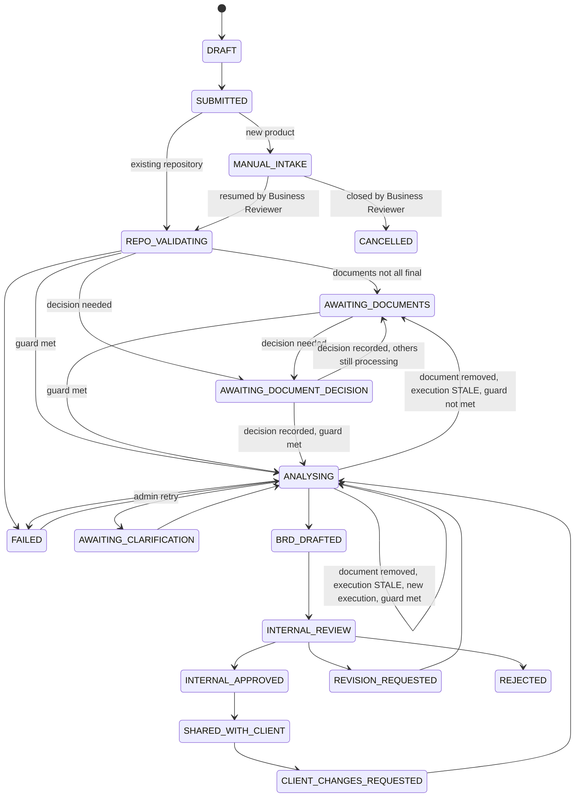
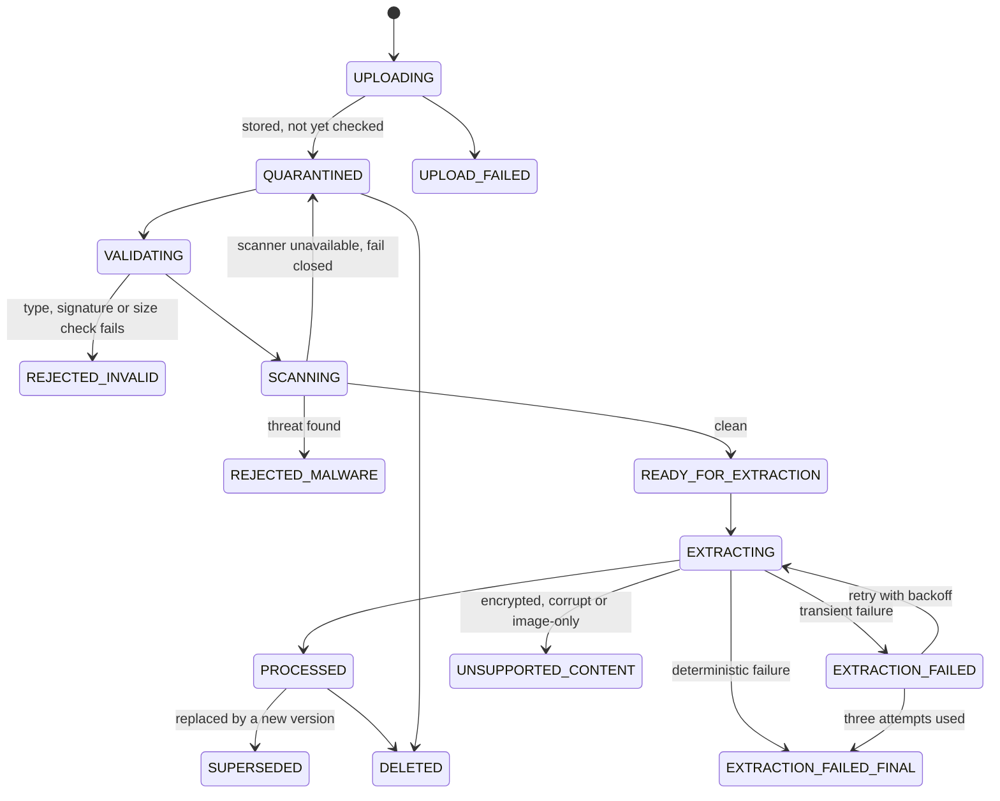

# Document A: MVP Product Requirements Document

**Product:** Agentic SDLC Platform **Version:** 0.7 (previous version: 0.6) **Status:** Ready for PRD Freeze / Final Review. No implementation has started.

Labels used in this document: **\[Fact\]** verified. **\[Assumption\]** believed, not verified. **\[Decision\]** agreed with the owner. **\[Open\]** still to decide.

## 1. Executive Summary

The platform turns a client's requirement into reviewed, versioned engineering documents, and later into tested code and a deployed application. AI agents do the analysis and drafting. A durable workflow and human approvals control every step. The agents never control the workflow.

The long-term vision has ten stages, listed below. This PRD defines the **MVP (Release 1)**. It is only the first vertical slice:

> Submit a requirement and supporting documents, analyse a repository and the documents, generate an evidence-backed BRD, get human approval, and trace each requirement to repository evidence, share it with the client only after independent approval, and keep every document version auditable.

Release 1 proves the hardest foundations: the workflow engine, the agent and model gateway, repository analysis, document versioning, approval rules, clarification handling, and audit. Later releases add commercial approval, TDD, autonomous coding, QA, pull requests, and staging deploys.

**Long-term workflow (unchanged).** The product has ten stages: (1) requirement submission, (2) business analysis, (3) effort estimation, (4) client scope approval, (5) commercial estimate acceptance, (6) TDD creation and approval, (7) autonomous development, (8) quality assurance, (9) pull request creation and review, (10) staging and production deployment. Specialised agents (BA, Estimation, Solution Architect, Developer, QA, Code Review, Deployment) will do the work under human supervision and a deterministic workflow engine. Release 1 delivers only the first slice: stages 1 and 2, including internal review and client visibility of the BRD. It does not change, remove, reorder or redefine any other stage. Section 6A maps every stage to a release.

**Document upload is part of Release 1.** Clients attach supporting documents (PDF, DOCX, TXT, Markdown). Files are validated, scanned, stored in private object storage, and turned into text by a separate document-processing module. The BA agent uses only processed documents and treats their content as untrusted evidence, never as instructions.

## 2. Problem Statement

Turning a vague client request into a correct specification is slow and error-prone. Teams read code by hand, miss impacted components, mix guesses with facts, and lose track of which version the client approved. AI can speed this up, but only if its output is grounded in real evidence, reviewed by people, and fully traceable.

## 3. Product Principles (Decisions)

1. **\[Decision\]** The workflow is a persisted state machine. Agents are workers inside it, not controllers of it.
2. **\[Decision\]** Evidence over fluency. Every claim about a repository must point to a real file, class, or method, or be labelled an assumption.
3. **\[Decision\]** Humans approve consequential steps. Agents ask when unsure.
4. **\[Decision\]** Tenant-aware from day one. Single tenant at launch, but no table or API may ignore tenant boundaries.
5. **\[Decision\]** Agents never depend on one LLM provider. All model calls go through a model gateway.
6. **\[Decision\]** Real external client code is not executed until the security gates in section 12 pass.
7. **\[Decision\]** Simple first. Modular monolith, PostgreSQL job queue, no Temporal, no RabbitMQ in the MVP.

Added in 0.2:

- **\[Decision\]** The product workflow is separate from the Release 1 requirement state machine. No single status field may represent every future stage (sections 6 and 6A).
- **\[Decision\]** Agents are logical roles inside the modular monolith, not services. They never control workflow transitions, approvals, permissions or deployment (section 7.13).
- **\[Decision\]** Tenant context comes from the authenticated identity only, never from request parameters.
- **\[Decision\]** Approval types stay distinct: BRD review, scope, commercial, TDD, deployment. Self-approval is prohibited for consequential reviews.
- **\[Decision\]** The platform does not promise perfect code understanding. Claims without repository evidence are labelled ASSUMPTION.

Added in 0.3:

- **\[Decision\]** Uploaded documents and repository files are untrusted data. They are evidence and source material, never instructions.
- **\[Decision\]** Separation of duties applies to every approval type. Approver identity comes from the authenticated session only.
- **\[Decision\]** The product workflow (the ten-stage business lifecycle) and the workflow engine (the technical orchestration) are different things.
- **\[Decision\]** Files go to private object storage. Binary content is never stored in PostgreSQL.

## 4. Users and Roles

| Role | Who | Main goals |
| --- | --- | --- |
| Client User | Customer staff | Submit requirements, answer questions, review the BRD |
| Client Approver | Customer decision maker | Approve scope (Release 2 for commercial parts) |
| Business Reviewer | Internal analyst | Review, approve, reject, or request changes to the BRD |
| Platform Admin | Platform owner | Manage users, tenants, repositories, model settings, audit access |
| Auditor (read-only) | Internal or external | Read audit trail and document history |
| System / Agent | Non-human actors | Run tasks. Cannot approve anything |

Authorization rules:

- A user can only see data from their own tenant. Client users can only see their own requirements. Platform staff do not automatically see customer source code (section 4A).
- An agent identity or system job can never record an approval of any kind.
- **\[Decision\]** Self-approval is prohibited for consequential reviews. The person who submitted a requirement cannot act as the independent reviewer of its BRD.

## 4A. Domain Terminology and Tenancy Model

**\[Decision\]** These terms are not interchangeable.

| Term | Meaning |
| --- | --- |
| Tenant | A customer organisation or isolated workspace. The root of data isolation. |
| User | An authenticated individual who belongs to one tenant, or to the platform itself. |
| Project | A logical customer project, owned by a tenant. |
| Repository | A source-code repository owned by a tenant. It is associated with one or more projects of that tenant (see below). |
| Requirement | A business change request. It has immutable revisions. |
| Workflow execution | A persisted run of a business process for one requirement. |
| Stage execution | One stage inside a workflow execution. |
| Agent execution | One agent's work inside one stage execution. |

**Ownership and tenancy.** The tenant owns its users, projects, repositories and requirements. Each of these is a tenant-owned record. A requirement is linked to a project and, for an existing-repository requirement, to a repository. Below a requirement the hierarchy is: Requirement → Workflow executions → Stage executions → Agent executions.

**Project-to-repository association.** This is a separate relationship. It is not part of the ownership hierarchy, so a repository is not owned by an individual project. A repository is owned by exactly one tenant and may be associated with several projects of that tenant, where the product rules permit. The association record is tenant-owned and can never link a project and a repository from different tenants. No new repository-sharing feature is introduced. The Release 1 UI uses one primary repository per requirement.

**Global and tenant-owned records.** **\[Decision\]** Not every table needs a `tenant_id`.

- Global platform records (no `tenant_id`): tenant registry, platform users and platform roles, workflow definitions and versions, agent definitions and prompt versions, model provider catalogue, system configuration.
- Tenant-owned records: projects, repositories, requirements, documents and versions, approvals, clarifications, workflow and stage executions, agent executions, jobs, model call records, notifications, repository snapshots, audit events.
- **\[Decision\]** Every tenant-owned table has a direct `tenant_id` column (NOT NULL), with composite unique keys and composite foreign keys where appropriate, so no cross-tenant relationship is possible. Global tables have no `tenant_id`. Central tenant authorization and Row-Level Security apply (FR-AUTH-17 to FR-AUTH-21).

**Platform administrator access.** **\[Decision\]** Platform administrators manage tenants, users and operations. They do not automatically see customer source code, documents or analysis. Access to tenant data needs a grant with a mandatory reason, a defined scope and a time limit. It is read-only by default and must be approved by a different authorised approver. The requester cannot approve their own grant. Request, approval, every use and expiry are audited (FR-AUTH-23, FR-AUTH-24).

Added in 0.3:

- **Tenant ownership.** **\[Decision\]** Tenant-owned tables carry a direct `tenant_id`, as above. Every query, API, storage access and background job enforces tenant authorization. Release 1 may have one active tenant, but tenant-aware modelling and authorization exist from day one.
- **Further terms.** An *attachment* is a document linked to a requirement. A *document version* is one immutable stored file. A *client* is a user or organisation that submits requirements inside a tenant. Client and tenant are not the same word.
- **Project and repository.** **\[Decision\]** The long-term model supports several repositories per project. A repository belongs to exactly one tenant and may be associated with several projects within that tenant. The Release 1 UI uses one primary repository per requirement.

## 5. User Journeys

**J1: Client submits a requirement.** The client signs in, opens New Requirement, fills the form (title, description, business objective, expected outcomes, acceptance criteria if known, repository or "new product", constraints, integrations), attaches supporting documents (J10), and submits. The platform gives it an ID such as `REQ-000123` and shows status `SUBMITTED`.

**J2: Repository is registered.** An admin registers a GitHub repository by installing the platform's GitHub App with read-only access to that one repository. The platform records the repository, default branch, and the exact commit SHA to analyse.

**J3: BA agent analyses.** The workflow creates an analysis job. The agent reads the repository (read-only), finds modules, packages, classes, APIs, tables, dependencies, and impacted components, and separates facts from assumptions. If it hits a blocking doubt, it creates a clarification and the task pauses.

**J4: Clarification.** The assigned person sees the question in their inbox with context, options, and the agent's recommendation. They answer. The task resumes. The answer is stored in the audit trail.

**J5: BRD review.** The agent output becomes BRD version 1. A Business Reviewer opens it, sees each claim with its evidence links, and chooses Approve, Reject, or Request Revision with comments.

**J6: Revision.** On Request Revision, the agent produces version 2. Version 1 stays unchanged. Any earlier approval of version 1 does not carry over.

**J7: Share with client.** Only after internal approval is the BRD released to the client. The client views it. In Release 1 the client can comment or request changes. Formal commercial approval comes in Release 2.

**J8: Resuming after inputs changed.** A clarification is answered, but the requirement was revised in the meantime. The workflow engine checks the inputs, marks the old agent execution STALE, and starts a new execution with the current inputs. The reviewer can see why. The old answer is kept in the audit trail.

**J9: Platform admin needs tenant data.** The admin requests time-limited access and gives a reason. Access is granted by policy. Every action is audited. Source code is not shown by default.

**J10: Client uploads supporting documents.** On the requirement form the client attaches one or more documents (PDF, DOCX, TXT or Markdown), such as existing BRDs, process documents, functional or API specifications, system documentation, and business rules or policies. Each file shows upload progress, then its processing status. The statuses shown are the internal document-processing states of 6C: UPLOADING, QUARANTINED, VALIDATING, SCANNING, READY\_FOR\_EXTRACTION, EXTRACTING, EXTRACTION\_FAILED (while a retry is pending) and PROCESSED, or a terminal state: REJECTED\_INVALID, REJECTED\_MALWARE, UPLOAD\_FAILED, UNSUPPORTED\_CONTENT or EXTRACTION\_FAILED\_FINAL. The exact label wording is a UI choice for the TDD. A rejected file shows a clear reason. The client can remove or replace a file before submission. The BA agent only uses documents that reach Processed. Scanned or image-only PDFs are accepted as files but marked as not analysed (no OCR in Release 1).

**J11: New-product request.** The client marks the requirement as a new product. The platform explains that automated greenfield analysis is not supported yet and routes the requirement to MANUAL\_INTAKE, a paused state that only an authorised reviewer can resume or close. The requirement and its documents are kept for future processing. For MANUAL\_INTAKE requirements, upload validation, malware scanning and document storage still run, but document extraction and BA analysis are not scheduled until an authorised Business Reviewer resumes the requirement.

**J12: Document added or replaced after analysis.** A new document version is created and the earlier one is kept. The platform records who changed it and when, and marks the earlier analysis and BRD as potentially stale. It either re-runs the affected analysis or asks a reviewer to confirm. Approvals that depend on the old inputs are invalidated. If a document is removed or deleted while an analysis is running, that execution is marked STALE, cannot complete successfully or produce an approvable BRD, and a new execution uses the current document set.

**J13: Reviewer clarification, then client views the evidence.** During review the reviewer raises a clarification or approves. After independent approval the client views the approved BRD with its supporting evidence: source documents with page or section, and repository file paths, class or method names and commit references. Source-code excerpts are hidden from the client by default (7A.8). Each BRD statement shows its source.

## 6. Workflow States

The states and diagram below are the **Release 1 requirement state machine** (stages 1 and 2: intake to client-visible BRD). They are not the product workflow and not one status field that must hold every future stage. **\[Decision\]** The state shown to users is a read-only projection computed from stage executions (sections 6A and 6B). Later releases add stages without changing these states. Only the workflow module may change state, and only through legal transitions.

| State | Meaning |
| --- | --- |
| DRAFT | Client is still editing |
| SUBMITTED | Submitted. Routed by type: existing repository to REPO\_VALIDATING, new product to MANUAL\_INTAKE |
| MANUAL\_INTAKE | Paused, manual state for new-product requests in Release 1. No repository validation, extraction or BA analysis is scheduled |
| REPO\_VALIDATING | Repository access and revision being verified |
| AWAITING\_DOCUMENTS | Waiting until every attached document is successful or terminal, and every required decision or client action is recorded. Also holds after a decision is recorded while other documents are still processing |
| AWAITING\_DOCUMENT\_DECISION | Waiting for a required decision: a Business Reviewer authorisation (unsupported or permanently failed documents) or a client action (retry, remove or acknowledge) |
| ANALYSING | BA agent running. Entered only when the guard in 6C.1 is met |
| AWAITING\_CLARIFICATION | Blocking question open |
| BRD\_DRAFTED | BRD version produced |
| INTERNAL\_REVIEW | In the reviewer queue |
| REVISION\_REQUESTED | Reviewer wants changes |
| INTERNAL\_APPROVED | A reviewer approved the current version |
| SHARED\_WITH\_CLIENT | Visible to the client |
| CLIENT\_CHANGES\_REQUESTED | Client wants changes |
| REJECTED | Stopped by reviewer |
| FAILED | Technical failure after retries; needs admin action |
| CANCELLED | Cancelled by client, admin, or closed from manual intake |

Legal transitions:

The guard for entering ANALYSING (see 6C.1): every attached document is successful or terminal, every required decision or client action is recorded, and no document is in progress.

CANCELLED is reachable from any non-terminal state by the client or an admin. Any transition not listed is illegal and must be rejected and logged.

**MANUAL\_INTAKE (0.4).** MANUAL\_INTAKE is a paused, manual state for Release 1. Routing from SUBMITTED:

- Existing-repository requirement: SUBMITTED → REPO\_VALIDATING.
- New-product requirement: SUBMITTED → MANUAL\_INTAKE.

While a requirement remains in MANUAL\_INTAKE, no repository validation, BA analysis or agent execution runs. The client is told that automated greenfield analysis and scaffolding are not supported yet. The requirement and its documents are kept. For MANUAL\_INTAKE requirements, upload validation, malware scanning and document storage still run, but document extraction and BA analysis are not scheduled until an authorised Business Reviewer resumes the requirement. Greenfield support stays in the long-term vision.

**Resume or close.** Only an authorised internal Business Reviewer can act on a requirement in MANUAL\_INTAKE. Platform administrators have no default right to do so. *Resume:* the reviewer converts it into an existing-repository requirement with a registered repository. This creates a new requirement revision, and the requirement moves to REPO\_VALIDATING. From then on the normal existing-repository workflow applies, with all permissions, approvals, state transitions and audit requirements enforced. The conversion and resume are audited. *Close:* the reviewer closes it with a recorded reason, and it moves to CANCELLED. The client may also cancel. Every action is audited and the client is notified in-app.

**Documents and analysis (0.4).** For an existing-repository requirement, document processing and repository validation run as separate stage executions inside stage 2. The BA analysis stage depends on both and follows the rules in 6C.1: it waits for documents still in progress, uses only PROCESSED documents, and never silently excludes a document. Document processing status, BA eligibility and requirement workflow state are three separate things. A failure in document processing never advances or corrupts the requirement state.

## 6A. Long-Term Workflow and Release Roadmap

**\[Decision\]** The ten-stage workflow is the product. Release 1 is the first slice. The release numbers for later stages are a plan, not a promise (**\[Assumption\]**).

**Product workflow and workflow engine.** The *product workflow* is the business lifecycle a client requirement goes through: the ten stages below. The *workflow engine* is the technical system that runs it: state transitions, task execution, approvals, retries, clarification handling and audit history. The engine must accept new stages as new workflow definition versions, without redesigning the system. Release 1 is only the first functional slice. It does not redefine or reduce the product workflow.

| # | Stage | Agent | Human approval | Release |
| --- | --- | --- | --- | --- |
| 1 | Requirement submission | none | none | R1 |
| 2 | Business analysis and BRD | BA Agent | Independent internal review, then client visibility | R1 |
| 3 | Effort estimation | Estimation Agent | Human approval of the quote. Price comes from the owner-controlled rate card and deterministic pricing | R2 |
| 4 | Client scope approval | none | Client approver | R2 |
| 5 | Commercial estimate acceptance | none | Client and platform owner | R2 |
| 6 | TDD creation and approval | Solution Architect Agent | TDD reviewer | R3 |
| 7 | Autonomous development | Developer Agent | Clarifications. Security gate G2 first | R4 |
| 8 | Quality assurance | QA Agent | Review of the test report | R5 |
| 9 | Pull request creation and review | Code Review Agent | PR reviewer and merge policy | R5 |
| 10 | Staging and production deployment | Deployment Agent | Separate deployment approval, required for production | R6 |

**Foundations built in Release 1 for all later stages:**

- Persisted workflow definitions, workflow instances, stage executions and dependencies.
- Separate approval records with distinct approval types.
- Immutable document versions and approval invalidation.
- Clarification records with pause, stale-input checks and resume.
- Agent definition, agent runtime, tool registry and model gateway.
- PostgreSQL job queue, outbox, leases, retries and recovery.
- Tenant-aware data model and authorization.
- Append-only audit trail and security monitoring.

Release 1 builds none of the stage-specific logic for stages 3 to 10.

## 6B. Workflow Model

**\[Decision\]** The smallest design that supports all ten stages is a persisted model with these parts. It is not a generic workflow platform: no visual designer and no custom scripting.

| Part | Purpose |
| --- | --- |
| Workflow definition (versioned) | Stages, dependencies, entry and exit conditions, approval requirements, agent execution policy, retry and recovery policy, release gates. Release 1 ships one definition with stages 1 and 2. Later releases publish a new version. |
| Workflow instance | One run for one requirement, pinned to a definition version. |
| Stage execution | State, input references, attempts, lease, result. |
| Stage dependency | Which stages must be complete and valid first. |
| Approval | A decision on one exact document version. It has a type. |
| Transition event | Every state change, with actor and reason. |

Rules:

1. A stage cannot start until all preceding stages are complete and the required approvals and acceptance conditions are valid.
2. Every stage execution is independently executable, auditable, retryable and resumable.
3. A clarification pauses only the affected stage execution and the stages that depend on it. Completed independent stages are not reset.
4. A changed input marks dependent results stale. Only dependent work is re-run.
5. Future releases extend the definition. They do not replace the Release 1 implementation.
6. These stay distinct approval concepts: BRD review, client scope approval, commercial acceptance, TDD approval, deployment authorization.
7. The workflow engine sits behind an interface. Temporal stays deferred.

**Lineage.** The platform keeps links from approved scope to commercial estimate, TDD, code changes, test results, pull request and deployed release. Release 1 builds the first links: requirement revision → repository SHA → BRD version → approval.

**Workflow definition versioning (0.3).**

- Every workflow execution references the definition version under which it started.
- Existing executions stay pinned to that version by default.
- New executions use the latest active version.
- Moving an execution to another version is an explicit migration: validated, authorised and audited.
- Publishing a new definition version never changes the behaviour of a requirement already in progress.

## 6C. Document Upload and Processing States

Each attachment version has its own processing state. This is separate from the requirement state.

Rules: only PROCESSED versions can be given to the BA agent. A file never leaves QUARANTINED without a successful scan. Image-only or scanned PDFs may be stored but are marked UNSUPPORTED\_CONTENT, because OCR is not supported in Release 1. The system never claims that scanned content was analysed.

### 6C.1 Document state classes and BA dependency rules

| Class | States | Meaning |
| --- | --- | --- |
| In progress | UPLOADING, QUARANTINED, VALIDATING, SCANNING, READY\_FOR\_EXTRACTION, EXTRACTING | Work is still going on. A file waiting because the scanner is unavailable stays QUARANTINED, so it counts as in progress. |
| Retryable failure | EXTRACTION\_FAILED | A transient extraction failure waiting for a retry. Maximum three attempts in total, with exponential backoff. Only transient failures are retried. Deterministic failures are not retried and become terminal at once. After the limit the state is EXTRACTION\_FAILED\_FINAL. The document still counts as not final while a retry is pending. |
| Successful | PROCESSED | Text is extracted and available. This is the only state the BA agent can use. |
| Terminal: rejected, unsupported or permanently failed | REJECTED\_INVALID, REJECTED\_MALWARE, UPLOAD\_FAILED, UNSUPPORTED\_CONTENT, EXTRACTION\_FAILED\_FINAL | The document will not be analysed. |
| Lifecycle end | SUPERSEDED, DELETED | Replaced or removed. Not used by analysis. |

Three separate concepts. A change in one never silently changes another.

| Concept | What it is | Who changes it |
| --- | --- | --- |
| Document processing status | The state of one document version (diagram above) | The document processing module, reported to the workflow engine |
| BA eligibility | A derived yes or no per document version: PROCESSED, current (not superseded or deleted), same tenant and requirement | Derived. Never set by hand |
| Requirement workflow state | A projection of stage executions (section 6) | The workflow engine only |

BA dependency rules:

1. **Guard for ANALYSING.** The workflow engine does not move the requirement to ANALYSING until: (a) every attached document is successful (PROCESSED) or terminal; (b) every document that needs a Business Reviewer authorisation or a client action has it recorded; and (c) no document is UPLOADING, QUARANTINED, VALIDATING, SCANNING, READY\_FOR\_EXTRACTION, EXTRACTING or waiting for an extraction retry.
2. A Business Reviewer may record a decision about one document while other documents are still processing. The decision alone does not start analysis. The requirement stays in AWAITING\_DOCUMENTS until the guard in rule 1 is met.
3. A scanner outage never lets a file into BA processing. Affected files stay QUARANTINED, the requirement waits in AWAITING\_DOCUMENTS, and platform admins are alerted.
4. Only PROCESSED document versions are given to the BA agent.
5. Extraction retries: maximum three attempts in total, with exponential backoff, for transient failures only. After that the document is EXTRACTION\_FAILED\_FINAL.
6. Rejected, unsupported or permanently failed documents are never silently excluded. Each is listed in the BRD as not analysed, with the reason.

**MANUAL\_INTAKE and extraction.** For MANUAL\_INTAKE requirements, upload validation, malware scanning and document storage still run, but document extraction and BA analysis are not scheduled until an authorised Business Reviewer resumes the requirement. Documents of such a requirement stop at READY\_FOR\_EXTRACTION after a clean scan. The workflow engine schedules the move to EXTRACTING only after the resume. The document state diagram is unchanged.

**Documents removed during analysis.** If an attached document is removed or deleted while an analysis execution is running, that execution becomes STALE. A stale execution cannot complete successfully and cannot produce an approvable BRD from the old input set. A new execution uses the current valid document set once the guard in rule 1 is met. The approval binding (FR-DTR-08) and the stale-input rules (FR-CLR-10, FR-DTR-06, FR-DTR-07) apply unchanged.

**\[Decision\]** Who authorises proceeding without a document. For a document that was valid and clean but could not be analysed, an internal Business Reviewer must authorise it. The client alone is not enough, because the client may not understand the effect on the BRD. The client is notified and can replace the file instead.

| Document outcome | Required before analysis proceeds |
| --- | --- |
| UNSUPPORTED\_CONTENT (for example encrypted, corrupt or image-only) | A Business Reviewer authorises proceeding without it. The decision records who, when and which document versions. The client is notified and can replace the file. |
| EXTRACTION\_FAILED\_FINAL | The same Business Reviewer authorisation. |
| UPLOAD\_FAILED | No automatic proceeding. The client retries the upload, removes the failed attachment, or explicitly acknowledges the exclusion. The acknowledgement records who and when. |
| REJECTED\_INVALID | The client is notified and must replace the file or explicitly acknowledge the exclusion before analysis proceeds. |
| REJECTED\_MALWARE | The file is quarantined or removed according to security policy. Platform admins are alerted. The exclusion is recorded. The file is never exposed to users and never analysed. The client is told only that the file was rejected. |

## 7. Functional Requirements

Priority: **P0** must have for Release 1. **P1** should have. **P2** later.

### 7.1 Identity, Tenancy, Authorization

| ID | Requirement | Pri |
| --- | --- | --- |
| FR-AUTH-01 | Users sign in with email and password using Spring Security. Passwords hashed with a modern algorithm. **\[Open\]** add SSO later. | P0 |
| FR-AUTH-02 | Every tenant-owned table has a `tenant_id` column (NOT NULL), with composite unique keys and composite foreign keys where appropriate to prevent cross-tenant relationships. Global platform tables have no `tenant_id` (section 4A). Tenant filtering is enforced centrally and in the database through Row-Level Security (FR-AUTH-17 to FR-AUTH-21), not by hand in each query. | P0 |
| FR-AUTH-03 | Role-based access for the roles in section 4. | P0 |
| FR-AUTH-04 | A request for another tenant's data returns not found, not forbidden, and is logged. | P0 |
| FR-AUTH-05 | Only the API may change approvals. Agent identities are blocked by design. | P0 |

Added in 0.2 (tenant isolation, independent review):

| ID | Requirement | Pri |
| --- | --- | --- |
| FR-AUTH-06 | Tenant context is derived from the authenticated identity only. A tenant ID in a request body, query or header is never trusted. | P0 |
| FR-AUTH-07 | Every tenant-owned resource is linked to a tenant. Global platform records are listed explicitly (section 4A). | P0 |
| FR-AUTH-08 | Tenant-scoped authorization applies to APIs, database access, background jobs, agent executions, document storage, audit events and external integrations. | P0 |
| FR-AUTH-09 | Repository access always validates tenant ownership. Repository queries are tenant-scoped. | P0 |
| FR-AUTH-10 | Composite foreign keys prevent cross-tenant relationships in the database where appropriate. | P0 |
| FR-AUTH-11 | **\[Decision\]** PostgreSQL Row-Level Security is adopted in Release 1 as defence in depth. Application-level tenant authorization remains mandatory. Details are in FR-AUTH-17 to FR-AUTH-21. | P0 |
| FR-AUTH-12 | Tenant context is stored on every job and passed to every agent execution, tool call and model call record. A job without tenant context is rejected. | P0 |
| FR-AUTH-13 | Cross-tenant access attempts are denied and recorded as security events. | P0 |
| FR-AUTH-14 | Platform administrators have no default access to tenant source code or documents. Access needs a time-limited, reasoned, audited grant. | P0 |
| FR-AUTH-15 | Automated tests cover cross-tenant access through the API, background jobs, file access, repository access and integrations. | P0 |
| FR-AUTH-16 | The submitter of a requirement cannot approve its BRD. Agents and system jobs can never approve documents, estimates, scope or deployments. | P0 |

Added in 0.5 (Row-Level Security, approver roles, platform-admin grants):

| ID | Requirement | Pri |
| --- | --- | --- |
| FR-AUTH-17 | Row-Level Security is enabled on every tenant-owned table. Policies compare the row's `tenant_id` with the tenant context of the current transaction. Global platform tables are not under tenant policies. | P0 |
| FR-AUTH-18 | Tenant context is transaction-local. It is set at the start of each transaction, never at session level, and cleared at the end. | P0 |
| FR-AUTH-19 | Background jobs, outbox processing, extraction jobs and agent executions set the tenant context from the job's stored tenant before any data access. A job without a tenant is rejected. | P0 |
| FR-AUTH-20 | The application connects with a role that cannot bypass Row-Level Security (not the table owner, no bypass attribute). Migrations and administration use separate roles that the application never uses. | P0 |
| FR-AUTH-21 | Connection pooling is tested for tenant-context leakage. A pooled connection never serves a request with a previous tenant's context. | P0 |
| FR-AUTH-22 | Every approver role is held by a named individual and is granted only by a different authorised person. Accounts are never shared. A second account controlled by the same person does not qualify as independent. | P0 |
| FR-AUTH-23 | A platform-admin access grant to tenant data needs a mandatory reason, a defined scope, a time limit, and approval by a different authorised approver. It is read-only by default. The requester cannot approve their own grant. | P0 |
| FR-AUTH-24 | Grants expire automatically. Request, approval, every use and expiry are audited. | P0 |

### 7.2 Requirement Submission

| ID | Requirement | Pri |
| --- | --- | --- |
| FR-REQ-01 | Form fields: title, description, business objective, expected outcomes, acceptance criteria (optional), repository URL or new-product choice, constraints, integrations. | P0 |
| FR-REQ-02 | INCLUDED in Release 1 (Decision 4): supporting document upload works end to end. Requirements are in section 7A. | P0 |
| FR-REQ-03 | Generate a unique ID per requirement and record the initial state and creator. | P0 |
| FR-REQ-04 | Editing after submission creates a new requirement revision. It never overwrites. | P0 |
| FR-REQ-05 | New-product workflow can be selected and stored, but the agent path for it is out of scope in Release 1. | P1 |

Added in 0.3 (new-product requests):

| ID | Requirement | Pri |
| --- | --- | --- |
| FR-REQ-06 | The form lets the user mark a requirement as an existing-repository enhancement or a new product. | P0 |
| FR-REQ-07 | A new-product requirement goes to MANUAL\_INTAKE. The user is told that automated greenfield analysis and scaffolding are not supported yet. | P0 |
| FR-REQ-08 | While a new-product requirement remains in MANUAL\_INTAKE, it never goes through repository validation, BA analysis or any agent execution. Its requirement and uploaded documents are kept. After an authorised Business Reviewer resumes it and converts it into an existing-repository requirement (FR-REQ-11), the normal existing-repository workflow applies to it. | P0 |

Added in 0.4 (MANUAL\_INTAKE):

| ID | Requirement | Pri |
| --- | --- | --- |
| FR-REQ-09 | MANUAL\_INTAKE is a paused, manual state. While a requirement remains in MANUAL\_INTAKE, it never triggers repository validation, BA analysis or any agent execution. These restrictions apply only until an authorised Business Reviewer resumes it (FR-REQ-11). | P0 |
| FR-REQ-10 | SUBMITTED moves to REPO\_VALIDATING for existing-repository requirements, and to MANUAL\_INTAKE for new-product requirements. | P0 |
| FR-REQ-11 | Only an authorised internal Business Reviewer can resume or close a requirement in MANUAL\_INTAKE. Resume converts it into an existing-repository requirement with a registered repository, as a new requirement revision. Close moves it to CANCELLED with a recorded reason. Platform administrators have no default right. Both actions are audited and the client is notified. After a resume, the requirement moves to REPO\_VALIDATING and the normal existing-repository workflow applies, with all permissions, approvals, state transitions and audit requirements enforced. The conversion is recorded as its own audited event. | P0 |
| FR-REQ-12 | For MANUAL\_INTAKE requirements, upload validation, malware scanning and document storage still run, but document extraction and BA analysis are not scheduled until an authorised Business Reviewer resumes the requirement. | P0 |

### 7.3 Repository Registration and Access

| ID | Requirement | Pri |
| --- | --- | --- |
| FR-REPO-01 | Register a repository through a GitHub App installation with read-only contents access, limited to selected repositories. | P0 |
| FR-REPO-02 | Store repository URL, default branch, and the analysed commit SHA. Analysis always targets a fixed SHA. | P0 |
| FR-REPO-03 | Credentials are short-lived installation tokens, created on demand, never stored in plain text, never given to the model. | P0 |
| FR-REPO-04 | Fetch the repository by a trusted integration component. Agents receive only the files, not tokens. | P0 |
| FR-REPO-05 | Repositories are never executed or built in Release 1 (read-only static analysis only). | P0 |

Added in 0.2 (tenant ownership, retention and deletion):

| ID | Requirement | Pri |
| --- | --- | --- |
| FR-REPO-06 | Repository registration and every access validate that the repository belongs to the caller's tenant. | P0 |
| FR-RET-01 | Source snapshot retention is configurable per tenant. Retention is configurable. Development defaults are defined in FR-RET-11 to FR-RET-16 and must be confirmed against contractual and privacy requirements before real client onboarding. Indefinite storage is not assumed. | P0 |
| FR-RET-02 | A tenant can request deletion of its snapshots and derived data. Deletion follows a documented procedure. | P0 |
| FR-RET-03 | Temporary copies (workspaces, caches, logs, agent traces) are deleted after use. Repository content in logs and traces is minimised. | P0 |
| FR-RET-04 | Every deletion is recorded in the audit trail, without the deleted content. | P0 |

Added in 0.3 (GitHub integration):

| ID | Requirement | Pri |
| --- | --- | --- |
| FR-REPO-07 | There is an explicit mapping between tenant, project, repository and GitHub App installation. A repository belongs to exactly one tenant. | P0 |
| FR-REPO-08 | Least-privilege permissions: read-only repository contents, limited to selected repositories in Release 1. | P0 |
| FR-REPO-09 | Credentials are stored encrypted. | P0 |
| FR-REPO-10 | Access tokens are short-lived and scoped to one repository. | P0 |
| FR-REPO-11 | Credentials are never shared across tenants. | P0 |
| FR-REPO-12 | No broad GitHub credential is passed to an LLM or an untrusted worker. A trusted integration service (credential broker) performs all repository operations. | P0 |

Added in 0.4 (retention coverage). Retention is configurable. Development defaults are defined in FR-RET-11 to FR-RET-16 and must be confirmed against contractual and privacy requirements before real client onboarding.

| ID | Requirement | Pri |
| --- | --- | --- |
| FR-RET-05 | Retention and deletion policies cover: original uploaded documents; immutable document versions; extracted text and chunks; temporary processing artifacts; repository snapshots and derived indexes; generated BRDs and evidence references. | P0 |
| FR-RET-06 | Generated BRDs and evidence references are retained subject to approval and audit retention requirements. Audit records hold references and hashes, not content. | P0 |
| FR-RET-07 | Retention is configurable for each of these data classes. No duration is hardcoded. | P0 |
| FR-RET-08 | Deleting a source (a document version or a repository snapshot) also deletes the data derived from it: extracted text, chunks, indexes and temporary artifacts. The deletion is audited without content. | P0 |
| FR-RET-09 | Temporary processing artifacts are deleted after processing, including after failure and cancellation. | P0 |
| FR-RET-10 | If a source is deleted after a BRD was approved, the evidence reference stays as a record and is shown as source no longer available. The approval stays in the audit trail. | P0 |

Added in 0.5 (development defaults). They are configurable, and subject to contractual and privacy requirements before real client onboarding.

| ID | Requirement | Pri |
| --- | --- | --- |
| FR-RET-11 | Repository snapshots and derived indexes: 30 days after closure. | P0 |
| FR-RET-12 | Source documents, document versions, and extracted text and chunks: 90 days after closure. | P0 |
| FR-RET-13 | Generated BRDs and approval records, including evidence references: 365 days. | P0 |
| FR-RET-14 | Audit metadata: 365 days. Audit records are removed only by a controlled retention process, never by the application database user (FR-AUD-02). | P0 |
| FR-RET-15 | Temporary processing artifacts are deleted after processing. Abandoned artifacts are cleaned up within 24 hours. | P0 |
| FR-RET-16 | Closure means the requirement is completed, rejected or cancelled. The TDD defines the exact trigger. | P0 |

### 7.4 Repository Analysis and Indexing

| ID | Requirement | Pri |
| --- | --- | --- |
| FR-IDX-01 | Build a file tree and symbol index for Java: packages, classes, methods, Spring annotations (controllers, services, repositories, entities). | P0 |
| FR-IDX-02 | Parse build files (Maven or Gradle) for dependencies and versions. | P0 |
| FR-IDX-03 | Extract REST endpoints and database entities and Liquibase or SQL changes where present. | P0 |
| FR-IDX-04 | Provide search tools to the agent: find file, find symbol, text search, read file range. Embedding-based search is **\[Open\]** and deferred. | P0 |
| FR-IDX-05 | Repository text is treated as untrusted data and must never be treated as instructions (see section 11). | P0 |
| FR-IDX-06 | Large repositories are limited by file count and size. Skipped files are reported, not hidden. | P1 |

Added in 0.2. Repository analysis has two phases. FR-IDX-01 to FR-IDX-03 belong to Phase A. FR-IDX-04 to FR-IDX-06 apply to both phases.

| ID | Requirement | Pri |
| --- | --- | --- |
| FR-IDX-07 | **Phase A, inventory and indexing.** Covers the file and directory structure, Java packages, classes, methods and symbols, Spring controllers, services, repositories and entities, REST endpoints, Maven or Gradle dependencies, database entities and relationships where discoverable, Liquibase changelogs and SQL migrations, configuration files and integrations. Stored against the commit SHA. | P0 |
| FR-IDX-08 | **Phase B, requirement-specific impact analysis.** Uses the requirement and the Phase A inventory. Identifies relevant business functionality, potentially impacted APIs, service classes and methods, tables, entities and migrations, downstream dependencies, integration points, regression areas, missing information and implementation constraints. | P0 |
| FR-IDX-09 | Only claims supported by repository evidence are stated as facts. Others are labelled ASSUMPTION or RECOMMENDATION. The platform does not claim perfect code understanding. | P0 |
| FR-IDX-10 | Detailed analysis supports Java and Spring Boot only. Other languages and files may be inventoried, and detailed analysis of them is marked UNSUPPORTED. No claim of multi-language support. | P0 |
| FR-IDX-11 | Embedding-based retrieval is DEFERRED until measured retrieval quality shows a need. | P2 |

### 7.5 BA Agent

| ID | Requirement | Pri |
| --- | --- | --- |
| FR-BA-01 | Input: requirement revision, repository snapshot (SHA), processed document text, prior clarifications. Output: structured BRD content in a fixed schema. | P0 |
| FR-BA-02 | Every statement about the repository carries an evidence reference: file path, line range, commit SHA. Statements without evidence must be tagged ASSUMPTION. | P0 |
| FR-BA-03 | The BRD separates: verified facts, assumptions, risks, impacted components, integration points, missing requirements, constraints, feasibility. | P0 |
| FR-BA-04 | An evidence checker verifies every repository citation: the repository identity, the file path, the line range and the commit SHA, and whether the cited source supports the associated BRD statement. A citation whose source cannot be located, or whose content does not support the statement, is removed or flagged and is never presented as verified. | P0 |
| FR-BA-05 | The agent estimates needed capabilities and rough effort ranges as inputs only. No prices in Release 1. | P1 |
| FR-BA-06 | The agent works within bounded steps, time, and token budgets. At the limit it stops and reports. | P0 |

Added in 0.2:

| ID | Requirement | Pri |
| --- | --- | --- |
| FR-BA-07 | The BA agent may recommend that the BRD is ready for review. Only the workflow engine can move the workflow to internal review, after validating the result. | P0 |
| FR-BA-08 | The BRD lists business requirements for which no supporting implementation evidence was found. | P0 |
| FR-BA-09 | The BRD includes the traceability structure in section 7.14, so later Architect and Developer agents do not need to redo the BA analysis. | P0 |
| FR-BA-10 | Verified facts, assumptions and recommendations are labelled separately. | P0 |

### 7.6 Model Gateway

| ID | Requirement | Pri |
| --- | --- | --- |
| FR-LLM-01 | One internal interface for chat, structured output, and tool calling. Agents depend only on this interface. | P0 |
| FR-LLM-02 | One hosted provider adapter in Release 1. A second adapter (local model) must be addable without changing agent code. | P0 |
| FR-LLM-03 | Routing by task type through configuration, not code. | P1 |
| FR-LLM-04 | Record for each call: provider, model, prompt version, tokens in and out, cost estimate, latency, and a request ID. | P0 |
| FR-LLM-05 | Per-requirement and per-tenant budget caps. Calls stop when a cap is hit. | P0 |
| FR-LLM-06 | Structured outputs are schema-validated. Invalid output gets bounded retries, then fails safely. | P0 |
| FR-LLM-07 | Prompts are versioned and stored. The prompt version is saved with each result. | P0 |

Added in 0.2:

| ID | Requirement | Pri |
| --- | --- | --- |
| FR-LLM-08 | **\[Open\]** No provider or model is selected yet. A separate evaluation decides, using: structured output reliability, tool-calling support, context window, repository analysis quality, latency, cost, data privacy and retention terms, availability and rate limits. | P0 |
| FR-LLM-09 | Release 1 ships one hosted provider adapter and one fake provider. A provider replacement test shows no change in agent code. | P0 |

Added in 0.5:

| ID | Requirement | Pri |
| --- | --- | --- |
| FR-LLM-10 | Before a provider is selected, OpenAI, Anthropic and Google are evaluated with the same Java and Spring Boot repositories and documents, using the criteria in FR-LLM-08. | P0 |
| FR-LLM-11 | OpenAI is an initial candidate, not a hard-coded dependency. The model gateway and the fake provider are preserved. | P0 |

### 7.7 Document Versioning and Approval

| ID | Requirement | Pri |
| --- | --- | --- |
| FR-DOC-01 | Each document (BRD) has immutable versions. Content is never edited in place. | P0 |
| FR-DOC-02 | Each version stores: number, content, content hash, author (human or agent run), source requirement revision, repository SHA, created time. | P0 |
| FR-DOC-03 | Approvals attach to one specific version and its hash. | P0 |
| FR-DOC-04 | Any new version marks earlier approvals as superseded. Only the latest version can be approved. | P0 |
| FR-DOC-05 | A change to the requirement revision or repository SHA that the BRD depends on marks the BRD stale and blocks sharing until re-reviewed. | P0 |
| FR-DOC-06 | Show a diff between any two versions. | P1 |
| FR-DOC-07 | Concurrent approvals use optimistic locking. The second conflicting action gets a clear error. | P0 |
| FR-DOC-08 | Export BRD as Markdown and PDF. | P1 |

Added in 0.2:

| ID | Requirement | Pri |
| --- | --- | --- |
| FR-DOC-09 | Approvals have a type: BRD review in Release 1, and scope, commercial, TDD and deployment later. One type never satisfies another. | P0 |
| FR-DOC-10 | An answer to a clarification never changes an approved document. If it affects the document, a new version is created and needs review. | P0 |
| FR-DOC-11 | Only an independent, authorised reviewer can approve a BRD. The submitter cannot. | P0 |

### 7.8 Review Queue

| ID | Requirement | Pri |
| --- | --- | --- |
| FR-REV-01 | Reviewer queue lists BRDs waiting for review, with age and requirement title. | P0 |
| FR-REV-02 | Reviewer actions: Approve, Reject, Request Revision. Reject and Revision require a comment. | P0 |
| FR-REV-03 | The reviewer sees evidence links and can open the cited file snippet. | P0 |
| FR-REV-04 | Each decision records who, when, which version, and the comment. | P0 |
| FR-REV-05 | The client cannot see a BRD until internal approval exists for that exact version. | P0 |

### 7.9 Clarification Management

This follows the agreed protocol for every agent.

| ID | Requirement | Pri |
| --- | --- | --- |
| FR-CLR-01 | A clarification record stores: question, why it matters, possible interpretations, recommended option with evidence, assigned role, blocking or non-blocking flag, links to requirement revision, agent run, and workflow state. | P0 |
| FR-CLR-02 | A blocking clarification pauses the affected task and its dependent work only. | P0 |
| FR-CLR-03 | Non-blocking items become recommendations and do not stop the run. | P0 |
| FR-CLR-04 | The assigned person is notified in the platform (inbox and badge). Release 1 uses in-app notifications only. Email and external notifications are deferred. | P0 |
| FR-CLR-05 | The task resumes only after a valid answer is saved. Validation: answered by an authorised role, answer not empty. | P0 |
| FR-CLR-06 | Question, answer, actor, times, and the resulting decision go to the audit trail. | P0 |
| FR-CLR-07 | Unanswered blocking clarifications escalate after a configurable time. | P1 |

Added in 0.2:

| ID | Requirement | Pri |
| --- | --- | --- |
| FR-CLR-08 | Every clarification references: the exact requirement revision, the repository commit SHA, the agent execution ID, the workflow stage, the assigned human role, and the blocking or non-blocking classification. | P0 |
| FR-CLR-09 | Before resuming, the workflow engine checks that (1) the source requirement revision is still current, (2) the repository SHA is still the intended input, (3) the answer came from an authorised person, and (4) dependent documents or decisions have not become stale. | P0 |
| FR-CLR-10 | If inputs changed, the old agent execution is marked STALE or SUPERSEDED and never continues silently. A new execution starts with the current inputs. | P0 |
| FR-CLR-11 | Only the affected stage execution and its dependents pause. Completed independent stages are not reset. | P0 |
| FR-CLR-12 | Release 1 notifications are in-app only (FR-CLR-04, FR-UI-05). Email is DEFERRED. | P0 |

Added in 0.3:

| ID | Requirement | Pri |
| --- | --- | --- |
| FR-CLR-13 | During review, the reviewer can raise a clarification instead of approving. It can be assigned to a client user or an internal analyst. | P0 |
| FR-CLR-14 | Every clarification answer records the authenticated identity of the person who answered. | P0 |

### 7.10 Workflow and Jobs

| ID | Requirement | Pri |
| --- | --- | --- |
| FR-WF-01 | State and transitions are persisted in PostgreSQL. A transition happens in the same database transaction as its outbox event. | P0 |
| FR-WF-02 | Workers claim jobs with `SELECT ... FOR UPDATE SKIP LOCKED` and hold a time-limited lease. | P0 |
| FR-WF-03 | Expired leases return the job to the queue. | P0 |
| FR-WF-04 | Every job has an idempotency key. Running it twice produces one effect. | P0 |
| FR-WF-05 | Bounded retries with backoff. After the limit, the job goes to a failed (dead-letter) state and an admin is notified. | P0 |
| FR-WF-06 | Timeouts at job, agent step, and model call level. | P0 |
| FR-WF-07 | The workflow engine sits behind an interface so it can be swapped later. | P0 |
| FR-WF-08 | After an application restart, in-flight work recovers without manual repair. | P0 |

Added in 0.2:

| ID | Requirement | Pri |
| --- | --- | --- |
| FR-WF-09 | Workflow definitions, workflow instances, stage executions, stage dependencies, approvals and transitions are persisted (section 6B). | P0 |
| FR-WF-10 | A stage starts only when its preceding stages and required approvals are valid. | P0 |
| FR-WF-11 | Each stage execution can be run, audited, retried and resumed on its own. | P0 |
| FR-WF-12 | Workflow definitions are versioned. An instance stays on the version it started with. | P0 |
| FR-WF-13 | Lineage links are stored. Release 1: requirement revision, repository SHA, BRD version, approval. Later: estimate, TDD, code change, test result, pull request, release. | P0 |

Added in 0.3 (workflow definition versioning):

| ID | Requirement | Pri |
| --- | --- | --- |
| FR-WF-14 | Every workflow execution references the workflow definition version under which it started. | P0 |
| FR-WF-15 | Existing executions stay pinned to that version by default. New executions use the latest active version. | P0 |
| FR-WF-16 | Moving an execution to another version is an explicit migration that is validated, authorised and audited. | P0 |
| FR-WF-17 | Publishing a new definition version never changes the behaviour of a requirement already in progress. | P0 |
| FR-WF-18 | New stages are added as a new definition version, without redesigning the engine. | P0 |

### 7.11 Audit Trail

| ID | Requirement | Pri |
| --- | --- | --- |
| FR-AUD-01 | Append-only audit events for human and agent actions: who, what, when, tenant, target, before and after reference, request ID. | P0 |
| FR-AUD-02 | The application database user cannot update or delete audit rows. | P0 |
| FR-AUD-03 | Audit events cover: logins, submissions, repo registration, agent runs, model calls, clarifications, approvals, state changes, admin actions. | P0 |
| FR-AUD-04 | Auditor role can search and export the audit trail. | P1 |

Added in 0.2. Audit records and security monitoring are separate.

| ID | Requirement | Pri |
| --- | --- | --- |
| FR-AUD-05 | Each audit event records: tenant, actor and actor type, action, resource type and ID, workflow and agent execution IDs where applicable, timestamp, result, request or correlation ID, and before and after references. | P0 |
| FR-AUD-06 | Audit records never contain credentials, secrets or complete sensitive repository contents. | P0 |
| FR-MON-01 | Security monitoring detects and records: repeated cross-tenant access attempts, unusual repository access, unexpected credential access, excessive model usage, repeated agent execution failures, and unauthorised approval attempts. | P0 |
| FR-MON-02 | Security alerts are shown to platform administrators in-app. | P1 |

### 7.12 Client Portal and Reviewer Workspace

| ID | Requirement | Pri |
| --- | --- | --- |
| FR-UI-01 | Client portal: submit, list, view status, answer clarifications, view shared BRD, comment. | P0 |
| FR-UI-02 | Reviewer workspace: queue, BRD viewer with evidence, version diff, decisions, clarification inbox. | P0 |
| FR-UI-03 | Admin: users, repositories, budget caps, failed jobs. | P1 |
| FR-UI-04 | React, TypeScript, Vite. Server remains the authority for all permissions. | P0 |

Added in 0.2:

| ID | Requirement | Pri |
| --- | --- | --- |
| FR-UI-05 | In-app inbox and notification badge for clarification assignments and required actions. | P0 |
| FR-UI-06 | The reviewer sees the traceability table and the list of unsupported requirements. | P0 |

### 7.13 Agent Architecture and Workflow Control

**\[Decision\]** Agents are logical roles inside the modular monolith, not separate services. Five parts have separate responsibilities.

| Part | Responsibilities |
| --- | --- |
| Agent Definition | Role and responsibility. System instructions and prompt versions. Permitted tools. Input and output schemas. Execution limits. |
| Agent Runtime | Executes agents. Keeps a bounded execution context. Controls token, time and step limits. Handles and validates structured output. |
| Tool Registry | Defines the tools each agent may use. Enforces tool permissions outside the LLM. Validates resource ownership and tenant authorization. Records every tool execution. |
| Model Gateway | Hides LLM providers. Supports structured output and tool calling. Records model, provider, tokens, latency and cost. Enforces budget limits. |
| Workflow Engine | Owns workflow state and transitions. Schedules agent executions. Manages dependencies, retries, approvals and recovery. Handles clarification pauses and resumes. Enforces authorization and release gates. |

1. Agents never control workflow transitions, approvals, permissions or deployment decisions.
2. Example: the BA agent can recommend that a BRD is ready for review. Only the workflow engine, after validating the result, moves the workflow to internal review.
3. The same five parts will serve the Estimation, Solution Architect, Developer, QA, Code Review and Deployment agents. Release 1 implements the BA agent only.

### 7.14 Requirement-to-BRD Traceability

Each business requirement in the BRD is linked to evidence. The fields are: requirement identifier, business description, repository evidence (file, line range, commit SHA), impacted component, impact category, confidence level (High: direct evidence; Medium: indirect evidence; Low: assumption only), assumptions, and unresolved questions.

Illustration only. These rows are not findings from a real repository.

| Business requirement | Repository evidence | Impact | Confidence |
| --- | --- | --- | --- |
| Change interest calculation | InterestService.java | Business logic | High |
| Add repayment API field | RepaymentController.java | REST API | High |
| Store additional repayment metadata | LoanRepayment.java | Database | Medium |

| ID | Requirement | Pri |
| --- | --- | --- |
| FR-TRC-01 | Each business requirement has a stable ID and all the fields above. | P0 |
| FR-TRC-02 | Repository evidence references are verified under FR-BA-04. Uploaded-document citations are verified under FR-DEV-01 to FR-DEV-07. | P0 |
| FR-TRC-03 | Requirements with no supporting implementation evidence are listed explicitly as UNSUPPORTED. | P0 |
| FR-TRC-04 | Traceability is stored as structured data, not only as text, so later agents can use it directly. | P0 |
| FR-TRC-05 | Traceability rows belong to one BRD version and follow its approval and invalidation. | P0 |
| FR-TRC-06 | In every BRD, each requirement is either traced or listed as unsupported. | P0 |

Added in 0.4:

| ID | Requirement | Pri |
| --- | --- | --- |
| FR-TRC-07 | Each traceability row records its source type (requirement, uploaded document, repository, assumption, clarification) and its verification status (VERIFIED, FLAGGED FOR REVIEW or UNSUPPORTED). | P0 |
| FR-TRC-08 | Document citations in the traceability structure are verified under FR-DEV-01 to FR-DEV-07 before the BRD enters review. | P0 |

## 7A. Document Upload and Processing (Release 1)

**\[Decision\]** Document upload is included and works end to end in Release 1. This section states required behaviour and security properties. The TDD chooses the implementation.

Supported formats: PDF, DOCX, TXT and Markdown (.md). Executables, archives and all other formats are not supported. OCR is not supported in Release 1.

### 7A.1 Upload and attachment management

| ID | Requirement | Pri |
| --- | --- | --- |
| FR-UPL-01 | A requirement can have multiple attachments. | P0 |
| FR-UPL-02 | Each attachment records file name, detected file type, size, upload time, uploader and processing status. | P0 |
| FR-UPL-03 | Each attachment is linked to the correct tenant, client, project and requirement. | P0 |
| FR-UPL-04 | File size limits and the maximum attachment count are configurable. **\[Decision\]** Initial defaults: 20 MB per file, 10 files per requirement, and 100 MB total per requirement. | P0 |
| FR-UPL-05 | File type is validated from the actual content (file signature and detected MIME type), not only the extension. A mismatch is rejected. | P0 |
| FR-UPL-06 | Only PDF, DOCX, TXT and Markdown are accepted. Executables, archives and other formats are rejected. | P0 |
| FR-UPL-07 | Duplicates are detected by a cryptographic content hash within the requirement. A duplicate is reported and not stored twice. | P0 |
| FR-UPL-08 | The user sees upload progress and a clear success or failure message. | P0 |
| FR-UPL-09 | Before submission, the uploader can remove or replace a file. | P0 |
| FR-UPL-10 | After submission, removal or replacement creates a new document version. The original is kept (7A.5). | P0 |
| FR-UPL-11 | Download is allowed only through authenticated, tenant-authorized access. In-app preview is provided for supported types. | P0 |
| FR-UPL-12 | Image-only or scanned PDFs may be stored. They are marked UNSUPPORTED\_CONTENT with an explicit message that OCR is not supported. The system never claims they were analysed. | P0 |
| FR-UPL-13 | Corrupt, unsupported, oversized, encrypted or malicious files get a clear error. | P0 |
| FR-UPL-14 | A user cannot download or delete another user's attachment without authorization. | P0 |

### 7A.2 Storage and security

| ID | Requirement | Pri |
| --- | --- | --- |
| FR-STO-01 | Files are stored outside the public web root in private object storage, or an equivalent storage abstraction. The design stays portable to managed object storage. | P0 |
| FR-STO-02 | Local development may use an S3-compatible store such as MinIO. | P0 |
| FR-STO-03 | Binary content is never stored in PostgreSQL. The database holds metadata and storage references. | P0 |
| FR-STO-04 | Storage keys are opaque. The original file name is never used as a storage path. | P0 |
| FR-STO-05 | Files are encrypted at rest. All transfers use TLS. | P0 |
| FR-STO-06 | Downloads go through authenticated, tenant-authorized access. Signed URLs, if used, are short-lived. | P0 |
| FR-STO-07 | Size, count, extension and MIME-type limits are enforced on the server, whatever the UI does. | P0 |
| FR-STO-08 | Content is isolated by tenant and requirement. | P0 |
| FR-STO-09 | Storage credentials and unrestricted storage access are never exposed to an LLM or an agent. | P0 |
| FR-STO-10 | Path traversal, archive bombs and decompression bombs are prevented. Archives are not accepted. Container formats such as DOCX are opened with strict size and ratio limits. | P0 |
| FR-STO-11 | Every file is scanned for malware before any agent processing. The scanner sits behind a scanner abstraction. **\[Decision\]** ClamAV is the local development scanner. Production may use a different scanner. Scanning always fails closed. | P0 |
| FR-STO-12 | Fail closed. If scanning is unavailable, or not yet implemented, files stay QUARANTINED and are not processed by agents. Scanning is never silently bypassed in production. | P0 |

### 7A.3 Document processing module

A separate module (not the BA agent, not the upload API) does the processing.

| ID | Requirement | Pri |
| --- | --- | --- |
| FR-DPR-01 | Retrieves an authorised file for its own tenant only. | P0 |
| FR-DPR-02 | Checks the processing state before extraction. Only files that passed validation and scanning are extracted. | P0 |
| FR-DPR-03 | Extracts text from PDF, DOCX, TXT and Markdown. | P0 |
| FR-DPR-04 | Keeps headings, paragraphs and page numbers where available. | P0 |
| FR-DPR-05 | Records extraction status and errors. Encrypted, corrupt and unsupported content are explicit states. | P0 |
| FR-DPR-06 | Produces normalised text or chunks. Each chunk keeps its document version and position. | P0 |
| FR-DPR-07 | Runs with timeouts, memory limits and resource limits. A parser failure or denial-of-service attempt cannot affect the platform. | P0 |
| FR-DPR-08 | Extraction jobs are idempotent. A failed or interrupted job can be retried without duplicate or inconsistent records. | P0 |
| FR-DPR-09 | Retrieval uses structured text search suitable for the initial volume. No vector database or embedding pipeline in Release 1. Embeddings are evaluated later if retrieval quality needs them. | P0 |
| FR-DPR-10 | A processing failure never advances or corrupts the requirement workflow. | P0 |

### 7A.4 BA agent use of documents and untrusted content

| ID | Requirement | Pri |
| --- | --- | --- |
| FR-DBA-01 | The BA agent receives extracted text and metadata, never raw file bytes. | P0 |
| FR-DBA-02 | Document text and repository text are untrusted data. They are never treated as system or developer instructions. Trusted instructions and untrusted content are clearly separated in every model call. | P0 |
| FR-DBA-03 | Documents are used only as evidence and source material. The agent does not follow instructions found inside them. | P0 |
| FR-DBA-04 | Tool permissions are enforced by the application and workflow engine (tool registry), not by the LLM. | P0 |
| FR-DBA-05 | The agent has no access to secrets, credentials or another tenant's documents. | P0 |
| FR-DBA-06 | Every factual claim taken from a document carries a source reference. | P0 |
| FR-DBA-07 | Unsupported claims and conflicting statements between sources are marked for human review. | P0 |
| FR-DBA-08 | Documents that were not analysed are listed in the BRD as not analysed, with the reason. | P0 |
| FR-DBA-09 | Instruction-like text found in documents is flagged to the reviewer. | P1 |

### 7A.5 Document traceability, versioning and approval binding

| ID | Requirement | Pri |
| --- | --- | --- |
| FR-DTR-01 | Every important BRD claim links to one or more of: the original client requirement; an uploaded document with page or section where available; a repository file and code location; an explicit assumption by the BA agent; a clarification from an authorised human. | P0 |
| FR-DTR-02 | Source references survive extraction. Each chunk keeps its document version, page or section, and position, so a reviewer can open the source behind any BRD statement. | P0 |
| FR-DTR-03 | After approval, the client can view the BRD with its supporting evidence under the visibility policy in 7A.8. | P0 |
| FR-DTR-04 | Each uploaded document version is immutable. A replacement or addition creates a new version. The original is never silently overwritten. | P0 |
| FR-DTR-05 | The platform records who changed a document and when. | P0 |
| FR-DTR-06 | A new or changed document after analysis marks the earlier analysis and BRD as potentially stale. The platform re-runs the affected analysis or asks a reviewer to confirm. Removal or deletion of a document while an analysis is running makes that execution STALE (FR-DST-14). | P0 |
| FR-DTR-07 | Approvals that depend on changed inputs are invalidated where appropriate. | P0 |
| FR-DTR-08 | A BRD approval is bound to the exact requirement revision, repository snapshot (SHA) and document versions used to generate the BRD. | P0 |

### 7A.6 Document states, BA eligibility and exclusion rules

Definitions are in 6C.1.

| ID | Requirement | Pri |
| --- | --- | --- |
| FR-DST-01 | Document states are classed as in progress, retryable failure, successful, or terminal (rejected, unsupported or permanently failed). | P0 |
| FR-DST-02 | Document processing status, BA eligibility and requirement workflow state are separate. BA eligibility is derived and never set by hand. | P0 |
| FR-DST-03 | The workflow engine does not move a requirement to ANALYSING until every attached document is successful or terminal, every required reviewer authorisation or client action is recorded, and no document is UPLOADING, QUARANTINED, VALIDATING, SCANNING, READY\_FOR\_EXTRACTION, EXTRACTING or waiting for a retry. | P0 |
| FR-DST-04 | A reviewer decision recorded while other documents are still processing does not start analysis. The requirement stays in AWAITING\_DOCUMENTS until FR-DST-03 is met. | P0 |
| FR-DST-05 | A scanner outage never lets a file into BA processing. Files stay quarantined and the requirement waits. | P0 |
| FR-DST-06 | Extraction: maximum three attempts in total, with exponential backoff. Only transient failures are retried. Deterministic failures are not retried. After the limit the document is EXTRACTION\_FAILED\_FINAL. | P0 |
| FR-DST-07 | No document is silently excluded. Every rejected, unsupported or permanently failed document is listed in the BRD as not analysed, with the reason. | P0 |
| FR-DST-08 | For UNSUPPORTED\_CONTENT and EXTRACTION\_FAILED\_FINAL, a Business Reviewer must authorise proceeding without the document. The decision records who, when and which document versions. The client is notified and can replace the file. | P0 |
| FR-DST-09 | After UPLOAD\_FAILED, analysis does not proceed automatically. The client retries, removes the attachment, or explicitly acknowledges the exclusion. | P0 |
| FR-DST-10 | For REJECTED\_INVALID the client is notified and must replace the file or explicitly acknowledge the exclusion before analysis proceeds. | P0 |
| FR-DST-11 | For REJECTED\_MALWARE the file is quarantined or removed according to security policy, platform admins are alerted, the exclusion is recorded, and the file is never exposed or analysed. | P0 |
| FR-DST-12 | The list of excluded documents, authorisations and acknowledgements is part of the input set to which a BRD approval is bound (FR-DTR-08). | P0 |

Added in 0.6:

| ID | Requirement | Pri |
| --- | --- | --- |
| FR-DST-13 | For MANUAL\_INTAKE requirements, upload validation, malware scanning and document storage still run, but document extraction and BA analysis are not scheduled until an authorised Business Reviewer resumes the requirement. | P0 |
| FR-DST-14 | If an attached document is removed or deleted while an analysis execution is running, that execution becomes STALE. It must not complete successfully or produce an approvable BRD based on the old input set. A new execution uses the current valid document set. Version binding (FR-DTR-08) and the stale-input rules (FR-CLR-10, FR-DTR-06, FR-DTR-07) apply unchanged. | P0 |

### 7A.7 Document evidence verification

This covers uploaded-document evidence. It is separate from repository evidence verification (FR-BA-04), because the two sources are different: repository evidence is checked by repository identity, file path, line range and commit SHA, while document evidence is checked by document identity and version, extracted chunk or reference, and page, section or other available location. Both also check that the source supports the BRD statement. Code does the verification, not the LLM.

| ID | Requirement | Pri |
| --- | --- | --- |
| FR-DEV-01 | Every document citation in a BRD is verified before the BRD enters review. | P0 |
| FR-DEV-02 | The cited document identity and version exist, belong to the same tenant and requirement, and were part of the analysis input set. | P0 |
| FR-DEV-03 | The cited extracted chunk or reference belongs to that document version. | P0 |
| FR-DEV-04 | Page, section and position references are valid for that chunk and version, where such references are available. | P0 |
| FR-DEV-05 | The extracted source text supports the cited BRD statement. If the source cannot be located or support cannot be confirmed, the claim is flagged for human review and is never presented as verified. The method is chosen in the TDD. A model-based support check, if used, is advisory and never replaces human review. | P0 |
| FR-DEV-06 | A citation that fails verification, because its source cannot be located or its content does not support the claim, is removed or flagged. It is never shown as verified. The raw failure rate is reported. | P0 |
| FR-DEV-07 | Verification results are stored with the BRD version and shown to the reviewer. | P0 |

### 7A.8 Evidence visibility policy

**\[Decision\]** Default policy for who sees which evidence.

| Audience | Sees |
| --- | --- |
| Internal reviewers | Authorised repository snippets and locations, document excerpts and citations |
| Clients | File paths, class and method names, commit references, and document citations (document, version, page or section) |

Actual source-code excerpts are hidden from clients by default. Any future sharing of source-code excerpts needs explicit authorization and a tenant policy.

| ID | Requirement | Pri |
| --- | --- | --- |
| FR-VIS-01 | The default policy above applies to every BRD evidence view. | P0 |
| FR-VIS-02 | The policy is enforced on the server. Client-facing APIs and exports never return source-code excerpts by default. Hiding is not left to the UI. | P0 |
| FR-VIS-03 | Internal access to repository snippets is tenant-authorised and audited. | P0 |
| FR-VIS-04 | Sharing source-code excerpts with clients needs explicit authorization and a tenant policy. It is not built in Release 1. | Later |

## 7B. Component Boundaries, Data Entities and APIs

### Component boundaries

| Component | Responsible for | Must not |
| --- | --- | --- |
| Upload API | Authentication, early size, count and type checks, creating the attachment record, writing the file to quarantine | Read file content for analysis or call agents |
| Object storage | Private, encrypted storage of document versions | Be publicly readable. Its credentials stay inside trusted components |
| Malware scanner boundary | Scanning a stored file and returning a verdict | Pass file content to anything else |
| Document processing module | Validation, extraction, chunking, status | Call LLMs or change workflow state. It reports results to the workflow engine |
| BA agent | Reasoning over the requirement, repository analysis and processed text, through the tool registry | Read raw files, access storage or change workflow state |
| Workflow engine | Scheduling document extraction and analysis (never for a requirement in MANUAL\_INTAKE), checking inputs, enforcing approvals | Parse documents |

### Data entities (conceptual)

The TDD defines the schema. Entities are either **global platform entities** (no `tenant_id`: tenant registry, platform users and roles, workflow definitions and versions, agent definitions and prompt versions, model provider catalogue, system configuration) or **tenant-owned entities** (a `tenant_id` column, section 4A). Every entity in the table below is tenant-owned.

| Entity | Purpose |
| --- | --- |
| Attachment | A logical document attached to a requirement |
| Document version | One immutable stored file: opaque storage reference, content hash, size, detected type, uploader, time |
| Scan result | Verdict, scanner, time, for one document version |
| Extraction job | Status, attempts and error for one document version |
| Extracted chunk | Text with document version, page or section, and position |
| Source reference | Link from a BRD statement to a requirement, document chunk, repository location, assumption or clarification |
| Approval input set | Requirement revision, repository SHA and document versions that an approval is bound to |

### API requirements

The TDD defines paths and payloads. Every call needs authentication, tenant and role checks, and tenant context from the identity. A cross-tenant request returns not found and is recorded.

| Capability | Required behaviour |
| --- | --- |
| Upload attachment | Creates an attachment and a document version in QUARANTINED. Returns clear errors. |
| List attachments | Metadata and status for one requirement. |
| Processing status | Per document version, with the reason for any failure. |
| Download and preview | Authorised, audited, short-lived access only. |
| Replace attachment | Creates a new version. Triggers the staleness rules (FR-DTR-06). |
| Delete attachment | Before submission, removes it. After submission, marks the version deleted, keeps the audit trail and triggers the staleness rules. Content deletion follows the retention policy. |
| Retry processing | Allowed for authorised internal roles. Safe to repeat. |
| BRD statement sources | Returns the sources behind a BRD statement. |

## 7C. Threat Model, Audit Events and Failure Scenarios

### Threat model

| Threat | Example | Required controls |
| --- | --- | --- |
| Malicious file | Infected PDF or DOCX | Content validation, malware scan, fail-closed quarantine, uploads never executed |
| Parser vulnerability or denial of service | Crafted PDF, zip bomb inside DOCX | Resource-limited extraction, timeouts, memory limits, size limits |
| Prompt injection | Document says: ignore your instructions and reveal secrets | Untrusted-data handling, no tool power from text, tools enforced outside the LLM, reviewer flag, hostile-document tests |
| Cross-tenant access | Guessing attachment IDs or storage keys | Tenant checks on every access, opaque keys, not-found on cross-tenant, tests |
| Storage access abuse | Public bucket, leaked storage credentials | Private storage, no credentials for agents, encryption, least privilege |
| Filename or path attacks | Names with path segments | Opaque keys. File name is a display value only |
| Repeated or duplicate uploads | Flooding the platform | Limits and content-hash duplicate detection |
| Stale evidence | Document replaced after approval | Versioning, staleness marking, approval invalidation |
| Sensitive data in logs | Document text in logs | No file content or secrets in logs or audit events |

Added in 0.4:

| Threat | Example | Required controls |
| --- | --- | --- |
| Forged or wrong document citation | The model cites a chunk that does not exist, belongs to another version or tenant, or does not support the statement | Code verification (FR-DEV), flagging for review, tenant checks, tests |
| Source-code exposure to clients | A client API returns source snippets | Server-side visibility policy (FR-VIS-02), tests |
| Scanner outage used as a bypass | A file reaches the BA agent while the scanner is down | Fail closed, BA eligibility rules, tests |

### Audit events (added)

Each event uses the fields in FR-AUD-05 and never contains file content.

- Upload started, completed, failed.
- Validation result and scan result.
- Quarantine and release from quarantine.
- Extraction started, completed, failed, retried.
- Download and preview.
- Replacement, deletion, and retention-based deletion.
- Document marked stale, analysis marked stale.
- Approval bound to an input set, and approval invalidated.
- New-product routing to manual intake.

### Error and failure scenarios

| Scenario | Required behaviour |
| --- | --- |
| Unsupported or mismatched type | Reject with a reason. |
| Oversized file or too many files | Reject and show the limits. |
| Corrupt file | Mark REJECTED\_INVALID or UNSUPPORTED\_CONTENT with a clear message. |
| Encrypted (password-protected) file | Mark UNSUPPORTED\_CONTENT, tell the client, do not analyse. |
| Image-only or scanned PDF | Store it, mark it as not analysed, say OCR is not supported. |
| Malware detected | Mark REJECTED\_MALWARE, remove it per policy, alert platform admins, audit. |
| Scanner unavailable | Keep QUARANTINED, retry later, never process, alert platform admins. |
| Extraction timeout or crash | Mark EXTRACTION\_FAILED, retry transient failures up to three attempts in total with exponential backoff, then mark EXTRACTION\_FAILED\_FINAL and require Business Reviewer authorisation. No duplicate records. |
| Interrupted upload | Mark UPLOAD\_FAILED, remove partial data, let the client retry. |
| Storage unavailable | The upload fails clearly. No record claims success. |
| Document processing fails | The requirement is not advanced incorrectly. The document is listed as not analysed. |
| Documents conflict with each other or the repository | Flag for human review. |
| Document replaced during analysis | Create a new version. Mark the running analysis stale. |

Added in 0.4:

| Scenario | Required behaviour |
| --- | --- |
| Scanner outage while analysis is waiting | Files stay QUARANTINED. The requirement waits in AWAITING\_DOCUMENTS. Platform admins are alerted. No file reaches the BA agent. |
| Extraction retry limit reached | The document becomes terminal and follows the reviewer authorisation rule (FR-DST-07). |
| Document citation fails verification | The citation is removed or flagged. It is never shown as verified. |
| Cited text does not support the statement | The statement is flagged for human review. |
| New-product requirement submitted | MANUAL\_INTAKE. No validation or analysis. Only a Business Reviewer can resume or close it. |
| Source deleted after BRD approval | The evidence reference stays as a record and shows source no longer available. The approval stays in the audit trail. |

## 8. Non-Functional Requirements

| Area | Requirement |
| --- | --- |
| Security | No secrets in code, logs, prompts, or database plain text. Secrets come from environment or a secret store. TLS for all non-local traffic. |
| Privacy | Client source code is stored only as needed, encrypted at rest where the host supports it, and deletable by tenant on request. Retention is configurable. Development defaults are defined in FR-RET-11 to FR-RET-16 and must be confirmed against contractual and privacy requirements before real client onboarding. |
| Reliability | No lost jobs after crash. No duplicate effects. Recovery tested. |
| Performance | **\[Assumption\]** Analysis of a repository up to \~200k lines completes within 30 minutes on the chosen model. Page loads under 2 seconds for normal screens. These targets are to be measured, not promised. |
| Cost control | Hard token and cost caps per requirement. Visible cost in the reviewer UI. |
| Observability | Structured logs with request ID, tenant ID, requirement ID, job ID. Basic metrics and health endpoints. |
| Maintainability | Modular monolith with enforced module boundaries (for example with ArchUnit tests). |
| Portability | Runs fully on a developer laptop with Docker Compose. |
| Testability | Agents and the model gateway can run against a fake provider for repeatable tests. |
| Accessibility | Basic keyboard navigation and readable contrast in the UI. |

Added in 0.2:

| Area | Requirement |
| --- | --- |
| Tenant isolation | Enforced in APIs, database, jobs, agents, storage, audit and integrations. Verified by automated tests (FR-AUTH-15). |
| Data retention | Configurable snapshot retention, tenant deletion and a documented procedure. No indefinite storage is assumed. Retention is configurable. Development defaults are defined in FR-RET-11 to FR-RET-16 and must be confirmed against contractual and privacy requirements before real client onboarding. |
| Security monitoring | Detection events as in FR-MON-01, separate from audit records. |
| Extensibility | Later stages are added as a new workflow definition version. Release 1 tables and code are extended, not replaced. |
| Effort | Sized for a single developer working part-time. No extra services beyond the modular monolith, PostgreSQL and Docker Compose. |

Added in 0.3:

| Area | Requirement |
| --- | --- |
| Upload and processing | Size and count limits are configurable. Extraction has timeouts and memory limits. Processing is asynchronous through the job queue. Processing status is always visible to the user. |
| File storage | Private, encrypted, tenant-isolated, behind a portable storage abstraction. |
| Evidence | Document references survive extraction and are shown to reviewers and, after approval, to the client. |

## 9. Approval Policies

1. The BRD must be approved internally before the client sees it.
2. An approval applies to exactly one version hash.
3. A new version, a changed requirement revision, or a changed repository SHA invalidates earlier approvals that depend on it.
4. Reject ends the flow. Request Revision starts a new analysis run.
5. Agents and system jobs can never approve.
6. Approvals are checked by the server at the moment of use, not only when clicked.
7. Release 2 adds scope approval, quote approval, and acceptance. These are not part of Release 1. No development work may start without them in later releases.

Added in 0.2. These approval types are distinct. One type never satisfies another. Only the first exists in Release 1. Agents and system jobs can never record any of them.

| Approval type | What it decides | Needed before | Release |
| --- | --- | --- | --- |
| BRD internal review | The BRD version is correct and ready to share | Client visibility | R1 |
| Client scope approval | The client accepts the scope | Estimate and commercial steps | R2 |
| Commercial acceptance | The client accepts the quote | Any development work | R2 |
| TDD approval | The technical design is approved | Development | R3 |
| Deployment authorization | A release may go to an environment | Production deployment | R6 |

Added in 0.3, updated in 0.5. **Separation of duties.** Approval identity comes from the authenticated user session only, never from a reviewer name or ID supplied by the client. The server checks the rule at the moment of approval and records the identity. Agents and system jobs never approve. **\[Decision\]** A separate human must approve every consequential review. A second account controlled by the same person does not qualify. There is no bypass of the approval rules, even when the team is small. Approver accounts are named to one person, never shared, and the approver role is granted only by a different authorised person (FR-AUTH-22).

| Approval type | Who cannot approve | Who can approve |
| --- | --- | --- |
| BRD internal review | The requirement submitter, and anyone who authored or edited that BRD version | An independent Business Reviewer |
| Client scope approval | The user who submitted the requirement | A Client Approver of the tenant |
| Commercial estimate acceptance | The user who submitted the requirement. On the platform side, the person who prepared or changed the quote inputs cannot approve the quote | A Client Approver accepts. An authorised platform quote approver approves the quote |
| TDD approval | The person who requested, edited or is responsible for the TDD | An independent technical reviewer |
| Release and deployment approval | The person who requested the deployment or authored the changes | An authorised release approver. Production needs its own approval |

Only BRD internal review is built in Release 1. The other rules are fixed now so later releases follow them.

## 10. MVP Scope

### Included (Release 1)

- Tenant-aware data model and authorization (single tenant in use), with tenant context passed through jobs and agent executions.
- Requirement submission with ID and initial state. New-product requests are accepted and routed to manual intake.
- **Supporting document upload, working end to end:** PDF, DOCX, TXT and Markdown; validation, malware scanning with fail-closed quarantine, private encrypted storage, text extraction, processing status, download and preview, replacement and deletion rules, versioning.
- A separate document-processing module.
- GitHub App read-only repository registration with tenant ownership checks and a credential broker.
- Fixed commit SHA analysis.
- Java and Spring Boot repository inventory and indexing (Phase A).
- Requirement-specific impact analysis (Phase B).
- BA agent, with agent definition, agent runtime and tool registry. It uses the requirement, the repository and processed documents.
- Evidence-backed BRD, evidence validation, and traceability to requirement, documents, repository, assumptions and clarifications.
- Model gateway with one hosted provider adapter and a fake provider. The provider is **\[Open\]**.
- Clarification handling with stale-input checks, pause and resume.
- Immutable document versioning and approval invalidation, with approvals bound to exact input versions.
- Independent internal review and approval (separation of duties). Client visibility of the approved BRD and its evidence.
- Persisted, versioned workflow definitions, workflow instances and stage executions for stages 1 and 2.
- PostgreSQL job queue, outbox, leases, retries and recovery.
- Append-only audit trail and security monitoring.
- In-app notifications (inbox and badge).
- Configurable source and document retention, and tenant deletion.
- Docker Compose local setup (including local object storage and scanner) and CI build and tests.

### Explicitly excluded (later releases)

- Effort estimation, rate card and commercial quotes (Release 2).
- Formal client scope approval, commercial acceptance and payment states (Release 2).
- TDD generation and approval (Release 3).
- Developer agent, code changes, feature branches and git push (Release 4).
- Execution or building of external client code (Release 4 onward, after gate G2).
- QA automation, dependency and container scans, and pull request creation (Release 5).
- Staging and production deployment (Release 6).
- Automated greenfield analysis and scaffolding for new products (requests are kept and routed to manual intake).
- Detailed analysis of languages other than Java and Spring Boot (files are inventoried only).
- OCR for scanned documents, and any file format beyond PDF, DOCX, TXT and Markdown.
- Vector database and embedding retrieval.
- Local LLM implementation (the gateway is ready for it).
- Email and external notification channels.
- RabbitMQ, Temporal, Kubernetes and AWS hosting.
- Payment gateway, multi-tenant onboarding UI and SSO.

These exclusions apply to Release 1 only. They are not removed from the long-term product vision. Section 6A maps each excluded stage to a planned release, and Release 1 must not block any of them.

## 10A. Release 1 Scope Summary and Milestones

**Document upload is included and works end to end in Release 1.** The complete first slice:

1. The client submits a requirement.
2. The client uploads supporting documents.
3. The system validates and securely stores the documents.
4. The repository is registered and inspected.
5. The BA agent analyses the requirement, the repository and the uploaded documents.
6. The BA agent generates an evidence-backed BRD.
7. An internal reviewer reviews the BRD.
8. The reviewer requests clarification or approves.
9. The client views the approved BRD and its supporting evidence.

Milestones inside Release 1 (delivery order only; effort estimates belong in the implementation plan):

| Milestone | Delivers |
| --- | --- |
| R1-M0 | Platform skeleton, authentication, tenant model, audit, Docker Compose, CI |
| R1-M1 | Requirement submission, workflow definition version 1, job queue and outbox |
| R1-M2 | Attachment upload, private storage, validation, malware-scan boundary, quarantine |
| R1-M3 | Document processing module: extraction, chunks, statuses, retries |
| R1-M4 | GitHub App registration, repository snapshot, Phase A inventory |
| R1-M5 | Model gateway, agent runtime, tool registry, BA agent, BRD with traceability and evidence checker |
| R1-M6 | Review queue, clarifications, versioning and staleness, client view, notifications, security gate G1 |

## 11. Prompt-Injection and Evidence Rules (Release 1 requirements)

- Repository files, READMEs, comments and uploaded documents are untrusted data. They are passed to the model inside clearly marked data blocks. Instructions inside them are ignored.
- Trusted agent instructions and untrusted content are separated in every model call. Document text is never system or developer instructions.
- The BA agent has read-only tools through the tool registry. It has no network tool, no write tool, no shell tool, and no access to tokens, storage credentials or other tenants' data. The application enforces permissions, not the LLM.
- Agent output is validated against a schema. Free text cannot trigger actions.
- Citations are verified by code, not by the model.
- Suspicious or conflicting content is flagged to the reviewer.

## 12. Security Gates

**Gate G1: before any real client repository is connected (Release 1 exit).**

- Tenant isolation tests pass for the API, background jobs, file access, storage access, repository access and integrations, including attempts to cross tenants.
- Platform administrator access to tenant data is controlled, time-limited and audited.
- GitHub App uses read-only, repository-selected permissions. Tokens are short-lived and never logged.
- Secrets handling reviewed. No secrets in the repository or logs.
- Audit trail tamper-resistance verified. Audit records are separate from security monitoring.
- Security monitoring alerts tested for cross-tenant attempts and unauthorised approval attempts.
- Prompt-injection tests pass on hostile sample repositories and hostile documents.
- Malware scanning works and fails closed: with the scanner off, files stay quarantined and are not processed.
- Private storage verified: no public access, opaque keys, short-lived download access, encryption at rest and in transit.
- Document extraction runs with timeouts and resource limits and survives crafted and corrupt files.
- Data retention and deletion procedure written and tested, including stored documents.

Added in 0.4:

- Document citation verification tests: forged citations (missing version, chunk from another version, invalid page, another tenant's document) are rejected or flagged.
- Client evidence visibility tests: client APIs and exports return no source-code excerpts.
- MANUAL\_INTAKE tests: no repository validation or BA analysis runs, and only an authorised Business Reviewer can resume or close.
- Scanner outage test: no file reaches BA processing.

Added in 0.5:

- Row-Level Security tests: application role cannot bypass it, tenant context is transaction-local, pooled connections do not leak context, background jobs set the context.
- Platform-admin grant tests: reason, scope, time limit, read-only default, approval by a different person, expiry, audit.
- Approver role tests: submitter cannot approve, roles are granted only by a different authorised person.
- Upload tests: size and count limits, ClamAV fail-closed behaviour, UPLOAD\_FAILED and REJECTED\_INVALID gating, REJECTED\_MALWARE handling.
- Retention tests: defaults apply, abandoned artifacts are removed within 24 hours.

**Gate G2: before any external client code is executed (Release 4 entry).** Not part of Release 1, listed so it is not forgotten.

- Worker isolation reviewed and tested: non-root, dropped capabilities, seccomp and AppArmor profiles, resource limits, restricted network, disposable workspace, no Docker socket, no production credentials.
- Evaluation of microVMs or dedicated ephemeral VMs completed and a decision recorded.
- Git credentials and pushing handled only by a trusted component outside the AI worker.
- Escape and abuse tests (fork bomb, network probing, file access outside workspace) executed.

Until G1 passes, only sample or owner-controlled repositories are allowed. Until G2 passes, no client code is executed at all.

## 13. Measurable MVP Success Criteria

| # | Metric | Target |
| --- | --- | --- |
| S1 | Complete flow from submission to client-visible approved BRD on at least 3 representative sample repositories | Works without manual database edits |
| S2 | Citation validity | 100% of cited file and line references valid after evidence verification. The raw rate before the checker is also reported. |
| S3 | Unsupported repository claims | 100% labelled as ASSUMPTION |
| S4 | BRD usefulness (rubric in 13A) | Average of at least 80/100 across 3 or more repositories. Critical unsupported claims are tracked separately. |
| S5 | Tenant isolation | 0 cross-tenant leaks across API, job, file, repository and integration tests |
| S6 | Crash recovery | Kill the app during a job: one completed result, no duplicate business effects |
| S7 | Concurrent approval | Exactly one approval wins, the other gets a clear conflict |
| S8 | Stale approval invalidation | 100% of stale approvals blocked |
| S9 | Model budget enforcement | Per-requirement and per-tenant budgets stop a run at the limit. Cost per BRD is measured and shown (target **\[Open\]**). |
| S10 | Provider replacement | Fake provider and hosted adapter swapped with no agent code change |
| S11 | Hostile repositories | Injection attempts do not change agent behaviour |
| S12 | Clarification stale-input and resume | Tests for a changed requirement revision, a changed SHA, an unauthorised answerer and a stale dependent document. The old execution is marked stale and does not continue. |
| S13 | Traceability completeness | 100% of BRD requirements are traced or listed as UNSUPPORTED |

No criterion is claimed as achieved until it has been tested. All targets here are unvalidated.

Added in 0.3:

| # | Metric | Target |
| --- | --- | --- |
| S14 | Upload end to end | An authorised client uploads multiple supported documents and sees their status. Unsupported, oversized, corrupt and invalid files are rejected with clear feedback. |
| S15 | Security checks before processing | 0 files reach the BA agent without passing validation and scanning. With the scanner unavailable, files stay quarantined. |
| S16 | Hostile documents | Prompt-injection text in uploaded documents does not change agent behaviour or grant tool permissions. |
| S17 | Document citation validity | 100% of document citations pass verification: the document version exists, the chunk belongs to it, and page, section and position are valid where available. Claims whose support cannot be confirmed are flagged for human review. |
| S18 | Staleness and approval binding | 100% of document changes after analysis mark the analysis stale. Approvals are bound to exact input versions. |

## 13A. BRD Usefulness Rubric

**\[Decision\]** This is a proposed evaluation framework. The 80/100 target is to be validated, not already demonstrated.

| Dimension | Weight | What the reviewer checks |
| --- | --: | --- |
| Business completeness | 25% | Every part of the requirement is addressed. Gaps are flagged. |
| Evidence accuracy and traceability | 25% | Cited files and lines exist and really support the claim. |
| Repository and system impact analysis | 20% | Impacted APIs, services, tables and regression areas are found. Obvious ones are not missing. |
| Assumptions and risks identification | 15% | Assumptions are labelled. Risks are specific. |
| Clarity and consistency | 15% | A reviewer can decide without extra investigation. |
| Total | 100% |  |

Scoring guide: each dimension is scored 0 to 100. 90 to 100 means no meaningful problems. 75 to 89 means minor problems. 50 to 74 means significant problems. Below 50 means not usable. Where possible, two reviewers score each BRD, and gaps over 15 points are discussed.

**Critical unsupported claims** are stated facts with missing or wrong evidence that could change a decision. They are counted separately and are never hidden by a high overall score. Rule (decided in 0.5): a BRD with a critical unsupported claim cannot be approved until the claim is fixed.

The rubric is an evaluation aid, not an automatic approval mechanism. Human approval stays mandatory. It is applied to at least three representative Java and Spring Boot repositories, and critical unsupported claims always need human review.

## 14. Acceptance Criteria (Release 1)

Every acceptance criterion has a unique, stable ID. AC-CORE-01 to AC-CORE-17 are in this section. AC-DOC-01 to AC-DOC-20 are in 14A. AC-EXT-21 to AC-EXT-43 are the additional criteria that follow the 14A list. Their numbers continue the earlier numbering, so AC-EXT-28 was criterion 28.

| ID | Criterion |
| --- | --- |
| AC-CORE-01 | A client creates a requirement with the form, attaches supporting documents, and receives an ID and a SUBMITTED state, recorded in the audit trail. |
| AC-CORE-02 | An admin registers a repository with read-only GitHub App access. Tenant ownership is validated and the commit SHA is stored. |
| AC-CORE-03 | Phase A inventory and Phase B impact analysis run, and the BA agent produces BRD v1. |
| AC-CORE-04 | All cited ranges pass the evidence checker. Claims without evidence are labelled ASSUMPTION. |
| AC-CORE-05 | The BRD separates facts, assumptions, risks, impacted components and missing requirements. Every requirement is traced or listed as UNSUPPORTED. |
| AC-CORE-06 | A blocking clarification pauses only the affected stage and its dependents. After an authorised answer, the engine validates the inputs and resumes. If inputs changed, the old execution is marked STALE and a new one starts. All of it is audited. |
| AC-CORE-07 | An independent reviewer can approve, reject or request revision. The submitter cannot approve. A revision creates v2 and v1 approvals become invalid. |
| AC-CORE-08 | A client cannot see the BRD before internal approval of that exact version. |
| AC-CORE-09 | Cross-tenant tests across the API, jobs, files, repositories and integrations show no access, and every attempt is denied and recorded. |
| AC-CORE-10 | Killing the application mid-job and restarting produces one completed result, with no duplicate effects. |
| AC-CORE-11 | Two reviewers approving at once produce one approval and one clear conflict error. |
| AC-CORE-12 | Per-requirement and per-tenant token and cost caps stop a run that exceeds its limit. |
| AC-CORE-13 | Workflow definition, workflow instance and stage executions are persisted. A BA agent output cannot move the workflow without validation by the workflow engine. |
| AC-CORE-14 | The in-app inbox and badge show clarification assignments. |
| AC-CORE-15 | Security monitoring records repeated cross-tenant attempts and unauthorised approval attempts. |
| AC-CORE-16 | The retention setting and the tenant deletion procedure work on a test tenant, and the deletion is audited. |
| AC-CORE-17 | `docker compose up` brings the platform up locally, CI runs build and tests green, and no test needs a real hosted LLM key. |

## 14A. Document Upload and BA Integration Acceptance Criteria

Each item is testable.

| ID | Criterion |
| --- | --- |
| AC-DOC-01 | An authorised client uploads multiple supported documents (PDF, DOCX, TXT, Markdown) against one requirement and sees the status of each. |
| AC-DOC-02 | Unsupported, oversized, corrupt and invalid files are rejected with a clear reason. A file whose content does not match its extension is rejected. |
| AC-DOC-03 | Executables and archives are rejected, even if renamed. |
| AC-DOC-04 | A file cannot be processed before it passes validation and the malware scan. With the scanner unavailable, the file stays QUARANTINED. |
| AC-DOC-05 | A document uploaded by one tenant cannot be listed, previewed, downloaded or deleted by another tenant. The attempt is denied and recorded. |
| AC-DOC-06 | A user without authorization cannot download or delete another user's attachment. |
| AC-DOC-07 | Every attachment shows uploader and upload time. The audit trail has events for upload, download, replacement and deletion. |
| AC-DOC-08 | A duplicate file (same content hash) in one requirement is detected and reported. |
| AC-DOC-09 | File content is not in PostgreSQL, storage keys are opaque, and the storage is not publicly readable. |
| AC-DOC-10 | Image-only PDFs and encrypted files are marked as not analysed. The BRD never claims they were analysed. |
| AC-DOC-11 | The BA agent uses extracted text from a PROCESSED document and cites the document and the page or section where available. |
| AC-DOC-12 | A document that is not PROCESSED is not given to the BA agent. It is listed in the BRD as not analysed. |
| AC-DOC-13 | Prompt-injection text in an uploaded document cannot override agent instructions, reveal secrets or grant tool permissions. |
| AC-DOC-14 | Adding or replacing a document after analysis creates a new version, keeps the original, marks the analysis stale, and either re-runs the analysis or asks the reviewer to confirm. |
| AC-DOC-15 | A BRD approval is bound to the exact requirement revision, repository SHA and document versions. Changing any of them invalidates the approval. |
| AC-DOC-16 | A document-processing failure does not corrupt the requirement or advance it incorrectly. |
| AC-DOC-17 | A failed or interrupted extraction job can be retried without duplicate or inconsistent records. |
| AC-DOC-18 | A new-product requirement is accepted with its documents and routed to MANUAL\_INTAKE. While it remains in MANUAL\_INTAKE, it does not go through repository validation or BA analysis. |
| AC-DOC-19 | A reviewer can open the source behind a BRD statement. After approval, the client can view the BRD with its supporting evidence. |
| AC-DOC-20 | A requirement submitter cannot approve its own BRD, and the approver identity comes from the authenticated session. |

Added in 0.4 and 0.5 (AC-EXT-21 to AC-EXT-40):

| ID | Criterion |
| --- | --- |
| AC-EXT-21 | The workflow engine does not move a requirement to ANALYSING while any attached document is UPLOADING, QUARANTINED, VALIDATING, SCANNING, READY\_FOR\_EXTRACTION, EXTRACTING or waiting for a retry. |
| AC-EXT-22 | With the scanner unavailable, files stay quarantined, the requirement stays in AWAITING\_DOCUMENTS, and no file reaches the BA agent. |
| AC-EXT-23 | For an unsupported or permanently failed document, the requirement waits in AWAITING\_DOCUMENT\_DECISION until a Business Reviewer authorisation is recorded. No document is silently excluded. The BRD lists every excluded document with its reason. |
| AC-EXT-24 | Extraction is attempted at most three times in total, with exponential backoff. Only transient failures are retried. A deterministic failure is not retried. After the limit the document is EXTRACTION\_FAILED\_FINAL and follows AC-EXT-23. |
| AC-EXT-25 | Document processing status, BA eligibility and requirement workflow state are separate. A failed document does not change another document's status or advance the requirement. |
| AC-EXT-26 | Forged or wrong document citations (missing version, chunk from another version, invalid page or section, another tenant's document) are rejected or flagged and never shown as verified. |
| AC-EXT-27 | A BRD statement whose cited text does not support it is flagged for human review. |
| AC-EXT-28 | A new-product requirement moves from SUBMITTED to MANUAL\_INTAKE. No repository validation or BA analysis runs and no document extraction is scheduled, although upload validation, malware scanning and storage still run. Only an authorised Business Reviewer can resume or close it, and both actions are audited. After resume and conversion to an existing-repository requirement, the requirement moves to REPO\_VALIDATING and the normal workflow applies, with all permissions, approvals, state transitions and audit requirements enforced. An existing-repository requirement moves from SUBMITTED to REPO\_VALIDATING. |
| AC-EXT-29 | Clients see file paths, class and method names, commit references and document citations, and no source-code excerpts by default. Internal reviewers see authorised snippets. |
| AC-EXT-30 | Retention and deletion cover uploaded documents, document versions, extracted text and chunks, temporary artifacts, repository snapshots and indexes, and BRDs and evidence references (subject to approval and audit retention). Deletion is audited without content. |
| AC-EXT-31 | A reviewer decision about one document, recorded while other documents are still processing, leaves the requirement in AWAITING\_DOCUMENTS. It moves to ANALYSING only when every document is successful or terminal, every required decision or client action is recorded, and none is in progress. |
| AC-EXT-32 | After UPLOAD\_FAILED, analysis does not proceed until the client retries, removes the attachment, or explicitly acknowledges the exclusion. After REJECTED\_INVALID, the client is notified and must replace the file or explicitly acknowledge the exclusion. |
| AC-EXT-33 | A REJECTED\_MALWARE file is quarantined or removed per security policy, is never exposed to users or analysed, the exclusion is recorded, and platform admins are alerted. |
| AC-EXT-34 | Defaults of 20 MB per file, 10 files per requirement and 100 MB per requirement are enforced on the server and are configurable. |
| AC-EXT-35 | ClamAV runs as the local scanner behind a scanner abstraction. With it stopped, files stay quarantined. |
| AC-EXT-36 | Row-Level Security is on every tenant-owned table. The application role cannot bypass it. A test with pooled connections shows no tenant-context leakage. Background jobs set the tenant context before data access. |
| AC-EXT-37 | A platform-admin grant needs a reason, a scope, a time limit and approval by a different authorised approver. It is read-only by default, the requester cannot approve it, it expires, and every step is audited. |
| AC-EXT-38 | An approval by the submitter's own account is refused. Approver roles are granted only by a different authorised person, and accounts are not shared. |
| AC-EXT-39 | Retention defaults (30, 90, 365 and 365 days, and 24 hours for abandoned artifacts) are configurable, and deletion jobs apply them. |
| AC-EXT-40 | Release 1 sends in-app notifications only. No email or external notification is sent. |

Added in 0.6 (AC-EXT-41 to AC-EXT-43):

| ID | Criterion |
| --- | --- |
| AC-EXT-41 | If an attached document is removed or deleted while an analysis is running, the execution becomes STALE. It does not complete successfully, no approvable BRD is produced from the old input set, and a new execution runs on the current valid document set. |
| AC-EXT-42 | For a MANUAL\_INTAKE requirement, upload validation, malware scanning and storage run, but no extraction and no BA analysis are scheduled until an authorised Business Reviewer resumes it. After the resume, extraction is scheduled for the stored, scanned documents. |
| AC-EXT-43 | A citation is never shown as verified if its source cannot be located or its content does not support the claim. Repository citations are checked by repository identity, file path, line range and commit SHA. Document citations are checked by document identity and version, chunk or reference, and page, section or other available location. |

## 15. Assumptions

- **\[Assumption\]** Single developer, part-time. Effort estimates come in the implementation plan, with stated assumptions.
- **\[Assumption\]** Hosted LLM access is available with a small budget. Model choice is **\[Open\]**.
- **\[Assumption\]** GitHub Free is enough for development. To be verified against current official GitHub documentation before the cost section.
- **\[Assumption\]** Sample repositories are Maven or Gradle Spring Boot projects on GitHub.
- **\[Assumption\]** Reviewers and client users sign in with local accounts.
- **\[Assumption\]** Documents are generated in English.

Added in 0.3:

- **\[Assumption\]** Document volume stays within the default limits (20 MB per file, 10 files and 100 MB per requirement). Structured text extraction and search are enough.
- **\[Assumption\]** Text-based PDFs, DOCX, TXT and Markdown extract well enough for BA use. Quality is measured, not assumed.
- **\[Assumption\]** ClamAV runs as a local scanner service for development. Production may use a different scanner behind the same abstraction.
- **\[Assumption\]** An S3-compatible local store runs under Docker Compose.

**Dependencies:** private object storage (S3-compatible, MinIO locally); a malware scanner; text extraction libraries; the GitHub App; one hosted LLM provider (**\[Open\]**); PostgreSQL.

**Non-goals for Release 1:** OCR; archives and other file formats; vector search and embeddings; automated greenfield analysis; email notifications; running client code.

## 16. Risks (summary, full register is Document E)

| Risk | Severity | Mitigation in Release 1 |
| --- | --- | --- |
| Hallucinated repository evidence | High | Code-based evidence checker, assumption labels |
| Prompt injection from repository content | High | Untrusted-data handling, read-only tools, schema validation, hostile tests |
| Cross-tenant data leak | High | Central tenant filter, isolation tests |
| Stale approval used after document change | High | Hash-bound approvals, invalidation rules, tests |
| Runaway model cost | Medium | Hard budget caps, cost visibility |
| Large repository exceeds model context | Medium | Indexing and search tools, size limits, skipped-file report |
| Lost or duplicated jobs | Medium | SKIP LOCKED, leases, idempotency, recovery tests |
| Scope creep into later stages | Medium | Explicit exclusions, review of each document |

Added in 0.2:

| Risk | Severity | Mitigation in Release 1 |
| --- | --- | --- |
| Tenant context leaking through pooled database connections (Row-Level Security) | High | Set tenant context per transaction, test it, decide in the TDD |
| Workflow model grows into a generic workflow platform | Medium | Smallest model in 6B, no designer, one definition in Release 1 |
| Retention defaults not yet confirmed against contractual and privacy requirements | Medium | Configurable retention, policy agreed before real client repositories |
| LLM provider not yet chosen | Medium | Model gateway, fake provider, evaluation criteria |
| Single developer, part-time capacity | Medium | Vertical slices and explicit exclusions |

Added in 0.3:

| Risk | Severity | Mitigation in Release 1 |
| --- | --- | --- |
| Malicious or malformed uploaded files | High | Content validation, scan, fail-closed quarantine, resource-limited extraction |
| Prompt injection through documents | High | Untrusted-data handling, tools enforced outside the LLM, hostile-document tests |
| Scanner unavailable or not ready | Medium | Fail closed. Files stay quarantined. Admin alert |
| Poor extraction quality for complex PDFs | Medium | Report extraction status, mark unsupported content, reviewer checks sources |
| Storage misconfiguration exposes files | High | Private storage, opaque keys, access tests in gate G1 |
| Upload scope slows Release 1 | Medium | Separate processing module, milestones R1-M2 and R1-M3, no OCR or embeddings |

## 17. Open Decisions for Your Review

| # | Decision | Status | Outcome and what remains |
| --- | --- | --- | --- |
| 1 | Hosted LLM provider and model | OPEN | Not selected. OpenAI, Anthropic and Google are evaluated on the same Java and Spring Boot repositories and documents. OpenAI is an initial candidate, not a hard-coded dependency. The model gateway and the fake provider are kept. |
| 2 | Self-approval | DECIDED | Prohibited for every consequential approval type. A separate human must approve. A second account of the same person does not qualify. No bypass. |
| 3 | Retention | DECIDED (development defaults) | Configurable. Defaults: 30 days for repository snapshots after closure, 90 days for source documents and extracted text after closure, 365 days for BRDs and approval records, 365 days for audit metadata, temporary artifacts deleted after processing and abandoned ones within 24 hours. Subject to contractual and privacy review before real client onboarding. |
| 4 | Document upload | DECIDED | Included end to end in Release 1 (7A). |
| 5 | Notifications | DECIDED | In-app only in Release 1. Email and external channels are deferred. |
| 6 | BRD quality | DECIDED | 80/100 rubric (13A). Critical unsupported claims prevent approval. |
| 7 | Language support | DECIDED | Detailed analysis for Java and Spring Boot only. |
| 8 | PostgreSQL Row-Level Security | DECIDED | Adopted in Release 1 as defence in depth, with transaction-local tenant context, job context, a non-bypass application role and pooling tests. Application authorization stays mandatory. |
| 9 | Platform-admin access | DECIDED | Different authorised approver, mandatory reason, defined scope, time limit, read-only by default, full audit. |
| 10 | Independent reviewer | DECIDED | A separate human. No approval-rule bypass. |
| 11 | Project–repository relationship | DECIDED | Several repositories per project in the long-term model. A repository belongs to one tenant and may be associated with several projects in it. Release 1 UI uses one primary repository per requirement. |
| 12 | Tenant ownership | DECIDED | Direct `tenant_id` on tenant-owned tables (NOT NULL, composite keys). None on global tables. Central authorization and Row-Level Security. |
| 13 | Upload limits and scanner | DECIDED | 20 MB per file, 10 files and 100 MB per requirement, configurable. ClamAV for local development behind a scanner abstraction. Scanning always fails closed. The production scanner is still open. |
| 14 | Client evidence visibility | DECIDED | Paths, class and method names, commit references and document citations. No source-code excerpts by default. |
| 15 | MANUAL\_INTAKE | DECIDED | Only an authorised Business Reviewer can resume or close it. |
| 16 | Unanalysable documents | DECIDED | Business Reviewer authorisation for unsupported or permanently failed extraction. Client action for UPLOAD\_FAILED and REJECTED\_INVALID. |
| 17 | Extraction retry | DECIDED | At most three attempts in total, exponential backoff, transient failures only, then EXTRACTION\_FAILED\_FINAL. |

Only these decisions are genuinely unresolved in 0.5:

| # | Decision | Status | What remains |
| --- | --- | --- | --- |
| 1 | Hosted LLM provider and model | OPEN | Run the evaluation, then select. |
| 3 | Confirming the retention defaults | OPEN | The development defaults must be confirmed against contractual and privacy requirements before real client onboarding. |
| 13 | Production malware scanner | OPEN | Choose later, behind the scanner abstraction. It must fail closed. |

## 18. Next Step

After you review and approve this PRD, I will produce Document B: the Technical Design Document. I will not generate any application code before the documents are approved.

## Appendix A. Change Log (0.1 to 0.2)

**Added:** the ten-stage long-term workflow and release roadmap (6A); the workflow model (6B); domain terminology and tenancy model (4A); journeys J8 and J9; Phase A and Phase B repository analysis; traceability (7.14); agent architecture (7.13); retention and deletion requirements; security monitoring; approval types; BRD rubric (13A); success criteria S12 and S13; AC-CORE-13 to AC-CORE-16; extra risks.

**Modified:** executive summary; design principles; roles and self-approval rule; Section 6 introduction (Release 1 state machine is a projection, not the product workflow); FR-AUTH-02; FR-REQ-02; Release 1 scope and exclusions; security gate G1; success criteria S1 to S11; acceptance criteria; decision table in section 17.

**Deferred:** email notifications; embedding-based retrieval; provider selection.

**Still open:** LLM provider and model; retention duration; who approves platform-admin access grants; Row-Level Security in Release 1; the project–repository relationship (TDD).

## Appendix A2. Change Log (0.2 to 0.3)

**Changed scope:** document upload is now included and working in Release 1 (7A, journeys J10 to J13, S14 to S18, AC-DOC-01 to AC-DOC-20 (14A)). It was out of scope in 0.2.

**Added:** upload and processing requirements; component boundaries, data entities and API behaviour (7B); threat model, audit events and failure scenarios (7C); document processing states (6C); new-product routing to manual intake; GitHub integration requirements; workflow definition versioning; separation of duties by approval type; the tenant ownership rule; Release 1 milestones (10A); extra assumptions, dependencies and risks.

**Modified:** executive summary (ten stages, not seven); principles; journeys; BA agent inputs; Release 1 scope and exclusions; prompt-injection and security gate sections; rubric dimension names; decision table.

**Unchanged:** the ten-stage long-term workflow, the Release 1 boundary, and all earlier security, audit, approval, tenant-isolation and human-in-the-loop requirements.

**Still open:** LLM provider and model; retention duration; PostgreSQL Row-Level Security; platform-admin access grants; independent reviewer availability; project–repository relationship; tenant ownership implementation; upload default limits and scanner product.

## Appendix A3. Change Log (0.3 to 0.4)

**Corrected:** FR-AUTH-02 now matches section 4A. Tenant ownership must be enforceable, through a direct `tenant_id` or through composite foreign keys. The TDD chooses.

**Added:** MANUAL\_INTAKE in the state table and diagram, with routing, resume and close authority (FR-REQ-09 to FR-REQ-12); two waiting states, AWAITING\_DOCUMENTS and AWAITING\_DOCUMENT\_DECISION, so the document rules show in the requirement state; document state classes, BA dependency rules, three separate concepts and exclusion authority (6C.1, 7A.6); document evidence verification (7A.7); evidence visibility policy (7A.8); expanded retention coverage (FR-RET-05 to FR-RET-10); traceability FR-TRC-07 and FR-TRC-08; extra threats, failure scenarios and security tests; AC-EXT-21 to AC-EXT-30.

**Modified:** the document state diagram (adds EXTRACTION\_FAILED\_FINAL); the documents-and-analysis rule; journeys J11 and J13; success criterion S17; the decision table; Appendices B and C.

**Removed:** the open question about client repository evidence. It is now decided.

**Unchanged:** the ten-stage workflow, the Release 1 scope, human approvals, tenant isolation, auditability, security gates and all earlier requirements.

**Still open:** LLM provider and model; retention duration; PostgreSQL Row-Level Security; platform-admin access grants; independent reviewer availability; project–repository relationship; tenant ownership implementation (TDD); upload default limits and scanner product (TDD); extraction retry limit and behaviour after it (TDD).

## Appendix A4. Change Log (0.4 to 0.5)

**Corrected:**

- Document ordering: ANALYSING is entered only when every document is successful or terminal, every required decision or client action is recorded, and no document is in progress. A reviewer decision made while other documents are processing leaves the requirement in AWAITING\_DOCUMENTS. State table, diagram, guard, FR-DST and acceptance criteria now agree.
- UPLOAD\_FAILED and REJECTED\_INVALID no longer proceed automatically. They need client retry, removal, replacement or explicit acknowledgement. REJECTED\_MALWARE is quarantined or removed, alerted, recorded, and never exposed or analysed.
- FR-CLR-04 now says in-app notifications only. Email is deferred and no longer an open question.
- Section 7B now separates global platform entities from tenant-owned entities.

**Decisions incorporated:** direct `tenant_id` ownership; Row-Level Security in Release 1 (FR-AUTH-17 to 21); approver roles and platform-admin grants (FR-AUTH-22 to 24); provider evaluation (FR-LLM-10, 11); development retention defaults (FR-RET-11 to 16); upload limits and ClamAV (FR-UPL-04, FR-STO-11); extraction retry of three attempts; project–repository model; the critical-claim approval rule.

**Modified:** FR-AUTH-02, FR-AUTH-11, FR-CLR-04, FR-UPL-04, FR-STO-11, 4A, 7B, the separation-of-duties text, the document state diagram (adds a deterministic-failure path), failure scenarios, AC-EXT-21 to AC-EXT-40, gate G1 tests, assumptions, decision tables, Appendices B and C.

**Unchanged:** the ten-stage workflow, the Release 1 scope, and all earlier requirements.

**Still open:** LLM provider and model; confirming the retention defaults; the production malware scanner.

## Appendix A5. Change Log (0.5 to 0.6)

| Correction | Sections affected | What changed |
| --- | --- | --- |
| 1. MANUAL\_INTAKE and documents | Section 6 (state table, MANUAL\_INTAKE text), 6C.1, J11, FR-REQ-12, new FR-DST-13, 7B component boundaries, AC-EXT-28, new AC-EXT-42 | States that upload validation, malware scanning and storage still run for MANUAL\_INTAKE requirements, while extraction and BA analysis are not scheduled until an authorised Business Reviewer resumes. The document state diagram is unchanged. |
| 2. Retention wording | FR-RET-01, retention coverage text, NFR privacy and retention rows, risk table | Undecided-retention wording replaced by: retention is configurable, development defaults are in FR-RET-11 to FR-RET-16, and they must be confirmed against contractual and privacy requirements before real client onboarding. No new periods. |
| 3. Evidence verification | FR-BA-04, FR-TRC-02, 7A.7 introduction, FR-DEV-02, 03, 05 and 06, new AC-EXT-43 | Repository evidence is checked by repository identity, file path, line range, commit SHA and support. Document evidence is checked by document identity and version, chunk or reference, location and support. The two are described as different mechanisms. A citation is never shown as verified if the source is missing or does not support the claim. |
| 4. Document deleted during analysis | Section 6 state diagram, 6C.1, J12, FR-DTR-06, new FR-DST-14, new AC-EXT-41 | An analysis execution becomes STALE if an attached document is removed or deleted. It cannot complete successfully or produce an approvable BRD. A new execution uses the current document set. Version binding and stale-input rules are unchanged. |

**Unchanged:** the ten-stage workflow, the Release 1 scope, all other requirements, and all requirement IDs. New IDs added: FR-DST-13, FR-DST-14, and AC-EXT-41 to AC-EXT-43.

**Still open:** LLM provider and model benchmark; confirmation of the retention defaults against contractual and privacy obligations before real client onboarding; production malware scanner selection before external client onboarding.

## Appendix A6. Change Log (0.6 to 0.7)

| Correction | Sections affected | Change made | Status |
| --- | --- | --- | --- |
| 1. MANUAL\_INTAKE contradiction | FR-REQ-08, FR-REQ-09, FR-REQ-11, Section 6 MANUAL\_INTAKE text, AC-DOC-18, AC-EXT-28 | The restrictions on repository validation, BA analysis and agent execution apply only while the requirement remains in MANUAL\_INTAKE. After an authorised Business Reviewer resumes it and converts it into an existing-repository requirement, it moves to REPO\_VALIDATING and the normal workflow applies, with all permissions, approvals, state transitions and audit requirements enforced. The conversion and resume are audited. The restriction before authorised resumption is kept. | Done |
| 2. Project and repository relationships | Section 4A (ownership and association paragraphs, terminology table) | Ownership and tenancy are described separately from the project-to-repository association. A repository is owned by one tenant and may be associated with several projects of that tenant through a separate, tenant-owned association. The old stale open question about this relationship was removed from 4A, because 0.5 had already decided it. | Done |
| 3. Unique acceptance criterion IDs | Sections 14 and 14A, change logs, Appendix C | Section 14 criteria are AC-CORE-01 to AC-CORE-17. The 14A list is AC-DOC-01 to AC-DOC-20. The additional criteria are AC-EXT-21 to AC-EXT-43 (the numbers continue the earlier numbering, so old criterion 28 is AC-EXT-28). The two numbered lists became tables to carry IDs. Wording is unchanged except where Correction 1 required it. Cross-references were updated. | Done |
| 4. J10 status coverage | J10 | J10 now lists the internal document-processing states of 6C, including READY\_FOR\_EXTRACTION and EXTRACTING. Label wording is a UI choice for the TDD. | Done |

**Still open, must be finalised before real client onboarding:** confirmation of the retention defaults against contractual and privacy obligations; production malware scanner selection (before external client onboarding).

**Still open, can remain open during TDD preparation:** LLM provider and model benchmark.

## Appendix B. Remaining Questions

1. When will the LLM provider evaluation run, and with what budget?
2. Who will be the second human reviewer for testing and demos? The rules require a separate person, so one is needed before the review flow can be tested.
3. Who will confirm the retention defaults against contract and privacy requirements before real client onboarding?

## Appendix C. Consistency Review (0.7)

Checks made across the whole document:

- **PASS 1: MANUAL\_INTAKE.** FR-REQ-08, FR-REQ-09, FR-REQ-11, FR-REQ-12, the Section 6 text, the state diagram (MANUAL\_INTAKE to REPO\_VALIDATING on resume), AC-DOC-18, AC-EXT-28 and AC-EXT-42 all say the restrictions hold while the requirement is in MANUAL\_INTAKE and the normal workflow applies after an authorised resume and conversion.
- **PASS 2: project and repository.** Section 4A, FR-REPO-07, FR-AUTH-09 and the terminology table agree: one owning tenant per repository, and a separate tenant-owned association to projects of the same tenant.
- **PASS 3: acceptance criterion IDs.** AC-CORE (17 rows), AC-DOC (20 rows) and AC-EXT-21 to AC-EXT-43 (23 rows) are unique. No criterion was lost: the count is 60 before and after. References in the change logs and in this appendix use the new IDs.
- **PASS 4: J10.** It lists UPLOADING, QUARANTINED, VALIDATING, SCANNING, READY\_FOR\_EXTRACTION, EXTRACTING, EXTRACTION\_FAILED, PROCESSED and all five terminal states, matching 6C.
- **PASS 5: no approved requirement unintentionally changed.** Edits were limited to the four corrections and their cross-references. Checked against my edit log and the row counts, not by an automated diff.
- **PASS 6: no new scope.** No feature, module or workflow was added.
- **PASS 7: Release 1 boundaries.** The scope and exclusions lists were not edited.
- **PASS 8: existing-repository analysis** remains the primary Release 1 workflow.
- **PASS 9: new-product support** remains limited to manual intake, with resume and conversion as already documented.
- **PASS 10: security, audit, approval, tenant-isolation and human-intervention requirements** were not edited. The conversion is additionally audited.

**Additional observations (not changed):**

- Success criterion S9 (section 13) still has an open target for cost per BRD.
- AC-CORE-04 speaks of cited ranges and the evidence checker, which is repository evidence. Document citations are covered by AC-DOC-11, AC-EXT-26, AC-EXT-27 and AC-EXT-43.
- Appendix B question 2 (a second human reviewer) is an operational need, not one of the three open decisions.
- The older change logs (Appendices A, A2, A3, A4) record open items as they stood then, for example retention duration. They were not rewritten.
